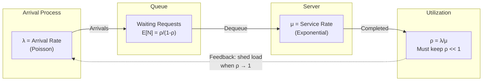
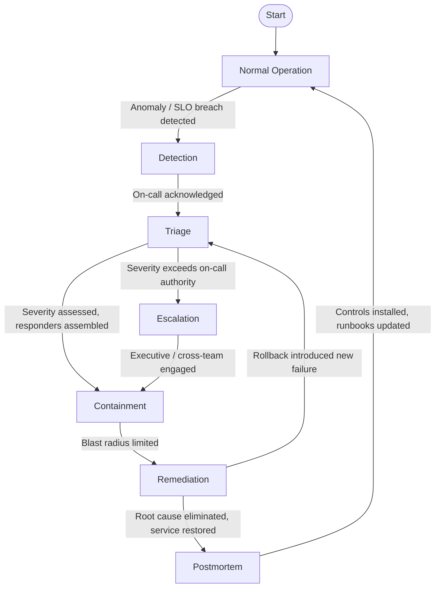
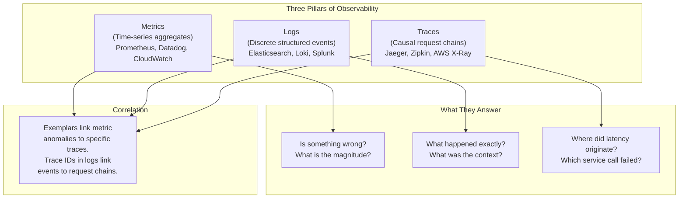
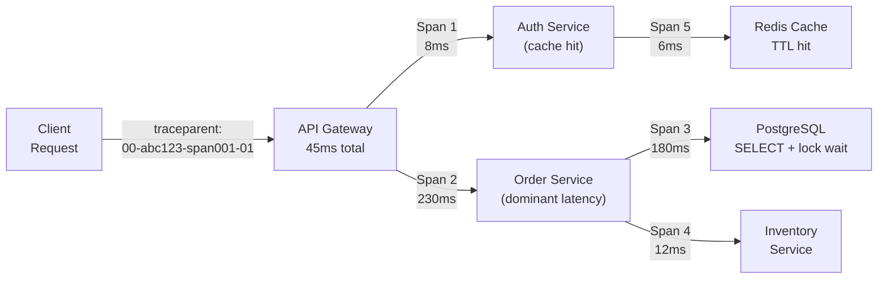
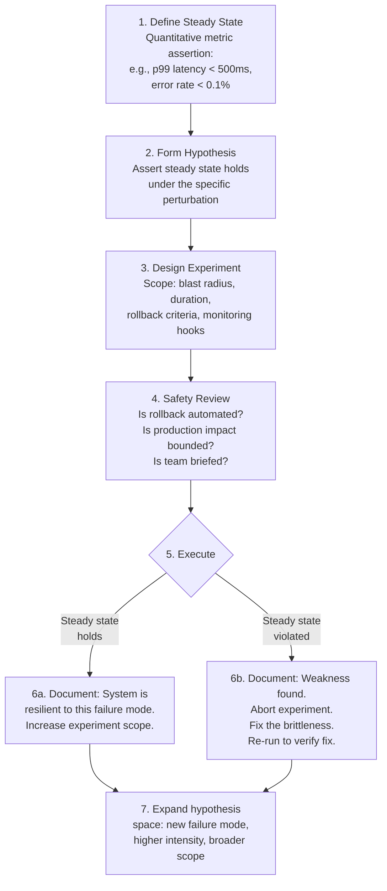
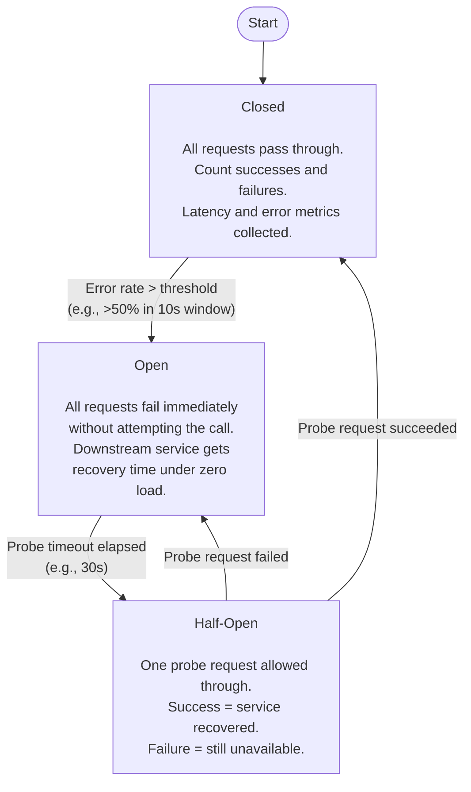
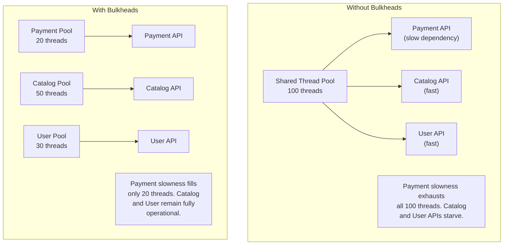
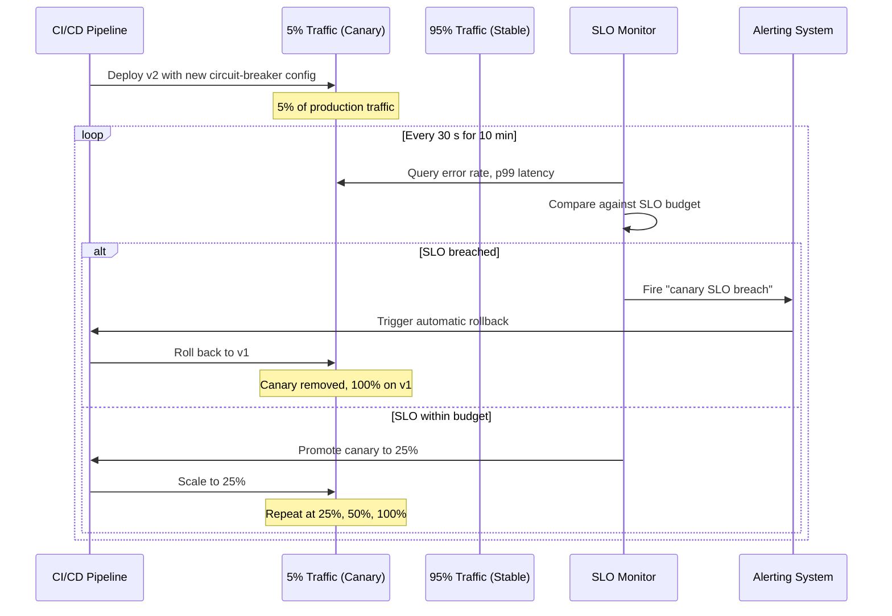
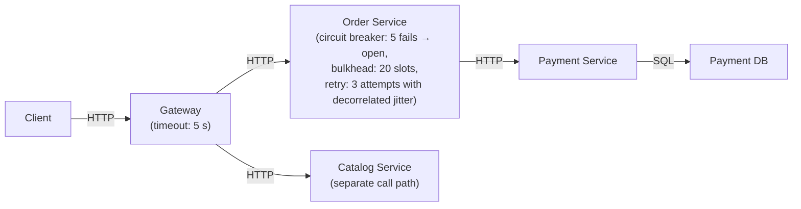

# Lesson 6: Incident Response, Chaos Engineering, and Resilience Patterns

## 1. First-Principles Foundations: Failure as an Invariant

Modern distributed systems operate in a permanent state of partial failure. The transition from monolithic architectures to microservice meshes fundamentally altered the failure surface: what was once a single process crash now manifests as cascading timeouts across dozens of network hops, each subject to independent failure modes. The semiconductor physics underlying server hardware guarantees non-deterministic faults: cosmic ray bit flips induce single-event upsets in SRAM cells at a rate of roughly one error per 256 MB of DRAM per month at sea level (increasing by approximately a factor of three at typical data center altitudes), DRAM row-hammer exploits allow an unprivileged process to flip bits in adjacent rows through rapid repeated access, and thermal throttling reduces CPU frequency below the rated specification when junction temperatures exceed safe limits, introducing timing-dependent bugs into otherwise correct code. Network fabrics experience packet loss from tail-drop or RED (Random Early Detection) when bursty traffic exceeds switch queue depths, and TCP congestion control algorithms cannot distinguish malicious denial-of-service floods from legitimate load spikes without application-layer cooperation. Storage systems face the mechanical reality that spinning disks fail with a bathtub curve distribution—high infant mortality (Backblaze's drive reliability data consistently shows elevated failure rates in the first three months), stable midlife operation at a constant hazard rate, and exponential wear-out beyond rated workload limits—while SSDs degrade through write-amplification and NAND cell charge leakage that narrows the sensing voltage window over successive program-erase cycles.

### 1.1 Reliability Mathematics

The mathematical foundation of reliability engineering begins with the exponential failure distribution. If a component has a constant hazard rate λ (failures per unit time), the probability that it survives beyond time t follows:

```text
P(T > t) = e^(-λt)
```

The mean time to failure is MTTF = 1/λ. For systems composed of n independent components arranged in series (where any single component failure causes total system failure), the combined failure rate is:

```text
λ_sys = Σ λ_i   for i = 1..n
MTTF_sys = 1 / λ_sys = 1 / (Σ λ_i)
```

This inverse relationship is the core argument for redundancy. Adding more components—more microservices, more network hops, more intermediate caches—increases failure probability unless each component achieves dramatically higher individual reliability. For components in parallel (where all must fail before the system fails), the system reliability is the product of individual unreliabilities:

```text
R_parallel(t) = 1 - Π (1 - R_i(t))   for i = 1..n
```

which grows with redundancy. This is the mathematical basis for active-active replication, N+1 power supplies, and geographic redundancy.

The "nines" availability metric follows directly:

| Availability | Downtime/Year | Downtime/Month | Downtime/Week |
|---|---|---|---|
| 99% (2 nines) | 87.6 hours | 7.3 hours | 1.68 hours |
| 99.9% (3 nines) | 8.76 hours | 43.8 minutes | 10.1 minutes |
| 99.99% (4 nines) | 52.56 minutes | 4.38 minutes | 1.01 minutes |
| 99.999% (5 nines) | 5.26 minutes | 26.3 seconds | 6.05 seconds |
| 99.9999% (6 nines) | 31.5 seconds | 2.63 seconds | 604 ms |

Each additional nine requires roughly an order-of-magnitude investment in redundancy, automated failover, and operational maturity. Financial trading infrastructure justifies six nines despite enormous cost; a content delivery network rationally targets four nines; a startup's internal tooling is correctly served at two or three.

### 1.2 Queuing Theory and the Utilization Cliff

The M/M/1 queue—a single server with Poisson arrivals at rate λ and exponentially distributed service times at rate μ—produces one of the most important results in capacity planning. The utilization factor is ρ = λ/μ, and average queue length is:

```text
E[N] = ρ / (1 - ρ)
```

As ρ → 1, E[N] → ∞. The relationship is not linear; it is hyperbolic. A system running at 70% utilization has a mean queue length of approximately 2.33 service units, while one running at 90% has 9 units, and at 95% has 19 units. This is why production services should target 50–70% CPU and memory utilization: the remaining headroom is not wasted capacity, it is insurance against tail events. The M/M/1/K variant, which caps queue depth at K, models real systems with bounded buffers; under overload, it sheds excess arrivals rather than queuing them indefinitely, which is the mathematical basis for load shedding and admission control.



## 2. Incident Response as a Control-Theoretic Feedback Loop

Incident response is a control system operating on the state space of system health. The system under operation generates a continuous stream of telemetry: performance metrics sampled at high frequency (time-series data), structured log events emitted from application code, and distributed traces capturing request flow across service boundaries. This observability data flows into detection subsystems that apply statistical anomaly detection, threshold-based alerting, and pattern recognition to identify deviations from expected behavior.

The incident lifecycle is a finite state machine with well-defined transitions:



The fundamental tension in incident response lies between the need for rapid action under uncertainty and the requirement for causal rigor in remediation. When a production database begins rejecting connections, operators face incomplete information: is this a query planner regression causing lock contention, a connection pool exhaustion from a traffic spike, a full filesystem on the primary replica, or a Byzantine fault from memory corruption? Initial response must proceed with partial observability, applying heuristics and pattern matching from prior incidents while simultaneously expanding the observation space through targeted instrumentation. This mirrors the reinforcement learning problem of exploration versus exploitation: exploitation applies known fixes to familiar symptoms (restarting a service, failing over to a replica, rate-limiting suspect clients), while exploration instruments new signals and tests hypotheses about causal mechanisms.

### 2.1 Severity Classification

Severity levels must map to quantifiable business impact, not subjective technical complexity. A concrete scheme:

| Severity | Customer Impact | Response Time | Example |
|---|---|---|---|
| SEV-1 | Complete service outage or data loss | Immediate page, all hands | Payment processing down |
| SEV-2 | Major feature unavailable, >1% error rate | Page within 5 minutes | Checkout errors for subset of users |
| SEV-3 | Degraded performance, minor features affected | Notify async, same day | Search latency elevated 2× |
| SEV-4 | No customer impact, potential risk | Ticket, next sprint | Disk at 80%, approaching threshold |

The common mistake is classifying by root cause ("the database is having issues") rather than by symptom impact. Alert on customer-visible symptoms—API error rates, SLO breach, revenue-affecting failures—not internal system state.

### 2.2 Runbooks as Decision Trees

Runbooks codify institutional knowledge, transforming incident response from ad-hoc scrambling into systematic protocol. Effective runbooks are imperative, not explanatory. They specify conditions and commands, not theory:

```bash
# Runbook: PostgreSQL Connection Pool Exhaustion (SEV-2)
# Symptoms: pg_stat_activity shows max_connections near limit;
#            application logs show "connection refused" or "too many clients"

# 1. Confirm diagnosis
psql -h $PRIMARY_HOST -c "SELECT count(*) FROM pg_stat_activity;"
psql -h $PRIMARY_HOST -c "SHOW max_connections;"

# 2. Identify connection hogs (clients holding idle connections)
psql -h $PRIMARY_HOST -c "
  SELECT client_addr, state, wait_event_type, count(*)
  FROM pg_stat_activity
  GROUP BY 1,2,3
  ORDER BY 4 DESC
  LIMIT 20;"

# 3a. If a specific application pod is leaking connections: drain it
kubectl drain $POD_NAME --ignore-daemonsets --delete-emptydir-data

# 3b. If a PgBouncer pool is misconfigured: reload config without restart
psql -h $PGBOUNCER_HOST -p 6432 pgbouncer -c "RELOAD;"

# 4. If immediate relief needed: terminate idle connections older than 10m
psql -h $PRIMARY_HOST -c "
  SELECT pg_terminate_backend(pid)
  FROM pg_stat_activity
  WHERE state = 'idle'
    AND query_start < now() - interval '10 minutes'
    AND pid <> pg_backend_pid();"

# 5. Post-incident: file ticket to audit max_connections, pool_size, and
#    pgbouncer server_pool_size settings.
```

Runbooks evolve through the postmortem process. Each incident that reveals a gap in procedures or introduces a new failure mode results in a runbook update, creating a positive feedback loop where operational knowledge accumulates.

### 2.3 Postmortem Analysis

Postmortem analysis transforms costly disruptions into learning opportunities. The process begins with timeline reconstruction: assembling a chronological account from logs, metrics, and communication transcripts. Root cause analysis then applies structured methodologies:

**Five Whys** traces causal chains. For a service outage caused by a certificate expiry: Why did the service fail? → TLS handshake rejected. Why was TLS rejected? → Certificate expired. Why was it not renewed? → Automated renewal job failed. Why did the renewal job fail? → IAM role lost permission to write to the certificate store. Why did the IAM role lose permission? → A Terraform refactoring removed the policy attachment. This chain reveals the proximate cause (Terraform change) but the postmortem must also identify the systemic weakness: no alerting on certificate expiry horizon, no automated validation of IAM permissions in CI.

**Fault Tree Analysis (FTA)** works top-down from the failure event, decomposing it into a Boolean tree of contributing events using AND and OR gates, enabling calculation of minimum cut sets—the smallest combinations of component failures that cause the top-level event. This is especially useful for safety-critical systems where formal probability estimates are needed.

Blameless postmortem culture recognizes that human error is a symptom of system design that makes mistakes easy and consequences severe, not individual moral failure. The question is never "who made the error?" but "what properties of the system allowed a single human action to cause this impact?"

Postmortem action items must follow the SMART framework with explicit ownership. Vague actions ("improve monitoring") get deprioritized; specific actions ("add PagerDuty alert firing when certificate expiry is within 30 days, assigned to @platform-team, due by next Thursday") get executed.

## 3. Observability: The Three Pillars and Their Instrumentation

The architecture of observability systems directly determines the efficacy of incident response. Three pillars structure modern observability:



**Metrics** provide high-level health indicators and enable anomaly detection through statistical process control: tracking the mean and standard deviation of response times allows detection when current values exceed historical bounds by multiple standard deviations. The four golden signals (Google SRE) are latency, traffic, errors, and saturation—any service instrumented for these four signals has sufficient coverage to detect customer-visible degradation.

**Logs** capture detailed event data for forensic analysis. Structured logging (JSON or key=value) is mandatory for production systems; free-text logs are unsearchable at scale. Sampling strategies balance storage costs against investigative completeness: always log error events at full fidelity, sample successful requests at a configurable rate (e.g., 1% during normal operation, 100% during active incidents via dynamic configuration).

**Distributed traces** reconstruct request paths through microservice architectures, enabling operators to identify where latency originates and how failures propagate. The W3C Trace Context standard (traceparent header) defines a vendor-neutral propagation format, ensuring traces span services instrumented with different vendors' SDKs.



This trace immediately reveals that the 230ms Order Service span is dominated by a 180ms PostgreSQL call. Without distributed tracing, the API Gateway would only report a 275ms total latency with no attribution.

### 3.1 Instrumentation Overhead

The instrumentation strategy must balance observability depth against performance overhead. OpenTelemetry's auto-instrumentation for Java uses Java agents (via `-javaagent`) to instrument popular frameworks without code changes, typically adding 2–5% CPU overhead. For latency-sensitive paths in C or Rust, manual span creation is preferred. The overhead rule of thumb: instrumentation should not exceed 1% added latency at the 99th percentile for user-facing request paths.

```python
# Production-grade trace instrumentation with OpenTelemetry (Python)
import time
from opentelemetry import trace
from opentelemetry.sdk.trace import TracerProvider
from opentelemetry.sdk.trace.export import BatchSpanProcessor
from opentelemetry.exporter.otlp.proto.grpc.trace_exporter import OTLPSpanExporter
from opentelemetry.sdk.resources import Resource

# Configure resource attributes for service identification
resource = Resource.create({
    "service.name": "order-service",
    "service.version": "2.14.3",
    "deployment.environment": "production",
})

provider = TracerProvider(resource=resource)
exporter = OTLPSpanExporter(
    endpoint="http://otel-collector:4317",
    insecure=True,  # Use TLS in production; this is for internal mesh
)
# BatchSpanProcessor avoids blocking the request path: spans are
# exported asynchronously in configurable batch windows.
provider.add_span_processor(
    BatchSpanProcessor(
        exporter,
        max_queue_size=2048,
        max_export_batch_size=512,
        export_timeout_millis=5000,
        schedule_delay_millis=200,
    )
)
trace.set_tracer_provider(provider)
tracer = trace.get_tracer(__name__)

def process_order(order_id: str, user_id: str) -> dict:
    with tracer.start_as_current_span("process_order") as span:
        # Attach business context as span attributes for correlation
        span.set_attribute("order.id", order_id)
        span.set_attribute("user.id", user_id)
        span.set_attribute("order.source", "web")

        try:
            inventory = check_inventory(order_id)
            span.set_attribute("inventory.available", inventory["available"])

            if not inventory["available"]:
                # Record business events, not just errors
                span.add_event("inventory_unavailable", {
                    "sku": inventory["sku"],
                    "quantity_requested": inventory["requested"],
                    "quantity_on_hand": inventory["on_hand"],
                })
                return {"status": "backorder", "order_id": order_id}

            result = charge_payment(order_id, user_id)
            span.set_attribute("payment.transaction_id", result["txn_id"])
            return {"status": "confirmed", "order_id": order_id}

        except Exception as exc:
            # Record exception with full stack trace in the span
            span.record_exception(exc)
            span.set_status(trace.StatusCode.ERROR, str(exc))
            raise
```

### 3.2 Alerting: Symptoms vs. Causes, SLOs vs. Thresholds

Alerting systems must navigate sensitivity versus specificity. High sensitivity detects true incidents quickly but generates false positives that erode trust and cause alert fatigue. The optimal strategy alerts on SLO-based symptoms, not arbitrary metric thresholds.

A Service Level Objective (SLO) expresses a reliability commitment as a ratio of "good" events to total events over a rolling window. The error budget is the allowed number of "bad" events before the SLO is violated. Burn rate alerting fires when the error budget is being consumed faster than the replenishment rate, giving operators time to respond before the SLO is actually breached.

For example, a 99.9% availability SLO over 30 days allows 0.1% × 30d × 24h × 60m = 43.2 minutes of downtime. A burn rate of 1× means the budget is consumed at exactly the rate that exhausts it over 30 days. A burn rate of 14× means the entire 30-day budget would be consumed in just over 2 days. Paging at 14× burn rate provides early warning while reducing noise from brief transient blips.

```yaml
# Prometheus alerting rule using multi-window, multi-burn-rate SLO alerts
# Reference: Google SRE Workbook Chapter 5
groups:
  - name: order-service-slo
    rules:
      # Page immediately: very high burn rate will exhaust budget in ~1 hour
      - alert: OrderServiceHighBurnRate
        expr: |
          (
            rate(http_requests_total{job="order-service",status=~"5.."}[5m])
            /
            rate(http_requests_total{job="order-service"}[5m])
          ) > (14 * 0.001)  # 14x burn rate on 99.9% SLO
          and
          (
            rate(http_requests_total{job="order-service",status=~"5.."}[1h])
            /
            rate(http_requests_total{job="order-service"}[1h])
          ) > (14 * 0.001)
        for: 2m
        labels:
          severity: page
          slo: availability
        annotations:
          summary: "Order service burning error budget at 14x rate"
          description: "5m error rate {{ $value | humanizePercentage }} on order-service"
          runbook_url: "https://runbooks.internal/order-service/high-error-rate"

      # Ticket for review: moderate burn rate, budget will exhaust in ~3 days
      - alert: OrderServiceModerateBurnRate
        expr: |
          (
            rate(http_requests_total{job="order-service",status=~"5.."}[30m])
            /
            rate(http_requests_total{job="order-service"}[30m])
          ) > (3 * 0.001)
          and
          (
            rate(http_requests_total{job="order-service",status=~"5.."}[6h])
            /
            rate(http_requests_total{job="order-service"}[6h])
          ) > (3 * 0.001)
        for: 15m
        labels:
          severity: ticket
          slo: availability
        annotations:
          summary: "Order service elevated error rate — investigate during business hours"
```

## 4. Chaos Engineering: Proactive Failure Injection

Chaos engineering inverts the reactive incident response paradigm by proactively injecting controlled failures into production systems to validate resilience mechanisms before organic failures occur. The discipline originates from Netflix's observation in 2010–2011 that traditional testing—unit tests, integration tests, staged rollouts—failed to expose emergent behaviors arising from the interaction of many independently-correct components under production load and real failure conditions. The original Chaos Monkey tool randomly terminated EC2 instances in production during business hours, forcing applications to demonstrate graceful degradation and automatic recovery without human intervention. This deliberately chose production over staging because staging environments, by definition, do not replicate production traffic patterns, data volumes, or the full configuration of downstream dependencies.

This approach embodies Nassim Taleb's concept of antifragility (from *Antifragile*, 2012): systems that gain strength from stressors rather than merely tolerating them. By systematically exploring the failure state space, chaos experiments discover brittle assumptions: hardcoded timeouts that assume sub-millisecond latency, retry loops without exponential backoff that amplify load during outages, database connection pools sized for nominal load that saturate under replica failover, or service discovery caches that do not invalidate stale entries when a node leaves the cluster.

### 4.1 The Scientific Method Applied to Production

Each chaos experiment follows a rigorous experimental protocol:



The null hypothesis asserts that the perturbation has no measurable effect on the steady-state metric. Rejecting this null hypothesis with statistical significance (p < 0.05 by convention) indicates that the system lacks resilience to that failure mode. Experimental design must account for confounding variables: production traffic exhibits diurnal and weekly patterns, so experiments should run across multiple time windows or use randomized A/B splits to isolate the causal effect of the injected failure from ambient noise.

### 4.2 Failure Injection Taxonomy

| Layer | Failure Class | Mechanism | Brittleness Exposed |
|---|---|---|---|
| Network | Packet loss | `tc netem loss 1%` | Missing retry logic |
| Network | Latency injection | `tc netem delay 200ms 50ms` | Tight timeouts, thundering herd on retry |
| Network | Connection reset | `iptables -A OUTPUT -p tcp --dport $PORT -j REJECT --reject-with tcp-reset` | Missing retry on ECONNRESET |
| Compute | CPU throttling | Linux cgroups `cpu.cfs_quota_us` | Latency-sensitive code on shared CPU |
| Compute | Process kill | `SIGKILL` to service PID | Missing graceful shutdown, lost in-flight requests |
| Memory | OOM pressure | `stress-ng --vm 1 --vm-bytes 90%` | No backpressure, unbounded queue growth |
| Disk | I/O slowness | `tc` on block device via `blkio` cgroup | Synchronous disk writes in request path |
| State | Byzantine response | Proxy returning malformed JSON | Insufficient input validation, missing checksums |
| Time | Clock skew | `adjtimex()` or `libfaketime` | Distributed consensus bugs, JWT expiry races |
| DNS | NXDOMAIN | Local DNS intercept | Missing connection pooling, reconnection storms |

### 4.3 Implementing Chaos with Chaos Toolkit

The Chaos Toolkit (open source) provides a declarative JSON/YAML format for defining experiments with explicit steady-state probes and rollback actions:

```json
{
  "version": "1.0.0",
  "title": "Order service survives 30% packet loss to inventory service",
  "description": "Validates circuit breaker and fallback inventory cache function correctly under degraded network conditions.",
  "tags": ["network", "circuit-breaker", "order-service"],
  "steady-state-hypothesis": {
    "title": "Order service processes requests within SLO",
    "probes": [
      {
        "type": "probe",
        "name": "order-api-healthy",
        "tolerance": 200,
        "provider": {
          "type": "http",
          "url": "http://order-service.prod.svc/health",
          "timeout": 3
        }
      },
      {
        "type": "probe",
        "name": "p99-latency-within-slo",
        "tolerance": {
          "type": "range",
          "range": [0, 0.5]
        },
        "provider": {
          "type": "python",
          "module": "chaos_prometheus.probes",
          "func": "query_prometheus",
          "arguments": {
            "query": "histogram_quantile(0.99, rate(http_request_duration_seconds_bucket{job='order-service'}[5m]))",
            "url": "http://prometheus.monitoring.svc:9090"
          }
        }
      }
    ]
  },
  "method": [
    {
      "type": "action",
      "name": "inject-30pct-packet-loss-to-inventory",
      "provider": {
        "type": "process",
        "path": "tc",
        "arguments": "qdisc add dev eth0 root netem loss 30%"
      },
      "pauses": {
        "after": 60
      }
    }
  ],
  "rollbacks": [
    {
      "type": "action",
      "name": "remove-packet-loss",
      "provider": {
        "type": "process",
        "path": "tc",
        "arguments": "qdisc del dev eth0 root"
      }
    }
  ]
}
```

The rollback section is mandatory, not optional. Experiments without automated rollback are operationally reckless: an experiment that crashes the experimenter process or is interrupted by an unrelated incident must still restore normal network conditions.

### 4.4 Blast Radius Limitation

Chaos experiments in production require explicit blast radius controls:

- **Traffic scope**: Route experiments to a canary deployment receiving 1–5% of traffic, using weighted routing in Istio or AWS ALB weighted target groups.
- **Geographic scope**: Restrict experiments to a single availability zone, ensuring degradation affects only a fraction of users.
- **Automated abort**: Integrate experiment executors with monitoring systems. If p99 latency exceeds twice the SLO threshold, or if error rate breaches 1%, the experiment framework automatically halts injection and executes rollbacks.
- **Scheduling constraints**: Block experiments during peak traffic windows (defined by time-of-day rules), active deployments, or other operational work. The Netflix Simian Army used a "chaos schedule" that excluded weekends and nights specifically to ensure human responders were available.

## 5. Resilience Patterns: Architectural Solutions to Recurring Failures

### 5.1 Circuit Breaker

The circuit breaker pattern prevents cascading failures by monitoring the error rate of calls to a downstream dependency and transitioning through three states. The state machine provides adaptive control that trades temporary functionality loss for system stability.



The mathematical basis derives from queuing theory. When a downstream service is overloaded, additional requests increase queue depth without improving throughput, consuming threads and memory in the calling service. By failing fast when a dependency is known to be unavailable, the circuit breaker prevents thread pool exhaustion and frees resources for alternative code paths (fallbacks, cached responses, degraded-mode functionality).

A production-grade implementation in Go, illustrating the state machine with atomic transitions:

```go
package circuitbreaker

import (
	"errors"
	"sync"
	"sync/atomic"
	"time"
)

// State represents the circuit breaker state using iota for type safety.
type State int32

const (
	StateClosed   State = iota // Normal operation
	StateOpen                  // Failing fast
	StateHalfOpen              // Testing recovery
)

var ErrCircuitOpen = errors.New("circuit breaker is open")

// Config holds tunable parameters. These should be derived from measured
// latency percentiles and error budgets, not set arbitrarily.
type Config struct {
	// MaxFailures is the number of consecutive failures before opening.
	MaxFailures int
	// OpenTimeout is how long to wait before probing recovery (HalfOpen).
	OpenTimeout time.Duration
	// SuccessThreshold is consecutive successes needed to close from HalfOpen.
	SuccessThreshold int
}

type Counts struct {
	ConsecutiveFailures  int
	ConsecutiveSuccesses int
	TotalRequests        int64
	TotalFailures        int64
}

type CircuitBreaker struct {
	config    Config
	state     atomic.Int32
	mu        sync.Mutex
	counts    Counts
	openedAt  time.Time
	onStateChange func(from, to State)
}

func New(cfg Config, onStateChange func(from, to State)) *CircuitBreaker {
	cb := &CircuitBreaker{
		config:        cfg,
		onStateChange: onStateChange,
	}
	cb.state.Store(int32(StateClosed))
	return cb
}

// Do executes fn if the circuit is closed or half-open.
// It records success/failure and transitions state accordingly.
func (cb *CircuitBreaker) Do(fn func() error) error {
	state := State(cb.state.Load())
	switch state {
	case StateOpen:
		cb.mu.Lock()
		elapsed := time.Since(cb.openedAt)
		cb.mu.Unlock()
		if elapsed < cb.config.OpenTimeout {
			return ErrCircuitOpen
		}
		// Attempt transition to HalfOpen. Only one goroutine should
		// attempt the probe; others get ErrCircuitOpen while probing.
		if !cb.state.CompareAndSwap(int32(StateOpen), int32(StateHalfOpen)) {
			return ErrCircuitOpen
		}
		if cb.onStateChange != nil {
			cb.onStateChange(StateOpen, StateHalfOpen)
		}

	case StateHalfOpen:
		// Allow the single probe through. Concurrent callers fail fast.
		// The CAS in the Open case ensures only one goroutine gets here.
	}

	// Execute the protected call.
	err := fn()

	cb.mu.Lock()
	defer cb.mu.Unlock()

	atomic.AddInt64(&cb.counts.TotalRequests, 1)

	if err != nil {
		atomic.AddInt64(&cb.counts.TotalFailures, 1)
		cb.counts.ConsecutiveFailures++
		cb.counts.ConsecutiveSuccesses = 0

		currentState := State(cb.state.Load())
		if currentState == StateHalfOpen ||
			cb.counts.ConsecutiveFailures >= cb.config.MaxFailures {
			cb.state.Store(int32(StateOpen))
			cb.openedAt = time.Now()
			if cb.onStateChange != nil {
				cb.onStateChange(currentState, StateOpen)
			}
		}
		return err
	}

	// Success path
	cb.counts.ConsecutiveSuccesses++
	cb.counts.ConsecutiveFailures = 0

	if State(cb.state.Load()) == StateHalfOpen &&
		cb.counts.ConsecutiveSuccesses >= cb.config.SuccessThreshold {
		cb.state.Store(int32(StateClosed))
		if cb.onStateChange != nil {
			cb.onStateChange(StateHalfOpen, StateClosed)
		}
	}

	return nil
}
```

### 5.2 Retry with Exponential Backoff and Jitter

Naive retry implementations amplify failures. If a service experiences momentary overload causing 10% of requests to timeout and each client immediately retries, effective load on the service nearly doubles, pushing more requests into timeout and generating another wave of retries. This positive feedback loop is a thundering herd and is responsible for numerous large-scale outages. Exponential backoff with decorrelated jitter (described by Marc Brooker at AWS in a widely cited 2015 blog post, backed by simulation data) solves this amplification problem.

The key formulas:

- **Exponential backoff**: `delay = min(cap, base * 2^attempt)`
- **Full jitter**: `delay = random_between(0, min(cap, base * 2^attempt))`  
- **Decorrelated jitter** (Brooker's recommendation): `delay = min(cap, random_between(base, prev_delay * 3))`

Decorrelated jitter produces a flatter retry distribution and faster convergence than full jitter under high concurrency:

```rust
use std::time::Duration;
use rand::Rng;
use tokio::time::sleep;

/// Retry configuration derived from measured service latency percentiles.
#[derive(Debug, Clone)]
pub struct RetryConfig {
    /// Maximum number of attempts (including the original).
    pub max_attempts: u32,
    /// Base delay for the first retry.
    pub base_delay: Duration,
    /// Maximum delay cap. Prevents unbounded waits.
    pub max_delay: Duration,
    /// Jitter strategy.
    pub strategy: JitterStrategy,
}

#[derive(Debug, Clone)]
pub enum JitterStrategy {
    /// No jitter: delay = base * 2^attempt. Causes synchronized retry storms.
    /// Do not use in production.
    None,
    /// Full jitter: delay = random(0, base * 2^attempt).
    Full,
    /// Decorrelated jitter: delay = random(base, prev_delay * 3).
    /// Best convergence under high concurrency (Brooker 2015).
    Decorrelated,
}

pub async fn retry_with_backoff<F, Fut, T, E>(
    config: &RetryConfig,
    mut operation: F,
) -> Result<T, E>
where
    F: FnMut() -> Fut,
    Fut: std::future::Future<Output = Result<T, E>>,
    E: std::fmt::Debug,
{
    let mut rng = rand::thread_rng();
    let mut prev_delay = config.base_delay;

    for attempt in 0..config.max_attempts {
        match operation().await {
            Ok(value) => return Ok(value),
            Err(err) => {
                if attempt + 1 == config.max_attempts {
                    return Err(err);
                }

                let delay = match config.strategy {
                    JitterStrategy::None => {
                        // Exponential, no jitter. Only for deterministic testing.
                        let exp = config.base_delay.as_millis() as u64
                            * 2u64.saturating_pow(attempt);
                        Duration::from_millis(
                            exp.min(config.max_delay.as_millis() as u64)
                        )
                    }
                    JitterStrategy::Full => {
                        let cap = config.base_delay.as_millis() as u64
                            * 2u64.saturating_pow(attempt);
                        let cap = cap.min(config.max_delay.as_millis() as u64);
                        Duration::from_millis(rng.gen_range(0..=cap))
                    }
                    JitterStrategy::Decorrelated => {
                        let min_ms = config.base_delay.as_millis() as u64;
                        let max_ms = (prev_delay.as_millis() as u64 * 3)
                            .min(config.max_delay.as_millis() as u64);
                        let ms = rng.gen_range(min_ms..=max_ms.max(min_ms));
                        let d = Duration::from_millis(ms);
                        prev_delay = d;
                        d
                    }
                };

                tracing::warn!(
                    attempt = attempt + 1,
                    max_attempts = config.max_attempts,
                    delay_ms = delay.as_millis(),
                    error = ?err,
                    "Operation failed, retrying"
                );

                sleep(delay).await;
            }
        }
    }

    unreachable!("Loop exits via return in both success and final-attempt-failure branches")
}
```

The probability analysis: if the probability of a transient failure on any single attempt is p and retries are independent (true for time-based transients), the probability that all k attempts fail is p^k. For p = 0.3 and k = 3, that is 0.027—the success rate improves from 70% to 97.3% with only two retries. The critical constraint is that retries must only be applied to idempotent operations or operations with idempotency keys. Retrying a payment charge without an idempotency key causes duplicate charges. Retrying a database INSERT without checking for duplicates causes duplicate rows. The retry logic must live outside the operation's side effects or must leverage idempotent request designs.

### 5.3 Bulkhead

The bulkhead pattern borrows from maritime engineering: ships are divided into watertight compartments so a single hull breach cannot flood the entire vessel. In software systems, bulkheads partition resources—thread pools, connection pools, memory allocations, rate limit quotas—so that failures in one subsystem cannot exhaust resources needed by others.



Implementation at the Kubernetes level uses resource requests/limits and separate Deployments per logical service. Within a single service, bulkheads are implemented through separate `ExecutorService` instances in Java or separate worker pool goroutines in Go. The allocation is not arbitrary: it should reflect the criticality and expected concurrency of each workload class. A payments service deserves a larger bulkhead than a background analytics job even if the analytics job generates more traffic, because payment failures have direct revenue impact.

A common and correct pattern is to combine bulkheads with circuit breakers: the bulkhead bounds resource exhaustion, the circuit breaker bounds cascade duration. Together they implement defense in depth against dependency failures.

### 5.4 Timeout Configuration

Timeout configuration is one of the most critical and frequently misconfigured resilience mechanisms. Every distributed operation requires a deadline: without a timeout, a blocked call to an unresponsive service holds resources indefinitely, eventually exhausting thread pools and causing the calling service to fail.

Timeout values encode assumptions about expected latency that often prove incorrect under failure conditions. The correct approach derives timeout values from measured latency percentiles with explicit headroom:

```python
import numpy as np
import pandas as pd
from scipy import stats

def compute_timeout_recommendation(
    latency_samples_ms: list[float],
    normal_percentile: float = 99.9,
    degraded_multiplier: float = 3.0,
    safety_factor: float = 1.2,
) -> dict:
    """
    Compute a timeout recommendation from observed latency samples.

    The timeout must be:
    1. High enough to not cause false positives during tail latency events.
    2. Low enough to bound resource consumption and enable fast circuit breaking.

    Parameters
    ----------
    latency_samples_ms : observed request latencies in milliseconds.
    normal_percentile : the percentile of normal latency to use as baseline (99.9 is typical).
    degraded_multiplier : factor by which latency increases during partial failures
                          (e.g., replica failover might 3x p99 latency).
    safety_factor : additional headroom multiplier (1.2 = 20% headroom).

    Returns
    -------
    A dict with timeout recommendation and supporting statistics.
    """
    arr = np.array(latency_samples_ms)

    p50 = np.percentile(arr, 50)
    p99 = np.percentile(arr, 99)
    p999 = np.percentile(arr, 99.9)
    p9999 = np.percentile(arr, 99.99) if len(arr) >= 10000 else None

    p_normal = np.percentile(arr, normal_percentile)

    # Recommended timeout: covers the normal tail (p99.9 by default), with
    # headroom for degraded conditions observed during past failover events.
    baseline_timeout = p_normal * degraded_multiplier * safety_factor

    # Also compute the timeout that would cause false positives for
    # normal traffic (timeout must be above this).
    min_safe_timeout = p_normal * safety_factor

    return {
        "p50_ms": round(p50, 2),
        "p99_ms": round(p99, 2),
        "p99.9_ms": round(p999, 2),
        "p99.99_ms": round(p9999, 2) if p9999 else "insufficient samples",
        "recommended_timeout_ms": round(baseline_timeout, 0),
        "min_safe_timeout_ms": round(min_safe_timeout, 0),
        "note": (
            f"Timeout set at p{normal_percentile} × {degraded_multiplier}× degraded "
            f"multiplier × {safety_factor} safety factor. Re-derive it after every "
            "failover drill: the degraded multiplier is an assumption until measured."
        ),
    }
```


## 6. Failure Modes and Production Practice

### 6.1 Cascading Failure Taxonomy

The resilience patterns in Section 5 are individually necessary but collectively insufficient unless the operator understands how failures propagate through a system. Cascading failures follow a small number of topological archetypes; recognising the archetype at the moment of an incident shortens the time-to-stabilise by eliminating irrelevant diagnostic branches.

| Archetype | Trigger | Propagation Path | Typical Mitigation |
|---|---|---|---|
| **Resource exhaustion cascade** | Slow dependency holds threads/connections | Thread pool → caller pool → upstream caller pool | Bulkhead + timeout (5.3, 5.4) |
| **Retry storm** | Transient failure triggers synchronous retries across N callers | Amplified load → dependency saturates → all callers retry simultaneously | Jittered backoff (5.2) + circuit breaker (5.1) |
| **Failover amplification** | Replica failover concentrates traffic on surviving replicas | Surviving replicas exceed capacity → their dependencies saturate → secondary failover | Progressive failover, connection draining, bulkhead |
| **Configuration propagation** | Bad config pushed to all instances simultaneously | All instances enter error state in unison → no healthy instance remains | Canary config rollout, feature-flag gating, circuit breaker |
| **Feedback-loop oscillation** | Autoscaler reacts to latency spike by adding capacity; new capacity warms up slowly, latency stays high, autoscaler adds more | Oscillating capacity, thrashing | Hysteresis in autoscaler, cooldown windows, SLO-based scaling |

The critical insight is that these archetypes are not mutually exclusive. A failover amplification (row 3) that saturates a shared thread pool (row 1) while the autoscaler oscillates (row 5) produces a compound failure that no single pattern addresses. The operator's job is to decompose the compound failure into its constituent archetypes and apply the corresponding mitigation to each.

### 6.2 Anti-Patterns in Resilience Configuration

Production incidents are frequently caused not by the absence of a resilience pattern but by its misconfiguration. The following anti-patterns recur across postmortems at large-scale distributed systems:

**Timeout inheritance without adjustment.** A gateway sets a 30-second timeout. It calls service A with a 30-second timeout. Service A calls service B with a 30-second timeout. If service B is slow, service A blocks for 30 seconds, the gateway blocks for 30 seconds, and the client waits 30 seconds. The correct design subtracts the local processing budget at each hop:

```python
# Correct: deadline propagation with per-hop budget subtraction.
# Each service receives a deadline that is the caller's remaining budget
# minus its own expected processing time.

def propagate_deadline(
    caller_deadline_ms: float,
    local_processing_budget_ms: float,
    downstream_timeout_ms: float,
) -> float:
    """
    Compute the timeout to pass to a downstream call.

    The downstream timeout must not exceed the caller's remaining budget,
    otherwise the caller will time out before the downstream call completes,
    wasting the downstream work.

    Parameters
    ----------
    caller_deadline_ms : Total time the caller is willing to wait (from its own caller).
    local_processing_budget_ms : Time this service needs for its own logic
                                 (serialization, auth, local DB lookups).
    downstream_timeout_ms : The downstream service's own recommended timeout
                            (derived from its p99.9 latency, per Section 5.4).

    Returns
    -------
    The effective timeout to pass to the downstream call, in milliseconds.
    """
    remaining_budget = caller_deadline_ms - local_processing_budget_ms
    if remaining_budget <= 0:
        raise ValueError(
            f"Local processing budget ({local_processing_budget_ms} ms) "
            f"exceeds caller deadline ({caller_deadline_ms} ms). "
            "The caller's timeout is too tight for this service's work."
        )
    effective = min(downstream_timeout_ms, remaining_budget)
    return effective
```

**Circuit breaker with no half-open probe.** A circuit breaker that transitions from Open to Closed only after a fixed cooldown, without probing a single request in the half-open state, will either reopen too early (dependency still down, immediate re-trip) or too late (dependency recovered minutes ago, users experience unnecessary outage). The half-open state must send a small, bounded number of probe requests and only close the breaker if the probe succeeds.

**Retry without idempotency.** As noted in Section 5.2, retrying a non-idempotent operation (payment charge, order creation, email send) without an idempotency key causes duplicate side effects. The anti-pattern is not the retry itself but the absence of a deduplication mechanism. Every retryable endpoint must accept an `Idempotency-Key` header and the server must store the key with a TTL matching the maximum retry window.

**Bulkhead sized by traffic volume rather than criticality.** Allocating 80% of a thread pool to the highest-traffic service and 5% to a low-traffic but revenue-critical service means a traffic spike in the high-volume service starves the critical service. Bulkhead sizing must reflect business criticality, not request volume.

### 6.3 Production Deployment and Rollout Strategy

Resilience patterns are not toggles; they are configurations that interact with each other and with the deployment topology. Deploying a circuit breaker, a new timeout value, or a bulkhead partition into production requires a rollout strategy that prevents the change itself from becoming the failure.

The standard approach is a **canary rollout with automated rollback on SLO breach**:



The SLO monitor must query the **canary cohort specifically**, not the aggregate. A 5% canary with a 10% error rate is invisible in a 100%-traffic aggregate that shows 0.5% error rate. The query must filter by deployment version or pod label.

A second production concern is **configuration drift in resilience parameters**. Timeout values, circuit-breaker thresholds, and bulkhead sizes are derived from latency percentiles that shift over time (new hardware, traffic growth, dependency changes). A quarterly re-derivation of these parameters from fresh latency samples is a minimum cadence; a continuous re-derivation pipeline that updates a configuration store (e.g., a `ConfigMap` in Kubernetes or a feature-flag service) is preferred.

### 6.4 Testing Resilience in CI/CD

Resilience patterns are only as good as the tests that verify them. A circuit breaker that is never tested in a pipeline will silently misbehave when its threshold is misconfigured. The following test categories should be part of every service's CI pipeline, run against a local test double (for example an HTTP mock such as `respx` for `httpx`, or a fault-injecting proxy such as Toxiproxy) that can be told to fail, delay or return 503 on demand:

| Test | Injected fault | Assertion |
|---|---|---|
| Breaker opens | N consecutive 503s from the dependency | Call N+1 fails fast with the breaker's own error, and the mock records no new request |
| Breaker recovers | Dependency healthy again after the cooldown | Probe requests reach the mock; after the required successes the breaker is closed |
| Retry is bounded and jittered | 50% transient failures | Attempts never exceed the maximum; recorded delays are not all equal |
| Retry respects idempotency | One failure on a `POST` | The retried request carries the same `Idempotency-Key` |
| Bulkhead isolates | Saturate one partition with slow calls | A call on another partition still completes within its own timeout |
| Deadline propagates | Slow dependency | The downstream call's timeout is at most the caller's remaining budget |

The key principle: **every resilience pattern must have a test that verifies its failure mode, not just its happy path.** A circuit breaker test that only checks "the request succeeds" proves nothing. The test must verify that the breaker *opens*, that it *short-circuits*, and that it *recovers*.

---

## 7. Lab Exercise: Building a Resilient Service Mesh Simulation

### 7.1 Objective

Build a three-service simulation (gateway → order-service → payment-service) in Python that demonstrates the interaction of circuit breaker, retry with decorrelated jitter, bulkhead, and timeout. The simulation must be runnable locally and must produce a trace log showing how a payment-service outage propagates (or is contained) depending on which resilience patterns are enabled.

### 7.2 Architecture



### 7.3 Implementation Skeleton

```python
"""
resilient_mesh.py — Three-service resilience simulation.

Run: python resilient_mesh.py --payment-failure-rate 0.8 --duration 30

The simulation injects a configurable failure rate into the payment service
and measures:
  - Gateway error rate (client-visible)
  - Order-service circuit-breaker state transitions
  - Payment-service retry amplification factor
  - Catalog-service availability (should remain 100%)
"""

import asyncio
import argparse
import time
import random
from dataclasses import dataclass, field
from enum import Enum
from collections import deque
from typing import Optional
import logging

logging.basicConfig(level=logging.INFO, format="%(asctime)s %(levelname)s %(message)s")
log = logging.getLogger("resilient_mesh")


class CircuitState(Enum):
    CLOSED = "closed"
    OPEN = "open"
    HALF_OPEN = "half_open"


@dataclass
class CircuitBreaker:
    """
    Minimal circuit breaker with half-open probing.

    Parameters
    ----------
    failure_threshold : Number of consecutive failures before opening.
    recovery_timeout_s : Seconds the breaker stays open before probing.
    half_open_probes : Number of successful probes required to close.
    """
    failure_threshold: int = 5
    recovery_timeout_s: float = 10.0
    half_open_probes: int = 2

    state: CircuitState = field(default=CircuitState.CLOSED, init=False)
    _consecutive_failures: int = field(default=0, init=False)
    _open_since: float = field(default=0.0, init=False)
    _half_open_successes: int = field(default=0, init=False)
    _state_log: deque = field(default_factory=lambda: deque(maxlen=100), init=False)

    def record_success(self) -> None:
        if self.state == CircuitState.HALF_OPEN:
            self._half_open_successes += 1
            if self._half_open_successes >= self.half_open_probes:
                self._transition(CircuitState.CLOSED)
                self._half_open_successes = 0
                self._consecutive_failures = 0
        elif self.state == CircuitState.CLOSED:
            self._consecutive_failures = 0

    def record_failure(self) -> None:
        if self.state == CircuitState.CLOSED:
            self._consecutive_failures += 1
            if self._consecutive_failures >= self.failure_threshold:
                self._transition(CircuitState.OPEN)
        elif self.state == CircuitState.HALF_OPEN:
            self._transition(CircuitState.OPEN)
            self._half_open_successes = 0

    def allow_request(self) -> bool:
        """Return True if the request should proceed, False if short-circuited."""
        if self.state == CircuitState.OPEN:
            elapsed = time.monotonic() - self._open_since
            if elapsed >= self.recovery_timeout_s:
                self._transition(CircuitState.HALF_OPEN)
                self._half_open_successes = 0
                return True
            return False
        return True  # CLOSED or HALF_OPEN

    def _transition(self, new_state: CircuitState) -> None:
        old = self.state
        self.state = new_state
        if new_state == CircuitState.OPEN:
            self._open_since = time.monotonic()
        self._state_log.append((time.monotonic(), old, new_state))
        log.info("CircuitBreaker: %s → %s", old.value, new_state.value)


@dataclass
class Bulkhead:
    """
    Semaphore-based bulkhead. Limits concurrent in-flight operations
    to a fixed number of slots.
    """
    max_concurrent: int
    _sem: asyncio.Semaphore = field(init=False)

    def __post_init__(self) -> None:
        self._sem = asyncio.Semaphore(self.max_concurrent)

    async def execute(self, coro_factory: "callable") -> object:
        async with self._sem:
            return await coro_factory()


@dataclass
class RetryPolicy:
    """Decorrelated jitter retry (Section 5.2)."""
    max_attempts: int = 3
    base_delay_s: float = 0.1
    max_delay_s: float = 2.0

    async def execute(self, coro_factory: "callable") -> object:
        prev_delay = self.base_delay_s
        last_exc: Optional[Exception] = None
        for attempt in range(self.max_attempts):
            try:
                return await coro_factory()
            except Exception as exc:
                last_exc = exc
                if attempt + 1 == self.max_attempts:
                    raise
                hi = min(prev_delay * 3, self.max_delay_s)
                delay = random.uniform(self.base_delay_s, hi)
                prev_delay = delay
                log.debug("Retry attempt %d/%d, delay=%.3fs", attempt + 1, self.max_attempts, delay)
                await asyncio.sleep(delay)
        raise last_exc  # unreachable, but satisfies type checkers


async def payment_service(failure_rate: float) -> str:
    """Simulated payment service. Fails with probability `failure_rate`."""
    await asyncio.sleep(random.uniform(0.01, 0.05))  # simulate network + processing
    if random.random() < failure_rate:
        raise ConnectionError("payment service unavailable")
    return "charged"


async def order_service(
    cb: CircuitBreaker,
    bulkhead: Bulkhead,
    retry: RetryPolicy,
    failure_rate: float,
) -> str:
    """Order service: applies circuit breaker, bulkhead, and retry to payment calls."""
    if not cb.allow_request():
        raise RuntimeError("circuit breaker open — payment service unavailable")

    async def _call_payment() -> str:
        return await payment_service(failure_rate)

    try:
        result = await bulkhead.execute(lambda: retry.execute(_call_payment))
        cb.record_success()
        return result
    except Exception:
        cb.record_failure()
        raise


async def catalog_service() -> str:
    """Catalog service: independent, should never be affected by payment failures."""
    await asyncio.sleep(random.uniform(0.005, 0.02))
    return "catalog_ok"


async def gateway(
    cb: CircuitBreaker,
    bulkhead: Bulkhead,
    retry: RetryPolicy,
    failure_rate: float,
    timeout_s: float = 5.0,
) -> dict:
    """Gateway: routes to order-service and catalog-service with a global timeout."""
    results: dict = {}
    try:
        order_result = await asyncio.wait_for(
            order_service(cb, bulkhead, retry, failure_rate),
            timeout=timeout_s,
        )
        results["order"] = order_result
    except asyncio.TimeoutError:
        results["order"] = "timeout"
    except RuntimeError as exc:
        results["order"] = f"cb_open: {exc}"
    except Exception as exc:
        results["order"] = f"error: {exc}"

    try:
        results["catalog"] = await asyncio.wait_for(catalog_service(), timeout=2.0)
    except Exception as exc:
        results["catalog"] = f"error: {exc}"

    return results


async def run_simulation(
    failure_rate: float,
    duration_s: float,
    num_concurrent: int = 50,
) -> None:
    """Run the simulation for `duration_s` seconds, printing periodic stats."""
    cb = CircuitBreaker(failure_threshold=5, recovery_timeout_s=5.0, half_open_probes=2)
    bulkhead = Bulkhead(max_concurrent=20)
    retry = RetryPolicy(max_attempts=3, base_delay_s=0.05, max_delay_s=1.0)

    start = time.monotonic()
    total_requests = 0
    order_failures = 0
    catalog_failures = 0
    cb_transitions = 0

    async def worker() -> None:
        nonlocal total_requests, order_failures, catalog_failures
        while time.monotonic() - start < duration_s:
            result = await gateway(cb, bulkhead, retry, failure_rate)
            total_requests += 1
            if result.get("order") != "charged":  # errors, timeouts and open-breaker rejections
                order_failures += 1
            if "error" in result.get("catalog", ""):
                catalog_failures += 1
            await asyncio.sleep(0.01)

    tasks = [asyncio.create_task(worker()) for _ in range(num_concurrent)]
    await asyncio.gather(*tasks)

    elapsed = time.monotonic() - start
    log.info("=== Simulation complete ===")
    log.info("Duration: %.1f s", elapsed)
    log.info("Total requests: %d", total_requests)
    log.info("Order failures: %d (%.1f%%)", order_failures, 100 * order_failures / max(total_requests, 1))
    log.info("Catalog failures: %d (%.1f%%)", catalog_failures, 100 * catalog_failures / max(total_requests, 1))
    log.info("Circuit-breaker state log entries: %d", len(cb._state_log))
    for ts, old, new in cb._state_log:
        log.info("  CB transition at t=%.2f: %s → %s", ts - start, old.value, new.value)


if __name__ == "__main__":
    parser = argparse.ArgumentParser(description="Resilient service mesh simulation")
    parser.add_argument("--payment-failure-rate", type=float, default=0.8,
                        help="Probability that payment_service fails per call (0.0–1.0)")
    parser.add_argument("--duration", type=float, default=30.0,
                        help="Simulation duration in seconds")
    parser.add_argument("--concurrent", type=int, default=50,
                        help="Number of concurrent client workers")
    args = parser.parse_args()

    asyncio.run(run_simulation(
        failure_rate=args.payment_failure_rate,
        duration_s=args.duration,
        num_concurrent=args.concurrent,
    ))
```

### 7.4 Expected Observations

Run the simulation with `--payment-failure-rate 0.8` and observe:

1. **Circuit breaker opens** after 5 consecutive failed order calls, short-circuiting subsequent order requests. Orders still fail while it is open, but they fail in microseconds instead of after three retries, so the payment service receives far fewer calls.
2. **Catalog service remains at 100% availability** because its call does not share the payment bulkhead or breaker. In a real service that shares one thread or connection pool, it would need its own bulkhead to stay this isolated.
3. **Retry amplification**: with a 0.8 failure rate and 3 attempts, the effective load on the payment service is up to 3× the original request rate. The circuit breaker mitigates this by stopping retries after the threshold.
4. **Recovery**: after the `recovery_timeout_s` elapses, the breaker enters half-open, probes the payment service, and closes if probes succeed.

Now run with `--payment-failure-rate 0.0` (no failures) and confirm zero order failures and zero circuit-breaker transitions. Then run with `--payment-failure-rate 1.0` (total outage) and confirm that the circuit breaker opens as soon as 5 order calls have failed and that catalog availability remains 100%.

### 7.5 Extension

Add a second failure mode: a **latency spike** in the payment service (inject a 4-second delay with 30% probability instead of a hard failure). Observe that the circuit breaker does not trip (the calls succeed, just slowly), but the **timeout** in the gateway fires, and the **bulkhead** fills up, causing order requests to queue. This demonstrates why timeout configuration (Section 5.4) is as critical as circuit breaking: a slow dependency is as dangerous as a dead one.

---

## Summary

This lesson established that failure is not an anomaly but an invariant of distributed systems, and that the engineering discipline of DevSecOps must treat resilience as a first-class concern alongside security. The key threads:

- **Reliability is a mathematical property.** Nines of availability compound across dependencies; a 99.9% service calling three 99.9% dependencies achieves about 99.6% end-to-end availability (0.999⁴). Queuing theory shows that utilisation above ~80% causes latency to grow non-linearly, making headroom a design requirement, not an optimisation.

- **Incident response is a control loop.** Severity classification, runbooks, and postmortems form a feedback system that reduces mean time to stabilise and mean time to learn. The postmortem is the learning mechanism; without it, the same incident recurs.

- **Observability is the sensor layer.** Metrics, logs, and traces are the three pillars. Alerting on symptoms (SLO burn rate) rather than causes (CPU threshold) reduces alert fatigue and focuses operator attention on user impact.

- **Chaos engineering is the experiment layer.** The scientific method—hypothesis, controlled experiment, observation, conclusion—applied to production with bounded blast radius. Chaos Toolkit provides the tooling; the discipline is in the hypothesis and the analysis.

- **Resilience patterns are the actuator layer.** Circuit breakers bound cascade duration. Retry with jittered backoff handles transient failures without storms. Bulkheads partition resources to prevent cross-subsystem starvation. Timeouts bound resource consumption per call. Together they form a defence-in-depth architecture against the five cascading-failure archetypes.

- **Production practice closes the loop.** Canary rollouts with SLO-gated promotion, quarterly re-derivation of timeout and threshold parameters, and CI-level resilience tests ensure that the patterns are not merely present but correctly configured and continuously validated.

The unifying principle: **design for the failure mode you have not yet experienced, test it before it happens, and measure whether your mitigation worked.**

---

## Key Terms

| Term | Definition |
|---|---|
| **Availability (nines)** | The fraction of time a system is operational, expressed as 1 − (downtime / total time). "Three nines" = 99.9% = 8.77 h/year downtime. |
| **MTTR** | Mean Time To Repair (or Recover): average elapsed time from incident detection to service restoration. |
| **MTBF** | Mean Time Between Failures: average elapsed time between consecutive failures. |
| **SLO** | Service Level Objective: a quantitative target for a reliability metric (e.g., "p99 latency < 200 ms for 99.9% of requests"). |
| **SLI** | Service Level Indicator: the measured value of the metric an SLO targets (e.g., the observed p99 latency). |
| **Error budget** | The complement of the SLO: the fraction of requests allowed to fail or be slow. An SLO of 99.9% allows a 0.1% error budget. |
| **Burn rate** | The rate at which the error budget is consumed. A burn rate of 14× means the budget will be exhausted in 1/14 of the SLO window. |
| **Circuit breaker** | A resilience pattern that stops calling a failing dependency after a threshold of consecutive failures, entering an open state that short-circuits requests for a cooldown period. |
| **Half-open state** | The intermediate circuit-breaker state in which a small number of probe requests are allowed through to test whether the dependency has recovered. |
| **Retry with jitter** | Retrying a failed operation after a randomised delay to prevent synchronised retry storms across concurrent callers. |
| **Decorrelated jitter** | A jitter strategy where each retry delay is drawn uniformly from `[base, prev_delay × 3]`, spreading retries about as well as full jitter while keeping delays growing (Brooker, 2015). |
| **Bulkhead** | A resource-partitioning pattern that isolates failure domains by allocating separate thread pools, connection pools, or quotas per subsystem. |
| **Timeout** | A maximum duration for a distributed operation; without it, a blocked call holds resources indefinitely. |
| **Cascading failure** | A failure that propagates from one component to its dependents, amplifying in scope. |
| **Blast radius** | The set of components, users, or data affected by a single failure event. Chaos experiments must bound the blast radius. |
| **Chaos engineering** | The discipline of injecting controlled failures into a system to build confidence in its resilience, following the scientific method. |
| **Steady-state hypothesis** | The expected normal behaviour of a system (e.g., "error rate < 1%") against which a chaos experiment's results are compared. |
| **Postmortem** | A blameless, structured analysis of an incident that produces actionable findings and a list of follow-up tasks. |
| **Runbook** | A documented, step-by-step procedure for diagnosing and resolving a specific class of incident. |
| **Canary deployment** | A rollout strategy that directs a small fraction of traffic to a new version before promoting it to full traffic, with automated rollback on SLO breach. |
| **Idempotency key** | A unique identifier attached to a request that allows the server to detect and deduplicate retries of the same logical operation. |
| **Utilisation cliff** | The non-linear increase in queue length and latency as resource utilisation approaches 100%, described by queuing theory (M/M/1: mean number in system L = ρ / (1 − ρ), so latency grows as 1 / (1 − ρ)). |
| **SLO burn-rate alerting** | An alerting strategy that fires when the error budget is being consumed faster than a threshold rate, rather than when a single threshold is crossed. |
| **Failure injection** | The deliberate introduction of a fault (latency, error, resource exhaustion) into a running system to test resilience. |
| **Graceful degradation** | A system's ability to reduce functionality (e.g., serve cached data, disable non-critical features) rather than fail completely when a dependency is unavailable. |
| **Connection draining** | A failover technique that allows in-flight requests on a terminating instance to complete before the instance is removed, preventing request loss. |
| **Hysteresis** | A deliberate asymmetry in a control loop's activation and deactivation thresholds (e.g., autoscaler scales up at 70% CPU but scales down only at 30%) to prevent oscillation. |
| **Defense in depth** | Layering multiple independent mitigations (bulkhead + circuit breaker + timeout) so that the failure of one layer does not bypass the others. |
| **Steady-state hypothesis violation** | The condition in a chaos experiment where the observed system behaviour deviates from the predicted normal behaviour, indicating a resilience gap. |
| **Blast radius limitation** | The set of constraints (namespace, label selector, traffic percentage, time window) that bound the scope of a chaos experiment. |
| **Observability** | The property of a system that allows its internal state to be inferred from its external outputs (metrics, logs, traces). |
| **RED metrics** | Rate, Errors, Duration: the three metrics to collect for every service, as recommended by Weaveworks. |
| **USE method** | Utilisation, Saturation, Errors: the three metrics to collect for every resource, as recommended by Brendan Gregg. |
| **Post-incident review** | Synonym for postmortem; a structured, blameless analysis conducted after an incident is resolved. |
| **Severity classification** | The process of assigning a priority level (SEV-1 through SEV-4) to an incident based on user impact and revenue effect. |
| **On-call rotation** | The scheduled assignment of incident-response responsibility to engineers, typically in shifts of 12–24 hours. |
| **War room** | The virtual or physical coordination space where the incident commander, responders, and stakeholders collaborate during a SEV-1 incident. |
| **Incident commander (IC)** | The role responsible for overall coordination of an incident response, delegating to scribe, operations, and communications leads. |
| **Blameless postmortem** | A postmortem that focuses on system and process failures rather than individual human error, to encourage honest reporting. |
| **Failure mode** | A specific way in which a component can fail (e.g., "database connection pool exhaustion", "DNS resolution timeout"). |
| **Fault tree analysis (FTA)** | A top-down deductive method for identifying all combinations of component failures that lead to a system-level failure. |
