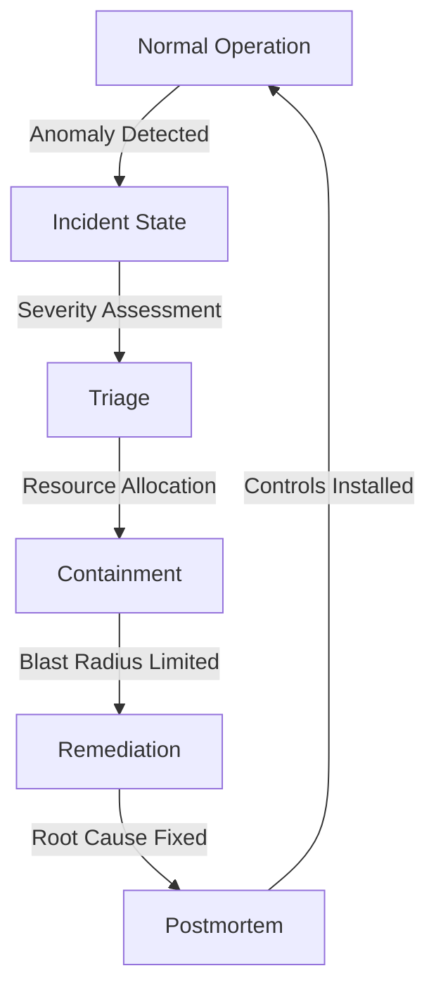
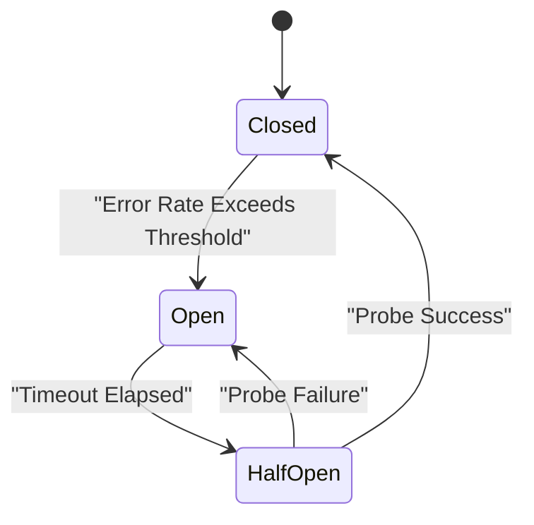
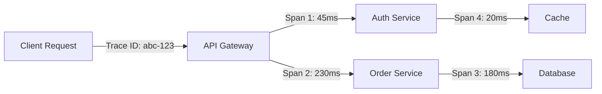

# Lesson 6: Incident Response, Chaos Engineering, Resilience Patterns

## 1. First-Principles Intuition & Invariants

Modern distributed systems operate in a permanent state of partial failure. The transition from monolithic architectures to microservice meshes fundamentally altered the failure surface: what was once a single process crash now manifests as cascading timeouts across dozens of network hops, each subject to independent failure modes. The semiconductor physics underlying server hardware guarantees that cosmic ray bit flips, DRAM row-hammer exploits, and thermal throttling will introduce non-deterministic faults into computation. Network fabrics experience packet loss from buffer overflows when bursty traffic exceeds switch queue depths, and TCP congestion control algorithms cannot distinguish malicious denial-of-service floods from legitimate load spikes. Storage systems face the mechanical reality that spinning disks fail with a bathtub curve distribution—high infant mortality, stable midlife operation, and exponential wear-out—while SSDs degrade through write-amplification and NAND cell charge leakage.

The mathematical foundation of reliability engineering begins with the exponential failure distribution. If a component has a constant hazard rate λ (failures per unit time), the probability that it survives beyond time t follows P(T > t) = e^(-λt). For systems composed of n independent components in series (where any single failure causes total system failure), the combined failure rate becomes λ_sys = Σ λ_i for i=1 to n, and the mean time to failure contracts to MTTF_sys = 1/λ_sys. This inverse relationship explains why adding more components—more microservices, more network hops, more database replicas—exponentially increases failure probability unless each component achieves dramatically higher individual reliability. The calculus of availability quantifies this through the "nines" metric: 99.9% availability permits 8.76 hours of downtime per year, while 99.99% permits only 52.56 minutes, and achieving each additional nine requires an order-of-magnitude investment in redundancy, monitoring, and operational maturity.

Incident response emerges as a control-theoretic feedback loop operating on the state space of system health. The system under operation generates a continuous stream of telemetry—performance metrics sampled at high frequency, structured log events emitted from application code, and distributed traces capturing request flow across service boundaries. This observability data flows into detection subsystems that apply statistical anomaly detection, threshold-based alerting, and pattern recognition to identify deviations from expected behavior. When an anomaly exceeds a configured sensitivity threshold, the system transitions into an incident state, triggering a coordinated response protocol. The incident lifecycle itself constitutes a finite state machine with well-defined transitions: detection triggers triage (severity assessment and resource allocation), triage enables containment (limiting blast radius and preventing propagation), containment permits remediation (root cause elimination and system restoration), and remediation concludes with postmortem analysis (causal investigation and preventive control installation).

The fundamental tension in incident response lies between the need for rapid action under uncertainty and the requirement for causal rigor in remediation. When a production database begins rejecting connections, operators face incomplete information: is this a query planner regression causing lock contention, a connection pool exhaustion from a traffic spike, a filesystem full condition on the primary replica, or a Byzantine fault from memory corruption? The initial response must proceed with partial observability, applying heuristics and pattern matching from prior incidents while simultaneously expanding the observation space through targeted instrumentation. This mirrors the reinforcement learning problem of exploration versus exploitation: exploitation applies known fixes to familiar symptoms (restarting a service, failing over to a replica, rate-limiting suspect clients), while exploration instruments new signals and tests hypotheses about causal mechanisms.

Chaos engineering inverts this reactive paradigm by proactively injecting controlled failures into production systems to validate resilience mechanisms before organic failures occur. The discipline originates from Netflix's observation that traditional testing—unit tests, integration tests, staged rollouts—failed to expose emergent behaviors arising from the interaction of many independently-correct components under production load and failure conditions. The Chaos Monkey tool randomly terminates virtual machine instances in production, forcing applications to demonstrate graceful degradation and automatic recovery without human intervention. This approach embodies Taleb's concept of antifragility: systems that gain strength from stressors rather than merely tolerating them. By systematically exploring the failure state space, chaos experiments discover brittle assumptions—such as hardcoded timeouts that assume sub-millisecond latency, retry loops without exponential backoff that amplify load during outages, or database connection pools sized for nominal load that saturate under replica failover.

The mathematical framework for chaos engineering draws from experimental design and hypothesis testing. Each chaos experiment begins with a steady-state hypothesis: a quantitative assertion about system behavior under normal conditions, such as "the 99th percentile API latency remains below 500ms" or "order processing throughput sustains 10,000 transactions per second." The experiment then introduces a controlled perturbation—network latency injection, CPU throttling, replica failure, dependency circuit breaking—and measures whether the steady-state hypothesis continues to hold. The null hypothesis asserts that the perturbation has no effect on the steady-state metric; rejecting this null hypothesis with statistical significance (typically p < 0.05) indicates that the system lacks resilience to that failure mode. The experimental design must account for confounding variables: production traffic exhibits diurnal and weekly patterns, so experiments should run across multiple time windows or use randomized A/B splits to isolate the causal effect of the injected failure.

Resilience patterns encode battle-tested solutions to recurring failure modes in distributed systems. The circuit breaker pattern prevents cascading failures by monitoring the error rate of calls to a downstream dependency and transitioning through three states: closed (normal operation, all requests pass through), open (failure threshold exceeded, all requests immediately fail without attempting the call), and half-open (periodic probe requests test whether the dependency has recovered). This state machine implements a form of adaptive control that trades temporary functionality loss for system stability. The mathematical basis derives from queuing theory: when a downstream service becomes overloaded, additional requests increase queue depth without improving throughput, wasting resources that could serve other requests. By failing fast when a dependency is known to be unavailable, the circuit breaker prevents thread pool exhaustion and frees resources for alternative code paths.

The retry pattern addresses transient failures—temporary network glitches, brief service overloads, race conditions in distributed consensus protocols—by re-attempting failed operations with carefully designed backoff strategies. Naive retry implementations amplify failures: if a service experiences a momentary overload that causes 10% of requests to timeout, and each client immediately retries failed requests, the effective load on the service doubles, likely triggering a cascading failure as more requests timeout and generate retries. Exponential backoff with jitter solves this amplification problem by spacing retries with exponentially increasing delays (1s, 2s, 4s, 8s, ...) and adding random jitter to prevent synchronized retry storms. The mathematical analysis uses probabilistic modeling: if the probability of a transient failure is p and retries are independent, the probability that k consecutive retries all fail decreases as p^k, so a small number of retries dramatically improves success rates for genuinely transient faults while the exponential backoff prevents load amplification.

The bulkhead pattern borrows from maritime engineering, where ships are divided into watertight compartments so that a single hull breach cannot flood the entire vessel. In software systems, bulkheads partition resources—thread pools, connection pools, memory allocations, rate limit quotas—so that failures in one subsystem cannot exhaust resources needed by others. A microservice architecture naturally implements bulkheads by isolating services in separate processes with independent resource limits, but finer-grained partitioning applies within services. A web server might allocate separate thread pools for serving static assets, executing API queries, and processing background jobs, ensuring that a slow database query cannot block all threads and prevent the server from serving cached content. The resource allocation follows the same principles as CPU scheduling and memory management in operating systems: fair queueing disciplines prevent starvation, while admission control mechanisms reject requests when resource exhaustion is imminent rather than degrading performance for all clients.

Timeout configuration represents one of the most critical and frequently misconfigured resilience mechanisms. Every distributed operation requires a deadline: without timeouts, a blocked call to an unresponsive service will hold resources indefinitely, eventually exhausting thread pools and causing the calling service to fail. However, timeout values encode assumptions about expected latency and acceptable tail behavior that often prove incorrect under failure conditions. A timeout set too short causes false positives during temporary latency spikes, triggering unnecessary retries that amplify load. A timeout set too long delays failure detection, allowing cascading failures to propagate before circuit breakers can react. The correct timeout value depends on the latency distribution under both normal and degraded conditions. If a service's 99th percentile latency is 100ms under normal load but reaches 10 seconds during a replica failover, a 500ms timeout will cause widespread false positives during every failover event. Production timeout configuration should derive from measured latency percentiles with sufficient headroom for tail behavior: a common heuristic sets timeouts at the 99.9th percentile of observed latency, allowing 99.9% of requests to complete while bounding resource consumption for the slowest 0.1%.

Rate limiting and backpressure mechanisms implement closed-loop feedback control to prevent overload. When a service begins to exceed its capacity, it must communicate this state to upstream callers, who in turn reduce their request rate or apply load shedding to stay within available capacity. The transmission control protocol (TCP) implements this principle through congestion control: when packet loss indicates network congestion, TCP senders reduce their transmission rate using additive-increase/multiplicative-decrease (AIMD) dynamics. Application-level backpressure extends this concept through explicit signaling: a service under load returns HTTP 429 (Too Many Requests) responses with Retry-After headers, or applies token bucket rate limiting at API gateways. The mathematical analysis uses control theory: the system must remain stable under feedback, meaning that small perturbations in load should not trigger oscillations where services alternately throttle and resume traffic in an unstable cycle. Proportional-integral-derivative (PID) controllers, commonly used in industrial automation, can be adapted to manage rate limits dynamically based on observed latency, error rates, and resource utilization.

Load shedding explicitly drops work when the system cannot maintain acceptable service levels for all requests. This prioritization mechanism recognizes that during overload, attempting to serve all requests equally results in degraded performance for everyone, while selectively dropping lower-priority work preserves functionality for critical operations. A payments service under extreme load might shed background reconciliation jobs and analytics queries while continuing to process transaction authorizations. The decision of what to shed requires a priority model encoded in request metadata or inferred from request characteristics. Implementation techniques include priority queues where lower-priority work is evicted when queues fill, admission control that rejects requests based on current system utilization, and graceful degradation where optional features (personalized recommendations, detailed audit logs) are disabled under load while core functionality remains available.

The architecture of observability systems directly determines the efficacy of incident response. Three pillars structure modern observability: metrics (numerical measurements aggregated over time windows), logs (discrete structured events with timestamps and context), and traces (causal chains linking requests across service boundaries). Metrics provide high-level health indicators and enable anomaly detection through statistical process control: tracking the mean and standard deviation of response times allows detection when current values exceed historical bounds by multiple standard deviations. Logs capture detailed event data for forensic analysis, but their volume requires sampling strategies and retention policies that balance storage costs against investigative needs. Distributed traces reconstruct request paths through microservice architectures, enabling operators to identify where latency originates and how failures propagate.

The instrumentation strategy must balance observability depth against performance overhead. Recording every function call and variable assignment produces prohibitive data volume and runtime cost, but sparse instrumentation leaves blind spots that hide failure modes. Sampling strategies mitigate this tradeoff: always trace requests that experience errors or exceed latency thresholds, but probabilistically sample successful fast requests. Adaptive sampling adjusts rates based on observed traffic patterns, maintaining higher fidelity for rare code paths while reducing overhead on high-frequency operations. The overhead itself requires measurement: instrumentation that adds more than single-digit percentages to service latency or CPU utilization becomes part of the problem rather than the solution.

Alerting systems must navigate the tension between sensitivity and specificity. High sensitivity detects true incidents quickly but generates false positives that erode trust and cause alert fatigue, leading operators to ignore or silence notifications. High specificity reduces false positives but risks missing genuine incidents or delaying detection until failures cascade. The optimal alerting strategy applies layered thresholds: page operators immediately for symptoms indicating customer impact (elevated error rates, breached SLAs, revenue-affecting failures), but route lower-severity signals to asynchronous channels (tickets, dashboards) for investigation during business hours. The distinction between symptoms and causes proves critical: alert on customer-visible symptoms (API errors, timeouts, data inconsistencies) rather than internal system state (CPU utilization, memory pressure), because symptoms directly correlate with business impact while causes require interpretation and may represent normal behavior under certain workloads.

Runbooks codify institutional knowledge about system behavior and response procedures, transforming incident response from an ad-hoc scramble into a systematic protocol. Effective runbooks specify decision trees for common failure modes: if service X returns 503 errors, check metric A to determine if this indicates overload (scale horizontally), metric B to diagnose a downstream dependency failure (investigate service Y), or log pattern C to identify a recently deployed regression (initiate rollback). The runbook format should support rapid execution under stress: short imperative commands with expected outputs, not lengthy explanations. Runbooks evolve through the postmortem process: each incident that reveals a gap in procedures or introduces a new failure mode results in a runbook update, creating a positive feedback loop where operational knowledge accumulates over time.

Postmortem analysis transforms incidents from costly disruptions into learning opportunities. The process begins with timeline reconstruction: assembling a chronological account of system behavior, operator actions, and external events from logs, metrics, and communication transcripts. Root cause analysis then applies structured methodologies—five-whys questioning, fault tree analysis, or the Eindhoven classification model—to identify causal factors at multiple levels: immediate triggers (a DNS misconfiguration), contributing conditions (insufficient timeout on health checks), and systemic weaknesses (lack of automated failover testing). The output specifies action items with assigned owners and deadlines: immediate remediations that fix the specific failure mode, short-term improvements that reduce similar risks, and long-term architectural changes that increase systemic resilience. Blameless postmortem culture recognizes that human error represents a symptom of system design that makes mistakes easy and consequences severe, rather than individual moral failing.

The practice of chaos engineering has expanded from simple instance termination to sophisticated failure injection across multiple layers. Network chaos introduces packet loss, latency spikes, and connection resets to test resilience to degraded connectivity. State corruption simulates Byzantine faults where nodes return incorrect results rather than failing silently. Resource exhaustion experiments throttle CPU, memory, disk, or network bandwidth to validate that applications degrade gracefully under constraint. Time manipulation advances or delays system clocks to expose assumptions about clock synchronization and ordering. Each category of failure reveals different classes of assumptions: network chaos exposes timeout misconfigurations and missing retry logic, state corruption reveals insufficient validation and checksumming, resource exhaustion shows where services lack backpressure mechanisms, and time manipulation uncovers race conditions and distributed consensus bugs.

The infrastructure supporting chaos experiments must provide safety guarantees to prevent production disasters during testing. Blast radius limitation constrains experiments to a subset of infrastructure—a single availability zone, a percentage of traffic, or a canary deployment—so that failures remain contained and reversible. Abort mechanisms allow operators to immediately halt experiments if customer impact exceeds acceptable thresholds, typically automated through integration with monitoring systems that detect SLA breaches. Experiment scheduling respects operational constraints: avoid running experiments during peak traffic periods, maintenance windows, or when other operational work is in progress. Documentation and approval workflows ensure that teams understand experiment scope and have vetted the safety controls before execution.

Game day exercises simulate major incidents in controlled environments, allowing teams to practice response procedures and validate runbooks without risking production systems. These exercises range from tabletop discussions walking through failure scenarios to full-scale simulations where realistic failures are injected and teams execute their response protocols. The exercise should stress-test both technical systems and human coordination: communication channels, escalation procedures, decision-making under uncertainty, and collaboration across team boundaries. Post-exercise debriefs identify gaps in preparation: missing runbooks, unclear ownership, inadequate access controls, or communication breakdowns. Regular game days—quarterly or semi-annually—maintain operational readiness and ensure that team members practice infrequently-used procedures before they become necessary during actual incidents.

The evolution toward self-healing systems represents the logical endpoint of resilience engineering. Automated remediation systems observe failures, diagnose root causes, and execute fixes without human intervention, reducing time to recovery from minutes or hours to seconds. Kubernetes exemplifies this pattern through its reconciliation loop: controllers continuously observe cluster state, compare it to declared desired state, and take actions to converge the two. If a pod crashes, the ReplicaSet controller detects the discrepancy between current and desired replica count and creates a replacement pod. If a node fails, the scheduler redistributes pods to healthy nodes. The system achieves resilience through declarative specifications and continuous reconciliation rather than imperative scripting of recovery procedures.

Building self-healing capabilities requires investments across multiple domains. Comprehensive observability provides the sensor data needed to detect failures and diagnose causes. Automated testing validates that remediation actions actually fix problems rather than introducing new failures. Gradual rollout and canary deployment strategies limit the blast radius of automated changes. Override mechanisms allow human operators to disable automation when it misbehaves. Audit logging records all automated actions for post-incident analysis. The automation itself must be reliable: a self-healing system that fails to heal, or worse, causes additional failures during recovery attempts, undermines rather than enhances resilience.

The organizational structure of on-call rotations and incident response teams significantly impacts operational outcomes. Splitting responsibility for different system components across separate on-call rotations creates coordination overhead during incidents affecting multiple services and risks misdiagnoses when failures span organizational boundaries. Consolidated on-call where a single team holds end-to-end responsibility simplifies coordination but requires broader expertise and can concentrate stress on a smaller group. Follow-the-sun handoffs distribute on-call burden across time zones but introduce context loss at transition points. The optimal structure depends on system architecture, team size, and organizational culture, but certain principles hold universally: clear escalation paths for when an incident exceeds the on-call engineer's expertise, generous time-off policies to prevent burnout, and executive commitment to maintaining sustainable on-call load.

Capacity planning interacts with resilience through the relationship between utilization and failure rates. Systems running near maximum capacity lack headroom to absorb load spikes or absorb traffic during partial outages, making them brittle to small perturbations. The queueing theory result known as the M/M/1 queue demonstrates this mathematically: for a single-server queue with Poisson arrivals at rate λ and exponential service times with rate μ, the average queue length grows as λ/(μ - λ). As utilization ρ = λ/μ approaches 1 (full capacity), queue length explodes to infinity—a small increase in arrival rate causes unbounded queueing delay. Production systems should target utilization well below saturation, typically 50-70%, to maintain stability margins. The exact threshold depends on traffic variability and the cost of overprovisioning versus the cost of incidents, but the principle remains: headroom is not waste, it is insurance against tail events and operational flexibility.

The practice of progressive delivery—feature flags, canary releases, blue-green deployments, traffic splitting—provides fine-grained control over change introduction and rollback. Rather than deploying new versions atomically to all production traffic, progressive techniques gradually shift load to new versions while monitoring for regressions. Feature flags decouple deployment from activation, allowing code to be deployed in a disabled state and incrementally enabled for user segments. Canaries route a small percentage of traffic to new versions while the bulk remains on proven versions, providing early warning of problems at limited blast radius. Blue-green deployments maintain two complete production environments, switching traffic atomically via load balancer reconfiguration to enable instant rollback. Each technique trades operational complexity for reduced risk: managing multiple simultaneous versions and coordinating traffic shifts requires sophisticated infrastructure, but the ability to limit and reverse changes saves countless incidents.

The evolution of distributed systems toward eventual consistency and conflict-free replicated data types (CRDTs) reflects fundamental tradeoffs between availability and consistency. The CAP theorem establishes that in the presence of network partitions, systems must choose between consistency (all nodes see the same data) and availability (all nodes respond to requests). Traditional databases prioritized consistency, accepting availability loss during partitions. Modern distributed systems increasingly choose availability, accepting temporary inconsistency in exchange for continuous operation. CRDTs provide mathematical frameworks for merging divergent replicas without coordination: grow-only sets allow additions from any replica and merge through union, while last-write-wins registers resolve conflicts by timestamp. These structures sacrifice strong consistency guarantees but enable offline operation and multi-master replication that tolerate arbitrary network failures.

The security implications of incident response deserve explicit attention. Incidents create operational urgency that can bypass normal security controls if not carefully managed. Elevated privileges granted during emergency access need time-limited credentials and audit logging. Break-glass procedures for overriding safety mechanisms must themselves be protected against abuse. Incident communication channels may leak sensitive information about vulnerabilities or business impact if not properly secured. Postmortem documents containing technical details could assist attackers if publicly disclosed. The tension between operational transparency (sharing learnings broadly to improve industry practices) and security discretion (not revealing attack vectors) requires case-by-case judgment. Redacting specific technical details while preserving structural lessons allows knowledge sharing without creating security risks.

The cost structure of resilience investments follows a power law rather than a linear relationship. Improving from three nines to four nines availability might require doubling infrastructure costs through redundancy and geographic distribution. Moving from four nines to five nines could require another order of magnitude investment in automated failover, chaos testing, and operational maturity. Each additional nine becomes exponentially more expensive because it requires addressing progressively rarer failure modes and eliminating ever-smaller pockets of brittleness. This economic reality means that appropriate reliability targets vary by business context: a hobby project rationally accepts two nines availability, while financial trading systems justify six or seven nines despite enormous cost. The reliability engineering discipline involves not maximizing availability in absolute terms, but rather optimizing the cost-benefit tradeoff for specific business requirements.

The future trajectory of resilience engineering points toward increased automation, formal verification, and cross-layer optimization. Machine learning models trained on historical incident data can predict failures before they occur, triggering preemptive remediation. Formal methods verify that distributed protocols correctly implement safety and liveness properties under all possible failure scenarios, providing mathematical guarantees rather than probabilistic confidence. Cross-layer optimization recognizes that resilience mechanisms at different abstraction levels—hardware redundancy, network protocols, application logic, operator procedures—interact in complex ways, and holistic optimization across layers achieves better outcomes than localized improvements. The aspiration is not to eliminate failures, which thermodynamics and probability theory guarantee impossible, but to build systems whose behavior degrades gracefully under arbitrary combinations of faults, maintaining partial functionality even in scenarios never explicitly anticipated during design.
