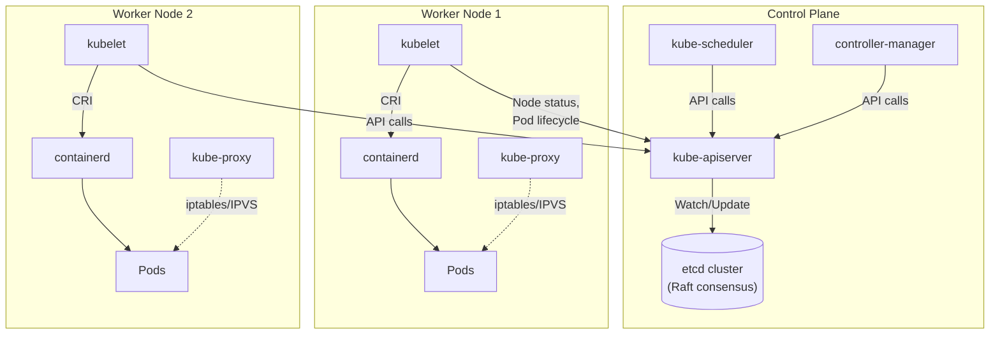
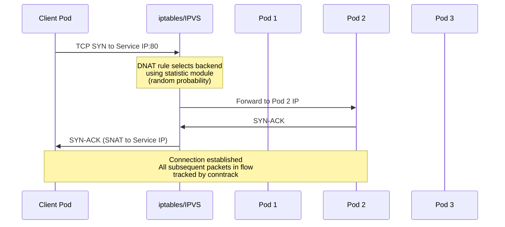

# Operational Verification Labs: Distributed Systems

## Overview

This lab provides hands-on experience with distributed systems verification, focusing on Kubernetes-based environments. You will inspect live system state, profile performance under load, inject controlled failures, and analyze recovery patterns. The exercises emphasize first-principles understanding of distributed system behavior: network partitions, consensus mechanisms, resource contention, and failure domains.

**Prerequisites:**
- Fundamental understanding of distributed systems theory (CAP theorem, consensus algorithms, failure models)
- Intermediate Linux system administration
- Basic Kubernetes architecture knowledge
- Access to a Linux environment (Ubuntu 22.04+ or RHEL 8+ recommended)

## Environment Setup

### Required Tools

Install the following diagnostic and orchestration tools:

```bash
# Kubernetes CLI
curl -LO "https://dl.k8s.io/release/$(curl -L -s https://dl.k8s.io/release/stable.txt)/bin/linux/amd64/kubectl"
sudo install -o root -g root -m 0755 kubectl /usr/local/bin/kubectl

# etcd client (verify etcd version matches your cluster version)
ETCD_VER=v3.5.12
curl -L https://github.com/etcd-io/etcd/releases/download/${ETCD_VER}/etcd-${ETCD_VER}-linux-amd64.tar.gz -o /tmp/etcd.tar.gz
tar xzvf /tmp/etcd.tar.gz -C /tmp
sudo install -o root -g root -m 0755 /tmp/etcd-${ETCD_VER}-linux-amd64/etcdctl /usr/local/bin/

# CRI tools for container runtime inspection
CRICTL_VER=v1.29.0
curl -L https://github.com/kubernetes-sigs/cri-tools/releases/download/${CRICTL_VER}/crictl-${CRICTL_VER}-linux-amd64.tar.gz -o /tmp/crictl.tar.gz
sudo tar zxvf /tmp/crictl.tar.gz -C /usr/local/bin

# Helm package manager
curl https://raw.githubusercontent.com/helm/helm/main/scripts/get-helm-3 | bash

# Network and performance analysis tools (most distributions include these)
sudo apt-get update && sudo apt-get install -y \
  iproute2 \
  ethtool \
  tcpdump \
  iperf3 \
  linux-tools-common \
  linux-tools-generic \
  strace \
  bpftrace \
  bpfcc-tools

# Verify installations
kubectl version --client
etcdctl version
crictl --version
helm version
```

### Cluster Provisioning

Create a multi-node Kubernetes cluster for realistic distributed systems testing. We use `kind` (Kubernetes IN Docker) for rapid local provisioning:

```bash
# Install kind
curl -Lo ./kind https://kind.sigs.k8s.io/dl/v0.20.0/kind-linux-amd64
chmod +x ./kind
sudo mv ./kind /usr/local/bin/kind

# Create multi-node cluster configuration
cat <<EOF > kind-config.yaml
kind: Cluster
apiVersion: kind.x-k8s.io/v1alpha4
nodes:
- role: control-plane
  extraPortMappings:
  - containerPort: 30000
    hostPort: 30000
    protocol: TCP
- role: worker
- role: worker
- role: worker
EOF

# Provision cluster
kind create cluster --name distributed-systems --config kind-config.yaml

# Verify cluster health
kubectl cluster-info
kubectl get nodes -o wide
```

Expected output shows three worker nodes and one control plane in `Ready` state. Verify that CoreDNS pods are running:

```bash
kubectl get pods -n kube-system -l k8s-app=kube-dns
```

### Understanding the Architecture

The Kubernetes control plane consists of:

1. **etcd**: Distributed key-value store implementing Raft consensus. Stores all cluster state. Leader election ensures strong consistency.
2. **kube-apiserver**: RESTful API server acting as the single source of truth. All state changes flow through this component.
3. **kube-controller-manager**: Control loops reconciling desired state with actual state (e.g., ReplicaSet controller maintaining pod count).
4. **kube-scheduler**: Assigns pods to nodes based on resource availability and constraints.

Worker nodes run:

1. **kubelet**: Node agent ensuring containers are running as specified.
2. **kube-proxy**: Network proxy implementing Kubernetes Service abstraction using iptables/IPVS.
3. **Container runtime**: (containerd/CRI-O) manages container lifecycle.



---

## Exercise 1: Live State and Internal Subsystem Inspection

**Objective:** Inspect cluster state at multiple layers (control plane, node, pod, container) to understand how distributed state is maintained and propagated.

### 1.1 Control Plane State Inspection

Examine etcd, the source of truth for all cluster state. Access etcd running in the control plane pod:

```bash
# Find etcd pod
kubectl get pods -n kube-system -l component=etcd

# Access etcd inside the pod (kind clusters run etcd as static pod)
kubectl exec -it -n kube-system etcd-distributed-systems-control-plane -- sh

# Inside etcd container, list all keys (observe key hierarchy)
ETCDCTL_API=3 etcdctl --endpoints=127.0.0.1:2379 \
  --cacert=/etc/kubernetes/pki/etcd/ca.crt \
  --cert=/etc/kubernetes/pki/etcd/server.crt \
  --key=/etc/kubernetes/pki/etcd/server.key \
  get / --prefix --keys-only | head -50

# Check etcd cluster health and member list
ETCDCTL_API=3 etcdctl --endpoints=127.0.0.1:2379 \
  --cacert=/etc/kubernetes/pki/etcd/ca.crt \
  --cert=/etc/kubernetes/pki/etcd/server.crt \
  --key=/etc/kubernetes/pki/etcd/server.key \
  member list -w table

# Check Raft leader and follower status
ETCDCTL_API=3 etcdctl --endpoints=127.0.0.1:2379 \
  --cacert=/etc/kubernetes/pki/etcd/ca.crt \
  --cert=/etc/kubernetes/pki/etcd/server.crt \
  --key=/etc/kubernetes/pki/etcd/server.key \
  endpoint status -w table

# Exit etcd container
exit
```

**Analysis:** etcd stores keys hierarchically under `/registry/`. Each Kubernetes object type has a dedicated prefix (`/registry/pods/`, `/registry/services/`). The Raft algorithm ensures linearizable reads and writes. Observe the `LEADER` field in endpoint status—only the leader handles writes, distributing them via Raft log replication.

### 1.2 Node Network Configuration

Inspect network interfaces and routing tables that form the cluster's data plane:

```bash
# Get node names
NODES=$(kubectl get nodes -o jsonpath='{.items[*].metadata.name}')

# For each node, inspect network configuration
for NODE in $NODES; do
  echo "=== Node: $NODE ==="
  docker exec $NODE ip -s -d link show
  docker exec $NODE ip route show
  docker exec $NODE iptables -t nat -L -n -v | grep -A 20 KUBE-SERVICES
done
```

**Understanding CNI (Container Network Interface):** Kubernetes delegates network setup to CNI plugins (kind uses kindnetd by default, production clusters often use Calico, Cilium, or Flannel). CNI plugins:

1. Assign pod IP addresses from the cluster CIDR
2. Configure routing between nodes
3. Implement network policies

Inspect pod-to-pod routing:

```bash
# Deploy two test pods
kubectl run test-pod-1 --image=nicolaka/netshoot --command -- sleep 3600
kubectl run test-pod-2 --image=nicolaka/netshoot --command -- sleep 3600

# Get pod IPs and nodes
kubectl get pods -o wide

# From test-pod-1, trace route to test-pod-2
POD2_IP=$(kubectl get pod test-pod-2 -o jsonpath='{.status.podIP}')
kubectl exec test-pod-1 -- traceroute $POD2_IP

# Inspect pod network namespace
POD1_ID=$(kubectl get pod test-pod-1 -o jsonpath='{.status.containerStatuses[0].containerID}' | sed 's/.*:\/\///')
NODE1=$(kubectl get pod test-pod-1 -o jsonpath='{.spec.nodeName}')

# Enter node and inspect container network namespace
docker exec $NODE1 crictl inspect $POD1_ID | grep -A 5 "network"
```

### 1.3 Service Mesh and Load Balancing

Kubernetes Services provide stable endpoints via kube-proxy. Examine iptables/IPVS rules:

```bash
# Deploy a service with multiple endpoints
kubectl create deployment nginx --image=nginx --replicas=3
kubectl expose deployment nginx --port=80 --type=ClusterIP

# Get service cluster IP
SVC_IP=$(kubectl get svc nginx -o jsonpath='{.spec.clusterIP}')

# Inspect iptables rules for this service
docker exec distributed-systems-worker iptables -t nat -L KUBE-SERVICES -n | grep $SVC_IP

# Trace full NAT chain
docker exec distributed-systems-worker iptables -t nat -L KUBE-SVC-* -n

# View endpoint distribution (load balancing is probabilistic via iptables statistic module)
docker exec distributed-systems-worker iptables -t nat -L KUBE-SEP-* -n
```

**How Service Load Balancing Works:**



### 1.4 Container Runtime Inspection

Use CRI tools to inspect container state below Kubernetes abstractions:

```bash
# List all containers on a node
docker exec distributed-systems-worker crictl ps

# Inspect a specific container
CONTAINER_ID=$(docker exec distributed-systems-worker crictl ps --name nginx -q | head -1)
docker exec distributed-systems-worker crictl inspect $CONTAINER_ID

# View container logs directly from runtime
docker exec distributed-systems-worker crictl logs $CONTAINER_ID

# Inspect container resource constraints (cgroups)
docker exec distributed-systems-worker crictl stats $CONTAINER_ID
```

### 1.5 System Call Tracing

Trace system calls to understand pod behavior at the kernel interface:

```bash
# Get container PID on the node
CONTAINER_PID=$(docker exec distributed-systems-worker crictl inspect $CONTAINER_ID | grep '"pid"' | head -1 | awk '{print $2}' | tr -d ',')

# Trace system calls (run for 10 seconds)
docker exec distributed-systems-worker timeout 10 strace -fp $CONTAINER_PID -e trace=network,file

# Trace only specific syscalls (e.g., network I/O)
docker exec distributed-systems-worker timeout 10 strace -fp $CONTAINER_PID -e trace=sendto,recvfrom,connect,accept
```

**Key observations:** Container processes make standard Linux syscalls. Isolation is enforced via namespaces (network, PID, mount, UTS) and cgroups (resource limits). The container runtime creates these boundaries, not the kernel itself.

---

## Exercise 2: Benchmarking and Saturation Profiling

**Objective:** Characterize system performance under load and identify bottlenecks (CPU, memory, network, I/O) using profiling tools.

### 2.1 Network Throughput and Latency

Measure pod-to-pod network performance to establish baselines:

```bash
# Deploy iperf3 server
cat <<EOF | kubectl apply -f -
apiVersion: v1
kind: Pod
metadata:
  name: iperf-server
  labels:
    app: iperf-server
spec:
  containers:
  - name: iperf
    image: networkstatic/iperf3
    args: ["-s"]
    ports:
    - containerPort: 5201
---
apiVersion: v1
kind: Service
metadata:
  name: iperf-server
spec:
  selector:
    app: iperf-server
  ports:
  - protocol: TCP
    port: 5201
    targetPort: 5201
EOF

# Deploy iperf3 client
kubectl run iperf-client --image=networkstatic/iperf3 --command -- sleep 3600

# Wait for pods to be ready
kubectl wait --for=condition=ready pod -l app=iperf-server --timeout=60s
kubectl wait --for=condition=ready pod iperf-client --timeout=60s

# Benchmark TCP throughput
kubectl exec iperf-client -- iperf3 -c iperf-server -t 30 -P 4

# Benchmark UDP throughput and packet loss
kubectl exec iperf-client -- iperf3 -c iperf-server -u -b 1G -t 30

# Measure latency with small packets
kubectl exec iperf-client -- iperf3 -c iperf-server -t 10 -l 128
```

**Expected results:** Throughput depends on CNI plugin overhead. Kind clusters with bridge networking typically achieve 5-20 Gbps within-node, 1-10 Gbps cross-node. Latency should be sub-millisecond within-node, 1-5ms cross-node. Significant packet loss under UDP load indicates buffer exhaustion.

### 2.2 CPU Profiling Under Load

Profile CPU utilization patterns using `perf` to identify hot paths:

```bash
# Deploy CPU-intensive workload
kubectl run cpu-stress --image=progrium/stress -- stress --cpu 2 --timeout 120s

# Get container PID
NODE=$(kubectl get pod cpu-stress -o jsonpath='{.spec.nodeName}')
CONTAINER_ID=$(kubectl get pod cpu-stress -o jsonpath='{.status.containerStatuses[0].containerID}' | sed 's/.*:\/\///')
CONTAINER_PID=$(docker exec $NODE crictl inspect $CONTAINER_ID | grep '"pid"' | head -1 | awk '{print $2}' | tr -d ',')

# Profile for 30 seconds (generate flamegraph data)
docker exec $NODE perf record -F 99 -p $CONTAINER_PID -g -- sleep 30

# Generate report
docker exec $NODE perf report --stdio
```

**Interpreting results:** The perf report shows function call stacks consuming CPU cycles. High percentages in spin loops or lock contention indicate synchronization bottlenecks. High percentages in memory allocation suggest GC pressure (for managed languages) or fragmentation.

### 2.3 Memory Pressure and OOM Behavior

Analyze memory allocation patterns and out-of-memory kill behavior:

```bash
# Deploy memory-intensive workload with limits
cat <<EOF | kubectl apply -f -
apiVersion: v1
kind: Pod
metadata:
  name: memory-stress
spec:
  containers:
  - name: stress
    image: progrium/stress
    command: ["stress"]
    args: ["--vm", "1", "--vm-bytes", "512M", "--timeout", "300s"]
    resources:
      limits:
        memory: "256Mi"
      requests:
        memory: "128Mi"
EOF

# Monitor memory usage in real-time
watch -n 1 kubectl top pod memory-stress

# Check for OOMKilled status
kubectl get pod memory-stress -o jsonpath='{.status.containerStatuses[0].lastState.terminated.reason}'

# Inspect cgroup memory statistics
NODE=$(kubectl get pod memory-stress -o jsonpath='{.spec.nodeName}')
CONTAINER_ID=$(kubectl get pod memory-stress -o jsonpath='{.status.containerStatuses[0].containerID}' | sed 's/.*:\/\///')
docker exec $NODE cat /sys/fs/cgroup/memory/kubepods/pod*/$(echo $CONTAINER_ID)/memory.stat
```

**Expected behavior:** When container memory exceeds the limit, the kernel OOM killer terminates the process. Kubernetes restarts the pod according to the restart policy. The `memory.stat` file shows page faults, cache usage, and RSS (resident set size).

### 2.4 Disk I/O Profiling

Measure disk throughput and IOPS under contention:

```bash
# Deploy fio benchmark
cat <<EOF | kubectl apply -f -
apiVersion: v1
kind: Pod
metadata:
  name: fio-test
spec:
  containers:
  - name: fio
    image: ubuntu
    command: ["sh", "-c"]
    args:
    - |
      apt-get update && apt-get install -y fio
      fio --name=randwrite --ioengine=libaio --iodepth=16 --rw=randwrite --bs=4k --direct=1 --size=1G --numjobs=4 --runtime=60 --group_reporting
    volumeMounts:
    - name: data
      mountPath: /data
  volumes:
  - name: data
    emptyDir: {}
EOF

# View results in logs
kubectl logs fio-test

# Profile I/O with bpftrace (requires kernel 4.9+)
docker exec $NODE bpftrace -e 'tracepoint:block:block_rq_issue { @[comm] = count(); }'
```

**Interpreting fio output:** Key metrics include IOPS (I/O operations per second), bandwidth (MB/s), and latency percentiles. Cloud environments typically show 3000-16000 IOPS for random 4K writes. Latency spikes in high percentiles (p99, p99.9) indicate I/O queuing or scheduling delays.

### 2.5 Distributed Load Test

Simulate realistic distributed workload with multiple clients:

```bash
# Deploy a simple HTTP service
kubectl create deployment web --image=nginx --replicas=3
kubectl expose deployment web --port=80 --type=ClusterIP

# Deploy load generator
cat <<EOF | kubectl apply -f -
apiVersion: v1
kind: Pod
metadata:
  name: loadtest
spec:
  containers:
  - name: hey
    image: williamyeh/hey
    command: ["sleep", "3600"]
EOF

# Run load test (10,000 requests, 50 concurrent)
kubectl exec loadtest -- /hey -n 10000 -c 50 http://web

# Monitor service performance
kubectl top pods -l app=web
```

---

## Exercise 3: Fault Injection and Recovery Analysis

**Objective:** Systematically inject failures to validate distributed system resilience. Analyze detection latency, failover mechanisms, and consistency guarantees.

### 3.1 Network Partition (Split-Brain Scenario)

Simulate network partition to observe consensus behavior:

```bash
# Deploy a stateful application (etcd cluster for demonstration)
cat <<EOF | kubectl apply -f -
apiVersion: v1
kind: Service
metadata:
  name: etcd-cluster
spec:
  clusterIP: None
  selector:
    app: etcd
  ports:
  - name: client
    port: 2379
  - name: peer
    port: 2380
---
apiVersion: apps/v1
kind: StatefulSet
metadata:
  name: etcd
spec:
  serviceName: etcd-cluster
  replicas: 3
  selector:
    matchLabels:
      app: etcd
  template:
    metadata:
      labels:
        app: etcd
    spec:
      containers:
      - name: etcd
        image: quay.io/coreos/etcd:v3.5.12
        ports:
        - containerPort: 2379
          name: client
        - containerPort: 2380
          name: peer
        env:
        - name: ETCD_NAME
          valueFrom:
            fieldRef:
              fieldPath: metadata.name
        - name: ETCD_INITIAL_CLUSTER
          value: "etcd-0=http://etcd-0.etcd-cluster:2380,etcd-1=http://etcd-1.etcd-cluster:2380,etcd-2=http://etcd-2.etcd-cluster:2380"
        - name: ETCD_INITIAL_CLUSTER_STATE
          value: "new"
        - name: ETCD_INITIAL_CLUSTER_TOKEN
          value: "etcd-cluster"
        - name: ETCD_INITIAL_ADVERTISE_PEER_URLS
          value: "http://$(ETCD_NAME).etcd-cluster:2380"
        - name: ETCD_LISTEN_PEER_URLS
          value: "http://0.0.0.0:2380"
        - name: ETCD_LISTEN_CLIENT_URLS
          value: "http://0.0.0.0:2379"
        - name: ETCD_ADVERTISE_CLIENT_URLS
          value: "http://$(ETCD_NAME).etcd-cluster:2379"
EOF

# Wait for cluster to form
kubectl wait --for=condition=ready pod -l app=etcd --timeout=120s

# Verify cluster health
kubectl exec etcd-0 -- etcdctl --endpoints=http://localhost:2379 member list

# Inject network partition: isolate etcd-2 from peers
kubectl exec etcd-2 -- sh -c "iptables -A INPUT -p tcp --dport 2380 -j DROP"
kubectl exec etcd-2 -- sh -c "iptables -A OUTPUT -p tcp --dport 2380 -j DROP"

# Observe leader election (etcd-0 or etcd-1 should maintain quorum)
kubectl exec etcd-0 -- etcdctl --endpoints=http://localhost:2379 endpoint status -w table

# Attempt write to isolated member (should fail or timeout)
kubectl exec etcd-2 -- etcdctl --endpoints=http://localhost:2379 put test value --command-timeout=5s

# Restore connectivity
kubectl exec etcd-2 -- sh -c "iptables -F"

# Verify rejoin and state sync
kubectl exec etcd-0 -- etcdctl --endpoints=http://etcd-0.etcd-cluster:2379,http://etcd-1.etcd-cluster:2379,http://etcd-2.etcd-cluster:2379 endpoint status -w table
```

**Analysis:** Raft requires a quorum (⌈n/2⌉ + 1 nodes) to commit writes. When etcd-2 is partitioned, the majority (2/3) continues operating. The isolated member cannot serve writes but can serve stale reads (depending on configuration). Upon healing, the follower catches up via log replication. This demonstrates the **availability vs. consistency tradeoff** in the CAP theorem.

### 3.2 Pod Eviction and Rescheduling

Test Kubernetes scheduling and recovery:

```bash
# Create a deployment with anti-affinity (spread across nodes)
cat <<EOF | kubectl apply -f -
apiVersion: apps/v1
kind: Deployment
metadata:
  name: web-ha
spec:
  replicas: 3
  selector:
    matchLabels:
      app: web-ha
  template:
    metadata:
      labels:
        app: web-ha
    spec:
      affinity:
        podAntiAffinity:
          requiredDuringSchedulingIgnoredDuringExecution:
          - labelSelector:
              matchExpressions:
              - key: app
                operator: In
                values:
                - web-ha
            topologyKey: "kubernetes.io/hostname"
      containers:
      - name: nginx
        image: nginx
        resources:
          requests:
            memory: "64Mi"
            cpu: "100m"
          limits:
            memory: "128Mi"
            cpu: "200m"
EOF

# Verify pod distribution
kubectl get pods -l app=web-ha -o wide

# Cordon a node (prevent new pods)
NODE_TO_DRAIN=$(kubectl get nodes -o jsonpath='{.items[1].metadata.name}')
kubectl cordon $NODE_TO_DRAIN

# Drain node (evict pods gracefully)
kubectl drain $NODE_TO_DRAIN --ignore-daemonsets --delete-emptydir-data --force

# Observe rescheduling
watch kubectl get pods -l app=web-ha -o wide

# Measure time to recovery
kubectl get events --sort-by='.lastTimestamp' | grep web-ha
```

**Expected behavior:** Draining sends SIGTERM to containers (default 30s grace period), then SIGKILL. Kubernetes scheduler places evicted pods on available nodes respecting affinity rules. ReplicaSet controller maintains desired count. Total recovery time depends on image pull latency and startup probes.

### 3.3 Node Failure Simulation

Simulate catastrophic node failure:

```bash
# Record initial state
kubectl get pods -o wide > /tmp/before_failure.txt

# Simulate node crash (docker stop simulates power loss)
NODE_TO_FAIL=$(kubectl get nodes -o jsonpath='{.items[2].metadata.name}')
docker stop $NODE_TO_FAIL

# Monitor detection (default timeout: 40s + grace period)
watch kubectl get nodes

# Observe pod status transitions (Running → Unknown → Terminating → New pod Running)
watch kubectl get pods -o wide

# Restart node
docker start $NODE_TO_FAIL

# Wait for kubelet to rejoin
kubectl wait --for=condition=ready node $NODE_TO_FAIL --timeout=120s
```

**Analysis:** Kubernetes uses heartbeats (node status updates every 10s, node lease every 10s) to detect failures. After missing heartbeats for `node-monitor-grace-period` (default 40s), the node is marked `NotReady`. The controller waits `pod-eviction-timeout` (default 5m) before evicting pods. This delay prevents thrashing during transient network issues but increases recovery time. In production, tune these parameters based on workload SLOs.

### 3.4 Control Plane Component Failure

Test control plane resilience:

```bash
# Identify kube-controller-manager pod
CONTROLLER_POD=$(kubectl get pods -n kube-system -l component=kube-controller-manager -o jsonpath='{.items[0].metadata.name}')

# Delete controller-manager (kubelet will restart it)
kubectl delete pod -n kube-system $CONTROLLER_POD

# Monitor recovery
kubectl get pods -n kube-system -w -l component=kube-controller-manager

# Create a deployment during outage
kubectl create deployment test-outage --image=nginx --replicas=3

# Observe delayed reconciliation (pods won't be created until controller recovers)
kubectl get pods -l app=test-outage
```

**Key insight:** Kubernetes control plane is designed for high availability. In production, run multiple controller-manager replicas (only one active via leader election). API server should be load-balanced. etcd should run 3 or 5 nodes for quorum. Single control plane node is a single point of failure.

### 3.5 Persistent Storage Failure

Simulate volume mount failure and data recovery:

```bash
# Create a StatefulSet with persistent storage
cat <<EOF | kubectl apply -f -
apiVersion: v1
kind: Service
metadata:
  name: db
spec:
  clusterIP: None
  selector:
    app: db
  ports:
  - port: 5432
---
apiVersion: apps/v1
kind: StatefulSet
metadata:
  name: postgres
spec:
  serviceName: db
  replicas: 2
  selector:
    matchLabels:
      app: db
  template:
    metadata:
      labels:
        app: db
    spec:
      containers:
      - name: postgres
        image: postgres:16
        env:
        - name: POSTGRES_PASSWORD
          value: test123
        volumeMounts:
        - name: data
          mountPath: /var/lib/postgresql/data
  volumeClaimTemplates:
  - metadata:
      name: data
    spec:
      accessModes: ["ReadWriteOnce"]
      resources:
        requests:
          storage: 1Gi
EOF

# Wait for StatefulSet to be ready
kubectl wait --for=condition=ready pod -l app=db --timeout=120s

# Write test data
kubectl exec postgres-0 -- psql -U postgres -c "CREATE TABLE test (id SERIAL PRIMARY KEY, data TEXT);"
kubectl exec postgres-0 -- psql -U postgres -c "INSERT INTO test (data) VALUES ('recovery-test-1'), ('recovery-test-2');"

# Delete pod (volume persists)
kubectl delete pod postgres-0

# Wait for recreation
kubectl wait --for=condition=ready pod postgres-0 --timeout=120s

# Verify data persistence
kubectl exec postgres-0 -- psql -U postgres -c "SELECT * FROM test;"
```

**Expected result:** Data survives pod deletion because PersistentVolume is decoupled from pod lifecycle. PersistentVolumeClaim binds to the same volume during pod recreation. This pattern enables stateful workload resilience.

---

## Diagnostic Cheat Sheet

### Control Plane

| Tool | Command | Purpose |
|------|---------|---------|
| etcdctl | `etcdctl --endpoints=https://127.0.0.1:2379 --cacert=/etc/kubernetes/pki/etcd/ca.crt --cert=/etc/kubernetes/pki/etcd/server.crt --key=/etc/kubernetes/pki/etcd/server.key endpoint health` | Verify etcd cluster health |
| etcdctl | `etcdctl --endpoints=https://127.0.0.1:2379 ... member list` | List etcd cluster members |
| kubectl | `kubectl get componentstatuses` (deprecated, use health endpoints) | Check control plane component health |
| kubectl | `kubectl get --raw /healthz` | API server health check |

### Node-Level Networking

| Tool | Command | Purpose |
|------|---------|---------|
| ip | `ip -s link show` | Network interface statistics (bytes, packets, errors) |
| ip | `ip route show` | Routing table for pod traffic |
| iptables | `iptables -t nat -L KUBE-SERVICES -n` | kube-proxy NAT rules for Services |
| ss | `ss -tunap` | Socket statistics (TCP/UDP connections, process bindings) |
| ethtool | `ethtool -S eth0` | NIC hardware statistics |
| tc | `tc -s qdisc show` | Traffic control queue statistics |

### Pod-Level Networking

| Tool | Command | Purpose |
|------|---------|---------|
| kubectl | `kubectl get pods -o wide` | Pod IPs and node placement |
| kubectl | `kubectl exec <pod> -- ip addr` | Pod network namespace configuration |
| tcpdump | `tcpdump -i any -nn port 80` | Capture pod network traffic |
| traceroute | `kubectl exec <pod> -- traceroute <target-ip>` | Trace pod-to-pod routing |

### Container Runtime

| Tool | Command | Purpose |
|------|---------|---------|
| crictl | `crictl ps` | List running containers |
| crictl | `crictl inspect <container-id>` | Container configuration and state |
| crictl | `crictl stats` | Container resource usage |
| crictl | `crictl logs <container-id>` | Container stdout/stderr |

### Performance Profiling

| Tool | Command | Purpose |
|------|---------|---------|
| kubectl top | `kubectl top nodes` | Node CPU/memory usage |
| kubectl top | `kubectl top pods --containers` | Pod/container resource usage |
| perf | `perf record -F 99 -p <pid> -g -- sleep 30` | CPU profiling (call stacks) |
| perf | `perf stat -e cycles,instructions -p <pid>` | Hardware counter statistics |
| strace | `strace -fp <pid> -e trace=network` | System call tracing |
| bpftrace | `bpftrace -e 'tracepoint:syscalls:sys_enter_write { @[comm] = count(); }'` | Kernel event tracing |

### Application-Level

| Tool | Command | Purpose |
|------|---------|---------|
| kubectl logs | `kubectl logs <pod> --previous` | Previous container logs (after crash) |
| kubectl exec | `kubectl exec <pod> -- <command>` | Execute command in running container |
| kubectl describe | `kubectl describe pod <pod>` | Pod events and status details |
| kubectl events | `kubectl get events --sort-by='.lastTimestamp'` | Cluster-wide event timeline |

### Load Testing

| Tool | Command | Purpose |
|------|---------|---------|
| iperf3 | `iperf3 -c <server-ip> -t 30 -P 4` | Network throughput benchmark |
| hey | `hey -n 10000 -c 50 http://<service>` | HTTP load generator |
| fio | `fio --name=test --ioengine=libaio --rw=randwrite --bs=4k --size=1G` | Disk I/O benchmark |
| stress | `stress --cpu 4 --io 2 --vm 2 --vm-bytes 512M` | Generic resource stress test |

---

## Verification Checklist

### Environment Setup
- [ ] All required tools installed and on PATH
- [ ] Kubernetes cluster running with multiple worker nodes
- [ ] CoreDNS pods in `Running` state
- [ ] Network connectivity between all nodes verified

### Exercise 1: Live State Inspection
- [ ] etcd cluster health confirmed (all members up, leader elected)
- [ ] Node network interfaces and routes examined
- [ ] iptables/IPVS rules for Services inspected
- [ ] Container runtime state queried via crictl
- [ ] System call tracing captured for running pods

### Exercise 2: Benchmarking
- [ ] Pod-to-pod network throughput measured (TCP and UDP)
- [ ] CPU profiling data collected under load
- [ ] Memory pressure and OOM behavior observed
- [ ] Disk I/O IOPS and latency characterized
- [ ] Distributed load test completed with metrics

### Exercise 3: Fault Injection
- [ ] Network partition injected and Raft consensus behavior observed
- [ ] Pod eviction and rescheduling time measured
- [ ] Node failure detected and workload migrated
- [ ] Control plane component recovery validated
- [ ] Persistent storage durability across pod restarts confirmed

### Production Readiness
- [ ] High availability verified (multi-replica control plane, quorum-based state store)
- [ ] Failure detection latency acceptable for SLOs
- [ ] Resource limits prevent noisy neighbor problems
- [ ] Monitoring and alerting configured for key metrics
- [ ] Disaster recovery procedures documented and tested

---

## Further Reading

**Distributed Systems Theory:**
- Lamport, L. (1998). *The Part-Time Parliament* (Paxos algorithm). ACM Transactions on Computer Systems.
- Ongaro, D., & Ousterhout, J. (2014). *In Search of an Understandable Consensus Algorithm* (Raft). USENIX ATC.
- Gilbert, S., & Lynch, N. (2002). *Brewer's Conjecture and the Feasibility of Consistent, Available, Partition-Tolerant Web Services* (CAP theorem proof). ACM SIGACT News.

**Kubernetes Internals:**
- Burns, B., et al. (2019). *Kubernetes: Up and Running, 2nd Edition*. O'Reilly Media.
- Hightower, K., Burns, B., & Beda, J. (2017). *Kubernetes: The Definitive Guide*. O'Reilly Media.
- Official Kubernetes documentation: https://kubernetes.io/docs/concepts/

**Performance Analysis:**
- Gregg, B. (2020). *Systems Performance: Enterprise and the Cloud, 2nd Edition*. Pearson.
- Gregg, B. (2019). *BPF Performance Tools*. Addison-Wesley.

**Networking:**
- Fall, K. R., & Stevens, W. R. (2011). *TCP/IP Illustrated, Volume 1: The Protocols, 2nd Edition*. Addison-Wesley.
- Kubernetes Networking Model: https://kubernetes.io/docs/concepts/cluster-administration/networking/

---

## Cleanup

Remove all resources created during the lab:

```bash
# Delete test deployments and services
kubectl delete deployment --all
kubectl delete service --all
kubectl delete statefulset --all
kubectl delete pod --all

# Delete the kind cluster
kind delete cluster --name distributed-systems

# Remove downloaded tools (optional)
sudo rm /usr/local/bin/{kubectl,etcdctl,crictl,helm,kind}
```
