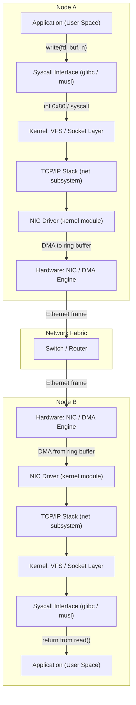
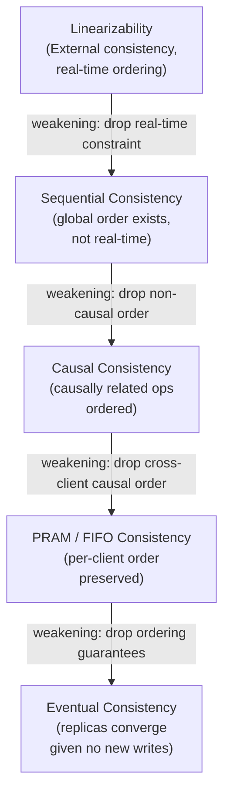
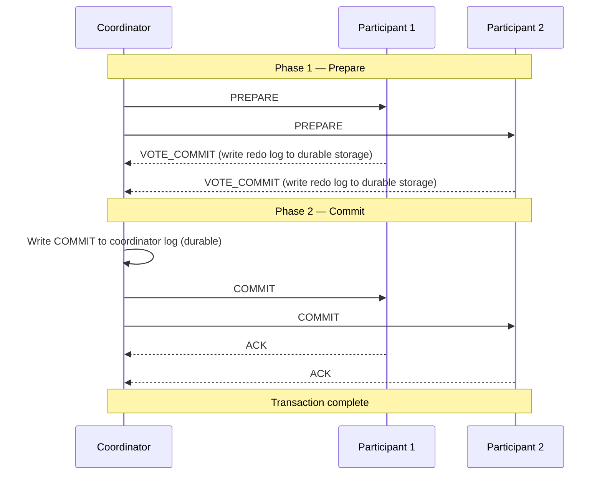
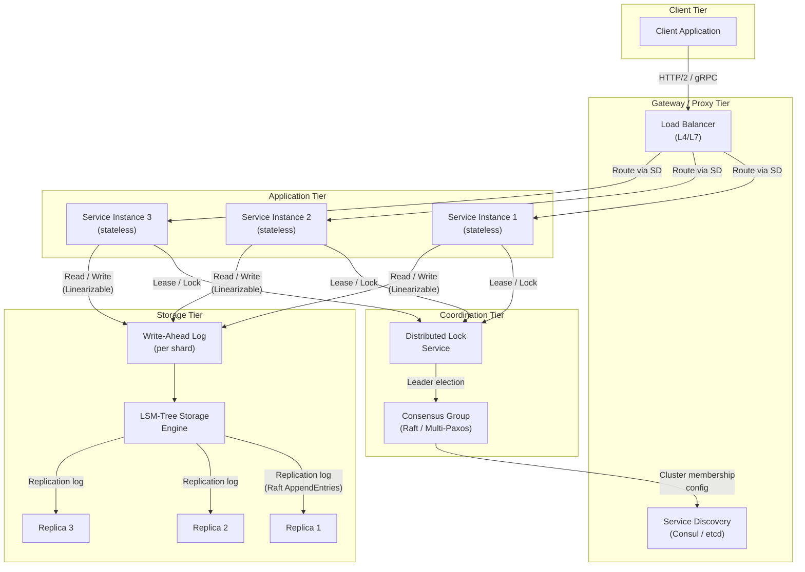
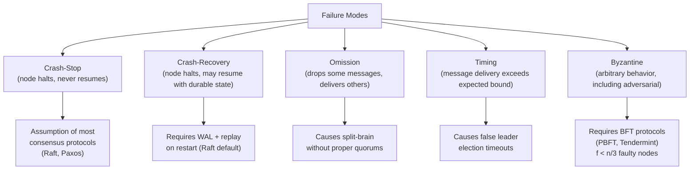

# Lesson 1: Foundations & Kernel/System Invariants

## Curriculum Roadmap

This lesson establishes the theoretical foundations of distributed systems from first principles: the execution boundaries imposed by hardware and operating systems, the impossibility results that define the design space, the non-negotiable invariants that correct implementations must preserve, and the architectural patterns that emerge from these constraints. By the end of this lesson you will understand *why* distributed systems are hard at a mechanistic level, not merely *that* they are hard.

---

## 1. First-Principles Problem Space & Execution Boundaries

### 1.1 What Makes a System "Distributed"

A distributed system is a collection of autonomous computing elements — processes, threads, or hardware nodes — that appear to their users as a single coherent system. The defining property is the **absence of shared memory**: every node has its own address space, its own clock, and its own view of the world. Communication is the *only* mechanism for coordination, and communication takes non-zero, unbounded time.

This is not a performance property. It is a fundamental structural constraint with deep consequences:

- **No global time.** There is no hardware register you can read to get the current wall-clock time across all nodes simultaneously. Every clock drifts; NTP corrects drift to within tens of milliseconds in a LAN, hundreds of milliseconds on a WAN.
- **No global state.** There is no instruction that atomically reads the state of two processes on different machines. Any "snapshot" of distributed state is reconstructed, not observed.
- **Partial failure is the norm.** A node can fail while others continue. The surviving nodes *cannot distinguish* a crashed node from a very slow one, or a network partition from a node outage. This is the central difficulty.

### 1.2 Execution Boundaries: Hardware Through Kernel to Application

Understanding distributed systems requires a precise model of the execution layers a message crosses before it influences another node.



Each boundary is a potential latency source, a failure domain, and a trust boundary:

**User space → Kernel (syscall):** A `write()` on a TCP socket does not send bytes to the network. It copies data into the kernel's send buffer and returns. The kernel decides when to actually transmit based on Nagle's algorithm, congestion control, and buffer pressure. The application has relinquished control. This is why `TCP_NODELAY` matters for latency-sensitive RPC.

**Kernel → NIC (DMA):** The kernel constructs an sk_buff, runs it through Netfilter hooks, hands it to the driver, and the driver programs the NIC's DMA ring. The CPU is not involved in the transfer itself. The NIC signals completion via interrupt or the driver polls (NAPI).

**NIC → Network:** The frame enters a physical medium with propagation delay (~5 μs/km for copper, ~3.33 μs/km for fiber), switching delay, and queueing delay. These are physical constants, not software properties. Light in fiber travels at ~200,000 km/s. A round-trip from New York to London (~5,500 km) has a theoretical minimum latency of ~55 ms. No software optimization crosses this floor.

**Implication for distributed systems design:** Any protocol that assumes sub-millisecond inter-node communication for correctness is not safe to deploy across data centers in different geographic regions. Protocols like Spanner's TrueTime acknowledge this explicitly by using atomic clocks and GPS receivers to bound clock uncertainty.

### 1.3 The Fallacies of Distributed Computing

Peter Deutsch and James Gosling formalized eight assumptions that engineers incorrectly treat as safe:

1. The network is reliable.
2. Latency is zero.
3. Bandwidth is infinite.
4. The network is secure.
5. Topology does not change.
6. There is one administrator.
7. Transport cost is zero.
8. The network is homogeneous.

These are not rhetorical points. Each fallacy corresponds to a class of real bugs. Assumption (1) failing means TCP connections drop mid-transfer; your application must handle `ECONNRESET` and retry with idempotent semantics. Assumption (5) failing means DNS TTLs expire, load balancers drain, and IP addresses change beneath long-lived connections. Assumption (4) failing means TLS certificate validation is not optional in production.

---

## 2. Impossibility Results: The Hard Boundaries of the Design Space

Before examining what distributed systems *can* do, it is essential to understand what they provably *cannot* do. These results are not engineering limitations to be optimized away; they are mathematical theorems.

### 2.1 The FLP Impossibility Result

**Fischer, Lynch, and Paterson (1985)** — the most important result in distributed systems theory — proved that:

> *In an asynchronous distributed system, no consensus protocol can be both safe and live in the presence of even a single crash failure.*

The proof proceeds by showing that any deterministic consensus protocol has a "bivalent" initial configuration (one where the outcome is not yet decided), and that there always exists an adversarial message scheduling that keeps the protocol in a bivalent state indefinitely, preventing termination.

The key term is **asynchronous**: a model where message delays are unbounded and there is no global clock. In this model, a slow node is indistinguishable from a crashed node — a fundamental observational equivalence.

**Practical consequence:** Every consensus system in production violates the FLP impossibility by weakening the asynchrony assumption. Paxos and Raft rely on a *partially synchronous* model (Dwork, Lynch, Stockmeyer 1988): the system is eventually synchronous, meaning there exists some time GST (Global Stabilization Time) after which message delays are bounded by some unknown Δ. Progress is only guaranteed after GST. This is why Raft's election timeout must be an order of magnitude larger than the expected one-way message delay.

### 2.2 The CAP Theorem

**Brewer's conjecture (2000), formalized by Gilbert and Lynch (2002):**

> *A distributed data store cannot simultaneously guarantee Consistency, Availability, and Partition Tolerance.*

The formal definitions matter:

- **Consistency (C):** Every read receives the most recent write or an error. This is linearizability: the system behaves as if there is a single copy of the data.
- **Availability (A):** Every request to a non-failed node receives a response — not an error, not a timeout.
- **Partition Tolerance (P):** The system continues to operate despite an arbitrary number of messages being dropped by the network.

The proof is straightforward: if a network partition separates nodes N1 and N2, and a write goes to N1 and a read to N2, the system must choose: return a stale value (sacrificing C) or return an error (sacrificing A). P cannot be sacrificed in a real network.

**What CAP does not say:** CAP is a worst-case result about network partitions. During normal operation (no partition), systems can provide both C and A. The more nuanced framework is **PACELC** (Abadi 2012): *if there is a partition (P), trade off A and C; else (E), trade off latency (L) and consistency (C)*. Spanner sacrifices latency for consistency. DynamoDB sacrifices consistency for latency by default.

### 2.3 Lamport Clocks and the Partial Order of Events

Without a global clock, how do we reason about the order of events? Lamport (1978) defined the **happens-before** relation (→):

- If a and b are events in the same process and a occurs before b, then a → b.
- If a is the sending of a message and b is the receipt of that message, then a → b.
- If a → b and b → c, then a → c (transitivity).

A **Lamport clock** is a logical counter L(e) assigned to each event e such that if a → b, then L(a) < L(b). The assignment rule:

1. Each process maintains a counter, initially 0.
2. Before executing an event, increment the counter.
3. When sending a message, include the current counter value.
4. When receiving a message with timestamp T, set the counter to max(local, T) + 1.

Lamport clocks give a consistent partial order but not a total order. Two events with L(a) < L(b) may be concurrent (neither a → b nor b → a). **Vector clocks** (Fidge 1988, Mattern 1988) solve this: each process maintains a vector of counters, one per process. Event a causally precedes event b iff VC(a)[i] ≤ VC(b)[i] for all i, with strict inequality for at least one i.

```python
# Vector clock implementation
from typing import Dict
import copy

class VectorClock:
    def __init__(self, node_id: str, nodes: list[str]):
        self.node_id = node_id
        self.clock: Dict[str, int] = {n: 0 for n in nodes}

    def tick(self) -> Dict[str, int]:
        """Increment local counter before a local event."""
        self.clock[self.node_id] += 1
        return copy.deepcopy(self.clock)

    def send(self) -> Dict[str, int]:
        """Return clock to attach to an outgoing message."""
        self.clock[self.node_id] += 1
        return copy.deepcopy(self.clock)

    def receive(self, remote: Dict[str, int]) -> Dict[str, int]:
        """Merge incoming clock, then increment local."""
        for node, ts in remote.items():
            self.clock[node] = max(self.clock.get(node, 0), ts)
        self.clock[self.node_id] += 1
        return copy.deepcopy(self.clock)

    def concurrent_with(self, vc_a: Dict[str, int], vc_b: Dict[str, int]) -> bool:
        """True if neither vc_a -> vc_b nor vc_b -> vc_a."""
        a_before_b = all(vc_a.get(k, 0) <= vc_b.get(k, 0) for k in set(vc_a) | set(vc_b))
        b_before_a = all(vc_b.get(k, 0) <= vc_a.get(k, 0) for k in set(vc_a) | set(vc_b))
        return not a_before_b and not b_before_a

    def __repr__(self) -> str:
        return f"VC({self.node_id}): {self.clock}"


# Example: three-node system, detect concurrent writes
nodes = ["A", "B", "C"]
vc_a = VectorClock("A", nodes)
vc_b = VectorClock("B", nodes)

# A performs a write
ts_write_a = vc_a.send()           # A: {A:1, B:0, C:0}
# B independently performs a write (no communication yet)
ts_write_b = vc_b.send()           # B: {A:0, B:1, C:0}

print(vc_a.concurrent_with(ts_write_a, ts_write_b))  # True — concurrent writes
```

Vector clocks are the basis for conflict detection in systems like Amazon's Dynamo and Riak. When two replicas have concurrent writes (neither happened-before the other), the system cannot automatically resolve the conflict; it must surface the conflict to the application or use a CRDT-based merge strategy.

---

## 3. Fundamental System Invariants

The following invariants are not aspirational properties. They are correctness conditions: a system that violates them under any reachable execution is incorrect by definition.

### 3.1 Safety vs. Liveness

Every property of a distributed system is either a **safety property** ("something bad never happens") or a **liveness property** ("something good eventually happens"). This distinction, formalized by Alpern and Schneider (1985), is critical because:

- Safety violations are *definitive*: once violated, the execution is permanently incorrect. They can be proved by exhibiting a finite prefix.
- Liveness violations are *eventual*: the system might still recover. They require reasoning about infinite executions.

The FLP result is precisely a proof that you cannot guarantee both safety (agreement, validity) and liveness (termination) in an asynchronous system with failures.

### 3.2 Consistency Models: A Precise Hierarchy

"Consistency" is not a single property. It is a spectrum of guarantees, ordered from strongest to weakest:



**Linearizability** (Herlihy & Wing 1990): An operation appears to take effect atomically at some point between its invocation and its response. The strongest single-object consistency model. Spanner, etcd (Raft), and ZooKeeper provide linearizable reads under specific conditions. Linearizability is *composable*: a system of linearizable objects is itself linearizable.

**Sequential consistency** (Lamport 1979): There exists a global total order of all operations consistent with each process's local order. Does not require the global order to respect real time. Used in CPU memory models (x86 TSO approximates this for certain access patterns).

**Causal consistency**: Writes that are causally related (one happened-before the other) are seen in the same order by all nodes. Concurrent writes may be seen in different orders. MongoDB's causally consistent sessions implement this.

**Eventual consistency**: If no new writes occur, all replicas eventually converge to the same value. Provides no ordering guarantees. Amazon DynamoDB, Apache Cassandra (with quorum < R+W > N), and DNS use eventual consistency.

The choice of consistency model directly determines the achievable latency and availability, as the PACELC theorem formalizes.

### 3.3 Atomicity, Isolation, and Durability in a Distributed Context

The classical ACID properties from database theory require careful reinterpretation in a distributed context.

**Atomicity** in a distributed transaction means that a transaction spanning multiple nodes either commits on all nodes or aborts on all nodes. The mechanism is **Two-Phase Commit (2PC)**:



2PC has a critical vulnerability: if the coordinator crashes after participants have voted COMMIT but before sending COMMIT messages, the participants are **blocked** — they cannot commit or abort without the coordinator's decision. This is the fundamental problem of 2PC: it is a **blocking protocol**. Three-Phase Commit (3PC) attempts to address this by adding a pre-commit phase, but it is not safe under network partitions. Modern systems like Google Spanner use Paxos-based coordinators to make 2PC non-blocking by replicating the coordinator state.

**Isolation** in distributed systems is implemented via concurrency control. Two dominant paradigms:

- **Pessimistic concurrency control (2PL — Two-Phase Locking):** Acquire all locks before releasing any. Prevents conflicts but causes deadlocks (which must be detected via cycle detection in a wait-for graph, distributed across nodes).
- **Optimistic concurrency control (OCC):** Execute without locks; at commit time, validate that the read set has not been modified. If validation fails, abort and retry. Efficient when conflicts are rare; degrades under high contention.

**Durability** requires that committed data survive node failures. In a single node, this means writing to a Write-Ahead Log (WAL) on a durable medium before acknowledging a commit. In a distributed system, durability is achieved by replication: a commit is durable when enough replicas have written it to their WALs that no single failure can destroy all copies. "Enough" is defined by the quorum condition: W + R > N, where W is the write quorum, R is the read quorum, and N is the replication factor.

---

## 4. High-Level Process & Subsystem Architecture

The following diagram depicts the layered architecture of a production distributed data system, showing the actual subsystems and their interactions:



### 4.1 The Role of the Consensus Layer

The consensus group (Raft or Multi-Paxos) is the system's source of truth for two things: **cluster membership** and **log ordering**. Everything else is built on top of the guarantee that the consensus log is a consistent, durable, totally ordered sequence of commands.

A Raft cluster elects a leader. The leader is the only node that accepts writes. All writes are appended to the leader's log and replicated to a quorum of followers before the write is acknowledged to the client. If the leader crashes, a new election occurs. The new leader is guaranteed to have all committed entries because Raft's election constraint ensures that only nodes with logs at least as up-to-date as the majority can win an election.

The following Go implementation provides a structurally correct skeleton of Raft's core log replication mechanism. It is intentionally simplified to focus on the invariants:

```go
package raft

import (
    "context"
    "fmt"
    "log/slog"
    "sync"
    "sync/atomic"
    "time"
)

// NodeState represents the Raft consensus state machine states.
type NodeState uint32

const (
    Follower  NodeState = iota
    Candidate NodeState = iota
    Leader    NodeState = iota
)

// LogEntry is a single command in the Raft log.
// Term is the leader's term when the entry was received.
type LogEntry struct {
    Term    uint64
    Index   uint64
    Command []byte
}

// RaftNode holds the persistent and volatile state for a single Raft peer.
// Fields marked "Persistent" must survive crashes — they must be written to
// stable storage before responding to any RPC.
type RaftNode struct {
    mu sync.Mutex

    id    string
    peers []string

    // Persistent state (must be written to stable storage before RPC response)
    currentTerm uint64     // latest term seen; monotonically increasing
    votedFor    string     // candidateId voted for in currentTerm, "" if none
    log         []LogEntry // log entries; index is 1-based

    // Volatile state on all servers
    commitIndex uint64 // highest log entry known to be committed
    lastApplied uint64 // highest log entry applied to state machine

    // Volatile state on leader only (reinitialized after election)
    nextIndex  map[string]uint64 // next log index to send to each peer
    matchIndex map[string]uint64 // highest log index known replicated on each peer

    state       NodeState
    electionTimer *time.Timer
    applyCh     chan LogEntry

    logger *slog.Logger
}

// AppendEntriesArgs is sent by the leader to replicate log entries
// and also serves as the heartbeat mechanism (Entries == nil).
type AppendEntriesArgs struct {
    Term         uint64     // leader's term
    LeaderID     string     // so followers can redirect clients
    PrevLogIndex uint64     // index of log entry immediately preceding new ones
    PrevLogTerm  uint64     // term of PrevLogIndex entry
    Entries      []LogEntry // log entries to store; empty for heartbeat
    LeaderCommit uint64     // leader's commitIndex
}

// AppendEntriesReply is the response to AppendEntriesArgs.
type AppendEntriesReply struct {
    Term    uint64 // currentTerm, for leader to update itself
    Success bool   // true if follower contained entry matching PrevLogIndex/PrevLogTerm
    // Optimization: return conflicting term and first index of that term
    // to allow the leader to skip entire terms on retry, reducing round trips.
    ConflictTerm  uint64
    ConflictIndex uint64
}

// AppendEntries implements the core Raft log consistency check.
// This is Section 5.3 of the Raft paper (Ongaro & Ousterhout 2014).
func (r *RaftNode) AppendEntries(
    ctx context.Context,
    args *AppendEntriesArgs,
    reply *AppendEntriesReply,
) error {
    r.mu.Lock()
    defer r.mu.Unlock()

    reply.Term = r.currentTerm

    // Rule 1: Reply false if term < currentTerm (§5.1)
    if args.Term < r.currentTerm {
        reply.Success = false
        return nil
    }

    // Seeing a higher term: revert to follower, update term.
    if args.Term > r.currentTerm {
        r.currentTerm = args.Term
        r.votedFor = ""
        r.becomeFollower()
    }

    // Reset election timer — we have a valid leader.
    r.resetElectionTimer()

    // Rule 2: Reply false if log does not contain an entry at PrevLogIndex
    // whose term matches PrevLogTerm (§5.3 — the Log Matching Property).
    if args.PrevLogIndex > 0 {
        if args.PrevLogIndex > uint64(len(r.log)) {
            // Follower log is shorter than leader expects.
            reply.Success = false
            reply.ConflictIndex = uint64(len(r.log)) + 1
            reply.ConflictTerm = 0
            return nil
        }
        prevEntry := r.log[args.PrevLogIndex-1] // 1-based index
        if prevEntry.Term != args.PrevLogTerm {
            // Term conflict: return first index of the conflicting term.
            reply.Success = false
            reply.ConflictTerm = prevEntry.Term
            for i := args.PrevLogIndex - 1; i > 0; i-- {
                if r.log[i-1].Term != prevEntry.Term {
                    reply.ConflictIndex = i + 1
                    break
                }
            }
            return nil
        }
    }

    // Rule 3 & 4: Append new entries, deleting any conflicting existing entries.
    insertIdx := args.PrevLogIndex
    for i, entry := range args.Entries {
        logIdx := insertIdx + uint64(i) + 1
        if logIdx <= uint64(len(r.log)) {
            if r.log[logIdx-1].Term != entry.Term {
                // Conflict: truncate from this point forward.
                r.log = r.log[:logIdx-1]
            } else {
                continue // Entry already present and matches; skip.
            }
        }
        r.log = append(r.log, entry)
    }

    // Rule 5: If leaderCommit > commitIndex, advance commitIndex.
    if args.LeaderCommit > r.commitIndex {
        lastNewIndex := args.PrevLogIndex + uint64(len(args.Entries))
        if args.LeaderCommit < lastNewIndex {
            r.commitIndex = args.LeaderCommit
        } else {
            r.commitIndex = lastNewIndex
        }
        r.applyCommittedEntries()
    }

    reply.Success = true
    return nil
}

// applyCommittedEntries sends newly committed entries to the state machine.
// Must be called with r.mu held.
func (r *RaftNode) applyCommittedEntries() {
    for r.lastApplied < r.commitIndex {
        r.lastApplied++
        entry := r.log[r.lastApplied-1]
        r.logger.Info("applying entry",
            "index", entry.Index,
            "term", entry.Term,
            "command_len", len(entry.Command),
        )
        // Non-blocking send: the apply goroutine drains this channel.
        select {
        case r.applyCh <- entry:
        default:
            r.logger.Warn("applyCh full, state machine is falling behind",
                "lastApplied", r.lastApplied)
        }
    }
}

func (r *RaftNode) becomeFollower() {
    atomic.StoreUint32((*uint32)(&r.state), uint32(Follower))
    r.logger.Info("became follower", "term", r.currentTerm)
}

func (r *RaftNode) resetElectionTimer() {
    if r.electionTimer != nil {
        r.electionTimer.Reset(randomElectionTimeout())
    }
}

// randomElectionTimeout returns a jittered election timeout.
// Per Raft §5.2, this must be >> broadcast time (one-way message delay)
// to prevent spurious elections. Typical values: 150–300ms in a LAN,
// 1–2s across data centers.
func randomElectionTimeout() time.Duration {
    // In production, use crypto/rand or a seeded math/rand.
    base := 150 * time.Millisecond
    jitter := time.Duration(50+time.Now().UnixNano()%100) * time.Millisecond
    return base + jitter
}

func (r *RaftNode) String() string {
    return fmt.Sprintf("RaftNode{id=%s, term=%d, state=%d, logLen=%d}",
        r.id, r.currentTerm, r.state, len(r.log))
}
```

**Key invariants this code enforces:**

1. **Log Matching Property:** If two entries in different logs have the same index and term, the logs are identical up to that index. Enforced by the `PrevLogIndex`/`PrevLogTerm` consistency check.
2. **Leader Completeness:** A leader always has all committed entries. Enforced by the election mechanism (not shown here but depends on the `RequestVote` RPC rejecting candidates whose log is less up-to-date).
3. **Term monotonicity:** `currentTerm` never decreases. Enforced by the stale-term check at the start of every RPC handler.

---

## 5. The Kernel's Role: Memory, I/O, and Scheduling in Distributed Nodes

A distributed systems engineer who does not understand the kernel behavior of their nodes will be blindsided by production incidents. The following kernel mechanisms directly affect distributed system behavior.

### 5.1 Memory and the OOM Killer

The Linux kernel's Out-Of-Memory (OOM) killer will terminate processes when physical memory is exhausted. For a Raft leader, being OOM-killed is equivalent to a crash — it triggers a leader election. If the OOM killer targets the consensus process, the system loses its leader. This is why production consensus systems set `oom_score_adj` to `-1000` for critical processes (Linux kernel `Documentation/filesystems/proc.txt`), making them immune to OOM killing.

The tradeoff: an immune process can consume all available memory and cause the kernel to panic. The correct solution is memory cgroups with hard limits, combined with application-level memory pressure monitoring via `/proc/meminfo` and `cgroups v2` memory.pressure.

### 5.2 fsync and Durability

The kernel maintains a page cache. A `write()` syscall writes to the page cache; data is not durable until the page is flushed to the storage device. `fsync()` flushes the page cache to the device *and* forces the device to flush its write-back cache to persistent media (the device reports completion only after the data is on stable storage).

For a WAL, the write sequence must be:
1. `write()` or `writev()` to append to the log file.
2. `fdatasync()` (not `fsync()`: no need to sync metadata for a sequential append log) to make the data durable.
3. Only after `fdatasync()` returns do you send the `AppendEntriesReply` to the leader.

Failure to call `fdatasync()` before replying is a **correctness bug**, not a performance bug. The system may lose committed entries on a crash, violating durability. This is the most common source of "it was fine in testing" WAL bugs — SSDs on developer machines have volatile write caches but test environments often use `O_SYNC` implicitly.

```c
#include <fcntl.h>
#include <unistd.h>
#include <stdint.h>
#include <string.h>
#include <errno.h>
#include <stdio.h>
#include <stdlib.h>

/*
 * wal_append: Append a log entry to a Write-Ahead Log with durability guarantees.
 *
 * The on-disk format: [length: uint32_t][term: uint64_t][index: uint64_t][data: length bytes]
 *
 * Returns 0 on success, -errno on failure.
 *
 * CORRECTNESS NOTE: fdatasync() is called before returning. Any caller that
 * uses the return value as "data is durable" must not omit this call.
 * On hardware with non-volatile write caches (NVMe with power-loss protection),
 * this is a correctness requirement, not a performance hint.
 */
int wal_append(int fd, uint64_t term, uint64_t index,
               const void *data, uint32_t data_len)
{
    /* Header: 4 bytes length + 8 bytes term + 8 bytes index = 20 bytes */
    uint8_t header[20];
    uint32_t len_le  = __builtin_bswap32(data_len); /* big-endian on wire */
    uint64_t term_le = __builtin_bswap64(term);
    uint64_t idx_le  = __builtin_bswap64(index);

    memcpy(header,      &len_le,  4);
    memcpy(header + 4,  &term_le, 8);
    memcpy(header + 12, &idx_le,  8);

    /*
     * Use writev() for a single syscall. This does not guarantee atomicity
     * with respect to other writers — only one goroutine/thread should write
     * to the WAL at a time. The leader serializes writes through its log.
     */
    struct iovec iov[2];
    iov[0].iov_base = header;
    iov[0].iov_len  = sizeof(header);
    iov[1].iov_base = (void *)data;
    iov[1].iov_len  = data_len;

    ssize_t total = sizeof(header) + data_len;
    ssize_t written = writev(fd, iov, 2);
    if (written != total) {
        fprintf(stderr, "wal_append: writev wrote %zd of %zd bytes: %s\n",
                written, total, strerror(errno));
        return -errno;
    }

    /*
     * fdatasync() ensures data reaches stable storage before we return.
     * This is the durability barrier. On a crash between writev() and
     * fdatasync(), this entry is lost — which is correct behavior, since
     * we have not yet acknowledged the write.
     */
    if (fdatasync(fd) != 0) {
        fprintf(stderr, "wal_append: fdatasync failed: %s\n", strerror(errno));
        return -errno;
    }

    return 0;
}

/* Batch variant: accumulate N entries, then issue a single fdatasync().
 * Improves throughput at the cost of increased tail latency for individual entries.
 * This is the core mechanism behind Raft's "pipelining" optimization.
 */
int wal_append_batch(int fd, const struct iovec *entries, int count)
{
    /* Write all entries in a single writev() call, then one fdatasync(). */
    ssize_t total_written = writev(fd, entries, count);
    if (total_written < 0) {
        return -errno;
    }
    if (fdatasync(fd) != 0) {
        return -errno;
    }
    return 0;
}
```

### 5.3 CPU Scheduling and Priority Inversion

Linux's Completely Fair Scheduler (CFS) uses a red-black tree of virtual runtimes. Under CPU pressure, a low-priority process holding a mutex can prevent a high-priority consensus process from acquiring it — classic **priority inversion**. For real-time distributed systems, the mitigation is:

- Use `SCHED_FIFO` or `SCHED_RR` for critical consensus threads (requires `CAP_SYS_NICE`).
- Use lock-free data structures where possible (but be aware that lock-free does not mean wait-free).
- Use `pthread_mutexattr_setprotocol(PTHREAD_PRIO_INHERIT)` for mutexes protecting critical sections to enable priority inheritance.

---

## 6. Network Failure Taxonomy

Partial failures in a distributed system do not manifest as clean crashes. The failure mode spectrum includes:



**Byzantine faults** deserve special attention. In a system with n nodes, BFT protocols can tolerate f Byzantine (arbitrarily malicious or corrupted) nodes if n ≥ 3f + 1. This comes directly from the need for a quorum of 2f + 1 nodes to make progress (ensuring overlap with any other quorum of 2f + 1), minus the f faulty nodes that may vote adversarially. PBFT (Castro & Liskov 1999) achieves this but with O(n²) message complexity per consensus round. Modern alternatives like HotStuff (used in Facebook's LibraBFT / Diem) reduce this to O(n) by using a linear chain structure with threshold signatures.

---

## 7. Synthesis: The Invariant-Preserving System Design Process

The following process is a first-principles methodology for designing a correct distributed subsystem:

**Step 1 — Identify the safety invariant.** State precisely what must never happen. Example: "No two nodes commit conflicting values for the same log index." Write this as a formal predicate if possible.

**Step 2 — Identify the liveness condition.** State precisely what must eventually happen given a sufficiently synchronous network. Example: "A client write must eventually be acknowledged."

**Step 3 — Choose a failure model.** Crash-stop, crash-recovery, or Byzantine. The choice determines which protocols are applicable. Raft and Paxos assume crash-recovery. BFT protocols assume Byzantine, but are significantly more expensive.

**Step 4 — Determine the quorum structure.** For a replication factor of n, the write quorum W and read quorum R must satisfy W + R > n. For strong consistency, the leader-based protocols simplify this: all writes go through one node (the leader), eliminating the need for clients to manage quorums directly.

**Step 5 — Identify the durability boundary.** At which point in the write path is data considered durable? This must be precisely `fdatasync()` returning successfully on W replicas before the client ACK is sent.

**Step 6 — Enumerate failure scenarios and verify invariants hold.** For each failure mode (leader crash before commit, follower crash during replication, network partition during election), trace the protocol execution and verify the safety invariant is not violated.

---

## Exercises

### Exercise 1 — Vector Clock Conflict Detection (Python)

Extend the `VectorClock` class above to implement a `CausalOrderedQueue`: a priority queue that holds incoming messages and delivers them to the application only when all causally prior messages have been delivered. This models the behavior of causal broadcast in a distributed system.

**Invariant to verify:** For any two messages m1 and m2 where m1 → m2 (m1 causally precedes m2), m1 is delivered to the application before m2 on every node.

### Exercise 2 — WAL Implementation (C)

Using the `wal_append` function above as a foundation, implement a WAL reader that recovers log entries after a simulated crash. Specifically:

1. Write 100 entries to a WAL file using `wal_append`.
2. Simulate a mid-write crash by truncating the file to an arbitrary byte boundary using `ftruncate()`.
3. Implement `wal_recover()` that reads all complete entries (those with valid length prefixes and sufficient data) and discards the truncated tail.

**Invariant to verify:** No entry is returned by `wal_recover()` unless its full data was present on disk.

### Exercise 3 — FLP Implications (Design)

Design a consensus protocol that guarantees progress under the following constrained model: at most one node may be slow (delayed by up to 500ms) at any given time, but no nodes crash. Identify precisely which assumption of the FLP model your design violates, and explain why this violation is safe under your constrained model.

### Exercise 4 — Consistency Model Identification

For each of the following systems, identify the consistency model they provide under their default configuration, and state one scenario where this model causes observable inconsistency:

1. Apache Cassandra with `LOCAL_ONE` read consistency and `LOCAL_ONE` write consistency.
2. Redis Cluster (hash slot replication).
3. Amazon DynamoDB with eventually consistent reads.
4. PostgreSQL with `READ COMMITTED` isolation in a single-node deployment (not distributed — this is a contrast case).

---

## References

1. M. J. Fischer, N. A. Lynch, and M. S. Paterson. "Impossibility of Distributed Consensus with One Faulty Process." *Journal of the ACM*, 32(2):374–382, April 1985. The foundational impossibility result.

2. E. Brewer. "Towards Robust Distributed Systems." *Keynote, ACM Symposium on Principles of Distributed Computing (PODC)*, 2000. The original CAP conjecture.

3. S. Gilbert and N. Lynch. "Brewer's Conjecture and the Feasibility of Consistent, Available, Partition-Tolerant Web Services." *ACM SIGACT News*, 33(2):51–59, 2002. Formal proof of CAP.

4. L. Lamport. "Time, Clocks, and the Ordering of Events in a Distributed System." *Communications of the ACM*, 21(7):558–565, July 1978. Logical clocks and the happens-before relation.

5. L. Lamport. "Paxos Made Simple." *ACM SIGACT News*, 32(4):18–25, December 2001.

6. D. Ongaro and J. Ousterhout. "In Search of an Understandable Consensus Algorithm." *USENIX ATC*, 2014. The Raft paper.

7. M. Herlihy and J. M. Wing. "Linearizability: A Correctness Condition for Concurrent Objects." *ACM TOPLAS*, 12(3):463–492, July 1990.

8. D. Abadi. "Consistency Tradeoffs in Modern Distributed Database System Design: CAP is Only Part of the Story." *IEEE Computer*, 45(2):37–42, 2012. The PACELC model.

9. M. Castro and B. Liskov. "Practical Byzantine Fault Tolerance." *USENIX OSDI*, 1999.

10. M. Mazmanian Fidge. "Timestamps in Message-Passing Systems That Preserve the Partial Ordering." *Proceedings of the 11th Australian Computer Science Conference*, 1988. Vector clocks.

11. B. Alpern and F. B. Schneider. "Defining Liveness." *Information Processing Letters*, 21(4):181–185, 1985. Formal safety/liveness taxonomy.

12. C. Dwork, N. Lynch, and L. Stockmeyer. "Consensus in the Presence of Partial Synchrony." *Journal of the ACM*, 35(2):288–323, 1988. The partial synchrony model that makes Raft and Paxos practical.
