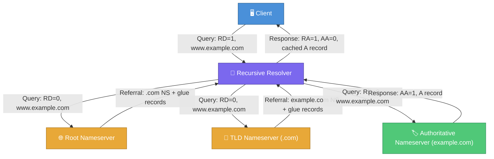

# Lesson 1: Resolution Mechanism, Namespace Hierarchy, Iterative vs Recursive Queries

## 1. First-Principles Intuition & Invariants

The Domain Name System emerged from a fundamental engineering contradiction in the early ARPANET: human operators required mnemonic labels for networked machines, yet packet-switched routing infrastructure operated exclusively on numeric addresses. The original solution—a centralized hosts.txt file distributed via FTP from the Stanford Research Institute—collapsed under exponential network growth in the early 1980s. Paul Mockapetris's 1983 RFC 882 and RFC 883 established DNS not as a simple lookup table, but as a hierarchical distributed database with delegation semantics, query routing intelligence, and eventual consistency guarantees.

At its theoretical core, DNS implements a directed acyclic graph (DAG) rooted at the anonymous empty label, conventionally represented by a single dot. Every fully qualified domain name (FQDN) encodes a path through this tree from leaf to root, reading right to left. The name `www.example.com.` decomposes into four labels: `www`, `example`, `com`, and the implicit root. This hierarchical decomposition enables the system's fundamental invariant: administrative authority can be recursively delegated without central coordination. The owner of the `com` zone delegates authority for `example.com` to an independent operator, who in turn delegates `www.example.com` or maintains direct authority over all third-level names.

The resolution mechanism operates through two complementary query modes that distribute computational burden and caching efficiency across the network topology. Recursive queries place full resolution responsibility on the receiving nameserver, which must either return a definitive answer or an authoritative error. The client transmits a single query and blocks until receiving a complete response. Iterative queries, conversely, shift traversal logic to the client: each response provides either the final answer or a referral to another nameserver closer to the authoritative source. The requesting resolver must iteratively follow these referrals until reaching authoritative data.

This query mode duality reflects fundamental distributed systems tradeoffs between client complexity, server resource consumption, and caching topology. Recursive resolvers—typically operated by ISPs, enterprises, or public DNS providers—maintain large cache hierarchies and absorb the multi-round-trip latency of iterative resolution on behalf of millions of stub resolvers. Stub resolvers, embedded in operating systems and applications, issue exclusively recursive queries to their configured recursive resolver, delegating all traversal complexity. Authoritative nameservers respond only to iterative queries, providing either zone data or delegation referrals without performing further recursion.

The namespace hierarchy imposes strict label length and total name length constraints derived from the original DNS wire format. Individual labels cannot exceed 63 octets, and a complete FQDN cannot exceed 255 octets in wire format representation. These constraints emerge from the message compression scheme: DNS uses two-octet pointers with a 14-bit offset field to deduplicate repeated domain names within a single packet, leaving the two high-order bits as flags. A pointer value with bits 11 in the most significant positions indicates an offset to a previously transmitted label sequence, enabling compression ratios exceeding 50% for zone transfer operations.

The resolution process fundamentally depends on the distributed trust model encoded in zone delegation records. When the `com` zone delegates authority for `example.com`, it publishes NS records identifying the authoritative nameservers for that child zone. These NS records create an authority chain: clients trust the root zone, which delegates to TLD operators, which delegate to domain registrants. This transitive trust model requires that delegation records remain synchronized between parent and child zones—a consistency problem that manifests in operational practice through registry-registrar protocols like EPP (Extensible Provisioning Protocol).

Glue records solve a critical bootstrapping problem inherent in the delegation model. Consider a delegation where the `example.com` zone specifies `ns1.example.com` as an authoritative nameserver. To resolve names under `example.com`, a resolver must first obtain the IP address of `ns1.example.com`. But resolving that nameserver's name requires querying the `example.com` zone, creating a circular dependency. Glue records—A or AAAA records for nameservers within the delegated zone, published in the parent zone alongside NS records—break this cycle by providing out-of-band address information. The parent zone includes both the delegation (`example.com NS ns1.example.com.`) and the glue (`ns1.example.com A 192.0.2.1`) in the authority and additional sections of the response.

The distinction between authoritative and non-authoritative responses encodes the source and trustworthiness of DNS data. An authoritative response originates from a nameserver that holds the canonical zone data, indicated by the Authoritative Answer (AA) bit in the DNS response header. Non-authoritative responses come from caching resolvers that previously obtained and cached the data. The AA bit enables clients to distinguish between fresh authoritative data and potentially stale cached data, though in practice most applications treat both equivalently, relying on TTL expiration to bound staleness.

## 2. Core Architecture & Mechanics

The DNS resolution pipeline begins with a stub resolver embedded in the operating system's name service switch (NSS) layer on UNIX systems or the DNS Client service on Windows. When an application invokes `getaddrinfo()` or `gethostbyname()`, the stub resolver reads `/etc/resolv.conf` (or registry keys on Windows) to identify configured recursive resolvers. This configuration typically specifies two or three nameserver IP addresses, enabling failover when the primary resolver becomes unreachable. The stub resolver constructs a DNS query message with a random 16-bit transaction ID, sets the Recursion Desired (RD) bit in the header flags, and transmits the query via UDP to port 53 of the first configured recursive resolver.

```
DNS Query Message Structure (Wire Format):

+--+--+--+--+--+--+--+--+--+--+--+--+--+--+--+--+
|                      ID                       |  16 bits: transaction ID
+--+--+--+--+--+--+--+--+--+--+--+--+--+--+--+--+
|QR|   Opcode  |AA|TC|RD|RA|Z |AD|CD| RCODE    |  16 bits: flags
+--+--+--+--+--+--+--+--+--+--+--+--+--+--+--+--+
|                    QDCOUNT                    |  16 bits: question count
+--+--+--+--+--+--+--+--+--+--+--+--+--+--+--+--+
|                    ANCOUNT                    |  16 bits: answer count
+--+--+--+--+--+--+--+--+--+--+--+--+--+--+--+--+
|                    NSCOUNT                    |  16 bits: authority count
+--+--+--+--+--+--+--+--+--+--+--+--+--+--+--+--+
|                    ARCOUNT                    |  16 bits: additional count
+--+--+--+--+--+--+--+--+--+--+--+--+--+--+--+--+

Question Section:
  QNAME: domain name (variable length, label sequence)
  QTYPE: query type (A=1, AAAA=28, NS=2, MX=15, etc.)
  QCLASS: query class (IN=1 for Internet)

Flags:
  QR: Query (0) or Response (1)
  RD: Recursion Desired
  RA: Recursion Available
  AA: Authoritative Answer
  TC: Truncated (use TCP)
```

Upon receiving a recursive query, the recursive resolver first consults its cache, keyed by `(qname, qtype, qclass)` tuples. Cache entries include both positive data (resource records with TTL countdown timers) and negative data (NXDOMAIN or NODATA responses with SOA-derived TTLs). If a cache hit provides unexpired data, the resolver immediately returns the cached response with the Recursion Available (RA) bit set and the AA bit cleared, indicating non-authoritative data. The response TTL reflects remaining cache lifetime, not the original authoritative TTL.

On a cache miss, the recursive resolver initiates iterative resolution by querying a root nameserver. Modern resolvers maintain a compiled-in root hints file containing the IP addresses of all thirteen root server clusters (a.root-servers.net through m.root-servers.net). These thirteen identifiers represent anycast clusters distributed across hundreds of physical nodes worldwide, operated by organizations including Verisign, ICANN, NASA, and the University of Maryland. The resolver selects a root server based on round-trip time estimates or random selection, constructs an iterative query (RD bit cleared), and transmits it to the root server.

The root server responds with a referral: the NS records for the appropriate top-level domain (TLD) zone, placed in the authority section of the response, accompanied by glue A/AAAA records in the additional section. For a query about `www.example.com`, the root server returns NS records pointing to the thirteen `.com` TLD nameservers operated by Verisign, along with their IPv4 and IPv6 addresses. The response includes no answer section data—only delegation information. The resolver caches both the NS records and the glue records, noting their distinct TTL values.



The resolver then queries one of the TLD nameservers for `www.example.com`, again with RD=0. The TLD server responds with another referral: the NS records for `example.com` and their corresponding glue records. This second referral identifies the authoritative nameservers that hold the actual zone data for `example.com`. The resolver caches this delegation information and proceeds to query one of the `example.com` authoritative nameservers.

The authoritative nameserver for `example.com` receives the query and searches its zone data for a matching record. If the queried name exists and holds the requested record type, the server returns an authoritative answer with the AA bit set. The answer section contains the requested resource records, the authority section may include the zone's NS records, and the additional section may include A/AAAA records for those nameservers. The recursive resolver caches all returned data according to individual TTL values, then forwards the answer to the stub resolver with RA=1 and AA=0.

Zone delegation mechanics at the authoritative server side involve careful synchronization between parent and child zones. When a domain registrant updates nameserver assignments through their registrar, the registrar submits an EPP command to the registry (the TLD operator). The registry updates its zone file to modify the NS and glue records, then signs the updated zone with DNSSEC if applicable, and notifies or waits for slave nameservers to transfer the new zone data. The registrant must simultaneously ensure their authoritative nameservers are configured and serving the zone data before the parent zone delegation becomes active, or else the domain becomes unresolvable during the transition window.

The DS (Delegation Signer) record extends the delegation model to support DNSSEC chain-of-trust. The parent zone publishes DS records containing cryptographic hashes of the child zone's DNSKEY records. When a DNSSEC-validating resolver receives a referral, it also receives the DS records, which enable validation of the child zone's signed responses. This creates a cryptographic trust chain from the signed root zone through each delegation point down to the final authoritative answer.

Message truncation and TCP fallback handle responses exceeding the UDP payload limit. Traditional DNS used 512-byte UDP messages, but EDNS0 (Extension mechanisms for DNS) allows clients to advertise larger buffer sizes up to 4096 bytes via an OPT pseudo-record in the additional section. When a response exceeds the negotiated size, the server sets the TC (Truncated) bit and returns a partial response. The resolver must retry the query over TCP, where DNS messages can reach the maximum TCP segment size. Modern authoritative servers often enforce rate limits on TCP connections to mitigate resource exhaustion attacks, leading to operational tension between DNSSEC's large signature records and UDP size constraints.

## 3. High-Performance Optimization & Failure Modes

Recursive resolver performance optimization centers on cache hit ratio maximization, latency minimization for cache misses, and horizontal scaling for query throughput. Production resolvers like BIND 9, Unbound, and PowerDNS Recursor implement multi-level cache hierarchies with separate negative cache stores for NXDOMAIN responses. The negative cache prevents repeated queries for nonexistent names, which constitute a significant fraction of query traffic due to typos, malware domain generation algorithms, and application probe failures. Negative TTLs derive from the MINIMUM field of the zone's SOA record, typically ranging from 300 to 3600 seconds.

Prefetching optimizes cache warming by re-querying records before TTL expiration. When a cached record's remaining TTL falls below a threshold (often 10% of original TTL), the resolver proactively issues a background query to refresh the data. This strategy ensures frequently accessed records never expire from cache, eliminating cache-miss latency for hot keys. However, aggressive prefetching generates additional backend load and can amplify traffic during DDoS attacks when attackers intentionally query random subdomains to bypass caching.

Query pipelining and connection reuse reduce per-query latency by maintaining persistent TCP connections or QUIC streams to frequently queried authoritative servers. DNS-over-HTTPS (DoH, RFC 8484) and DNS-over-TLS (DoT, RFC 7858) mandate encrypted transport but introduce connection establishment overhead. Recursive resolvers mitigate this through connection pooling, keeping dozens of persistent TLS sessions open to popular authoritative nameservers. The resolver must carefully manage connection count to avoid exhausting file descriptor limits while maximizing connection reuse.

Anycast routing distributes recursive resolver load across geographically dispersed nodes sharing a single IP address. Public DNS providers like Google Public DNS (8.8.8.8), Cloudflare (1.1.1.1), and Quad9 (9.9.9.9) operate hundreds of anycast nodes worldwide. BGP announcements ensure client queries reach the topologically nearest node, minimizing round-trip latency. Anycast also provides inherent DDoS mitigation: attack traffic distributes across all nodes, and local de-peering can isolate compromised transit paths. However, anycast routing instability can cause cache inconsistency when client queries switch between nodes mid-session, leading to subtle application failures if DNS responses differ between nodes.

Rate limiting protects recursive resolvers from amplification attacks and abusive clients. Modern resolvers implement Response Rate Limiting (RRL), which tracks query patterns per source IP and throttles responses when request rates exceed thresholds. RRL preferentially drops responses to queries for nonexistent domains (NXDOMAIN) and referral responses, which attackers commonly use in reflection attacks. Legitimate clients experience minimal impact because cached responses bypass rate limiting, but attackers querying random names encounter dropped packets.

Authoritative nameserver optimization emphasizes query throughput, zone transfer efficiency, and resilience under attack. High-performance authoritative servers like NSD and Knot DNS use pre-compiled zone structures loaded entirely into memory, enabling lock-free read-only query processing across multiple CPU cores. Zone data compiles into optimized binary formats with pre-computed name compression offsets and query-time CPU cache-friendly layouts. DNSSEC signatures are pre-computed during zone signing, eliminating cryptographic operations from the query path.

Zone transfer mechanisms (AXFR for full transfers, IXFR for incremental) synchronize data between primary and secondary nameservers. AXFR transmits the entire zone over TCP, while IXFR transmits only the differences between zone serial numbers. Production deployments typically place the hidden primary nameserver behind a firewall, exposing only secondary servers to public query traffic. This architecture protects the primary from DDoS attacks while enabling dynamic updates via RFC 2136 or database backends. Zone transfer ACLs restrict AXFR/IXFR to authorized secondary servers by source IP address or TSIG cryptographic authentication.

Glue record mismatches between parent and child zones create subtle resolution failures. When the parent zone's glue records contain outdated IP addresses, resolvers may attempt to query unreachable nameservers before falling back to alternate servers. This condition manifests as intermittent resolution timeouts with multi-second tail latencies. Diagnosing glue record staleness requires querying both the parent TLD nameserver (dig @a.gtld-servers.net example.com NS +norec) and the authoritative nameservers (dig @ns1.example.com example.com NS) to compare address records.

DNS amplification attacks exploit the UDP protocol's stateless nature and DNS's response size differential. An attacker sends queries for large record types (ANY, DNSKEY, or TXT records) with spoofed source IP addresses pointing to victim hosts. Authoritative servers respond with multi-kilobyte answers directed at victims, amplifying attack traffic by factors of 50× to 100×. Mitigation strategies include disabling the ANY query type, implementing RRL on authoritative servers, and deploying BCP 38 ingress filtering at network edges to block spoofed source addresses.

DNSSEC validation failures introduce new failure modes. When a validating resolver detects signature verification failures, key rollover timing issues, or expired signatures, it returns SERVFAIL to clients, completely blocking resolution for affected domains. Operational DNSSEC requires careful key management: the zone signing key (ZSK) rotates monthly or quarterly, while the key signing key (KSK) rotates annually. During KSK rollover, both old and new DS records must exist in the parent zone simultaneously for a hold-down period exceeding maximum TTL values across all caching resolvers. Premature DS record removal renders the entire zone unresolvable for validators.

Subdomain delegation depth impacts resolution latency linearly. Each delegation adds one round-trip to authoritative servers. A name like `host.prod.us-east-1.aws.corp.example.com` requires querying the root, `.com`, `example.com`, `corp.example.com`, `aws.corp.example.com`, `us-east-1.aws.corp.example.com`, and finally `prod.us-east-1.aws.corp.example.com` nameservers—seven serial round trips absent caching. Production DNS architectures limit delegation depth to three or four levels, balancing organizational hierarchy against query latency. Flat namespace designs like Consul and SkyDNS avoid deep delegation by synthesizing DNS responses from service discovery backends rather than traversing delegation chains.
