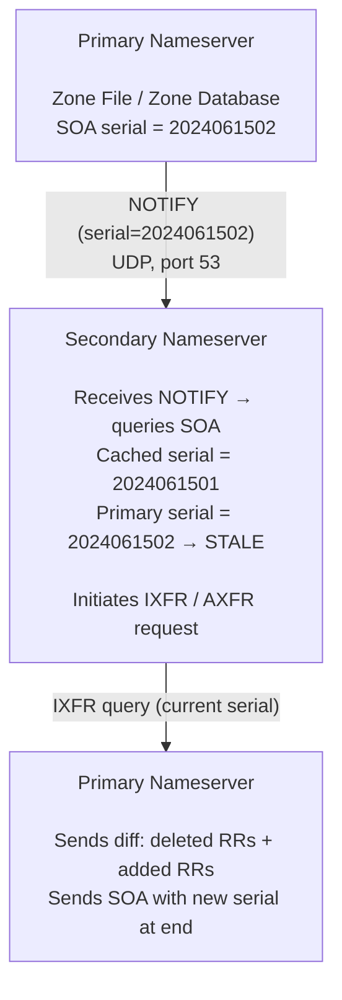

# Lesson 2: Record Types, Zone File Structure, SOA Parameters

## 1. First-Principles Intuition & Invariants

The Domain Name System was designed in 1983 by Paul Mockapetris in RFC 882 and RFC 883, later superseded by RFC 1034 and RFC 1035, to solve a problem that had become operationally untenable: a single flat text file, `HOSTS.TXT`, maintained by the Stanford Research Institute Network Information Center, could no longer scale to serve a growing ARPANET. Every host on the network needed a copy, and every change required a manual distribution cycle. The design that replaced it was not merely a lookup table but a distributed, hierarchically delegated, eventually consistent database whose fundamental unit of information is the resource record.

Understanding DNS at the level a systems engineer must requires abandoning the mental model of "DNS as a phone book" and replacing it with a more precise one: DNS is a globally distributed key-value store where the key is a tuple of `(owner_name, class, type)` and the value is the record data specific to that type. The class field, almost always `IN` for Internet in modern deployments, is a vestige of the original design's ambition to serve multiple network protocol families. What matters in production is the type field, because type determines both the syntax of the record data and the semantics the resolver will attach to it.

The invariant that governs all of DNS data is zone authority. A zone is a contiguous, delegated subtree of the global namespace that a particular set of authoritative nameservers is responsible for. The boundary of a zone is defined by NS records, which delegate child subdomains to other zones and other nameservers. This distinction between a zone and a domain is subtle but critical: `example.com` is a domain, a node in the namespace tree. The zone for `example.com` is the administrative unit that begins at that node and extends downward until delegation points cut it off. A single zone file is the serialization of that zone's resource records into a text format that nameserver software like BIND, NSD, or Knot DNS can load.

The authority record that opens every zone file, the Start of Authority, is not optional and not decorative. It is the cryptographic and operational contract that the zone makes with the rest of the DNS ecosystem. Its parameters govern how secondary nameservers synchronize state from primary nameservers, how long they may serve stale data before treating the zone as expired, and what the minimum time-to-live floor is for negative responses. Every other record in the zone file inherits its operational context from the SOA. Getting the SOA wrong means getting zone transfers wrong, staleness wrong, and negative caching wrong, in that order.

The class of record types defined in RFC 1035 and extended by subsequent RFCs maps precisely onto the services that the naming layer of the internet must provide. Address resolution, mail routing, delegation, reverse lookup, and extensible text annotation are not accidents of history; they represent the minimum complete set of functions a distributed naming system must expose to support the application protocols built on top of TCP/IP.

---

## 2. Core Architecture & Mechanics

### The Zone File as a Serialized Database

A zone file is a text serialization of a zone's resource record set (RRset). Its syntax is defined in RFC 1035 Section 5 and extended by RFC 1101 and others. The file is read top to bottom; several implicit state variables track the current origin (the default domain name appended to unqualified names) and the current default TTL. Understanding these implicit variables is essential to reading zone files without introducing subtle bugs.

The `$ORIGIN` directive sets the default suffix appended to any name not terminated with a trailing dot. If `$ORIGIN example.com.` is set and you write `www`, the parser expands that to `www.example.com.`. The trailing dot on a fully qualified domain name is not a stylistic choice — it is the structural delimiter that tells the parser "this name is absolute, do not append the origin." Missing a trailing dot on a nameserver or mail exchange record is one of the most common and consequential zone file errors, because the parser will silently append the origin and produce a record pointing at a non-existent name.

The `$TTL` directive sets the default TTL for all records that follow it without an explicit TTL field. Per RFC 2308, every zone file should begin with an explicit `$TTL` directive. Modern BIND and NSD will warn or refuse to load a zone file that lacks one.

The general resource record format is:

```text
[name] [ttl] [class] type rdata
```

All fields except `type` and `rdata` are optional in the sense that they fall back to implicit state, but explicit values are always preferable in production. The `name` field defaults to the last explicitly named owner. The `ttl` field defaults to `$TTL`. The `class` field defaults to `IN`. This means a carefully indented sequence of records sharing the same owner name is valid, and you will see this pattern constantly in real zone files.

A complete, production-grade zone file for `example.com.` demonstrates the full range of common record types:

```text
$ORIGIN example.com.
$TTL 3600

; SOA — must be the first record for the zone apex
@   IN  SOA ns1.example.com. hostmaster.example.com. (
            2024061501  ; serial
            7200        ; refresh
            3600        ; retry
            1209600     ; expire
            300         ; negative TTL
        )

; Authoritative nameservers for the zone
@       3600    IN  NS      ns1.example.com.
@       3600    IN  NS      ns2.example.com.

; A records — IPv4 address mappings
@       3600    IN  A       203.0.113.10
www     3600    IN  A       203.0.113.10
ns1     3600    IN  A       203.0.113.1
ns2     3600    IN  A       203.0.113.2

; AAAA records — IPv6 address mappings
@       3600    IN  AAAA    2001:db8::a
www     3600    IN  AAAA    2001:db8::a

; CNAME — canonical name alias
mail    3600    IN  CNAME   www.example.com.

; MX — mail exchanger with preference value
@       3600    IN  MX      10  smtp1.example.com.
@       3600    IN  MX      20  smtp2.example.com.

; TXT — SPF policy
@       3600    IN  TXT     "v=spf1 ip4:203.0.113.0/24 -all"

; TXT — DKIM selector (long strings split across quoted segments)
default._domainkey  3600  IN  TXT  (
    "v=DKIM1; k=rsa; p=MIIBIjANBgkqhkiG9w0BAQEFAAOCAQ8AMIIBCgKCAQEA"
    "0Z3VS5JJcds3xHn/ygWep4PAtEsHAFoqJyFkd4qCmxNMzMdoIeHd/N9XOLrC"
    "XsxODWxMJCMCFkq3BYnQoVNQIDAQAB"
)
```

This file is syntactically valid and loadable by BIND 9, NSD 4, and Knot DNS 3. The semicolon introduces a comment. The `@` symbol is a shorthand for the current `$ORIGIN` value.

### Record Type Semantics: A Mechanical Walkthrough

**A and AAAA records** are the most fundamental record types. An A record maps a domain name to a 32-bit IPv4 address. An AAAA record maps a domain name to a 128-bit IPv6 address. When a stub resolver asks "what is the address of `www.example.com`?", it sends separate queries for type A and type AAAA. The resolver's choice between the two results is governed by the host's address selection policy, defined by RFC 6724 and implemented in the operating system's `getaddrinfo(3)` call. Modern Linux systems prefer IPv6 by default, so if a host has both A and AAAA records and the client has IPv6 connectivity, the AAAA result will be used.

Multiple A or AAAA records for the same owner name form a resource record set. Authoritative nameservers return the full RRset in the answer section. Resolvers and clients may distribute connections across the returned addresses, though the behavior is application-dependent. This is the mechanism behind DNS-based round-robin load distribution, which is cheap and stateless but provides no health checking and is subject to TTL-governed refresh cycles rather than real-time failure detection.

**CNAME records** establish an alias from one name to another. The rdata field of a CNAME record is called the canonical name, and the semantic meaning is "the true name for this owner is the value of this record; re-query using that canonical name." The CNAME indirection is not transparent at the protocol level: a resolver receiving a CNAME in a response must restart the query process using the canonical name. This has two critical consequences. First, a CNAME record for an owner name precludes any other record type for that same owner, with the sole exception of DNSSEC records. The DNS protocol forbids coexisting CNAMEs and other data because the indirection would create semantic ambiguity. Second, a CNAME at the zone apex is illegal. The zone apex must carry NS and SOA records, and those cannot coexist with a CNAME. This is why CDN providers invented proprietary extensions like ALIAS or ANAME records, which perform CNAME-like behavior at resolution time server-side, returning synthesized A or AAAA records rather than a CNAME in the wire response.

**NS records** define the authoritative nameservers for a zone. At the zone apex, NS records list every nameserver that holds authoritative data for that zone. These are not the nameservers the resolver contacts first; that job belongs to the parent zone's delegation. What the zone apex NS records provide is the authoritative answer to "who is authoritative for this zone?", which is what resolvers cache and use for subsequent queries within that zone's TTL. A nameserver whose name is within the zone it serves requires a glue record — an A or AAAA record for the nameserver itself, carried in the additional section of the delegation response — because the resolver would otherwise face a circular dependency trying to look up the nameserver's address. Glue records are defined in the parent zone, not in the child zone itself.

**MX records** control mail routing. The rdata of an MX record consists of a 16-bit preference value followed by a fully qualified domain name identifying the mail exchanger. Lower preference values indicate higher priority. When an SMTP client performs a mail delivery lookup for `example.com`, it queries for MX records and attempts delivery to exchangers in ascending preference order, failing over to higher preference values if lower ones are unreachable. RFC 5321 requires that an MX record's value must resolve to an A or AAAA record and must never point at a CNAME. This restriction exists because the double-indirection of CNAME-following plus MX delivery creates ambiguous retry semantics.

**PTR records** perform reverse DNS lookups: given an IP address, return the associated domain name. The mechanism uses the special `in-addr.arpa.` and `ip6.arpa.` zones. A PTR record for the IPv4 address `203.0.113.10` lives at the owner name `10.113.0.203.in-addr.arpa.` — the octets are reversed so that delegation can proceed from left to right in the same direction as the DNS hierarchy. IPv6 PTR records use nibble-reversed hex notation under `ip6.arpa.`, which makes them verbose but structurally consistent. PTR records are used by mail servers for reverse-confirmed forward-confirmed DNS checks (FCrDNS), by logging and monitoring systems to annotate IP addresses, and by some intrusion detection systems for correlation.

**TXT records** store arbitrary text data associated with a domain name. Each TXT record consists of one or more character strings, each limited to 255 bytes. Multiple strings within a single TXT record are concatenated by the resolver before being returned. TXT records are the extensibility mechanism of the DNS data plane: SPF anti-spoofing policies, DKIM public keys, DMARC alignment policies, domain verification tokens for SaaS platforms, and ACME challenge responses for certificate issuance all live in TXT records. The 255-byte string limit frequently forces DKIM public keys to be split across multiple quoted string segments in the zone file, as shown in the zone file example above. This is a syntactic split only; the wire format and resolver behavior treat the concatenated result as a single value.

### The SOA Record: Operational Contract Dissected

The SOA record is the most structurally complex record in the zone file and the most operationally consequential. Its rdata contains seven fields that govern zone synchronization between primary and secondary nameservers and the behavior of negative caching.

```text
zone.  IN  SOA  mname  rname  ( serial refresh retry expire minimum )
```

The `mname` field names the primary nameserver for the zone — the nameserver from which secondary nameservers pull zone transfers. This is not necessarily the same nameserver that answers queries; in a hidden-primary architecture, the primary is not publicly listed in NS records and does not answer queries directly. It exists only as the authoritative source from which secondaries replicate.

The `rname` field encodes the zone administrator's email address in a DNS-safe format. The first unescaped dot is replaced with the `@` separator that normal email uses. So `hostmaster@example.com` becomes `hostmaster.example.com.` in the SOA rdata. This field is informational; no protocol mechanism uses it for automated contact.

The `serial` field is a 32-bit unsigned integer that acts as the version number of the zone. Secondary nameservers compare their cached serial against the primary's current serial to decide whether to initiate a zone transfer. The comparison uses RFC 1982 serial number arithmetic, which handles 32-bit wraparound correctly. The convention is to encode the serial as `YYYYMMDDnn`, where `nn` is a two-digit sequence number for the day, giving up to 100 revisions per day. For higher-frequency deployments, some operators use Unix epoch seconds, which provides finer granularity at the cost of losing human readability. The invariant that must never be violated: when you change any record in a zone, you must increment the serial number before distributing the zone to secondaries. If you do not, secondaries will not detect the change and will continue serving stale data until their refresh interval expires and they re-check regardless.

The `refresh` interval tells secondary nameservers how often to poll the primary for a changed serial, expressed in seconds. A value of `7200` means secondaries check every two hours. Modern DNS deployments can accelerate this significantly using NOTIFY messages (RFC 1996), where the primary sends a DNS NOTIFY packet to all secondaries whenever the zone is updated. Secondaries that receive a NOTIFY immediately trigger a serial check rather than waiting for the refresh interval to expire. Even with NOTIFY in place, the refresh value remains relevant as a fallback and as the interval for the routine SOA query that confirms the channel is healthy.

The `retry` interval governs how long a secondary waits before retrying a failed refresh attempt. If the primary is unreachable when the secondary attempts a serial check, the secondary will retry after `retry` seconds rather than waiting a full `refresh` interval. A common configuration sets retry to half the refresh value. The retry interval should be short enough to quickly recover connectivity to a flapping primary without flooding it with queries.

The `expire` interval defines how long a secondary will continue serving zone data if it cannot reach the primary at all. After `expire` seconds of continuous failure to contact the primary, the secondary stops answering queries for the zone and begins returning SERVFAIL. The intent is to prevent indefinite service from arbitrarily stale data. Typical values range from 1,209,600 seconds (two weeks) to 2,419,200 seconds (four weeks). The expire value must always be much larger than the refresh value; RFC 1912 recommends expire be at least seven times the refresh interval. If your expire value is shorter than your refresh interval, secondary servers will expire the zone before they even attempt a first successful refresh, which means they will never actually have valid data to serve.

The `minimum` field (also called the negative TTL, per RFC 2308) specifies how long resolvers should cache a negative response — a NXDOMAIN (name does not exist) or NODATA (name exists but has no records of the queried type) response. Before RFC 2308, this field was used as the default TTL for all records lacking an explicit TTL, which is why you will see old documentation describe it as the "minimum TTL." RFC 2308 changed its semantics so that negative caching TTL is the lower of the SOA minimum field and the TTL of the SOA record itself in the response. Setting this value too high means that deleted names or newly added records take a long time to propagate to resolvers. A value of 300 to 900 seconds is a reasonable default for most zones.

### Zone Transfer Mechanics and State Transitions

The relationship between primary and secondary nameservers follows a well-defined synchronization protocol. AXFR (Authoritative Transfer) is a full zone transfer: the primary sends every resource record in the zone as a stream of DNS messages, beginning and ending with the SOA record. IXFR (Incremental Transfer, RFC 1995) is a differential transfer: the secondary sends its current serial, and the primary responds with only the changes between that serial and the current zone version. If the primary has not retained enough history to satisfy the IXFR request (or if the difference would be larger than a full transfer), it falls back to AXFR.



Zone transfers require TCP, not UDP, because the response payload exceeds UDP's 512-byte limit (or even the 4096-byte EDNS0 extended limit for large zones). BIND 9's `named.conf` controls which hosts may initiate zone transfers via the `allow-transfer` ACL. In production, zone transfers must be restricted to the IP addresses of known secondary nameservers and optionally protected by TSIG (Transaction SIGnature) keys, which are HMAC-MD5 or HMAC-SHA256 keyed hashes that authenticate both the transfer request and the transfer data. Without TSIG, zone transfers over untrusted networks expose your entire zone contents to passive interception.

---

## 3. High-Performance Optimization & Failure Modes

### TTL Strategy as a Scaling Lever

TTL values are the primary mechanism by which zone operators control the trade-off between consistency latency and resolver load. A high TTL means resolvers cache answers longer, reducing query volume to your authoritative nameservers and reducing latency for end users who benefit from cached responses. A low TTL means changes propagate faster at the cost of higher query rates and more latency variance for cache misses.

The correct TTL strategy depends on operational rhythm. Static infrastructure — NS records, the SOA, records for nameserver glue — should carry TTLs of 86,400 seconds (24 hours) or higher. These records change rarely and benefit enormously from long caching. Address records for stable services should be 3,600 seconds. Address records that you expect to change during maintenance windows should be pre-lowered to 300 seconds at least one full current-TTL cycle before the change, so that all resolvers have flushed their caches before you need them to pick up the new value. This pattern is the core discipline of zero-downtime DNS migrations: lower TTL, wait, change record, verify, raise TTL.

The negative TTL (SOA minimum field) deserves special attention. If a client queries for a name that does not yet exist — perhaps because deployment is still in progress — resolvers cache the NXDOMAIN response for the duration of the negative TTL. If that value is 3,600 seconds and your deployment completes 10 minutes after the first failed query, affected resolvers will continue returning NXDOMAIN for up to 50 more minutes regardless of the positive record now in your zone. Keeping the negative TTL at 300 to 600 seconds avoids this trap.

### CNAME Chain Depth and Resolution Latency

CNAME chains introduce sequential round trips. If `a.example.com` is a CNAME for `b.example.com`, which is a CNAME for `c.example.com`, a resolver must issue three queries in sequence before receiving an address record. Each hop adds a full round trip. RFC 1034 recommends that implementations limit CNAME chain following to avoid infinite loops, and most resolvers cap chains at 8 or 10 levels. Beyond the protocol limit, long chains impose measurable latency in environments where the intermediate CNAME targets span multiple authoritative zones with separate TTLs and nameservers. In production, CNAME chains of more than two levels are a configuration smell that should be refactored to a single CNAME pointing directly at the canonical name.

### MX Priority and Mail Routing Failure Modes

A common MX misconfiguration is setting all exchangers to the same preference value. This is not round-robin load balancing in the same sense as multiple A records. SMTP clients interpret equal-preference MX records as equivalent choices and may select among them randomly, but RFC 5321 gives implementations latitude in how they handle ties. More importantly, when one exchanger at a given preference level is unreachable, the SMTP client must try all exchangers at that level before failing over to higher preference values. Setting all exchangers to equal preference means a single unreachable exchanger forces an exhaustive retry of the full set before the client gives up, increasing connection time for failed deliveries. The correct architecture assigns distinct preference values (`10`, `20`) to represent genuine priority tiers, with lower-priority exchangers functioning as overflow or fallback, not as primary delivery targets.

An MX record pointing at a name that resolves to a CNAME is a protocol violation per RFC 5321 Section 5. Many SMTP implementations will refuse to deliver to such a configuration, and others will follow the CNAME chain in ways that are implementation-defined and inconsistent. If your mail exchanger's DNS name changes, update the MX record's target value directly — do not introduce a CNAME indirection as a convenience.

### Zone Serial Drift and Split-Brain Nameservers

Zone serial drift occurs when primary and secondary nameservers hold different views of a zone's serial number for reasons other than a pending transfer. This can happen when multiple tools or operators edit the zone file without coordinating serial increments, when a hidden primary fails and a manual import restores an older backup, or when zone management software generates serials based on wall-clock time and two edits happen within the same second. The symptom is that some resolvers receive answers from secondaries with stale data while others receive current data from other nameservers, producing inconsistent behavior that is difficult to reproduce and diagnose.

The diagnostic command for inspecting zone serial across all authoritative nameservers uses `dig` with explicit server targeting:

```sh
# Query SOA from each authoritative nameserver directly
dig @ns1.example.com. example.com. SOA +short
dig @ns2.example.com. example.com. SOA +short

# Check which nameservers the parent zone delegates to
dig example.com. NS +short

# Perform a full AXFR from the primary to inspect zone contents
dig @ns1.example.com. example.com. AXFR

# Verify PTR record exists and is consistent with forward A record
dig -x 203.0.113.10 +short

# Trace the full resolution path from root to authoritative
dig +trace example.com. A
```

The `dig +trace` output is particularly valuable for diagnosing delegation failures. It performs iterative resolution from the root servers, showing every referral and the exact NS and glue records returned at each step. A mismatch between glue records in the parent zone and the actual A records in the child zone is a frequent source of resolution failures that are invisible to queries that hit the resolver cache.

### Validating Zone Files Before Deployment

Before loading a modified zone file into a running nameserver, always validate it offline. BIND provides `named-checkzone` for this purpose:

```sh
# Validate zone file syntax and semantics
named-checkzone example.com /etc/bind/zones/example.com.db

# Validate BIND configuration file referencing the zone
named-checkconf /etc/bind/named.conf

# For NSD, validate with nsd-checkzone
nsd-checkzone example.com /etc/nsd/zones/example.com.zone

# For Knot DNS, check with knotc
knotc zone-check example.com
```

`named-checkzone` catches trailing-dot omissions on FQDN rdata values, serial number format errors, CNAME conflicts, and syntactically invalid records. It is not a substitute for end-to-end testing but eliminates the most common classes of load-time failure before they reach production. In a CI/CD pipeline that manages zone files in version control, `named-checkzone` should run as a pre-merge check on every pull request that touches zone data.

The discipline of treating zone files as version-controlled infrastructure code — with peer review, automated validation, and staged rollout — is not bureaucratic overhead. A zone file error can render a domain entirely unresolvable in minutes, and the blast radius scales with the domain's TTL. For a zone with a 3,600-second TTL, a bad deployment may take an hour to recover from even after the zone file is corrected, because resolvers that cached the malformed answer continue serving it until their cached TTL expires.
