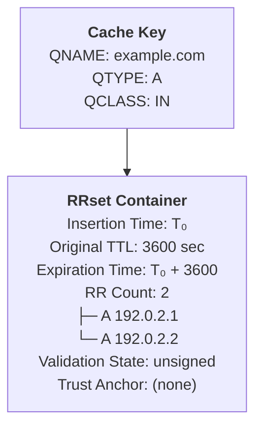
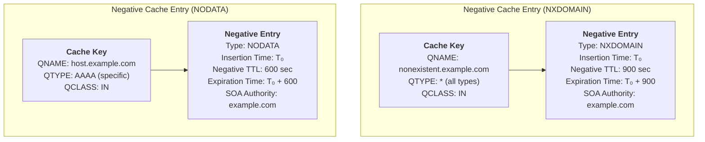

# Lesson 3: Caching Behavior, TTL Semantics, Negative Caching, Consistency Models

## 1. First-Principles Intuition & Invariants

The Domain Name System operates as a distributed, eventually-consistent read-heavy database where performance and availability fundamentally depend on aggressive client-side and intermediate caching. Unlike traditional databases that prioritize strong consistency guarantees through two-phase commit protocols or Paxos-style consensus, DNS deliberately sacrifices immediate consistency for horizontal scalability and latency reduction. Every DNS query traverses a multi-tier caching hierarchy—from browser stub resolvers through operating system caches to recursive resolvers operated by ISPs or public providers like Cloudflare and Google—before potentially reaching authoritative nameservers. This architectural decision trades freshness for speed, introducing a temporal gap between when an authoritative zone administrator updates a record and when that change propagates to the global population of resolvers.

At the heart of DNS caching semantics lies the Time-To-Live field, a 32-bit unsigned integer embedded in every resource record that represents the maximum duration in seconds for which a resolver may retain that record without revalidating it against authoritative sources. The TTL mechanism transforms DNS into a soft-state system where data automatically expires and must be refreshed, preventing indefinite staleness while avoiding the coordination overhead of cache invalidation protocols. When an authoritative nameserver responds to a query, it stamps each RR with a TTL value determined by the zone administrator through declarative configuration in zone files or dynamic DNS APIs. Recursive resolvers receiving these responses store the records in their local cache alongside a timestamp marking the moment of insertion, then decrement the TTL linearly as wall-clock time advances. Once the countdown reaches zero, the resolver purges the stale entry from cache and must perform a fresh resolution traversing the delegation hierarchy from root servers through TLD nameservers to the authoritative zone.

This TTL countdown mechanic introduces a critical operational tension between performance optimization and change propagation velocity. Long TTL values—measured in hours or days—maximize cache hit rates and minimize query load on authoritative infrastructure, dramatically reducing latency for end users and bandwidth costs for operators. However, extended TTLs severely constrain operational agility when infrastructure changes demand rapid DNS updates, such as failing over to disaster recovery sites, rolling out blue-green deployments, or mitigating DDoS attacks through traffic steering. Conversely, short TTLs—on the order of seconds or minutes—enable near-instantaneous propagation of DNS changes at the cost of increased query volume, higher latency percentiles due to cache misses, and greater exposure to authoritative server failures. Production DNS architectures must therefore balance these competing forces through differentiated TTL policies based on record volatility, with stable infrastructure records like MX and NS entries carrying multi-hour TTLs while dynamic service discovery records used in containerized environments employ sub-minute values.

Beyond positive caching of successfully resolved records, DNS resolvers implement negative caching to remember the non-existence of domain names or record types, preventing repeated queries for resources that definitively do not exist. The NXDOMAIN response code signals that an entire domain name has no records of any type within the queried zone, while NODATA responses indicate that the domain exists but lacks the specific record type requested. Without negative caching, attackers could trivially execute query amplification by flooding resolvers with requests for non-existent random subdomains, forcing expensive full-resolution traversals for each unique garbage name. RFC 2308 formalizes negative caching semantics by introducing the negative TTL mechanism, where the SOA record's MINIMUM field—historically misnamed, as it originally governed a different purpose—defines how long resolvers should cache negative responses. This allows authoritative operators to tune the caching duration for non-existence separately from positive records, typically using shorter values to balance cache efficiency against the operational need to quickly provision new subdomains.

The distributed, multi-tier nature of DNS caching creates an eventually-consistent system with emergent coherence properties that differ fundamentally from strongly-consistent databases. When a zone administrator updates an A record pointing example.com to a new IP address, that change becomes immediately visible to queries hitting the authoritative nameserver, but the old value persists across the resolver population according to a temporal distribution determined by TTL expiration and query patterns. A resolver that cached the old record just before the update will continue serving stale data for nearly the full TTL duration, while a resolver querying seconds after the change receives fresh data immediately. This temporal inconsistency window creates operational hazards during infrastructure migrations, as some client population will route traffic to old infrastructure while others connect to new systems, potentially causing transaction failures, session disruption, or split-brain database writes if applications fail to handle transient dual-population scenarios gracefully.

Cache poisoning represents the paramount security threat to DNS caching infrastructure, where attackers inject fraudulent records into resolver caches to hijack traffic, intercept credentials, or serve malware. The fundamental vulnerability emerges from the stateless, connectionless nature of UDP-based DNS protocols combined with historically weak transaction identifiers. A successful cache poisoning attack allows an adversary to overwrite legitimate cached records with malicious ones carrying arbitrarily long TTLs, persisting the compromise until manual cache flushes or TTL expiration. The Kaminsky vulnerability disclosed in 2008 demonstrated that attackers could efficiently poison caches by exploiting birthday-paradox collision probabilities in the 16-bit transaction ID space combined with predictable source port allocation. Modern defenses layer multiple randomization techniques—cryptographically random transaction IDs, source port randomization across the full 16-bit ephemeral range, and DNS0x20 case randomization encoding additional entropy in the query name—to expand the effective keyspace attackers must brute-force. DNSSEC provides cryptographic authentication through hierarchical public-key signatures, allowing resolvers to validate that records originate from legitimate zone operators, though deployment complexity and operational overhead have limited universal adoption.

Understanding DNS caching behavior from first principles requires internalizing that every resolver operates as an autonomous agent making local caching decisions based solely on TTL values received from upstream servers and its own configured policies. No central coordination mechanism synchronizes cache state across the global resolver population, and no acknowledgment protocol confirms that caches have purged stale data. This fundamentally asynchronous model delivers the horizontal scalability required for a system answering hundreds of billions of queries daily, but imposes strict disciplines on infrastructure operators who must design change management procedures accounting for maximum TTL-bounded staleness windows and implement health-checking and rollback automation to handle the inevitable inconsistent-state periods during deployments.

## 2. Core Architecture & Mechanics

A DNS resolver's caching subsystem maintains an in-memory data structure mapping tuple keys to resource record sets with associated metadata governing expiration and eviction policies. The canonical cache key consists of the fully-qualified domain name in wire format, query type (A, AAAA, MX, etc.), and query class (nearly always IN for Internet), forming a three-dimensional lookup space. Modern high-performance resolvers implement this structure using hash tables with separate chaining for collision resolution, often employing advanced techniques like consistent hashing or adaptive radix trees for prefix-based wildcard matching. Each cache entry contains not only the RRset payload—potentially multiple resource records sharing the same name and type—but also temporal metadata including the insertion timestamp, the original TTL value received from the authoritative server, and computed expiration times derived by adding TTL to insertion time.



The TTL countdown mechanism operates through one of two implementation strategies depending on resolver design philosophy. The decrementing model stores the original TTL and insertion timestamp, calculating remaining TTL on-demand during cache lookups by subtracting elapsed time from the original value. This approach minimizes storage overhead and eliminates the need for background timer threads, but requires microsecond-precision clock reads on every cache hit. The precomputed expiration model calculates and stores the absolute expiration timestamp at insertion time using monotonic clock sources immune to wall-clock adjustments, enabling simple comparison operations during lookups at the cost of slightly increased memory footprint. Production resolvers like BIND and Unbound employ the expiration timestamp approach because it simplifies cache eviction logic and provides deterministic performance characteristics under high query load.

When a recursive resolver receives a query, it first performs a cache lookup using the QNAME, QTYPE, and QCLASS tuple. If a matching entry exists and has not yet expired—determined by comparing current time against the expiration timestamp—the resolver constructs a response packet containing the cached RRset but crucially must adjust the TTL values in the response to reflect remaining time rather than the original TTL. This TTL decrementing requirement in responses prevents downstream caches from extending the lifetime of stale data beyond the authoritative server's intent. If example.com was cached 1800 seconds ago with an original TTL of 3600, the resolver must return the record with TTL 1800 to downstream clients. Failure to implement proper TTL decrementing creates pathological scenarios where records propagate through multiple caching layers with constant TTLs, effectively extending their lifetime indefinitely through cache chaining.

```
TTL Countdown Flow:

T₀: Authoritative Server Returns Record
    example.com. 3600 IN A 192.0.2.1
    [Resolver stores: insert_time=T₀, ttl=3600, expire=T₀+3600]

T₀+900: Client Query #1
    Remaining TTL = 3600 - 900 = 2700
    Response: example.com. 2700 IN A 192.0.2.1

T₀+2400: Client Query #2
    Remaining TTL = 3600 - 2400 = 1200
    Response: example.com. 1200 IN A 192.0.2.1

T₀+3600: Cache Entry Expires
    [Entry eligible for eviction, next query triggers fresh resolution]
```

Negative caching introduces additional complexity because the absence of data must be represented explicitly in the cache structure. When a resolver receives an NXDOMAIN response indicating that a queried name does not exist, it must store a negative cache entry that prevents subsequent queries for that name from triggering expensive resolution iterations. RFC 2308 specifies that the SOA record included in the authority section of negative responses carries the negative caching TTL in its MINIMUM field. The resolver extracts this value and creates a synthetic cache entry mapping the QNAME to a special NXDOMAIN marker with the specified TTL. Future queries matching this negative entry receive immediate NXDOMAIN responses without network traffic, dramatically reducing both latency and query load during misconfiguration events or DNS-based attacks.

NODATA responses—where the name exists but lacks the requested record type—require more nuanced caching semantics. A query for the AAAA record of a domain that only has A records returns NODATA (formally, a response with NOERROR rcode but an empty answer section). The resolver must cache this negative result specific to the QTYPE, allowing subsequent AAAA queries to short-circuit while still forwarding A queries to authoritative servers if not already cached. This type-specific negative caching prevents false negatives where caching a NODATA response for one type inappropriately suppresses queries for other types that might exist.



Cache eviction policies govern how resolvers manage finite memory resources when cache occupancy approaches configured limits. The simplest strategy implements hard limits that refuse new insertions once capacity is reached, forcing cache flushes or waiting for TTL-based expiration to free space. Production resolvers employ least-recently-used eviction algorithms that prioritize retaining frequently-accessed entries while purging stale data that no longer serves active query patterns. Advanced implementations track per-entry access frequencies and implement adaptive policies that protect high-value entries—like root server addresses and TLD nameserver records—from premature eviction even under memory pressure. Some resolvers expose tunable cache sizes for different record types, allocating larger pools for common A and AAAA records while constraining obscure types like NAPTR or TLSA to prevent cache pollution from specialized workloads.

Consistency model formalization requires understanding DNS caching as a distributed state machine where each resolver independently advances through state transitions triggered by queries, responses, and TTL expirations. At any given instant, the global DNS system exists in a superposition of states where different resolvers hold different cached values for the same name, all of which were valid at some point in the past but may no longer reflect authoritative state. The eventual consistency guarantee states that if updates cease for a duration exceeding the maximum TTL value in the system, all caches will eventually converge to identical state matching the authoritative zone through natural TTL expiration and re-resolution. The convergence time is strictly bounded by the maximum TTL, distinguishing DNS from weaker eventual consistency models in systems like Cassandra or Dynamo where anti-entropy repairs operate on non-deterministic schedules.

Cache coherence protocols in multi-server resolver deployments introduce additional architectural considerations. When an organization operates multiple recursive resolvers behind load balancers—common in enterprise and service provider networks—each resolver instance maintains independent cache state with no sharing or synchronization. A client query load-balanced to resolver A may receive a cached response while an identical query routed to resolver B triggers full resolution if B's cache lacks the entry. This cache incoherence across the resolver pool increases query latency variance and authoritative server load compared to a single unified cache, but provides horizontal scaling, fault isolation, and simplified operational models that avoid distributed cache consistency overhead. Some advanced deployments implement external distributed caching layers using systems like Redis or Memcached, trading additional network hops and complexity for improved hit rates through cache sharing, though this remains uncommon due to the performance-critical nature of DNS resolution.

## 3. High-Performance Optimization & Failure Modes

Optimizing DNS caching performance in production environments requires systematically addressing the cache miss penalties that dominate tail latency distributions. A well-tuned resolver achieves cache hit rates exceeding ninety-five percent for typical workloads, but the remaining five percent of misses that require full recursive resolution experience latencies two to three orders of magnitude higher than cached responses. Profiling production traffic reveals that cache misses cluster around several distinct patterns: random subdomain queries from malware or DDOS activity, cold-start cache population after resolver restarts, and TTL expiration of high-frequency domains during traffic spikes. Each pattern demands specialized mitigation strategies rather than universal tuning parameters.

Aggressive cache prefetching addresses TTL expiration misses for high-traffic domains by proactively refreshing popular entries before they expire. The resolver monitors query frequencies and identifies domains queried above a configured threshold within the TTL window. When these hot entries approach expiration—typically when remaining TTL drops below twenty-five percent of the original value—the resolver automatically issues background refresh queries to authoritative servers, updating the cache before clients experience miss penalties. This predictive caching strategy reduces P99 latency by ensuring popular domains never actually expire from cache, effectively extending their lifetime while still honoring TTL semantics by refreshing authoritative data regularly. The performance trade-off involves increased background query load and the risk of prematurely refreshing domains whose traffic patterns shift, wasting resources on prefetch queries that ultimately go unused.

Implementing cache prefetching requires careful consideration of query timing to avoid thundering herd effects where multiple resolver instances simultaneously refresh the same expiring entry. One robust approach uses deterministic jittering based on hashing the domain name combined with resolver instance identity to distribute refresh queries across a time window. For a domain with TTL 3600 seconds and prefetch trigger at twenty-five percent remaining (900 seconds before expiration), the resolver calculates a refresh window spanning from 1000 to 900 seconds before expiration, selecting a specific refresh time within that window using a deterministic hash function. This ensures different resolver instances naturally stagger their refresh queries without requiring distributed coordination.

```
Prefetch Logic Pseudocode:

function check_prefetch_candidates():
    current_time = monotonic_clock()
    for entry in cache where entry.access_count > PREFETCH_THRESHOLD:
        remaining_ttl = entry.expiration_time - current_time
        original_ttl = entry.original_ttl
        prefetch_trigger = original_ttl * 0.25
        
        if remaining_ttl < prefetch_trigger and not entry.prefetch_pending:
            # Jitter window: 10% of original TTL
            jitter_window = original_ttl * 0.10
            hash_input = entry.qname + resolver_instance_id
            jitter_offset = hash(hash_input) % jitter_window
            
            schedule_background_query(
                entry.qname,
                entry.qtype,
                delay = remaining_ttl - prefetch_trigger + jitter_offset
            )
            entry.prefetch_pending = true
```

Negative caching optimization focuses on protecting resolver infrastructure from query floods targeting non-existent domains, a common characteristic of malware command-and-control traffic and DNS tunneling attacks. Attackers generate queries for random subdomains under a controlled zone—like 8f3a9c2b.malware.example, f2d1e8b7.malware.example—creating unique cache keys that defeat positive caching. Without negative caching, every random query forces full recursive resolution traversing root servers, TLD servers, and eventually the attacker's authoritative nameserver, which can respond arbitrarily slowly to amplify resource exhaustion. Aggressive negative caching with carefully tuned negative TTL values transforms this attack into a cache-hits-per-zone scenario where the first random query under a zone triggers resolution, but subsequent queries for different random subdomains under the same zone can potentially benefit from wildcard negative caching strategies.

RFC 8198 introduces aggressive negative caching using DNSSEC-authenticated denial of existence through NSEC and NSEC3 records. When a resolver receives an NXDOMAIN response with DNSSEC signatures and NSEC records proving that no names exist in a specific range, it can cache not just the specific queried name but the entire authenticated gap. Future queries for any name falling within that proven-empty range receive immediate NXDOMAIN responses without network traffic. This cryptographically-authenticated range caching transforms negative caching from per-name to per-zone-region granularity, dramatically improving defense against random subdomain attacks while requiring DNSSEC deployment by authoritative zones.

```
Aggressive Negative Caching (NSEC Range):

Query: random1.example.com (NXDOMAIN)
Response includes NSEC record:
  aaa.example.com NSEC zzz.example.com A AAAA RRSIG NSEC

Resolver caches the proven-empty range:
  [aaa.example.com, zzz.example.com) → NXDOMAIN

Future queries within range return cached NXDOMAIN:
  random2.example.com → cached NXDOMAIN (in range)
  random3.example.com → cached NXDOMAIN (in range)
```

TTL manipulation for operational agility during infrastructure changes requires reducing TTLs well in advance of planned modifications to minimize the inconsistency window. A common operational pattern involves a two-phase TTL reduction strategy: hours or days before a planned migration, reduce the target record's TTL from its steady-state value (often 3600 or higher) down to a short value like sixty or three hundred seconds. This ensures that by the time the actual infrastructure change occurs, the vast majority of cached copies have expired and resolvers will quickly converge to the new value. After the migration completes and stability is confirmed, restore the TTL to its original long value to reduce query load. This operational discipline trades temporarily increased query volume during the TTL reduction window for dramatically shortened convergence times during the actual change.

Monitoring and observability for DNS caching systems must capture both the resolver's internal cache performance metrics and the distributed consistency state across the resolver population. Key internal metrics include cache hit rate stratified by query type, mean and P99 cache lookup latency, eviction rates indicating memory pressure, and prefetch success rates measuring how many proactive refreshes occurred before TTL expiration. External monitoring tracks the distribution of TTL values in responses returned to clients, allowing operators to detect cache stampedes where many entries expire simultaneously, and measures query latency distributions including the long tail representing cache misses. Advanced observability platforms correlate resolver cache states with authoritative server query logs to detect cache poisoning attempts by identifying resolvers repeatedly requesting records despite valid cache entries, potentially indicating compromised cache state.

Cache poisoning defenses in production resolvers layer multiple randomization and validation techniques to exponentially increase attack difficulty. Source port randomization spreads outbound queries across the full ephemeral port range (32768–60999 on Linux systems), adding approximately fifteen bits of entropy beyond the sixteen-bit transaction ID. DNS0x20 encoding randomizes the case of ASCII letters in query names, then validates that responses preserve this randomization, encoding an additional entropy channel that off-path attackers cannot predict. Combined, these techniques expand the effective keyspace an attacker must brute-force from 2^16 (65536 possibilities) to approximately 2^31 or higher, transforming practical attacks into computationally infeasible endeavors.

```
Port Randomization Implementation:

# Outbound query construction
transaction_id = cryptographic_random_u16()
source_port = cryptographic_random_range(32768, 60999)

send_query(
    qname = "example.com",
    qtype = A,
    txid = transaction_id,
    source_port = source_port
)

# Response validation
if received_response.txid != transaction_id:
    drop_response()
if received_response.source_port != query_source_port:
    drop_response()

# Accept only if both fields match
```

DNSSEC validation provides cryptographic authentication that eliminates cache poisoning risks for zones that deploy the technology, at the cost of increased complexity and resolution latency. When a DNSSEC-validating resolver queries a signed zone, it receives not only the requested resource records but also RRSIG records containing digital signatures computed by the zone's private key. The resolver fetches the zone's DNSKEY records containing the corresponding public key, then validates the signature chain up through the trust anchor (typically the root zone's key securely configured in the resolver). If validation succeeds, the resolver marks the cached entry as authenticated, providing cryptographic certainty that the data originated from the legitimate zone operator and was not tampered with in transit. Failed validation causes the resolver to return SERVFAIL to clients, preventing poisoned data from being used even if it reached the cache.

The operational overhead of DNSSEC includes increased response sizes due to signature records, additional round-trips to fetch public keys during initial validation, and the operational burden of managing key rollovers and maintaining trust anchor updates. Large-scale resolvers like Google Public DNS and Cloudflare 1.1.1.1 perform DNSSEC validation by default, but many private enterprise resolvers disable it due to complexity concerns, relying instead on randomization-based defenses. Hybrid approaches validate DNSSEC when signatures are present but fall back to permissive mode for unsigned zones, providing protection where available without breaking resolution for the majority of domains that remain unsigned.

Cache flushing operations during security incidents or troubleshooting require surgical precision to avoid cascading failures. Flushing the entire resolver cache forces every subsequent query to perform full recursive resolution, potentially overloading authoritative infrastructure and creating a self-induced denial of service. Production incident response procedures implement targeted flushing that removes only specific problematic domains or zone-level subtrees while preserving cache state for unaffected infrastructure. Modern resolver management APIs expose fine-grained cache control interfaces allowing operators to flush by domain suffix, query type, or even individual resource records. Some resolvers implement negative flushing that removes only negative cache entries, useful during rapid new subdomain provisioning scenarios where stale NXDOMAIN entries block legitimate traffic without affecting cached positive records.

```
Surgical Cache Flush Examples:

# Flush specific domain and all subdomains (Unbound)
unbound-control flush_zone example.com

# Flush specific record type for a domain (BIND)
rndc flushname example.com A

# Flush only negative cache entries (PowerDNS Recursor)
rec_control wipe-cache example.com$

# Flush entire cache (emergency only, high blast radius)
rndc flush  # BIND
unbound-control flush_zone .  # Unbound - notice root zone indicator
```

Distributed resolver deployments behind anycast routing introduce unique caching consistency challenges because client queries may reach different resolver instances across successive requests due to BGP routing changes or equal-cost multipath hashing variations. A client querying an anycast address like 1.1.1.1 might reach a resolver in Los Angeles for the first request, then a Dallas resolver for the second request moments later. If the LA resolver cached a record but Dallas did not, the client experiences inconsistent results and potentially measurable latency spikes. Anycast resolver operators mitigate this through massive cache pre-warming from global query telemetry, ensuring that popular domains remain cached across all instances, and by tuning BGP metrics to provide stable routing within metropolitan regions, reducing the probability that individual clients experience instance churn during normal operation.

Rate limiting and query throttling protect resolver cache infrastructure from abuse while maintaining service quality for legitimate traffic. Resolvers implement per-client query rate limits based on source IP address, dropping or deferring queries exceeding thresholds like ten queries per second. More sophisticated systems employ token bucket algorithms that permit short bursts while enforcing average rate limits over sliding time windows. Response rate limiting specifically targets responses to potentially spoofed source addresses by limiting the rate of responses to any single IP, preventing resolvers from being abused as amplification vectors in reflection attacks. These protective mechanisms trade potential false positives during legitimate traffic spikes for robust defense against query floods and cache exhaustion attacks.

Understanding DNS caching from the practitioner's perspective means recognizing that every operational decision—TTL values, negative caching policies, prefetch thresholds, and eviction strategies—represents a multi-dimensional trade-off between latency, consistency, resource consumption, and failure resilience. Production DNS architectures succeed by matching cache policies to traffic characteristics and operational requirements, instrumenting visibility into cache performance, and maintaining operational discipline around change management procedures that account for the inevitable temporal inconsistencies inherent in eventually-consistent distributed systems. The resolver cache serves as both the primary performance lever and the principal attack surface in DNS infrastructure, demanding constant attention to both optimization and security hardening from operators responsible for the foundation of internet connectivity.
