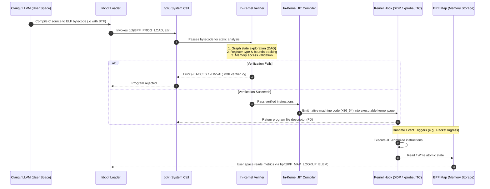

# Foundation: Extended Berkeley Packet Filter (eBPF)

## 1. Conceptual Mental Model

### The Kernel Programmability Revolution
Historically, modifying or observing the behavior of the Linux kernel required one of two extremes:
1. **Upstreaming Code into the Linux Kernel:** Submitting patches to the kernel mailing list, waiting months or years for merge, distribution packaging, and production infrastructure upgrades.
2. **Developing Out-of-Tree Kernel Modules (LKMs):** Writing C code that executes with unrestricted kernel-mode privilege (`Ring 0`). An uncaught null pointer dereference, buffer overrun, or race condition in an LKM crashes the host instantly with a kernel panic. Furthermore, LKMs break across kernel version bumps due to non-stable internal KABIs (Kernel Application Binary Interfaces).

```
Traditional Kernel Execution vs. eBPF Sandboxed Execution
==========================================================

+--------------------------------------------------------------+
| User Space                                                   |
|   Applications, Daemons, Observability Agents                |
+--------------------------------------------------------------+
                                |
             System Calls / bpf() syscall / perf_event
                                v
+--------------------------------------------------------------+
| Linux Kernel (Ring 0)                                        |
|                                                              |
|   Traditional Kernel Modules (LKM):                          |
|     + Unrestricted pointer access                            |
|     + Bugs cause fatal Kernel Panics (oops / crash)          |
|                                                              |
|   eBPF Subsystem:                                            |
|     +----------------------------------------------------+   |
|     | Bytecode Validation (Static Verifier DAG Analysis) |   |
|     +----------------------------------------------------+   |
|                               | (Proves safety & termination)|
|                               v                              |
|     +----------------------------------------------------+   |
|     | In-Kernel JIT Compiler (Native x86_64 / ARM64)     |   |
|     +----------------------------------------------------+   |
|                               |                              |
|                               v                              |
|     +----------------------------------------------------+   |
|     | Sandboxed Execution at Native Clock Speed          |   |
|     | Hooked directly into XDP, TC, kprobes, tracepoints |   |
|     +----------------------------------------------------+   |
|                               |                              |
|     +-------------------------+--------------------------+   |
|     | eBPF Maps (Lockless Per-CPU Arrays, Hash, RingBuf) |   |
|     +----------------------------------------------------+   |
+--------------------------------------------------------------+
```

**eBPF solves this dilemma by turning the kernel into an event-driven programmable runtime.** It embeds a verified, sandboxed virtual machine into the kernel core. You write high-level restricted C or Rust code, compile it using Clang/LLVM into eBPF bytecode, and load it into the kernel via the `bpf()` system call.

Before any instruction executes, the **In-Kernel Static Verifier** exhaustively parses the bytecode to mathematically prove that the program cannot crash the kernel, cannot corrupt kernel memory, cannot leak uninitialized data, and is guaranteed to terminate. Once verified, an **In-Kernel JIT (Just-In-Time) Compiler** translates the bytecode directly into native machine instructions (x86_64, aarch64, s390x, riscv), executing at raw hardware speed upon event invocation.

### The JavaScript Analogy
Consider web browsers before 1995: web pages were static HTML. To add dynamic client-side behavior, browser vendors had to add native features to the browser engine and release a new binary. JavaScript introduced a safe, sandboxed, event-driven runtime inside the browser, allowing developers to execute dynamic logic in response to DOM events (clicks, scrolls, network fetches) without risking operating system crashes.

**eBPF is the JavaScript of the Linux Kernel.** It allows developers to attach safe, sandboxed mini-programs to any kernel event—a packet ingress, a function entry, a context switch, or a disk write—without modifying the kernel source code or loading hazardous kernel modules.

---

## 2. Essential Terminology & Taxonomy

| Term | Technical Definition & In-Kernel Architecture |
| :--- | :--- |
| **eBPF VM** | A 64-bit RISC register machine embedded in the kernel. Features eleven 64-bit registers (`R0`–`R10`), a 512-byte fixed-size call frame stack, and 64-bit atomic instruction encoding. |
| **Static Verifier** | An in-kernel safety gate (`kernel/bpf/verifier.c`). Analyzes the program's control-flow graph (CFG) as a Directed Acyclic Graph (DAG), tracking register states, types, bounds (`smin`/`smax`, `umin`/`umax`), and memory access ranges. Rejects any code that violates invariants. |
| **JIT Compiler** | In-kernel compiler (`arch/*/net/bpf_jit_comp*.c`) that translates validated eBPF bytecode instructions into bare-metal native CPU instructions with 1:1 hardware register mappings. |
| **eBPF Map** | Kernel-resident, memory-efficient key/value data structures (`struct bpf_map`) used to persist state and provide bi-directional, high-throughput communication between user space and kernel space. |
| **XDP (eXpress Data Path)** | The earliest programmable network hook in the Linux network stack. Executes eBPF bytecode directly inside the network interface card (NIC) driver layer before the kernel allocates a `struct sk_buff` (socket buffer). |
| **TC (Traffic Control)** | Hook located in the `cls_bpf` classifier subsystem of the Linux networking stack. Operates on full `sk_buff` structures on both ingress and egress interfaces. |
| **kprobe / kretprobe** | Dynamic tracing hooks that allow attaching eBPF programs to virtually any internal kernel function entry (`kprobe`) or return (`kretprobe`) by dynamically patching instructions with breakpoints. |
| **tracepoint** | Static, deterministic trace hooks hardcoded into kernel source code by kernel developers (`TRACE_EVENT` macros). Guarantees stable API signatures across kernel minor versions. |
| **uprobe / uretprobe** | User-space dynamic tracing hooks. Patches instructions in user-space binaries or shared libraries (`libc.so`, Go binaries, SSL/TLS libraries) to inspect user-space function calls without recompiling. |
| **CO-RE (Compile Once – Run Everywhere)** | Compilation methodology relying on BPF Type Format (BTF) and Clang compiler built-ins (`__builtin_preserve_access_index`) to resolve kernel struct memory offset differences dynamically across diverse kernel versions at load time. |

---

## 3. Architecture & Execution Workflow

The lifecycle of an eBPF program moves through four distinct phases: Development, Verification, Compilation, and Event-Driven Execution.



---

## 4. Common Misconceptions & Mental Traps

### Misconception 1: "eBPF is just an improved packet capture tool (like tcpdump)."
* **Reality:** Classic BPF (cBPF) was designed in 1992 specifically for socket filtering (`libpcap`). eBPF, introduced in Linux 3.18, is a general-purpose, 64-bit in-kernel computation engine. It is utilized for full Layer 3/4 network routing (Cilium), runtime security enforcement (Tetragon, Falco), block storage profiling (BCC tools), CPU scheduling diagnostics, and application performance tracing.

### Misconception 2: "eBPF programs run in user space or inside a container."
* **Reality:** eBPF bytecode executes strictly inside **Kernel Space (Ring 0)**. It runs with kernel execution context and can inspect raw kernel data structures. Its safety does not stem from hardware virtualization (like KVM) or OS isolation (like Docker cgroups/namespaces); its safety is proven **statically prior to execution** by the in-kernel verifier.

### Misconception 3: "The verifier just checks for infinite loops."
* **Reality:** Loop detection is only one minor check. The verifier tracks the abstract type and numerical bounds of every single register on every possible execution branch. It validates:
  - Pointer provenance (distinguishing `PTR_TO_STACK`, `PTR_TO_MAP_VALUE`, `PTR_TO_CTX`, `SCALAR_VALUE`).
  - Pointer alignment and bounds checks before dereferencing.
  - Zero-initialization of stack memory before passing to helper functions.
  - Correct arguments and return type validation for in-kernel helper functions (`bpf_ktime_get_ns()`, `bpf_map_lookup_elem()`).

### Misconception 4: "eBPF programs can execute arbitrary Linux system calls."
* **Reality:** eBPF programs **cannot** invoke system calls or call arbitrary kernel functions. They can only invoke a strict, whitelist of stable **BPF Helper Functions** (`bpf_probe_read_kernel()`, `bpf_trace_printk()`, etc.) and designated BPF kfuncs exposed specifically for that program type.

---

## 5. Socratic Discussion Starters

1. **The Safety vs. Expressiveness Boundary:** How does the eBPF verifier reconcile the Halting Problem (which states that determining whether an arbitrary program will halt is undecidable) while verifying arbitrary eBPF programs? What specific constraints does it enforce on loops and graph complexity to make verification mathematically tractable?
2. **Context Switching Costs:** In high-speed 100GbE networking, why does standard Linux packet processing through `sk_buff` and `iptables` drop packets under load, whereas XDP programs running on bare metal can drop or forward 20+ million packets per second on a single CPU core?
3. **Observability Overhead:** Why is eBPF dynamic tracing using `kprobes` and `perf_event` ring buffers orders of magnitude faster and safer than traditional debugging techniques like `ptrace` or user-space logging daemons?
