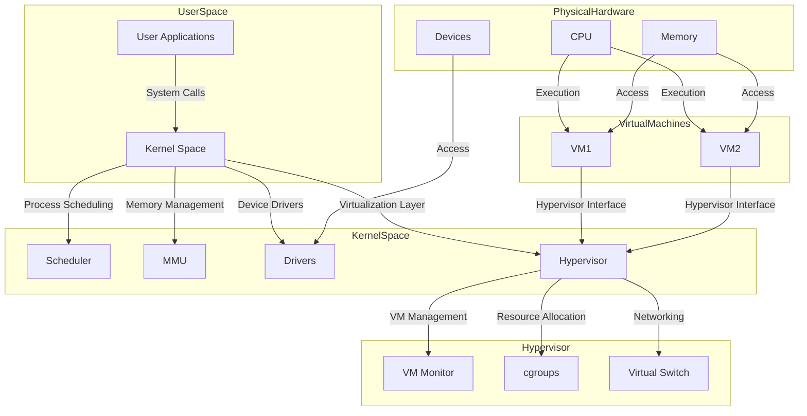

# Lesson 1: Foundations & Kernel/System Invariants

## Curriculum Roadmap
This masterclass curriculum on "01 Virtual Machine and ISA" is designed to provide a comprehensive understanding of the foundational principles and invariants that underpin virtual machines and Instruction Set Architectures (ISAs). The curriculum is structured to build a strong theoretical grounding, explore kernel boundaries, and establish non-negotiable system invariants. The modules are as follows:

- **Module 1: Foundations & Kernel/System Invariants**
  - First-Principles Problem Space & Execution Boundaries
  - Fundamental System Guarantees & Non-Negotiable Invariants
  - High-Level Process & Subsystem Architecture

- **Module 2: Virtual Machines & Hypervisors**
  - Virtualization Technologies: Full vs. Para-Virtualization
  - Hypervisor Architecture: Type 1 vs. Type 2
  - Virtual Machine Monitor (VMM) Design Patterns

- **Module 3: Instruction Set Architectures (ISAs)**
  - RISC vs. CISC: Architectural Principles
  - Modern ISA Extensions: AVX, SSE, NEON
  - ISA Evolution: ARM64, x86-64, RISC-V

- **Module 4: eBPF & Extended Berkeley Packet Filter**
  - eBPF Overview: Introduction to Extended Berkeley Packet Filter
  - eBPF Architecture: Program Types, Maps, and Helpers
  - eBPF Use Cases: Security, Networking, and Performance Monitoring

- **Module 5: Advanced Topics & Case Studies**
  - Kernel Exploitation & Security
  - eBPF Security Considerations
  - Case Studies: Real-World Applications of eBPF

## 1. First-Principles Problem Space & Execution Boundaries

The execution environment of a computer system is fundamentally divided into two distinct spaces: user space and kernel space. This distinction is crucial for understanding the boundaries and responsibilities of each domain, as well as the mechanisms that facilitate communication between them.

### User Space vs. Kernel Space

User space is the domain in which user applications execute. It is isolated from the kernel to ensure that application-level errors do not compromise the stability and security of the operating system. Applications in user space operate under strict constraints and have limited access to system resources. This isolation is enforced through hardware mechanisms such as memory protection units (MPUs) and memory management units (MMUs).

Kernel space, on the other hand, is the privileged domain where the operating system kernel and critical system services reside. The kernel has unrestricted access to system resources, including hardware devices, memory, and CPU. This privilege is necessary for the kernel to perform essential tasks such as process scheduling, memory management, and device driver operations.

### System Call Overheads

The boundary between user space and kernel space is traversed through system calls, which are the primary mechanism for user applications to request services from the kernel. System calls are designed to be efficient, but they do introduce some overhead due to the context switch required to transition between user and kernel modes. This context switch involves saving the current state of the user application, switching to kernel mode, executing the requested kernel service, and then restoring the user application's state.

The overhead of system calls can be mitigated through various optimizations, such as using fast system call interfaces (e.g., `sysenter`/`sysexit` on x86 architectures) and minimizing the number of system calls required by applications. Additionally, some modern kernels employ techniques such as direct system calls and zero-copy data transfers to further reduce the performance impact of system calls.

### Distributed Consensus Boundaries

In distributed systems, the concept of execution boundaries extends beyond the local machine to encompass the network and the coordination of multiple nodes. Distributed consensus is a critical aspect of distributed systems, ensuring that all nodes agree on a shared state despite potential failures and network partitions.

Consensus algorithms, such as Raft, Paxos, and Byzantine Fault Tolerance (BFT), are designed to achieve agreement among nodes in a fault-tolerant manner. Raft, for instance, is a widely used consensus algorithm that relies on a leader-follower architecture. The Raft algorithm ensures that a majority of nodes (a quorum) agree on the state of the system, with the quorum size defined as \( Q = \lfloor N/2 \rfloor + 1 \), where \( N \) is the total number of nodes in the cluster. This quorum-based approach ensures that the system remains consistent and available even in the presence of node failures.

## 2. Fundamental System Guarantees & Non-Negotiable Invariants

The stability and security of a computer system depend on a set of fundamental guarantees and non-negotiable invariants that must be maintained by the operating system and its components. These guarantees and invariants ensure that the system behaves predictably and securely, even in the face of unexpected conditions.

### Safety Constraints

Safety constraints are critical in ensuring that the system does not enter an unsafe state. In the context of virtual machines and ISAs, safety constraints include:

- **Memory Safety**: Ensuring that applications do not access memory outside their allocated regions. This is achieved through memory protection mechanisms such as page tables and segmentation.
- **Instruction Safety**: Ensuring that instructions are executed in a controlled and predictable manner. This is achieved through the design and implementation of the ISA, which defines the set of valid instructions and their behavior.
- **Resource Safety**: Ensuring that system resources are allocated and managed efficiently and fairly. This is achieved through resource management mechanisms such as cgroups and namespaces in Linux.

### Memory Isolation

Memory isolation is a fundamental aspect of system security and stability. It ensures that applications do not interfere with each other's memory spaces, preventing unauthorized access and data corruption. Memory isolation is achieved through hardware mechanisms such as page tables and segmentation, which map virtual memory addresses to physical memory addresses.

In a virtualized environment, memory isolation is extended to include isolation between virtual machines. Each virtual machine is assigned its own virtual address space, which is isolated from the address spaces of other virtual machines. This isolation is enforced through hardware-assisted virtualization technologies such as Intel VT-x and AMD-V.

### Consistency Guarantees

Consistency guarantees ensure that the system maintains a consistent state across all nodes and components. In distributed systems, consistency is achieved through consensus algorithms such as Raft, which ensure that all nodes agree on the state of the system. In a virtualized environment, consistency guarantees are essential for ensuring that virtual machines and their resources are managed consistently across the hypervisor.

## 3. High-Level Process & Subsystem Architecture

To provide a clear understanding of the high-level architecture of a virtual machine and its subsystems, we can use a Mermaid diagram to represent the execution flow and control plane topology. The diagram below illustrates the key components and their interactions in a virtualized environment.

### Execution Flow

The execution flow in a virtualized environment begins with user applications making system calls to request services from the kernel. The kernel handles these system calls by invoking the appropriate subsystems, such as the scheduler, memory management unit (MMU), and device drivers. The kernel also interacts with the virtualization layer, which manages the execution of virtual machines.

The hypervisor acts as the virtualization layer, providing a virtualized environment for the execution of virtual machines. The hypervisor manages the allocation of system resources, such as CPU time and memory, to the virtual machines. It also provides networking services through a virtual switch, allowing virtual machines to communicate with each other and with the external network.

### Control Plane Topology

The control plane topology in a virtualized environment is responsible for managing the configuration and operation of the virtual machines and their resources. The control plane includes the hypervisor, which manages the execution of virtual machines, and the kernel, which provides the necessary services to user applications.

The hypervisor interacts with the kernel through system calls, allowing the kernel to request services such as process scheduling and memory management. The hypervisor also interacts with the physical hardware, managing the allocation of resources to the virtual machines and handling device access.

In summary, this lesson provides a foundational understanding of the principles and invariants that underpin virtual machines and ISAs. By exploring the boundaries between user space and kernel space, the guarantees and invariants that ensure system stability and security, and the high-level architecture of a virtualized environment, we establish a strong theoretical grounding for the subsequent modules in this masterclass curriculum.
