# Lesson 2: Static Analysis Mechanisms

## 1. First-Principles Intuition & Invariants

In the realm of kernel programming, ensuring the safety and correctness of code is paramount. The Linux kernel, being the bedrock upon which countless systems and applications rely, demands rigorous verification mechanisms to prevent vulnerabilities and ensure stability. One such mechanism is the eBPF (Extended Berkeley Packet Filter) verifier, a static analysis tool embedded within the Linux kernel that scrutinizes eBPF programs before they are executed. This lesson delves into the foundational principles and invariants that underpin the static analysis techniques employed by the eBPF verifier.

At its core, the eBPF verifier operates as a formal method for proving the safety of eBPF programs. It ensures that these programs do not exhibit behaviors that could lead to system crashes, security breaches, or other undesirable outcomes. The verifier achieves this by performing a series of checks on the eBPF bytecode, ensuring that it adheres to a set of predefined safety invariants. These invariants are rooted in the principles of control flow analysis, data flow analysis, and memory safety, which are essential for maintaining the integrity of the kernel.

Control flow analysis is crucial for ensuring that eBPF programs do not enter infinite loops or execute undefined instructions. The verifier constructs a control flow graph (CFG) of the eBPF program, representing all possible execution paths. By analyzing this graph, the verifier can identify loops and ensure that they are bounded, preventing infinite execution. Additionally, the verifier checks for undefined instructions, ensuring that only valid eBPF opcodes are used.

Data flow analysis is another critical component of the verifier's static analysis. It focuses on the flow of data through the program, ensuring that all variables are properly initialized before use and that data is not accessed out of bounds. The verifier performs liveness analysis to determine which variables are live at each point in the program, ensuring that uninitialized variables do not lead to undefined behavior. It also performs bounds checking to prevent out-of-bounds memory access, a common source of security vulnerabilities.

Memory safety is a fundamental invariant that the eBPF verifier enforces. eBPF programs operate in a restricted environment, with limited access to kernel memory. The verifier ensures that eBPF programs do not access memory outside of their allocated regions, preventing buffer overflows and other memory corruption issues. This is achieved through a combination of static analysis techniques, including pointer analysis and memory region tracking.

The eBPF verifier also enforces a set of security invariants that prevent eBPF programs from performing actions that could compromise the system's security. For example, it ensures that eBPF programs do not modify kernel data structures or execute privileged operations. These security invariants are critical for maintaining the integrity and security of the kernel, even when executing untrusted eBPF programs.

In summary, the eBPF verifier is a sophisticated static analysis tool that ensures the safety and correctness of eBPF programs. It operates on a set of first-principles invariants, including control flow analysis, data flow analysis, and memory safety, to prevent a wide range of vulnerabilities and ensure the stability of the kernel.

## 2. Core Architecture & Mechanics

The eBPF verifier is a complex system that employs a variety of data structures and algorithms to perform its static analysis. At a high level, the verifier operates in several stages, each of which performs a specific set of checks on the eBPF bytecode. This section provides a detailed dissection of the internal architecture and mechanics of the eBPF verifier.

### Control Flow Analysis

The first stage of the eBPF verifier is control flow analysis, which constructs a control flow graph (CFG) of the eBPF program. The CFG is a directed graph where each node represents a basic block of instructions, and each edge represents a control flow transition between blocks. The verifier uses the CFG to perform several checks, including loop detection and undefined instruction verification.

To construct the CFG, the verifier iterates over the eBPF bytecode, identifying basic blocks and control flow transitions. Each basic block is a sequence of instructions that executes atomically, without any control flow transitions within the block. Control flow transitions occur when an instruction changes the flow of execution, such as a jump or conditional branch.

Once the CFG is constructed, the verifier performs loop detection to ensure that all loops are bounded. The verifier uses a depth-first search (DFS) algorithm to traverse the CFG, identifying all cycles. For each cycle, the verifier checks that the loop is bounded, meaning that it has a finite number of iterations. This is achieved by ensuring that the loop has a well-defined exit condition that is guaranteed to be met after a finite number of iterations.

The verifier also checks for undefined instructions, ensuring that only valid eBPF opcodes are used. The verifier maintains a list of valid opcodes and checks each instruction in the CFG against this list. If an undefined instruction is detected, the verifier rejects the program and returns an error.

### Data Flow Analysis

The second stage of the eBPF verifier is data flow analysis, which focuses on the flow of data through the program. The verifier performs several checks, including liveness analysis and bounds checking, to ensure that all variables are properly initialized before use and that data is not accessed out of bounds.

Liveness analysis is used to determine which variables are live at each point in the program. A variable is considered live if it is used in a subsequent instruction. The verifier performs liveness analysis by traversing the CFG in reverse, starting from the exit points of the program and working backward to the entry points. For each instruction, the verifier determines which variables are live and updates the liveness information accordingly.

Bounds checking is used to prevent out-of-bounds memory access. The verifier performs bounds checking by analyzing the memory access instructions in the CFG. For each memory access instruction, the verifier checks that the access is within the bounds of the allocated memory region. This is achieved by maintaining a set of memory region constraints and checking each memory access instruction against these constraints.

### Memory Safety

The third stage of the eBPF verifier is memory safety analysis, which ensures that eBPF programs do not access memory outside of their allocated regions. The verifier performs several checks, including pointer analysis and memory region tracking, to enforce memory safety.

Pointer analysis is used to track the flow of pointers through the program. The verifier maintains a set of pointer constraints, which specify the valid memory regions that each pointer can point to. For each pointer instruction, the verifier updates the pointer constraints based on the instruction's semantics. For example, if a pointer is assigned the address of a memory region, the verifier updates the pointer constraint to reflect this assignment.

Memory region tracking is used to track the allocation and deallocation of memory regions. The verifier maintains a set of memory region constraints, which specify the valid memory regions that can be accessed by the program. For each memory allocation instruction, the verifier adds a new memory region constraint to the set. For each memory deallocation instruction, the verifier removes the corresponding memory region constraint from the set.

The verifier also performs several checks to ensure that eBPF programs do not access memory outside of their allocated regions. For example, the verifier checks that all memory access instructions are within the bounds of the allocated memory regions. The verifier also checks that all pointer instructions are consistent with the pointer constraints, ensuring that pointers do not point to invalid memory regions.

### Security Invariants

The final stage of the eBPF verifier is security invariant analysis, which enforces a set of security invariants that prevent eBPF programs from performing actions that could compromise the system's security. The verifier performs several checks, including privilege checking and data integrity checking, to enforce these security invariants.

Privilege checking is used to ensure that eBPF programs do not perform privileged operations. The verifier maintains a set of privilege constraints, which specify the operations that eBPF programs are allowed to perform. For each privileged instruction, the verifier checks that the instruction is consistent with the privilege constraints. If a privileged instruction is detected, the verifier rejects the program and returns an error.

Data integrity checking is used to ensure that eBPF programs do not modify kernel data structures. The verifier maintains a set of data integrity constraints, which specify the data structures that eBPF programs are allowed to modify. For each data modification instruction, the verifier checks that the instruction is consistent with the data integrity constraints. If a data modification instruction is detected, the verifier rejects the program and returns an error.

To illustrate the internal architecture and mechanics of the eBPF verifier, consider the following diagram:

```mermaid
graph TD;
    A[Control Flow Analysis] --> B[CFG Construction];
    A --> C[Loop Detection];
    A --> D[Undefined Instruction Verification];
    B --> E[Basic Block Identification];
    B --> F[Control Flow Transition Identification];
    C --> G[DFS Algorithm];
    C --> H[Loop Boundedness Check];
    D --> I[Opcode List];
    D --> J[Undefined Instruction Check];
    K[Data Flow Analysis] --> L[Liveness Analysis];
    K --> M[Bounds Checking];
    L --> N[Reverse CFG Traversal];
    L --> O[Live Variable Determination];
    M --> P[Memory Access Instruction Analysis];
    M --> Q[Memory Region Constraint Checking];
    R[Memory Safety Analysis] --> S[Pointer Analysis];
    R --> T[Memory Region Tracking];
    S --> U[Pointer Constraint Maintenance];
    S --> V[Pointer Instruction Analysis];
    T --> W[Memory Region Constraint Maintenance];
    T --> X[Memory Allocation Instruction Analysis];
    T --> Y[Memory Deallocation Instruction Analysis];
    T --> Z[Memory Access Instruction Analysis];
    T --> AA[Memory Region Constraint Checking];
    AB[Security Invariant Analysis] --> AC[Privilege Checking];
    AB --> AD[Data Integrity Checking];
    AC --> AE[Privilege Constraint Maintenance];
    AC --> AF[Privileged Instruction Analysis];
    AD --> AG[Data Integrity Constraint Maintenance];
    AD --> AH[Data Modification Instruction Analysis];
```

This diagram illustrates the various stages and checks performed by the eBPF verifier. The control flow analysis stage constructs the CFG and performs loop detection and undefined instruction verification. The data flow analysis stage performs liveness analysis and bounds checking. The memory safety analysis stage performs pointer analysis and memory region tracking. The security invariant analysis stage performs privilege checking and data integrity checking.

## 3. High-Performance Optimization & Failure Modes

The eBPF verifier is designed to perform static analysis on eBPF programs efficiently, even for large and complex programs. To achieve this, the verifier employs several high-performance optimizations and failure modes to ensure that it operates efficiently and reliably.

### Concurrency

The eBPF verifier is designed to operate in a concurrent environment, where multiple eBPF programs may be verified simultaneously. To achieve this, the verifier uses a lock-free data structure to manage the CFG and other internal data structures. This lock-free data structure allows multiple threads to access and modify the data structures concurrently, without the need for locks or other synchronization mechanisms. This concurrency model ensures that the verifier can handle a large number of eBPF programs simultaneously, without introducing significant performance overhead.

### Resource Scaling

The eBPF verifier is designed to scale efficiently with the size and complexity of eBPF programs. To achieve this, the verifier uses a variety of techniques to optimize its resource usage. For example, the verifier uses a compact representation for the CFG and other internal data structures, reducing the memory footprint of the verifier. The verifier also uses a variety of algorithms to optimize the performance of its static analysis checks, such as the use of a static DAG verifier to prune the search space of the CFG.

### Boundary Edge Cases

The eBPF verifier is designed to handle a wide range of boundary edge cases, ensuring that it operates correctly even for complex and unusual eBPF programs. For example, the verifier is designed to handle eBPF programs with complex control flow, such as nested loops and conditional branches. The verifier is also designed to handle eBPF programs with complex data flow, such as programs that perform complex memory access patterns. The verifier is also designed to handle eBPF programs with complex memory safety requirements, such as programs that perform complex pointer manipulations.

### Failure Mitigations

The eBPF verifier is designed to handle a wide range of failure modes, ensuring that it operates reliably even in the presence of errors. For example, the verifier is designed to handle errors in the eBPF bytecode, such as undefined instructions and invalid memory access patterns. The verifier is also designed to handle errors in the internal data structures, such as invalid CFGs and invalid memory region constraints. The verifier is also designed to handle errors in the static analysis checks, such as false positives and false negatives.

In summary, the eBPF verifier is a sophisticated static analysis tool that ensures the safety and correctness of eBPF programs. It operates on a set of first-principles invariants, including control flow analysis, data flow analysis, and memory safety, to prevent a wide range of vulnerabilities and ensure the stability of the kernel. The verifier is designed to operate efficiently and reliably, even for large and complex eBPF programs, through the use of high-performance optimizations and failure mitigations.
