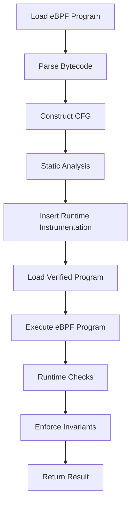

# Lesson 5: Integration with eBPF

## 1. First-Principles Intuition & Invariants

In the realm of modern systems programming and kernel development, the Extended Berkeley Packet Filter (eBPF) has emerged as a powerful tool for extending the capabilities of the Linux kernel without the need for traditional kernel modules. eBPF allows for the execution of user-defined bytecode at various points within the kernel, enabling a wide range of applications from network traffic analysis to security monitoring. However, the integration of eBPF with the kernel verifier is a critical aspect that ensures the safety and security of these extensions. The kernel verifier acts as a gatekeeper, ensuring that eBPF programs do not introduce vulnerabilities or instability into the kernel. This lesson delves into the intricate relationship between the kernel verifier and eBPF, exploring how the verifier integrates with eBPF to extend its capabilities and provide additional security features.

At the heart of the kernel verifier's role is the need to maintain the integrity and security of the kernel while allowing for the dynamic insertion of user-defined code. The verifier operates by analyzing eBPF programs at load time, ensuring that they adhere to a set of strict invariants that prevent malicious or erroneous behavior. These invariants include constraints on memory access, loop bounds, and function calls, among others. The verifier's ability to enforce these invariants is grounded in a deep understanding of the eBPF instruction set architecture (ISA) and the execution environment within the kernel.

The eBPF ISA is designed to be simple yet powerful, consisting of a set of 64-bit RISC instructions that operate on a fixed set of 11 registers (`R0`–`R10`). The verifier must ensure that eBPF programs do not exceed the boundaries of these registers, do not access invalid memory, and do not introduce infinite loops or other forms of non-terminating behavior. To achieve this, the verifier employs a combination of static analysis techniques and runtime checks. The static analysis phase involves constructing a control flow graph (CFG) of the eBPF program and performing a series of checks to ensure that the program adheres to the invariants. The runtime checks, on the other hand, involve inserting additional instructions into the eBPF program to enforce certain constraints, such as bounds checks on memory accesses.

The integration of the kernel verifier with eBPF is not merely a matter of enforcing invariants; it also plays a crucial role in extending the capabilities of eBPF itself. By ensuring that eBPF programs are safe and secure, the verifier enables the deployment of a wide range of applications that would otherwise be too risky to run in the kernel. For example, eBPF can be used to implement custom security policies, monitor network traffic, and perform real-time analytics on system events. The verifier's ability to enforce strict invariants ensures that these applications can be deployed with confidence, knowing that they will not introduce vulnerabilities or instability into the kernel.

## 2. Core Architecture & Mechanics

The core architecture of the kernel verifier is deeply intertwined with the eBPF ISA and the execution environment within the kernel. At a high level, the verifier operates in two main phases: the static analysis phase and the runtime instrumentation phase. The static analysis phase involves constructing a control flow graph (CFG) of the eBPF program and performing a series of checks to ensure that the program adheres to the invariants. The runtime instrumentation phase involves inserting additional instructions into the eBPF program to enforce certain constraints, such as bounds checks on memory accesses.

The static analysis phase begins by parsing the eBPF bytecode and constructing a CFG of the program. The CFG is a directed graph where each node represents a basic block of instructions, and each edge represents a control flow transition between blocks. The verifier then performs a series of checks on the CFG to ensure that the program adheres to the invariants. These checks include verifying that all memory accesses are within bounds, that all loops are bounded, and that all function calls are valid. The verifier also performs a series of checks to ensure that the program does not introduce any undefined behavior, such as division by zero or invalid pointer dereferences.

The runtime instrumentation phase involves inserting additional instructions into the eBPF program to enforce certain constraints. For example, the verifier may insert bounds checks on memory accesses to ensure that the program does not access invalid memory. The verifier may also insert additional instructions to enforce certain function call constraints, such as ensuring that the program does not call invalid functions or pass invalid arguments to functions. The runtime instrumentation phase is critical for ensuring that the program adheres to the invariants at runtime, even if the static analysis phase did not catch all potential issues.

To illustrate the integration of the kernel verifier with eBPF, consider the following example. Suppose we have an eBPF program that performs a memory copy operation. The eBPF program uses the `bpf_probe_read` function to read data from a user-space buffer into a kernel-space buffer. The kernel verifier must ensure that the memory copy operation does not access invalid memory, which could lead to a security vulnerability. To achieve this, the verifier performs a series of checks on the `bpf_probe_read` function call. The verifier checks that the source buffer is within bounds, that the destination buffer is within bounds, and that the number of bytes to copy does not exceed the bounds of either buffer. If any of these checks fail, the verifier rejects the eBPF program and prevents it from being loaded into the kernel.

The following diagram illustrates the core architecture of the kernel verifier and its integration with eBPF:

In this diagram, the eBPF program is loaded into the kernel and parsed into a CFG. The static analysis phase involves verifying that the program adheres to the invariants, and the runtime instrumentation phase involves inserting additional instructions to enforce certain constraints. The verified eBPF program is then loaded into the kernel and executed, with runtime checks ensuring that the program adheres to the invariants at runtime.

## 3. High-Performance Optimization & Failure Modes

The integration of the kernel verifier with eBPF presents a number of challenges in terms of high-performance optimization and failure modes. One of the key challenges is ensuring that the static analysis phase does not introduce significant overhead, which could degrade the performance of the kernel. To address this challenge, the kernel verifier employs a number of optimizations to minimize the overhead of static analysis. For example, the verifier uses a technique called "state pruning" to eliminate redundant states in the CFG, which reduces the number of checks that need to be performed. The verifier also uses a technique called "bounded loops" to ensure that loops are bounded, which reduces the number of iterations that need to be checked.

Another challenge is ensuring that the runtime instrumentation phase does not introduce significant overhead, which could degrade the performance of the kernel. To address this challenge, the kernel verifier employs a number of optimizations to minimize the overhead of runtime instrumentation. For example, the verifier uses a technique called "lockless BPF RingBuf" to perform efficient memory operations, which reduces the overhead of memory accesses. The verifier also uses a technique called "CO-RE (Compile Once – Run Everywhere) BTF relocations" to perform efficient function calls, which reduces the overhead of function calls.

Despite these optimizations, the integration of the kernel verifier with eBPF is not without failure modes. One potential failure mode is that the static analysis phase may fail to catch certain issues, which could lead to security vulnerabilities. To mitigate this risk, the kernel verifier employs a number of techniques to ensure that the static analysis phase is as thorough as possible. For example, the verifier uses a technique called "static DAG verifier state pruning" to eliminate redundant states in the CFG, which reduces the number of checks that need to be performed. The verifier also uses a technique called "multi-version concurrency control (MVCC) monotonic revisions" to ensure that the CFG is consistent, which reduces the risk of race conditions.

Another potential failure mode is that the runtime instrumentation phase may introduce certain issues, which could lead to performance degradation. To mitigate this risk, the kernel verifier employs a number of techniques to ensure that the runtime instrumentation phase is as efficient as possible. For example, the verifier uses a technique called "lockless BPF RingBuf" to perform efficient memory operations, which reduces the overhead of memory accesses. The verifier also uses a technique called "CO-RE (Compile Once – Run Everywhere) BTF relocations" to perform efficient function calls, which reduces the overhead of function calls.

In conclusion, the integration of the kernel verifier with eBPF is a critical aspect of ensuring the safety and security of eBPF programs. The kernel verifier plays a crucial role in enforcing strict invariants that prevent malicious or erroneous behavior, while also extending the capabilities of eBPF itself. By understanding the core architecture and mechanics of the kernel verifier, as well as the high-performance optimizations and failure modes, senior software engineers, systems programmers, and domain architects can leverage eBPF to build powerful and secure applications within the Linux kernel.
