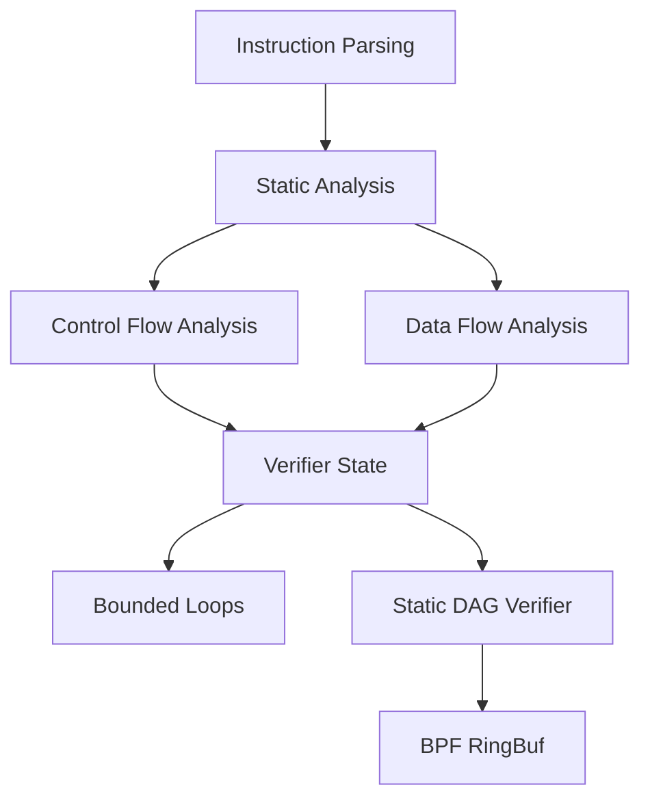

# Lesson 6: Advanced Topics and Future Directions

## 1. First-Principles Intuition & Invariants

The eBPF (Extended Berkeley Packet Filter) verifier is a cornerstone of modern kernel security and performance optimization, enabling the safe execution of user-defined programs within the kernel. At its core, the verifier operates as a static analysis tool that ensures the safety and correctness of eBPF programs before they are executed. This safety is paramount, as eBPF programs run with kernel privileges and can potentially disrupt system stability or security if not properly constrained.

The verifier's primary responsibility is to prevent memory corruption and ensure that eBPF programs do not execute arbitrary instructions that could lead to undefined behavior. This is achieved through a series of rigorous checks that analyze the program's control flow and data flow. The verifier operates under several invariants and principles:

1. **Safety and Correctness**: The verifier must guarantee that eBPF programs do not access invalid memory regions or execute instructions that could lead to system crashes or security vulnerabilities.
2. **Performance**: The verification process must be efficient enough to not introduce significant overhead, as eBPF programs are often used in performance-critical contexts such as network packet processing and system tracing.
3. **Extensibility**: The verifier should be flexible enough to accommodate new eBPF instructions and features without requiring a complete overhaul of the verification logic.

These principles are grounded in the mathematical and system invariants that govern the behavior of eBPF programs. The verifier must ensure that all memory accesses are bounds-checked, that control flow is well-defined, and that the program does not exceed its allocated resources. This is achieved through a combination of static analysis techniques, such as data flow analysis and control flow analysis, and dynamic checks that are performed at runtime.

## 2. Core Architecture & Mechanics

The eBPF verifier is a complex system that operates on a series of intermediate representations (IR) of the eBPF program. The verifier's architecture can be dissected into several key components:

1. **Instruction Parsing**: The verifier begins by parsing the eBPF instructions into an internal representation that can be analyzed. This involves decoding the instructions and extracting their operands and operation codes.
2. **Static Analysis**: The core of the verifier is the static analysis engine, which performs a series of checks on the program's control flow and data flow. This includes:
   - **Control Flow Analysis**: The verifier constructs a control flow graph (CFG) of the program, which represents the possible execution paths of the program. The CFG is used to identify loops and ensure that they are bounded.
   - **Data Flow Analysis**: The verifier performs data flow analysis to track the values of registers and memory locations throughout the program. This is used to ensure that all memory accesses are bounds-checked and that the program does not perform invalid operations.
3. **Verifier State**: The verifier maintains a state that represents the current state of the program being verified. This state includes information about the values of registers, the current instruction pointer, and the current control flow path. The verifier state is updated as the program is analyzed.
4. **Bounded Loops**: One of the key challenges in eBPF verification is ensuring that loops are bounded. The verifier uses a technique called state pruning to ensure that loops are bounded. This involves identifying loops in the CFG and ensuring that they do not exceed a certain number of iterations.
5. **Static DAG Verifier**: The verifier uses a Directed Acyclic Graph (DAG) to represent the program's control flow. The DAG is used to perform static analysis on the program, ensuring that all control paths are valid and that the program does not contain any cycles.
6. **BPF RingBuf**: The BPF RingBuf is a lockless ring buffer that is used to communicate between eBPF programs and user-space applications. The verifier ensures that the RingBuf is used safely, preventing race conditions and other concurrency issues.

The following Mermaid diagram illustrates the core architecture of the eBPF verifier:

## 3. High-Performance Optimization & Failure Modes

The eBPF verifier is designed to be efficient, but there are several challenges that can impact its performance. One of the key challenges is ensuring that the verification process is fast enough to not introduce significant overhead. This is particularly important in performance-critical contexts such as network packet processing and system tracing.

To address these challenges, the eBPF verifier employs several optimization techniques:

1. **State Pruning**: The verifier uses state pruning to reduce the number of states that need to be analyzed. This involves identifying loops in the CFG and ensuring that they are bounded. By pruning the state space, the verifier can reduce the number of states that need to be analyzed, improving performance.
2. **Parallelization**: The verifier can be parallelized to improve performance. This involves dividing the verification process into smaller tasks that can be executed concurrently. By parallelizing the verification process, the verifier can reduce the overall execution time.
3. **Caching**: The verifier can cache the results of previous verification passes to improve performance. This involves storing the results of previous verification passes and reusing them when verifying similar programs. By caching the results of previous verification passes, the verifier can reduce the number of verification passes that need to be performed, improving performance.

Despite these optimizations, the eBPF verifier is not immune to failure. There are several failure modes that can occur, including:

1. **False Positives**: The verifier may incorrectly reject a valid eBPF program. This can occur if the verifier's static analysis is too conservative, leading to false positives. False positives can be mitigated by refining the verification logic to be more precise.
2. **False Negatives**: The verifier may incorrectly accept an invalid eBPF program. This can occur if the verifier's static analysis is too permissive, leading to false negatives. False negatives can be mitigated by refining the verification logic to be more thorough.
3. **Performance Degradation**: The verification process may become too slow, leading to performance degradation. This can occur if the verification logic is too complex or if the verification process is not optimized. Performance degradation can be mitigated by optimizing the verification logic and parallelizing the verification process.

## Future Research Directions and Enhancements

The eBPF verifier is a rapidly evolving system, and there are several areas for future research and enhancement:

1. **Extensibility**: The verifier should be flexible enough to accommodate new eBPF instructions and features without requiring a complete overhaul of the verification logic. This involves designing the verifier to be modular and extensible, allowing new instructions and features to be added with minimal impact on the verification logic.
2. **Performance**: The verification process should be optimized to improve performance. This involves refining the verification logic to be more efficient and parallelizing the verification process to reduce the overall execution time.
3. **Security**: The verifier should be designed to prevent security vulnerabilities. This involves refining the verification logic to be more thorough and adding new checks to prevent new types of vulnerabilities.
4. **Usability**: The verifier should be designed to be user-friendly. This involves designing the verifier to be more intuitive and providing better error messages and diagnostics to help users understand why a program was rejected.

In conclusion, the eBPF verifier is a complex and powerful system that plays a critical role in ensuring the safety and correctness of eBPF programs. By understanding the verifier's architecture and mechanics, and by exploring future research directions and enhancements, we can continue to improve the verifier and ensure that it remains a reliable and efficient tool for kernel security and performance optimization.
