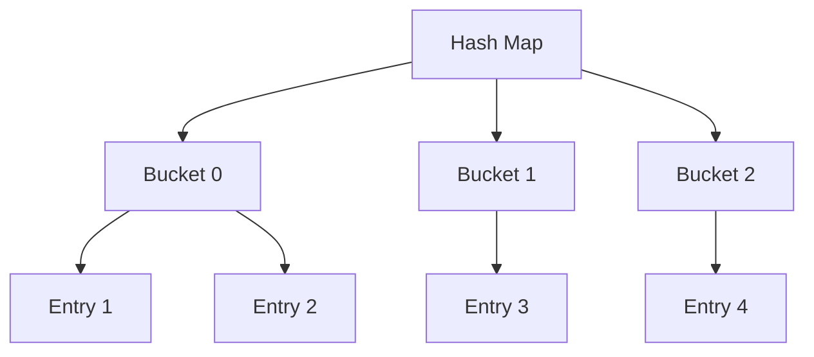
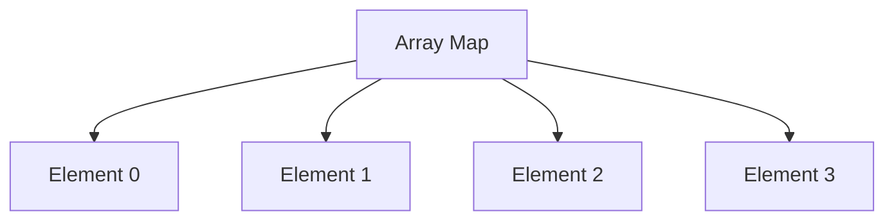
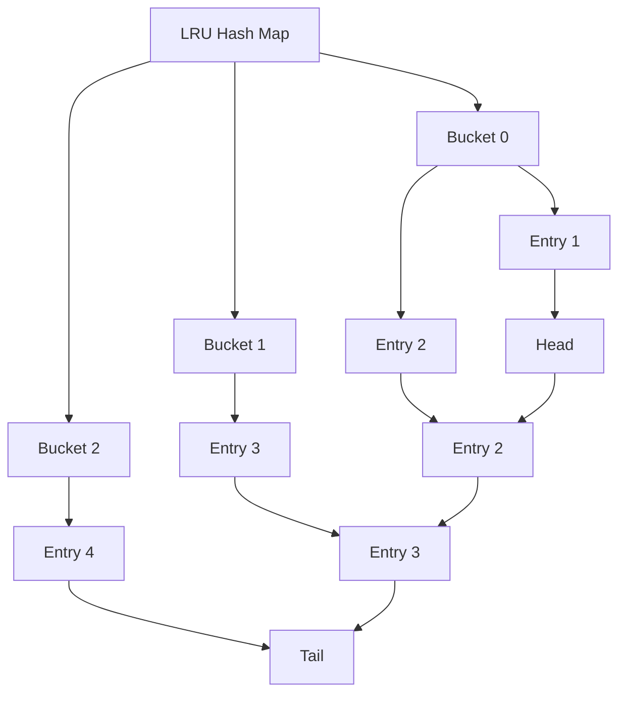

# Lesson 1: Introduction to eBPF Maps

## 1. First-Principles Intuition & Invariants

In the realm of high-performance computing and systems programming, the need for efficient data structures that can be accessed and modified with minimal overhead is paramount. Enter eBPF maps, a cornerstone of extended Berkeley Packet Filter (eBPF) technology. eBPF maps are kernel-resident data structures that provide a mechanism for eBPF programs to store and retrieve data, enabling them to perform complex operations with low latency and high throughput. These maps are not merely data containers; they are integral to the architecture of eBPF, serving as the backbone for stateful operations, event-driven processing, and communication between user-space and kernel-space.

The problem space that eBPF maps address is multifaceted. In traditional kernel programming, maintaining state across function calls or between different kernel modules is challenging due to the constraints of the kernel environment. eBPF maps offer a solution by providing a persistent, shared memory space that can be accessed by eBPF programs. This shared memory space is crucial for tasks such as tracking network connections, monitoring system performance, and implementing security policies. The invariants that govern eBPF maps include their ability to support concurrent access, their scalability with respect to the number of entries, and their resilience to failure modes such as memory exhaustion or race conditions.

At the heart of eBPF maps lies the concept of a key-value store, where each map is essentially a collection of key-value pairs. The keys are used to index into the map, and the values are the data stored at those keys. This key-value abstraction is powerful because it allows eBPF programs to perform operations such as lookups, updates, and deletions with predictable performance characteristics. The choice of key-value pairs as the fundamental data structure is not arbitrary; it is rooted in the need for efficient data retrieval and modification, which are critical for high-performance applications.

## 2. Core Architecture & Mechanics

The architecture of eBPF maps is designed to be both flexible and efficient. There are several types of eBPF maps, each optimized for different use cases. The most common types include hash maps, array maps, and LRU (Least Recently Used) hash maps. Each type of map has its own internal data structures and algorithms that enable efficient operations.

### Hash Maps

Hash maps are the most versatile type of eBPF map. They use a hash table to store key-value pairs, allowing for average-case constant-time complexity for lookups, updates, and deletions. The internal structure of a hash map consists of an array of buckets, where each bucket can contain multiple entries due to hash collisions. To resolve collisions, eBPF hash maps use chaining, where each bucket points to a linked list of entries that share the same hash value.

In the diagram above, the hash map is divided into three buckets. Bucket 0 contains two entries, while buckets 1 and 2 each contain one entry. The hash function determines which bucket a key-value pair is stored in, and the chaining mechanism resolves any collisions that occur.

### Array Maps

Array maps are simpler than hash maps but offer faster access times for sequential data. They are implemented as a fixed-size array, where the keys are indices into the array. This means that lookups, updates, and deletions can be performed in constant time, as the key directly corresponds to the index of the array element.

In the diagram above, the array map is divided into four elements, each indexed by a key. The keys are integers that correspond to the indices of the array elements. This allows for extremely fast access times, as the key directly maps to the element.

### LRU Hash Maps

LRU hash maps are a variation of hash maps that incorporate a least recently used eviction policy. They are useful for scenarios where the number of entries is limited, and it is necessary to evict the least recently used entries to make room for new ones. The internal structure of an LRU hash map consists of a hash table and a doubly linked list that maintains the order of entry usage. When a new entry is added, it is inserted at the head of the list. When an entry is accessed, it is moved to the head of the list. When the map reaches its capacity, the entry at the tail of the list (the least recently used entry) is evicted.

In the diagram above, the LRU hash map is divided into three buckets, and the doubly linked list maintains the order of entry usage. The head of the list points to the most recently used entry, while the tail points to the least recently used entry. When a new entry is added, it is inserted at the head of the list. When an entry is accessed, it is moved to the head of the list. When the map reaches its capacity, the entry at the tail of the list is evicted.

## 3. High-Performance Optimization & Failure Modes

The performance of eBPF maps is critical for their effectiveness in high-performance computing and systems programming. Several optimizations are employed to ensure that eBPF maps can handle large volumes of data with minimal overhead.

### Concurrency

Concurrency is a key challenge in the design of eBPF maps, as they must support concurrent access from multiple eBPF programs. To address this, eBPF maps use lockless data structures and atomic operations. For example, hash maps use lock-free chaining to resolve hash collisions, and array maps use atomic operations to update elements. These optimizations ensure that eBPF maps can handle concurrent access without introducing significant performance bottlenecks.

### Resource Scaling

The scalability of eBPF maps is another critical factor in their performance. To ensure that eBPF maps can scale with the number of entries, they are designed to be memory-efficient. For example, hash maps use a compact representation for keys and values, and array maps use a fixed-size array to store elements. Additionally, eBPF maps can be resized dynamically, allowing them to adapt to changing workloads.

### Boundary Edge Cases

Despite their optimizations, eBPF maps are not immune to failure modes. One common failure mode is memory exhaustion, which can occur when the map reaches its capacity and cannot allocate additional memory. To mitigate this, eBPF maps use a variety of techniques, such as pre-allocating memory and using a garbage collector to reclaim unused memory. Another failure mode is race conditions, which can occur when multiple eBPF programs access the map concurrently. To mitigate this, eBPF maps use lockless data structures and atomic operations to ensure that concurrent access is safe.

In conclusion, eBPF maps are a fundamental component of the eBPF technology stack, providing a mechanism for eBPF programs to store and retrieve data with minimal overhead. By understanding the core architecture and mechanics of eBPF maps, as well as the optimizations and failure modes that govern their performance, senior software engineers, systems programmers, and domain architects can leverage eBPF maps to build high-performance applications that can handle large volumes of data with minimal latency.
