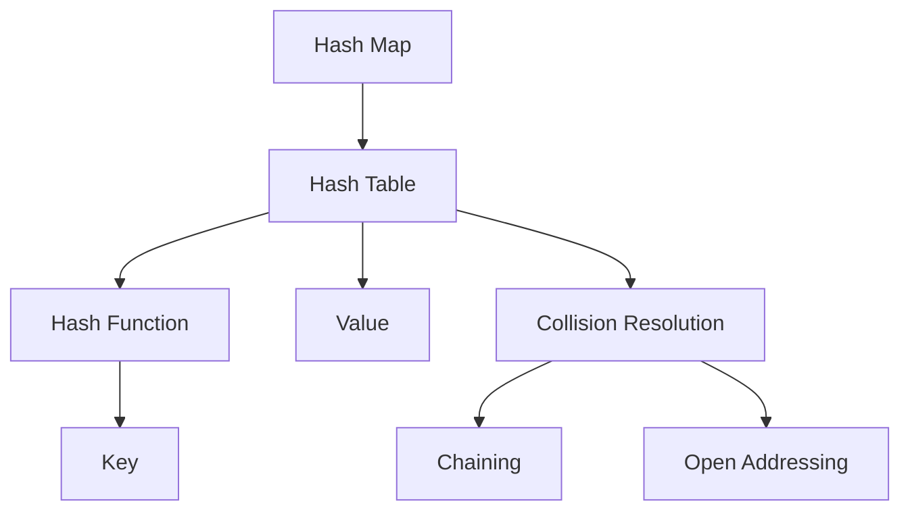
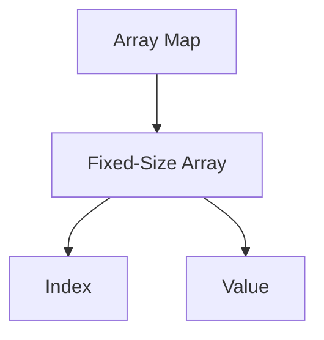
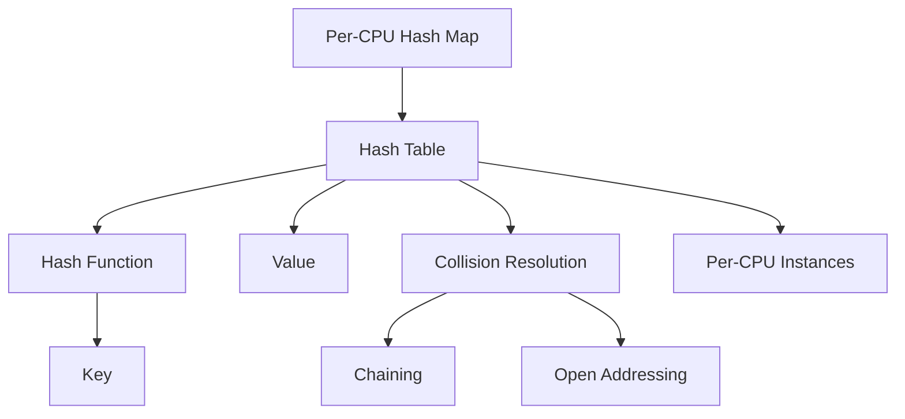
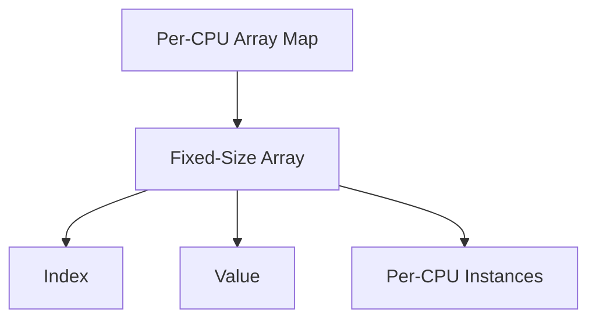

# Lesson 2: Optimizing eBPF Map Performance

## 1. First-Principles Intuition & Invariants

In the realm of high-performance computing, the efficiency of data structures is paramount. eBPF (Extended Berkeley Packet Filter) maps serve as the primary data storage mechanism within the eBPF ecosystem, enabling efficient data exchange between user-space and kernel-space programs. These maps are not mere containers; they are the backbone of eBPF's ability to perform complex operations at high speeds, such as network traffic analysis, security auditing, and performance monitoring. To fully leverage the power of eBPF maps, it is essential to understand their underlying architecture and the principles that govern their performance.

At the heart of eBPF maps lies the need for low-latency access and high throughput. This requirement stems from the fact that eBPF programs often operate in the critical path of system performance, such as in network packet processing or system call tracing. Any delay in map access can have a cascading effect on the overall system performance, leading to increased latency and reduced throughput. Therefore, optimizing eBPF map performance is not just an academic exercise; it is a practical necessity for building high-performance systems.

The performance of eBPF maps is influenced by several factors, including the choice of map type, the size of the map, the concurrency model, and the memory management strategy. Each of these factors plays a critical role in determining the overall performance of an eBPF program. For instance, the choice of map type can significantly impact the speed of lookups and updates. The `hash` map, for example, provides average O(1) lookup times, making it ideal for scenarios where fast access is required. On the other hand, the `array` map offers O(1) access times but requires a fixed size, which can be a limitation in dynamic environments.

Concurrency is another critical factor that affects eBPF map performance. In multi-threaded environments, contention for map access can lead to significant performance degradation. To mitigate this, eBPF maps are designed to support concurrent access with minimal locking. The static DAG verifier, a key component of the eBPF verifier, ensures that map operations are safe and efficient, even in concurrent scenarios. However, the effectiveness of these optimizations depends on the specific use case and the design of the eBPF program.

Memory management is yet another critical aspect of eBPF map performance. eBPF maps are allocated in the kernel's memory space, and their size is limited by the available kernel memory. Efficient memory management is essential to ensure that eBPF maps do not become a bottleneck in the system. Techniques such as pre-allocation, memory pooling, and efficient data structures can help to reduce memory fragmentation and improve the overall performance of eBPF maps.

In summary, the performance of eBPF maps is governed by a complex interplay of architectural design, concurrency models, and memory management strategies. To optimize eBPF map performance, it is essential to understand these underlying principles and apply them effectively in the design and implementation of eBPF programs.

## 2. Core Architecture & Mechanics

The architecture of eBPF maps is designed to provide efficient and scalable data storage for eBPF programs. At a high level, eBPF maps are implemented as hash tables, arrays, or other data structures that are optimized for fast access and low latency. Each map type is designed to address specific use cases, and the choice of map type can significantly impact the performance of an eBPF program.

### Hash Maps

The `hash` map is one of the most commonly used map types in eBPF. It is implemented as a hash table, which provides average O(1) lookup times. The `hash` map is ideal for scenarios where fast access is required, such as network traffic analysis or security auditing. The internal structure of a `hash` map is shown in Figure 1.

**Figure 1: Internal Structure of a Hash Map**

The `hash` map uses a hash function to map keys to indices in the hash table. If two keys hash to the same index, a collision occurs, and the hash map must resolve the collision using a collision resolution strategy. Two common collision resolution strategies are chaining and open addressing. Chaining involves storing multiple values at the same index using a linked list, while open addressing involves finding an alternative index within the hash table.

The `hash` map also supports concurrent access, which is achieved through lockless data structures. The static DAG verifier ensures that map operations are safe and efficient, even in concurrent scenarios. However, the effectiveness of these optimizations depends on the specific use case and the design of the eBPF program.

### Array Maps

The `array` map is another commonly used map type in eBPF. It is implemented as a fixed-size array, which provides O(1) lookup times. The `array` map is ideal for scenarios where the size of the data is known in advance, such as system call tracing or performance monitoring. The internal structure of an `array` map is shown in Figure 2.

**Figure 2: Internal Structure of an Array Map**

The `array` map uses a fixed-size array to store values, and each value is accessed using an index. The size of the array is specified when the map is created, and it cannot be changed dynamically. This makes the `array` map less flexible than the `hash` map, but it also provides faster access times.

The `array` map also supports concurrent access, which is achieved through lockless data structures. The static DAG verifier ensures that map operations are safe and efficient, even in concurrent scenarios. However, the effectiveness of these optimizations depends on the specific use case and the design of the eBPF program.

### Per-CPU Hash Maps

The `percpu_hash` map is a variant of the `hash` map that is optimized for concurrent access. It is implemented as a hash table, but each CPU core has its own instance of the hash table. This allows multiple CPU cores to access the map concurrently without contention, which can significantly improve performance in multi-threaded environments. The internal structure of a `percpu_hash` map is shown in Figure 3.

**Figure 3: Internal Structure of a Per-CPU Hash Map**

The `percpu_hash` map uses a hash function to map keys to indices in the hash table, and each CPU core has its own instance of the hash table. This allows multiple CPU cores to access the map concurrently without contention, which can significantly improve performance in multi-threaded environments. The `percpu_hash` map also supports concurrent access, which is achieved through lockless data structures. The static DAG verifier ensures that map operations are safe and efficient, even in concurrent scenarios. However, the effectiveness of these optimizations depends on the specific use case and the design of the eBPF program.

### Per-CPU Array Maps

The `percpu_array` map is a variant of the `array` map that is optimized for concurrent access. It is implemented as a fixed-size array, but each CPU core has its own instance of the array. This allows multiple CPU cores to access the map concurrently without contention, which can significantly improve performance in multi-threaded environments. The internal structure of a `percpu_array` map is shown in Figure 4.

**Figure 4: Internal Structure of a Per-CPU Array Map**

The `percpu_array` map uses a fixed-size array to store values, and each value is accessed using an index. The size of the array is specified when the map is created, and it cannot be changed dynamically. This makes the `percpu_array` map less flexible than the `percpu_hash` map, but it also provides faster access times. The `percpu_array` map also supports concurrent access, which is achieved through lockless data structures. The static DAG verifier ensures that map operations are safe and efficient, even in concurrent scenarios. However, the effectiveness of these optimizations depends on the specific use case and the design of the eBPF program.

## 3. High-Performance Optimization & Failure Modes

Optimizing eBPF map performance is a complex task that requires a deep understanding of the underlying architecture and the specific use case. In this section, we will explore some of the key techniques for optimizing eBPF map performance, as well as the potential failure modes and mitigations.

### Concurrency

Concurrency is a critical factor that affects eBPF map performance. In multi-threaded environments, contention for map access can lead to significant performance degradation. To mitigate this, eBPF maps are designed to support concurrent access with minimal locking. The static DAG verifier ensures that map operations are safe and efficient, even in concurrent scenarios. However, the effectiveness of these optimizations depends on the specific use case and the design of the eBPF program.

One of the key techniques for optimizing concurrency in eBPF maps is to use per-CPU maps. Per-CPU maps, such as `percpu_hash` and `percpu_array`, allow multiple CPU cores to access the map concurrently without contention. This can significantly improve performance in multi-threaded environments. However, per-CPU maps also have some limitations. For example, they require more memory than non-per-CPU maps, and they can be more difficult to manage.

Another technique for optimizing concurrency in eBPF maps is to use lockless data structures. Lockless data structures, such as atomic operations and lock-free queues, allow multiple CPU cores to access the map concurrently without contention. This can significantly improve performance in multi-threaded environments. However, lockless data structures can also be more difficult to implement and debug.

### Resource Scaling

Resource scaling is another critical factor that affects eBPF map performance. In high-performance systems, the size of the data can be very large, and the number of concurrent accesses can be very high. To handle these scenarios, eBPF maps must be designed to scale efficiently with the available resources.

One of the key techniques for scaling eBPF maps is to use efficient data structures. Efficient data structures, such as hash tables and arrays, can provide fast access times and low latency. However, efficient data structures can also be more difficult to implement and manage.

Another technique for scaling eBPF maps is to use memory pooling. Memory pooling involves pre-allocating a pool of memory and reusing it for map operations. This can reduce memory fragmentation and improve the overall performance of eBPF maps. However, memory pooling can also be more difficult to implement and manage.

### Boundary Edge Cases

Boundary edge cases are another critical factor that affects eBPF map performance. In high-performance systems, the data can be very large, and the number of concurrent accesses can be very high. To handle these scenarios, eBPF maps must be designed to handle boundary edge cases efficiently.

One of the key techniques for handling boundary edge cases in eBPF maps is to use error handling. Error handling involves detecting and handling errors in map operations. This can prevent performance degradation and ensure the stability of the system. However, error handling can also be more difficult to implement and manage.

Another technique for handling boundary edge cases in eBPF maps is to use resource limits. Resource limits involve setting limits on the size of the data and the number of concurrent accesses. This can prevent performance degradation and ensure the stability of the system. However, resource limits can also be more difficult to implement and manage.

### Failure Modes & Mitigations

Failure modes are another critical factor that affects eBPF map performance. In high-performance systems, the data can be very large, and the number of concurrent accesses can be very high. To handle these scenarios, eBPF maps must be designed to handle failure modes efficiently.

One of the key failure modes in eBPF maps is contention. Contention occurs when multiple CPU cores access the map concurrently, leading to performance degradation. To mitigate contention, eBPF maps can use per-CPU maps or lockless data structures. Per-CPU maps allow multiple CPU cores to access the map concurrently without contention, and lockless data structures allow multiple CPU cores to access the map concurrently without contention.

Another key failure mode in eBPF maps is memory fragmentation. Memory fragmentation occurs when memory is allocated and deallocated dynamically, leading to performance degradation. To mitigate memory fragmentation, eBPF maps can use memory pooling. Memory pooling involves pre-allocating a pool of memory and reusing it for map operations, which can reduce memory fragmentation and improve the overall performance of eBPF maps.

In summary, optimizing eBPF map performance is a complex task that requires a deep understanding of the underlying architecture and the specific use case. By using techniques such as per-CPU maps, lockless data structures, efficient data structures, memory pooling, error handling, and resource limits, it is possible to optimize eBPF map performance and handle boundary edge cases and failure modes efficiently.
