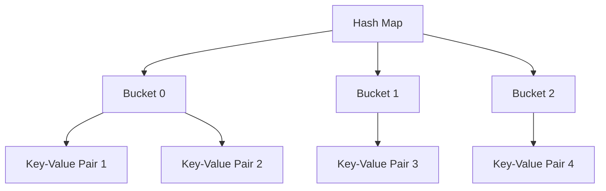
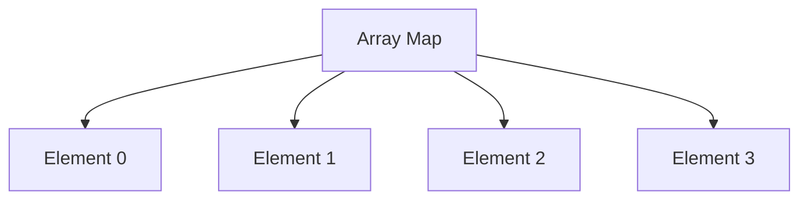
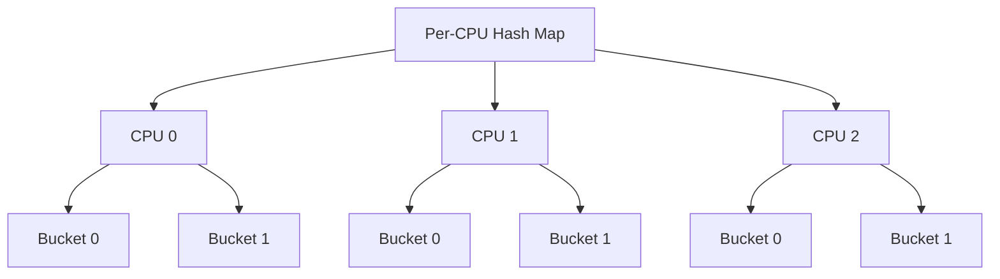

# Lesson 6: Case Studies and Best Practices

## 1. First-Principles Intuition & Invariants

In the realm of high-performance computing and network monitoring, the efficiency and scalability of data structures are paramount. eBPF (Extended Berkeley Packet Filter) maps serve as a foundational component, enabling efficient data storage and retrieval within the kernel space. These maps are not merely data structures; they are the backbone of eBPF programs, facilitating tasks such as packet filtering, network monitoring, and system tracing. To fully appreciate the power and potential of eBPF maps, we must delve into their theoretical underpinnings and the invariants that govern their behavior.

At the heart of eBPF maps lies the need for low-latency, high-throughput data access. Traditional kernel data structures, while robust, often suffer from performance bottlenecks due to locking mechanisms and memory allocation overhead. eBPF maps, on the other hand, are designed with performance in mind, leveraging lockless data structures and efficient memory management techniques. This design choice is rooted in the need to minimize the impact of eBPF programs on the overall system performance, ensuring that even the most resource-intensive operations do not degrade the system's responsiveness.

One of the key invariants of eBPF maps is their ability to support concurrent access without the need for explicit locking. This is achieved through the use of lockless data structures and atomic operations, which allow multiple eBPF programs to read from and write to the same map simultaneously without contention. This concurrency model is particularly important in high-performance environments, where the ability to handle a large number of concurrent operations is critical.

Another invariant is the bounded nature of eBPF maps. Unlike traditional data structures that can grow indefinitely, eBPF maps have a fixed size, which is specified at the time of creation. This boundedness ensures that eBPF programs do not consume excessive memory, which could lead to resource exhaustion and system instability. The fixed size also allows eBPF maps to be allocated in contiguous memory regions, which improves cache locality and reduces memory access latency.

The static DAG verifier, a critical component of the eBPF ecosystem, plays a pivotal role in ensuring the safety and correctness of eBPF maps. The verifier performs a series of checks to ensure that eBPF programs do not access memory out of bounds, use uninitialized memory, or perform other unsafe operations. This verification process is essential for maintaining the integrity of eBPF maps and preventing security vulnerabilities.

## 2. Core Architecture & Mechanics

To understand the architecture and mechanics of eBPF maps, we must examine their internal data structures and algorithms. eBPF supports several types of maps, each optimized for specific use cases. The most commonly used types are hash maps, array maps, and per-CPU hash maps. Each of these map types is designed to provide efficient data access and storage, while also meeting the specific requirements of the application.

### Hash Maps

Hash maps are the most versatile type of eBPF map, providing average O(1) time complexity for insertions, deletions, and lookups. The internal structure of a hash map consists of an array of buckets, where each bucket contains a linked list of key-value pairs. When a key is inserted into the map, it is hashed to determine the appropriate bucket. The key-value pair is then added to the linked list in that bucket. Similarly, when a key is looked up, it is hashed to determine the bucket, and the linked list is traversed to find the corresponding value.

### Array Maps

Array maps provide O(1) time complexity for insertions, deletions, and lookups, but with a fixed size. The internal structure of an array map is a simple array of key-value pairs, where the key is an index into the array. This fixed-size array allows for efficient memory allocation and access, making array maps ideal for use cases where the number of elements is known in advance.

### Per-CPU Hash Maps

Per-CPU hash maps are a variant of hash maps that are optimized for high-performance environments with multiple CPUs. Each CPU has its own instance of the hash map, allowing eBPF programs to access the map without contention. This per-CPU design eliminates the need for locking, which can be a significant performance bottleneck in multi-core systems.

The choice of map type is critical for the performance and scalability of eBPF programs. Each map type has its strengths and weaknesses, and the optimal choice depends on the specific requirements of the application. For example, hash maps are ideal for use cases where the number of elements is not known in advance, while array maps are better suited for fixed-size data sets. Per-CPU hash maps are the best choice for high-performance environments with multiple CPUs.

## 3. High-Performance Optimization & Failure Modes

To achieve high performance with eBPF maps, it is essential to optimize the data structures and algorithms used to access and manipulate the maps. One of the key optimizations is to minimize the number of memory accesses and to ensure that data is stored in contiguous memory regions. This can be achieved by using fixed-size data structures, such as array maps, and by aligning data structures to cache line boundaries.

Another optimization is to use lockless data structures and atomic operations to minimize contention and improve concurrency. This is particularly important in high-performance environments with multiple CPUs, where the ability to handle a large number of concurrent operations is critical. Per-CPU hash maps are a prime example of this optimization, as they eliminate the need for locking by providing a separate instance of the map for each CPU.

Despite these optimizations, eBPF maps are not immune to failure modes. One common failure mode is memory exhaustion, which can occur if the map is allowed to grow indefinitely. To prevent this, eBPF maps have a fixed size, which is specified at the time of creation. This boundedness ensures that eBPF programs do not consume excessive memory, which could lead to resource exhaustion and system instability.

Another failure mode is data corruption, which can occur if eBPF programs access memory out of bounds or use uninitialized memory. The static DAG verifier plays a critical role in preventing these types of failures by performing a series of checks to ensure that eBPF programs do not perform unsafe operations. The verifier ensures that eBPF programs do not access memory out of bounds, use uninitialized memory, or perform other unsafe operations.

In addition to these failure modes, eBPF maps can also suffer from performance degradation due to contention and memory fragmentation. Contention can occur if multiple eBPF programs attempt to access the same map simultaneously, leading to performance bottlenecks. Memory fragmentation can occur if the map is allowed to grow and shrink over time, leading to inefficient memory usage. To mitigate these failure modes, it is essential to use lockless data structures and to align data structures to cache line boundaries.

In conclusion, eBPF maps are a powerful and efficient data structure that plays a critical role in high-performance computing and network monitoring. By understanding the theoretical underpinnings and invariants of eBPF maps, we can leverage their full potential to build efficient and scalable eBPF programs. Through careful optimization and attention to failure modes, we can ensure that eBPF maps provide the high performance and reliability required for modern computing environments.
