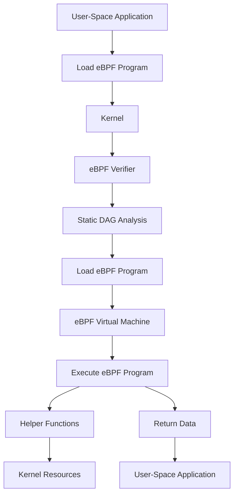

# Lesson 1: Core Concepts of eBPF

## 1. First-Principles Intuition & Invariants

In the realm of modern systems programming and infrastructure, the need for efficient, flexible, and secure in-kernel instrumentation and networking capabilities has never been more pronounced. Traditional methods of kernel development, characterized by their complexity and the inherent risks of modifying kernel code, have given way to a more modular and dynamic approach. Enter eBPF (Extended Berkeley Packet Filter), a revolutionary technology that allows for the safe and efficient execution of user-defined programs within the Linux kernel. eBPF represents a paradigm shift in how we think about kernel instrumentation, offering a powerful toolset for developers and system administrators alike.

At its core, eBPF is a virtual machine designed to execute small snippets of code, known as eBPF programs, directly within the kernel. These programs can be attached to various hook points within the kernel, enabling a wide range of functionalities such as network packet filtering, performance monitoring, security auditing, and more. The elegance of eBPF lies in its ability to provide these capabilities without the need for traditional kernel module development, thereby reducing the risk of introducing stability issues and security vulnerabilities.

The theoretical grounding of eBPF is rooted in the concept of a restricted virtual machine that operates within the confines of the kernel's memory space. This virtual machine is designed to execute bytecode that is both safe and efficient, ensuring that eBPF programs do not pose a threat to the stability or security of the system. The safety of eBPF programs is enforced through a series of static analysis checks performed by the kernel's eBPF verifier, which ensures that all programs adhere to a set of invariants that prevent malicious or erroneous behavior.

One of the key invariants enforced by the eBPF verifier is the bounded execution time of programs. This is achieved through a combination of static analysis techniques and runtime constraints. The verifier ensures that all loops within eBPF programs are bounded, meaning that they cannot run indefinitely. This is accomplished by analyzing the control flow of the program and ensuring that all loops have a maximum number of iterations. Additionally, the verifier enforces a set of constraints on the use of memory, ensuring that eBPF programs do not access memory out of bounds or perform other unsafe operations.

Another critical invariant is the immutability of the kernel's state during the execution of eBPF programs. This is achieved through the use of a read-only view of the kernel's memory space, which prevents eBPF programs from modifying kernel data structures directly. Instead, eBPF programs can only interact with the kernel through a set of predefined helper functions, which provide a controlled interface for accessing kernel resources.

The mathematical and system invariants of eBPF are further reinforced through the use of a static DAG (Directed Acyclic Graph) verifier. This verifier performs a series of static analysis checks on the eBPF bytecode, ensuring that all programs adhere to a set of invariants that prevent malicious or erroneous behavior. The DAG verifier works by constructing a graph representation of the control flow of the eBPF program and performing a series of checks to ensure that the program adheres to the invariants. This includes checks for bounded loops, memory safety, and other critical invariants.

## 2. Core Architecture & Mechanics

The architecture of eBPF is designed to be both efficient and flexible, allowing for a wide range of use cases. At the heart of the eBPF architecture is the eBPF virtual machine, which is responsible for executing eBPF programs. The eBPF virtual machine is designed to be lightweight and efficient, allowing for the execution of eBPF programs with minimal overhead.

The eBPF virtual machine operates on a 64-bit RISC (Reduced Instruction Set Computing) architecture, which is designed to be both efficient and easy to verify. The eBPF instruction set consists of a set of 64-bit RISC instructions, which are designed to be simple and efficient. The eBPF instruction set includes a set of basic arithmetic and logical operations, as well as a set of specialized instructions for interacting with the kernel.

The eBPF virtual machine uses a set of 11 general-purpose 64-bit registers, denoted as `R0` through `R10`. These registers are used to store intermediate results and to pass arguments to and from eBPF programs. The `R0` register is used as the return value register, while the `R1` through `R5` registers are used to pass arguments to eBPF programs. The `R6` through `R9` registers are used for temporary storage, while the `R10` register is used as the frame pointer register.

The eBPF virtual machine also includes a set of specialized instructions for interacting with the kernel. These instructions include a set of helper functions, which provide a controlled interface for accessing kernel resources. The helper functions are designed to be both efficient and safe, allowing eBPF programs to interact with the kernel without introducing stability or security issues.

The eBPF virtual machine is designed to be efficient and scalable, allowing for the execution of eBPF programs with minimal overhead. This is achieved through a combination of techniques, including the use of a just-in-time (JIT) compiler, which translates eBPF bytecode into native machine code, and the use of a lockless BPF RingBuf, which provides a high-performance mechanism for passing data between eBPF programs and user-space applications.

The architecture of eBPF is further enhanced through the use of CO-RE (Compile Once – Run Everywhere) BTF (BPF Type Format) relocations. BTF is a type format that provides a rich set of type information for eBPF programs, allowing them to interact with the kernel in a type-safe manner. CO-RE BTF relocations provide a mechanism for eBPF programs to be compiled once and run on a wide range of kernel versions, without the need for recompilation. This is achieved through the use of a set of relocation mechanisms, which allow eBPF programs to be adapted to different kernel versions at runtime.

To illustrate the architecture of eBPF, we can use a simple Mermaid diagram:

In this diagram, we can see the flow of an eBPF program from user-space to the kernel and back. The user-space application loads the eBPF program into the kernel, where it is verified by the eBPF verifier. The verified eBPF program is then executed by the eBPF virtual machine, which interacts with the kernel through a set of helper functions. The eBPF virtual machine returns data to the user-space application, completing the execution of the eBPF program.

## 3. High-Performance Optimization & Failure Modes

The performance of eBPF programs is a critical consideration, given their role in high-performance systems such as networking and performance monitoring. The eBPF virtual machine is designed to be efficient and scalable, allowing for the execution of eBPF programs with minimal overhead. This is achieved through a combination of techniques, including the use of a JIT compiler, which translates eBPF bytecode into native machine code, and the use of a lockless BPF RingBuf, which provides a high-performance mechanism for passing data between eBPF programs and user-space applications.

The JIT compiler is a critical component of the eBPF architecture, as it allows eBPF programs to be executed with minimal overhead. The JIT compiler translates eBPF bytecode into native machine code, which can be executed directly by the CPU. This translation is performed at load time, allowing eBPF programs to be executed with minimal overhead. The JIT compiler is designed to be both efficient and safe, ensuring that the generated machine code adheres to a set of invariants that prevent malicious or erroneous behavior.

The lockless BPF RingBuf is another critical component of the eBPF architecture, as it provides a high-performance mechanism for passing data between eBPF programs and user-space applications. The BPF RingBuf is a circular buffer that is used to pass data between eBPF programs and user-space applications. The BPF RingBuf is designed to be lockless, allowing for high-performance data transfer without the need for synchronization primitives. The BPF RingBuf is further enhanced through the use of a set of helper functions, which provide a controlled interface for accessing the buffer.

Concurrency is another critical consideration in the design of eBPF, given its role in high-performance systems. The eBPF virtual machine is designed to be concurrent, allowing for the execution of multiple eBPF programs simultaneously. This is achieved through a combination of techniques, including the use of a set of per-CPU data structures, which allow eBPF programs to be executed concurrently without the need for synchronization primitives. The eBPF virtual machine is further enhanced through the use of a set of helper functions, which provide a controlled interface for accessing shared resources.

Resource scaling is another critical consideration in the design of eBPF, given its role in high-performance systems. The eBPF virtual machine is designed to be scalable, allowing for the execution of eBPF programs on systems with a wide range of resources. This is achieved through a combination of techniques, including the use of a set of per-CPU data structures, which allow eBPF programs to be executed efficiently on systems with a wide range of resources. The eBPF virtual machine is further enhanced through the use of a set of helper functions, which provide a controlled interface for accessing shared resources.

Boundary edge cases and failure modes are critical considerations in the design of eBPF, given its role in high-performance systems. The eBPF virtual machine is designed to be robust, allowing for the execution of eBPF programs in the presence of boundary edge cases and failure modes. This is achieved through a combination of techniques, including the use of a set of invariants, which ensure that eBPF programs do not introduce stability or security issues. The eBPF virtual machine is further enhanced through the use of a set of helper functions, which provide a controlled interface for accessing shared resources.

In conclusion, eBPF represents a revolutionary technology that allows for the safe and efficient execution of user-defined programs within the Linux kernel. The architecture of eBPF is designed to be efficient, flexible, and scalable, allowing for a wide range of use cases. The eBPF virtual machine is designed to be efficient and robust, allowing for the execution of eBPF programs with minimal overhead. The use of a JIT compiler, lockless BPF RingBuf, and a set of helper functions further enhances the performance and scalability of eBPF programs. The invariants enforced by the eBPF verifier ensure that eBPF programs do not introduce stability or security issues, making eBPF a powerful tool for developers and system administrators alike.
