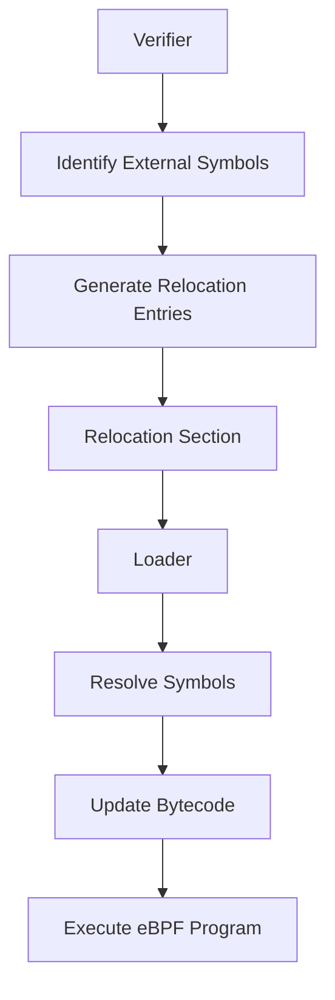

# Lesson 2: Relocation Mechanisms in eBPF

## 1. First-Principles Intuition & Invariants

In the realm of eBPF (Extended Berkeley Packet Filter), the concept of relocation is pivotal for ensuring that programs can be loaded and executed across different environments with varying kernel versions and configurations. At its core, relocation in eBPF involves adjusting the addresses of external symbols and data structures within the eBPF bytecode to match the runtime environment. This process is essential because eBPF programs are often loaded into the kernel, where they interact with kernel data structures and functions that may have different addresses on different systems.

The problem space of relocation in eBPF is rooted in the need for portability and flexibility. eBPF programs are designed to be lightweight and efficient, allowing them to be embedded directly into the kernel for performance-critical tasks such as network filtering, security auditing, and performance monitoring. However, the kernel's internal layout and the addresses of its symbols can vary significantly between different kernel versions and configurations. To address this, eBPF employs a sophisticated relocation mechanism that ensures the bytecode remains valid and functional across these variations.

The theoretical grounding of relocation in eBPF is deeply intertwined with the architecture of the eBPF virtual machine (eBPF VM). The eBPF VM is a 64-bit RISC architecture designed to execute eBPF programs efficiently and safely within the kernel. The VM operates on a set of 64-bit registers (`R0`–`R10`), which are used for storing intermediate results, passing arguments, and managing control flow. The relocation process ensures that the addresses of external symbols, such as kernel functions and data structures, are correctly resolved at load time, allowing the eBPF program to interact with the kernel as intended.

One of the key invariants in eBPF relocation is the requirement for the relocation process to be deterministic and consistent. This means that the same eBPF program should produce the same results and behavior across different systems, provided that the kernel provides the necessary symbols and data structures. This consistency is crucial for the reliability and predictability of eBPF programs, especially in production environments where consistent behavior is paramount.

Another invariant is the need for the relocation process to be efficient and performant. Since eBPF programs are often executed in performance-critical contexts, the overhead of the relocation process must be minimized to ensure that the eBPF VM can execute the programs with minimal latency. This efficiency is achieved through a combination of static analysis and dynamic resolution techniques, which are designed to minimize the runtime overhead of relocation.

## 2. Core Architecture & Mechanics

The core architecture of eBPF relocation involves a combination of static analysis and dynamic resolution techniques. At the heart of this architecture is the eBPF verifier, which is responsible for ensuring that eBPF programs are safe and valid before they are loaded into the kernel. The verifier performs a series of checks on the eBPF bytecode to ensure that it adheres to a set of safety constraints, such as preventing infinite loops and ensuring that all memory accesses are within bounds.

One of the key features of the eBPF verifier is its ability to perform static analysis on the eBPF bytecode. During the verification process, the verifier identifies all external symbols and data structures that are referenced by the eBPF program. These symbols are then marked for relocation, and the verifier generates a set of relocation entries that describe how the addresses of these symbols should be resolved at load time.

The relocation entries are stored in a separate section of the eBPF object file, which is a binary format used to store eBPF programs and their associated metadata. The relocation section contains a list of relocation entries, each of which specifies the type of relocation, the offset within the eBPF bytecode where the relocation should be applied, and the symbol that should be resolved.

The dynamic resolution of eBPF relocations is performed by the kernel's eBPF loader, which is responsible for loading and executing eBPF programs. When an eBPF program is loaded into the kernel, the loader reads the relocation section of the eBPF object file and applies the relocation entries to the eBPF bytecode. This involves resolving the addresses of external symbols and updating the eBPF bytecode to reflect these addresses.

The process of resolving eBPF relocations can be visualized using a simple diagram. Consider an eBPF program that references a kernel function `foo`. The eBPF verifier identifies this reference and generates a relocation entry for it. When the eBPF program is loaded into the kernel, the loader reads the relocation entry and resolves the address of `foo` in the kernel's symbol table. The loader then updates the eBPF bytecode to replace the reference to `foo` with its resolved address, allowing the eBPF program to call `foo` directly.

In this diagram, the eBPF verifier identifies external symbols and generates relocation entries, which are stored in the relocation section of the eBPF object file. The loader reads the relocation section and resolves the addresses of the external symbols, updating the eBPF bytecode to reflect these addresses. Finally, the loader executes the eBPF program, which can now interact with the kernel using the resolved addresses.

Another important aspect of eBPF relocation is the use of BTF (BPF Type Format) relocations. BTF is a type format that provides detailed type information for eBPF programs, including the types of external symbols and data structures. BTF relocations allow eBPF programs to reference kernel data structures and functions using their types, rather than their addresses. This approach provides several benefits, including improved portability and flexibility, as well as better integration with modern development tools.

BTF relocations are particularly useful in the context of CO-RE (Compile Once – Run Everywhere) eBPF programs. CO-RE eBPF programs are designed to be compiled once and executed on different kernel versions and configurations, without requiring recompilation. BTF relocations enable this portability by allowing eBPF programs to reference kernel data structures and functions using their types, rather than their addresses. This approach ensures that the eBPF program can adapt to changes in the kernel's internal layout and symbol addresses, without requiring recompilation.

The process of resolving BTF relocations is similar to the process of resolving standard eBPF relocations. When an eBPF program is loaded into the kernel, the loader reads the BTF relocation entries and resolves the addresses of the external symbols using the type information provided by BTF. The loader then updates the eBPF bytecode to reflect these addresses, allowing the eBPF program to interact with the kernel using the resolved addresses.

## 3. High-Performance Optimization & Failure Modes

The performance of eBPF relocation is critical for ensuring that eBPF programs can be loaded and executed efficiently within the kernel. The relocation process involves several steps, including static analysis, dynamic resolution, and bytecode updating, which can introduce overhead if not optimized carefully. To minimize this overhead, the eBPF verifier and loader employ a variety of optimization techniques.

One of the key optimizations in eBPF relocation is the use of a static DAG (Directed Acyclic Graph) verifier. The static DAG verifier performs a series of checks on the eBPF bytecode to ensure that it adheres to a set of safety constraints. The verifier uses a graph-based approach to analyze the control flow of the eBPF program, identifying all possible execution paths and ensuring that they are safe. This approach allows the verifier to perform static analysis efficiently, minimizing the overhead of relocation.

Another optimization in eBPF relocation is the use of bounded loops. The eBPF verifier enforces a set of constraints on the eBPF bytecode, including a limit on the number of iterations in loops. This constraint ensures that eBPF programs cannot execute infinite loops, which can cause the kernel to become unresponsive. The use of bounded loops also allows the verifier to perform static analysis more efficiently, as it can analyze the control flow of the eBPF program without having to consider infinite loops.

The use of lockless BPF RingBuf is another optimization in eBPF relocation. The BPF RingBuf is a lockless data structure that is used to communicate between eBPF programs and user-space applications. The RingBuf allows eBPF programs to send data to user-space applications without requiring locks, which can introduce overhead and contention. The use of lockless data structures ensures that eBPF programs can communicate with user-space applications efficiently, minimizing the overhead of relocation.

Despite these optimizations, eBPF relocation is not without its failure modes. One of the key failure modes in eBPF relocation is the failure to resolve external symbols. If the kernel does not provide the necessary symbols or data structures, the eBPF program may fail to load or execute correctly. To mitigate this failure mode, the eBPF verifier performs a series of checks on the eBPF bytecode to ensure that all external symbols are resolved before the program is loaded into the kernel. If any symbols are unresolved, the verifier will reject the eBPF program, preventing it from being loaded into the kernel.

Another failure mode in eBPF relocation is the failure to update the eBPF bytecode correctly. If the loader fails to update the eBPF bytecode to reflect the resolved addresses of external symbols, the eBPF program may execute incorrectly or crash. To mitigate this failure mode, the loader performs a series of checks on the eBPF bytecode to ensure that it is updated correctly. If any errors are detected, the loader will reject the eBPF program, preventing it from being loaded into the kernel.

In conclusion, relocation in eBPF is a critical mechanism that ensures that eBPF programs can be loaded and executed across different environments with varying kernel versions and configurations. The core architecture of eBPF relocation involves a combination of static analysis and dynamic resolution techniques, which are designed to minimize the overhead of relocation while ensuring the safety and reliability of eBPF programs. The use of optimizations such as static DAG verifiers, bounded loops, and lockless data structures ensures that eBPF programs can be loaded and executed efficiently within the kernel, while the use of failure modes such as unresolved symbols and incorrect bytecode updates ensures that eBPF programs are safe and reliable.
