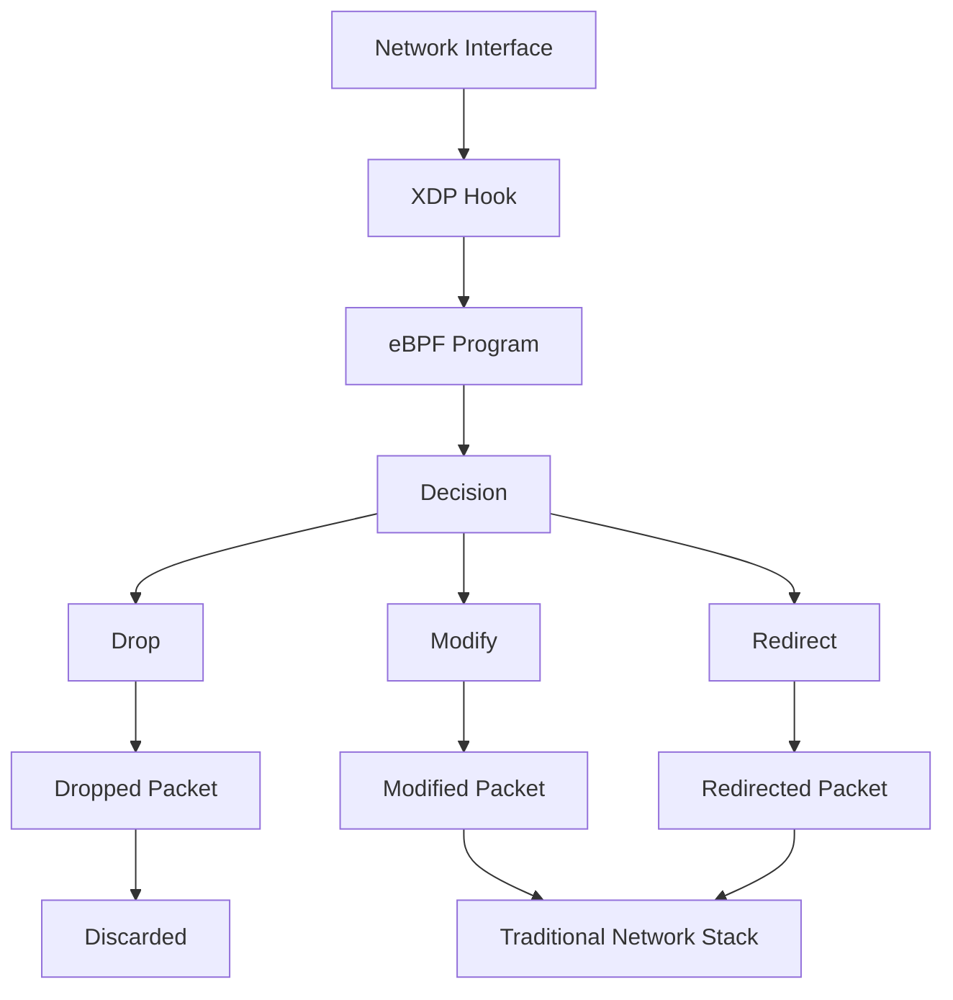

# Lesson 1: Introduction to XDP and eBPF

## 1. First-Principles Intuition & Invariants

In the realm of network performance and security, the need for efficient packet processing and filtering has become paramount. Traditional network stacks, while robust and feature-rich, often introduce latency and complexity that can hinder high-speed data transmission and real-time security analysis. This is where Extended Berkeley Packet Filter (eBPF) and its specialized variant, XDP (eXpress Data Path), come into play. These technologies leverage the power of the Linux kernel to provide a high-performance, flexible, and programmable framework for packet processing.

At the heart of eBPF and XDP lies the concept of in-kernel programmability. Unlike traditional user-space applications, eBPF programs run directly within the kernel, eliminating the overhead of context switching and data copying between user and kernel spaces. This allows for near-linear scaling and minimal latency, making it ideal for high-throughput environments. The mathematical and system invariants that underpin eBPF and XDP include the use of a 64-bit RISC instruction set, a static Directed Acyclic Graph (DAG) verifier, and a lockless BPF Ring Buffer for efficient data exchange.

The problem space that XDP addresses is the need for early-stage packet filtering and processing. Traditional network stacks process packets in user space, which introduces significant latency due to context switching and data copying. XDP, on the other hand, operates at the earliest stages of packet processing, directly in the network driver, allowing for immediate decision-making and action. This is particularly crucial in environments where every microsecond counts, such as high-frequency trading, real-time analytics, and network security.

## 2. Core Architecture & Mechanics

The architecture of XDP and eBPF is deeply rooted in the Linux kernel's ability to execute user-defined programs at specific points in the network data path. XDP programs are attached to network interfaces and are executed for each incoming packet before it is processed by the traditional network stack. This early attachment point allows XDP to perform actions such as dropping packets, modifying packet headers, or redirecting packets to different network interfaces.

The core mechanics of XDP involve the execution of eBPF bytecode within the kernel. eBPF programs are written in a restricted C-like language and are compiled into a sequence of 64-bit RISC instructions. These instructions are then verified by the eBPF verifier, which ensures that the programs do not access invalid memory or perform unsafe operations. The verifier operates on a static DAG, pruning states that cannot be reached, and ensuring that loops are bounded, thus preventing infinite execution.

The execution model of XDP can be visualized through the following Mermaid diagram:

In this diagram, packets enter the network interface and are processed by the XDP hook, where an eBPF program is executed. The program makes a decision to drop, modify, or redirect the packet. Modified packets are sent to the traditional network stack, while redirected packets are sent to a different network interface. Dropped packets are discarded.

The eBPF program itself is a sequence of instructions that operate on a set of 64-bit registers (`R0`–`R10`). The `R0` register is used to store the return value of the program, while the other registers are used for data manipulation. The program can access packet data through the `ctx` pointer, which provides access to packet metadata and payload.

## 3. High-Performance Optimization & Failure Modes

The high-performance nature of XDP and eBPF is achieved through several optimizations. One of the key optimizations is the use of a lockless BPF Ring Buffer for efficient data exchange between eBPF programs and user-space applications. This allows for high-throughput data transfer without the overhead of locks, which can introduce contention and reduce performance.

Another optimization is the use of the eBPF verifier to ensure that programs are safe and efficient. The verifier operates on a static DAG, pruning states that cannot be reached, and ensuring that loops are bounded. This allows the verifier to perform aggressive optimizations, such as inlining functions and eliminating dead code, without the risk of introducing unsafe operations.

Concurrency is another critical aspect of XDP and eBPF. eBPF programs are designed to be stateless, allowing multiple instances to run concurrently without interference. This is achieved through the use of per-CPU data structures, which store state information for each CPU. This allows eBPF programs to scale horizontally, leveraging the full power of multi-core systems.

Resource scaling is another area where XDP and eBPF excel. The use of eBPF bytecode allows for fine-grained control over resource usage, such as memory and CPU. This is achieved through the use of cgroups (control groups), which provide a mechanism for limiting and monitoring resource usage. By attaching eBPF programs to cgroups, it is possible to enforce resource limits and ensure that programs do not consume excessive resources.

Boundary edge cases and failure modes are also critical considerations in the design of XDP and eBPF. One common failure mode is the execution of unsafe operations, such as accessing invalid memory or performing infinite loops. The eBPF verifier addresses this by ensuring that programs are safe and efficient. Another failure mode is the introduction of latency, which can occur due to context switching and data copying. XDP addresses this by operating directly in the network driver, eliminating the need for context switching and data copying.

In conclusion, XDP and eBPF provide a powerful and flexible framework for high-performance packet processing and filtering. By leveraging the power of the Linux kernel, XDP allows for early-stage packet processing, reducing latency and improving performance. The core architecture and mechanics of XDP involve the execution of eBPF bytecode within the kernel, with the eBPF verifier ensuring that programs are safe and efficient. High-performance optimizations, such as the use of a lockless BPF Ring Buffer and per-CPU data structures, allow XDP to scale horizontally and leverage the full power of multi-core systems. Boundary edge cases and failure modes are addressed through the use of the eBPF verifier and cgroups, ensuring that programs are safe and efficient.
