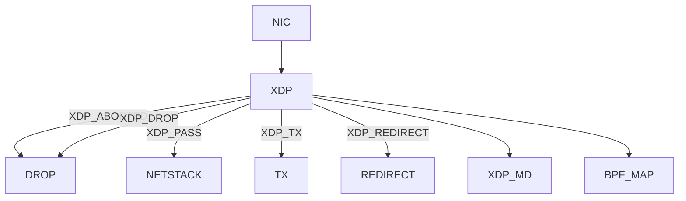

# Lesson 2: XDP Programming Basics

## 1. First-Principles Intuition & Invariants

Extended Berkeley Packet Filter (eBPF) has emerged as a powerful tool for network performance and security, enabling the execution of user-defined programs at various points in the networking stack. One of the most compelling features of eBPF is its ability to run programs in the eXpress Data Path (XDP) layer, which operates directly on incoming packets at the earliest possible stage in the network processing pipeline. This proximity to the network interface card (NIC) allows XDP programs to perform packet filtering, modification, and redirection with minimal latency and overhead.

The XDP layer is situated between the NIC driver and the network stack, providing a unique opportunity to intercept packets before they are processed by the operating system's networking subsystem. This positioning is critical for high-performance applications that require low-latency packet processing, such as network function virtualization (NFV), intrusion detection systems (IDS), and traffic shaping. The ability to execute custom logic at this level is a game-changer, as it allows for the offloading of complex processing tasks from the CPU to the NIC, thereby reducing the load on the host system and improving overall throughput.

To fully appreciate the power of XDP, it is essential to understand the underlying principles that govern its operation. At its core, XDP leverages the eBPF virtual machine (VM) to execute user-defined programs. The eBPF VM is a 64-bit RISC architecture designed to be simple, efficient, and secure. It operates within a tightly controlled environment, with strict constraints on the types of instructions that can be executed. This design ensures that eBPF programs are safe to run in the kernel space, as they cannot perform arbitrary operations that could lead to system instability or security vulnerabilities.

The XDP layer introduces several key concepts that are fundamental to understanding its operation. The first of these is the XDP hook, which represents the point in the network processing pipeline where an XDP program can be attached. There are several hooks available, including `XDP_ABORTED`, `XDP_DROP`, `XDP_PASS`, `XDP_TX`, and `XDP_REDIRECT`. Each hook corresponds to a different action that can be taken on a packet, such as dropping the packet, passing it to the network stack, or redirecting it to a different network interface.

Another critical concept in XDP is the XDP action, which defines the outcome of processing a packet. The action determines whether the packet is dropped, passed to the network stack, transmitted back out the same interface, or redirected to a different interface. The choice of action is determined by the logic implemented in the XDP program, which can inspect and modify packet headers, payload, and metadata.

The XDP layer also introduces several data structures that are essential for packet processing. One of the most important of these is the `xdp_md` structure, which provides metadata about the packet being processed. This structure includes fields such as the packet length, the network interface index, and the packet data pointer, which can be used to access the packet payload. Additionally, XDP programs can use the `bpf_map` data structure to store and retrieve state information, such as counters, filters, and session data.

Understanding these fundamental concepts is crucial for writing effective XDP programs. By leveraging the power of eBPF and the XDP layer, developers can create highly efficient and flexible network processing solutions that operate at the edge of the network stack. The ability to execute custom logic at this level opens up a wide range of possibilities for network optimization, security, and performance tuning.

## 2. Core Architecture & Mechanics

The architecture of the XDP layer is designed to provide high-performance packet processing with minimal overhead. At its core, XDP leverages the eBPF virtual machine (VM) to execute user-defined programs. The eBPF VM is a 64-bit RISC architecture that is optimized for performance and security. It operates within a tightly controlled environment, with strict constraints on the types of instructions that can be executed. This design ensures that eBPF programs are safe to run in the kernel space, as they cannot perform arbitrary operations that could lead to system instability or security vulnerabilities.

The XDP layer introduces several key components that work together to provide high-performance packet processing. The first of these is the XDP hook, which represents the point in the network processing pipeline where an XDP program can be attached. There are several hooks available, including `XDP_ABORTED`, `XDP_DROP`, `XDP_PASS`, `XDP_TX`, and `XDP_REDIRECT`. Each hook corresponds to a different action that can be taken on a packet, such as dropping the packet, passing it to the network stack, or redirecting it to a different network interface.

The XDP layer also introduces several data structures that are essential for packet processing. One of the most important of these is the `xdp_md` structure, which provides metadata about the packet being processed. This structure includes fields such as the packet length, the network interface index, and the packet data pointer, which can be used to access the packet payload. Additionally, XDP programs can use the `bpf_map` data structure to store and retrieve state information, such as counters, filters, and session data.

To illustrate the architecture of the XDP layer, consider the following diagram:



In this diagram, the NIC represents the network interface card, which receives incoming packets. The XDP layer is responsible for processing these packets, and it can take several actions based on the logic implemented in the XDP program. The `xdp_md` structure provides metadata about the packet, while the `bpf_map` data structure can be used to store and retrieve state information.

The XDP layer also introduces several mechanisms for optimizing packet processing. One of the most important of these is the use of the eBPF VM, which is designed to execute programs with minimal overhead. The eBPF VM operates within a tightly controlled environment, with strict constraints on the types of instructions that can be executed. This design ensures that eBPF programs are safe to run in the kernel space, as they cannot perform arbitrary operations that could lead to system instability or security vulnerabilities.

Another mechanism for optimizing packet processing is the use of the `bpf_map` data structure. This data structure can be used to store and retrieve state information, such as counters, filters, and session data. By using `bpf_map`, XDP programs can maintain state information across multiple packets, which can be used to implement complex filtering and processing logic.

To illustrate the mechanics of the XDP layer, consider the following example of an XDP program that drops packets with a specific destination IP address:

```c
#include <linux/bpf.h>
#include <bpf/bpf_helpers.h>
#include <linux/if_ether.h>
#include <linux/ip.h>

SEC("xdp")
int xdp_drop_packets(struct xdp_md *ctx) {
    void *data = (void *)(long)ctx->data;
    void *data_end = (void *)(long)ctx->data_end;

    struct ethhdr *eth = data;
    if (data + sizeof(*eth) > data_end)
        return XDP_ABORTED;

    if (eth->h_proto != htons(ETH_P_IP))
        return XDP_PASS;

    struct iphdr *iph = data + sizeof(*eth);
    if (data + sizeof(*eth) + sizeof(*iph) > data_end)
        return XDP_ABORTED;

    if (iph->daddr == htonl(0xC0A80101)) // Drop packets with destination IP 192.168.1.1
        return XDP_DROP;

    return XDP_PASS;
}

char _license[] SEC("license") = "GPL";
```

In this example, the XDP program inspects the destination IP address of incoming packets and drops packets with a specific destination IP address (192.168.1.1). The program uses the `xdp_md` structure to access the packet data and the `iphdr` structure to inspect the IP header. If the destination IP address matches the specified value, the program returns `XDP_DROP`, which drops the packet. Otherwise, the program returns `XDP_PASS`, which passes the packet to the network stack.

## 3. High-Performance Optimization & Failure Modes

The XDP layer is designed to provide high-performance packet processing with minimal overhead. However, achieving optimal performance requires careful consideration of several factors, including concurrency, resource scaling, boundary edge cases, and failure mitigations.

One of the most important factors for achieving high-performance packet processing is concurrency. The XDP layer is designed to handle multiple packets concurrently, which can significantly improve throughput. To achieve concurrency, XDP programs can use the `bpf_map` data structure to store and retrieve state information, such as counters, filters, and session data. By using `bpf_map`, XDP programs can maintain state information across multiple packets, which can be used to implement complex filtering and processing logic.

Another important factor for achieving high-performance packet processing is resource scaling. The XDP layer is designed to operate within the constraints of the eBPF VM, which is a 64-bit RISC architecture optimized for performance and security. The eBPF VM operates within a tightly controlled environment, with strict constraints on the types of instructions that can be executed. This design ensures that eBPF programs are safe to run in the kernel space, as they cannot perform arbitrary operations that could lead to system instability or security vulnerabilities.

To achieve resource scaling, XDP programs can use the `bpf_map` data structure to store and retrieve state information, such as counters, filters, and session data. By using `bpf_map`, XDP programs can maintain state information across multiple packets, which can be used to implement complex filtering and processing logic. Additionally, XDP programs can use the `bpf_redirect_map` function to redirect packets to different network interfaces, which can be used to distribute traffic across multiple interfaces and improve throughput.

Another important factor for achieving high-performance packet processing is boundary edge cases. The XDP layer is designed to handle a wide range of packet sizes and formats, but it is important to consider boundary edge cases, such as packets with invalid headers or payloads. To handle boundary edge cases, XDP programs can use the `xdp_md` structure to access the packet data and perform validation checks. If a packet fails validation checks, the program can return `XDP_DROP`, which drops the packet.

Finally, it is important to consider failure modes and implement failure mitigations. The XDP layer is designed to operate within the constraints of the eBPF VM, which is a 64-bit RISC architecture optimized for performance and security. The eBPF VM operates within a tightly controlled environment, with strict constraints on the types of instructions that can be executed. This design ensures that eBPF programs are safe to run in the kernel space, as they cannot perform arbitrary operations that could lead to system instability or security vulnerabilities.

To implement failure mitigations, XDP programs can use the `bpf_map` data structure to store and retrieve state information, such as counters, filters, and session data. By using `bpf_map`, XDP programs can maintain state information across multiple packets, which can be used to implement complex filtering and processing logic. Additionally, XDP programs can use the `bpf_redirect_map` function to redirect packets to different network interfaces, which can be used to distribute traffic across multiple interfaces and improve throughput.

In summary, the XDP layer is a powerful tool for network performance and security, enabling the execution of user-defined programs at the earliest possible stage in the network processing pipeline. By leveraging the power of eBPF and the XDP layer, developers can create highly efficient and flexible network processing solutions that operate at the edge of the network stack. The ability to execute custom logic at this level opens up a wide range of possibilities for network optimization, security, and performance tuning.
