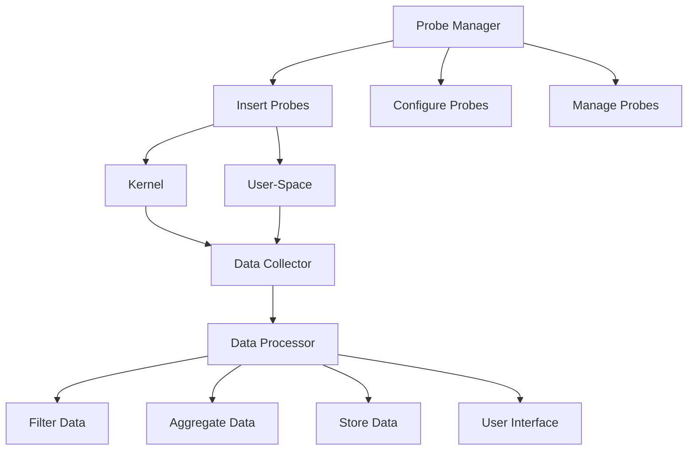

# Lesson 1: Introduction to Dynamic Tracing

## 1. First-Principles Intuition & Invariants

Dynamic tracing is a powerful diagnostic and performance tuning technique that allows system administrators and developers to observe the behavior of running systems in real-time without the need for intrusive changes to application code. This capability is particularly valuable in complex, distributed systems where traditional static analysis and logging fall short. At its core, dynamic tracing provides a means to instrument and monitor the execution of software at the kernel and application levels, enabling deep insights into system performance, resource utilization, and error conditions.

The problem space addressed by dynamic tracing is vast and multifaceted. In modern computing environments, systems are often composed of numerous interacting components, each with its own set of performance characteristics and failure modes. Traditional debugging and profiling techniques, while useful, often require significant modifications to application code, leading to potential performance degradation and increased complexity. Moreover, these techniques can be time-consuming and may not provide the granularity needed to diagnose subtle issues in production environments.

Dynamic tracing, on the other hand, offers a non-intrusive approach to system monitoring. By allowing developers to insert probes into running processes and the kernel, dynamic tracing enables the collection of detailed performance data without altering the application's execution path. This capability is grounded in the principles of observability and introspection, which are essential for understanding the behavior of complex systems. The invariants of dynamic tracing include the ability to capture system state at arbitrary points in time, the precision of data collected, and the minimal impact on system performance.

One of the key mathematical and system invariants in dynamic tracing is the concept of probes. Probes are points in the code where data can be collected or actions can be performed. These probes can be inserted at function entry and exit points, specific instructions, or even at kernel events. The placement and configuration of probes are critical to the effectiveness of dynamic tracing, as they determine the granularity and relevance of the data collected.

Another invariant is the need for efficient data collection and processing. Dynamic tracing systems must be able to handle large volumes of data in real-time while minimizing the overhead on the system being monitored. This requires sophisticated algorithms for data filtering, aggregation, and storage. Additionally, the system must be able to scale with the complexity and size of the system being monitored, ensuring that performance remains consistent even under heavy load.

## 2. Core Architecture & Mechanics

The architecture of dynamic tracing systems is designed to provide a flexible and powerful framework for system monitoring and performance tuning. At the heart of this architecture is the concept of probes, which are inserted into the code at specific points to collect data. These probes can be categorized into two main types: static probes and dynamic probes.

Static probes are predefined points in the code where data can be collected. They are typically defined by the developer and are embedded in the application or kernel source code. Static probes are advantageous because they are well-defined and can be easily managed, but they require prior knowledge of the codebase and may not be flexible enough to capture all relevant data.

Dynamic probes, on the other hand, are inserted at runtime and can be placed at arbitrary points in the code. This flexibility allows dynamic tracing systems to adapt to changing system conditions and capture data that may not have been anticipated during development. Dynamic probes are typically implemented using techniques such as kernel probes (kprobes) and user-space probes (uprobes), which allow probes to be inserted into both the kernel and user-space applications.

The mechanics of dynamic tracing involve several key components, including the probe manager, the data collector, and the data processor. The probe manager is responsible for inserting and managing probes in the system. It provides a high-level interface for defining and configuring probes, as well as for managing their lifecycle. The data collector is responsible for capturing data from the probes and sending it to the data processor. The data processor is responsible for filtering, aggregating, and storing the data, as well as for providing a user interface for analyzing the data.

To illustrate the architecture of a dynamic tracing system, consider the following diagram:

In this diagram, the probe manager is responsible for inserting and managing probes in both the kernel and user-space. The data collector captures data from the probes and sends it to the data processor, which filters, aggregates, and stores the data. The user interface provides a means for analyzing the data and gaining insights into system performance.

## 3. High-Performance Optimization & Failure Modes

The performance of dynamic tracing systems is critical to their effectiveness, as they must be able to capture and process large volumes of data in real-time without introducing significant overhead on the system being monitored. To achieve this, dynamic tracing systems employ a variety of optimization techniques, including efficient data structures, parallel processing, and adaptive sampling.

One of the key optimizations in dynamic tracing is the use of efficient data structures for storing and processing data. For example, hash tables and binary search trees are commonly used for fast data retrieval and insertion, while ring buffers are used for efficient data storage and retrieval. These data structures are designed to minimize the overhead of data processing and ensure that the system remains responsive even under heavy load.

Another optimization is the use of parallel processing to distribute the workload across multiple CPU cores. This allows dynamic tracing systems to handle large volumes of data in real-time without introducing significant latency. Parallel processing is particularly important in distributed systems, where the volume of data can be extremely high.

Adaptive sampling is another technique used to optimize the performance of dynamic tracing systems. Adaptive sampling involves dynamically adjusting the rate at which data is collected based on the current system conditions. For example, if the system is under heavy load, the sampling rate can be reduced to minimize the overhead on the system. Conversely, if the system is idle, the sampling rate can be increased to capture more detailed data.

Despite these optimizations, dynamic tracing systems are not immune to failure modes. One common failure mode is the introduction of performance degradation due to the overhead of data collection and processing. To mitigate this, dynamic tracing systems must be carefully designed to minimize the impact on system performance. This requires a deep understanding of the system architecture and the ability to identify and optimize performance bottlenecks.

Another failure mode is the introduction of data corruption due to race conditions or other concurrency issues. To mitigate this, dynamic tracing systems must be designed to handle concurrent data access safely. This requires the use of synchronization mechanisms such as locks and semaphores, as well as careful management of shared data structures.

In conclusion, dynamic tracing is a powerful diagnostic and performance tuning technique that allows system administrators and developers to observe the behavior of running systems in real-time without the need for intrusive changes to application code. The architecture of dynamic tracing systems is designed to provide a flexible and powerful framework for system monitoring and performance tuning, while the performance of these systems is optimized through a variety of techniques such as efficient data structures, parallel processing, and adaptive sampling. By understanding the principles and benefits of dynamic tracing, developers can gain deep insights into system performance, resource utilization, and error conditions, enabling them to diagnose and resolve issues more effectively.
