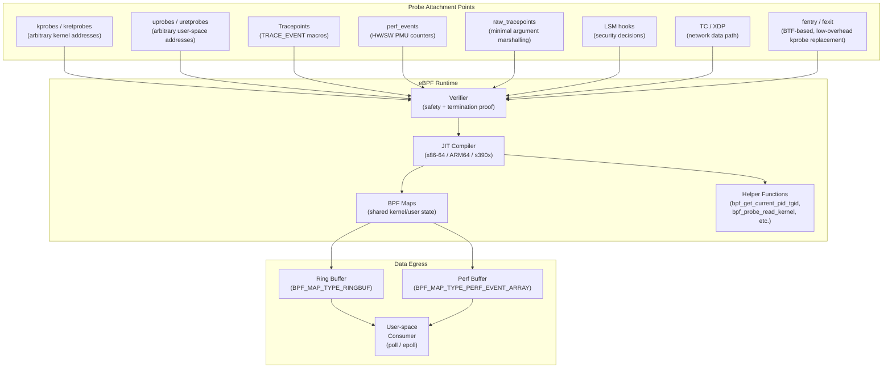
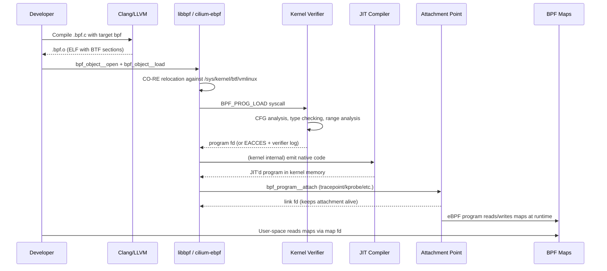
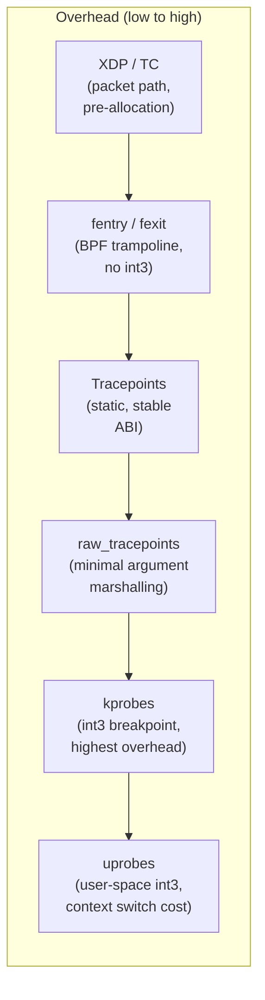
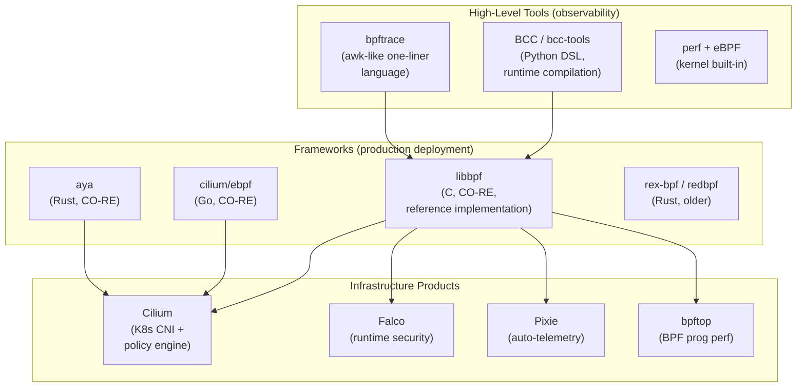

# Lesson 1: Introduction to Dynamic Tracing and eBPF

## 1. First-Principles Intuition & Invariants

### The Observability Problem

A production system is a black box in motion. Traditional logging emits only what developers anticipated at write-time. Profilers require recompilation or process restart. Core dumps capture a corpse, not a patient. The fundamental tension in systems observability is this: **the act of measurement must not materially alter the phenomenon being measured** — Heisenberg's uncertainty principle applied to software.

Dynamic tracing dissolves this tension by exploiting a property of modern CPUs and operating system kernels: execution is inherently sequential, and any instruction address is, in principle, an observable event. The kernel already maintains the machinery to redirect execution (interrupt vectors, exception handlers, debug registers). Dynamic tracing harnesses this machinery to insert ephemeral, surgical observation points — probes — into a live system without stopping it, without recompiling it, and without modifying its on-disk binaries.

The discipline emerged operationally from Sun Microsystems' DTrace (2003), Jonathan Corbet and Ingo Molnár's Linux kprobes (2.6.9, 2004), and Brendan Gregg's systematic methodology for USE (Utilization, Saturation, Errors) and RED (Rate, Errors, Duration) metrics. eBPF — extended Berkeley Packet Filter — is the contemporary synthesis: a safe, JIT-compiled, in-kernel virtual machine that provides a programmable substrate for every class of dynamic tracing probe.

### Probes as First-Class Mathematical Objects

Formally, a probe is a 4-tuple:

```
P = (location, condition, action, side-effect-budget)
```

- **location**: a point in the instruction stream — a virtual address, a function symbol, a tracepoint name, or an event source (hardware PMU counter overflow, network packet arrival).
- **condition**: a predicate evaluated at the probe site. Data is collected only when the predicate is true (filtering). This is architecturally critical: filtering in-kernel, before data crosses the kernel/user-space boundary, is what makes eBPF probes low-overhead.
- **action**: a program executed atomically relative to the probed context — reading registers, dereferencing pointers, incrementing counters, writing to a ring buffer.
- **side-effect-budget**: the invariant that the action must terminate in bounded time and must not block, allocate unbounded memory, or crash the kernel. eBPF enforces this at load time via a static verifier.

The **safety invariant** — that an untrusted probe program cannot compromise kernel integrity — is what distinguishes eBPF from its predecessors. DTrace provided safety through a restricted language (D). eBPF provides safety through formal verification of a general-purpose bytecode ISA.

### The Overhead Model

The overhead of a dynamic tracing probe has three components:

1. **Probe-site overhead**: the cost of redirecting execution to the probe handler. For kprobes, this is a software breakpoint (int3 on x86, BRK on ARM64) replaced by a jump instruction after the first hit — typically 1–5 ns. For tracepoints (statically defined trace hooks compiled into the kernel), the overhead is a single conditional branch test when no probe is attached — effectively zero.

2. **Action overhead**: the cost of executing the eBPF program. With JIT compilation to native code, this is on the order of tens to hundreds of nanoseconds depending on program complexity.

3. **Data egress overhead**: the cost of moving data from kernel to user space. eBPF ring buffers (`BPF_MAP_TYPE_RINGBUF`) use a lock-free, variable-length record design that amortizes this across batches. For high-frequency events (>1M/s), aggregation in-kernel using histograms (`BPF_MAP_TYPE_ARRAY` of bucketed counters) is preferred over per-event egress.

The practical overhead for a well-written eBPF probe on a function called at 100K/s is typically under 1% CPU on a modern core.

---

## 2. Core Architecture & Mechanics

### The Linux Tracing Ecosystem: A Unified View

The Linux kernel exposes multiple probe attachment points, each with different semantic guarantees and performance characteristics. eBPF is the unified action engine that programs can be attached to any of them.



### kprobes: Runtime Instruction Patching

kprobes work by overwriting the first byte of the target instruction with `0xCC` (int3, x86 software breakpoint). The CPU traps to the kprobe handler, which:

1. Saves registers into a `struct pt_regs`.
2. Calls the pre-handler (the eBPF program).
3. Single-steps the original instruction out-of-line in a "trampoline" memory region.
4. Calls the post-handler (optional).
5. Returns to the instruction after the probe site.

For `kretprobes`, a trampoline address is pushed onto the call stack in place of the real return address. When the function returns, it hits the trampoline, which calls the return handler before jumping to the actual caller. This is architecturally important: `kretprobes` can observe both arguments (captured at entry) and return values.

**fentry/fexit** (available since kernel 5.5 with CONFIG_DEBUG_INFO_BTF) are the preferred modern alternative. They use BPF trampoline technology to hook at the very first instruction of a function without int3, using direct JIT-generated stubs. Overhead is roughly 2–3× lower than kprobes.

### Tracepoints: Statically Defined Stability Contracts

A tracepoint defined with `TRACE_EVENT(sched_switch, ...)` compiles a no-op into the kernel that becomes patchable at runtime. The key difference from kprobes: tracepoints are **stable interfaces**. Kernel developers commit to not changing their argument signatures across minor versions. kprobe attachment points are internal symbols that can vanish with any kernel update.

For production observability infrastructure, tracepoints and BTF-typed raw tracepoints should be preferred over kprobes wherever the relevant tracepoint exists.

### The eBPF Verifier: Safety Through Static Analysis

Before any eBPF program executes, the kernel's verifier performs a depth-first search over all possible execution paths in the program's control-flow graph (CFG). It enforces:

- **No unbounded loops** (prior to kernel 5.3; bounded loops are now permitted with a maximum iteration count proven at verify time).
- **No out-of-bounds memory access**: every pointer dereference is proven to be within a valid memory region, using a type-aware range analysis that tracks `PTR_TO_MAP_VALUE`, `PTR_TO_STACK`, `PTR_TO_PACKET`, etc.
- **No use of uninitialized values**.
- **No calls to arbitrary kernel functions** (only to whitelisted BPF helper functions and, since 5.13, to a curated set of kernel functions via `bpf_kfunc`).
- **Program size limit**: 1 million verified instructions (kernel 5.3+; older kernels had a limit of 4096 instructions).
- **Stack depth ≤ 512 bytes**.

The verifier tracks the type and value range of every register across every execution path. This is O(N) in the number of instructions for simple programs, but worst-case exponential in the number of branches — which is why programs with complex branching can hit verifier complexity limits.

### BTF: The Type System That Makes eBPF Ergonomic

BPF Type Format (BTF) is a compact representation of C type information embedded in the kernel image (and in eBPF programs). It enables:

- **CO-RE (Compile Once, Run Everywhere)**: eBPF programs can relocate struct field accesses at load time by consulting the target kernel's BTF, eliminating the need to compile probes against a specific kernel version.
- **Verifier-enforced type safety**: the verifier uses BTF to validate that struct field accesses are correct.
- **Automatic argument marshalling**: `fentry`/`fexit` programs receive typed arguments directly rather than opaque `struct pt_regs *`.

CO-RE is architecturally central to deploying eBPF in production. Without it, every probe binary must be compiled on or for the specific kernel version it targets — operationally untenable in a fleet with heterogeneous kernel versions.

### BPF Maps: The Kernel/User-Space Communication Channel

BPF maps are the sole mechanism for persistent state in eBPF programs and for bidirectional communication between eBPF programs and user space. Each map has a typed key/value schema and is accessed from both sides via file descriptors (user space) or helper function calls (eBPF programs).

| Map Type | Access Pattern | Canonical Use Case |
|---|---|---|
| `HASH` | O(1) avg lookup by key | Per-process/per-connection state |
| `ARRAY` | O(1) index lookup, pre-allocated | Per-CPU counters, configuration |
| `PERCPU_HASH` / `PERCPU_ARRAY` | Per-CPU copy, no cross-CPU locking | High-frequency counters |
| `LRU_HASH` | Automatic eviction of least-recently-used entries | Connection tracking with bounded memory |
| `RINGBUF` | Lock-free SPMC ring buffer | Event streaming (preferred over perf buffer) |
| `PERF_EVENT_ARRAY` | Per-CPU perf ring buffers | Legacy event streaming |
| `STACK_TRACE` | Stack ID → address array | Flame graph generation |
| `PROG_ARRAY` | Index → BPF program FD | Tail calls (program chaining) |
| `SOCKHASH` / `SOCKMAP` | Socket redirection | L7 load balancing, socket splicing |

The `BPF_MAP_TYPE_RINGBUF` design (kernel 5.8) is worth understanding deeply. It is a single ring buffer shared across all CPUs, with a 64-bit atomic head/tail protocol. Writers (eBPF programs on any CPU) reserve space atomically, write data, then commit — all without disabling interrupts. The user-space consumer uses `mmap` + `epoll`/`poll` for zero-copy notification. This is superior to the per-CPU `PERF_EVENT_ARRAY` design for most workloads because it avoids per-event syscall overhead and eliminates out-of-order delivery.

---

## 3. The eBPF Program Lifecycle



---

## 4. Production-Grade eBPF: Annotated Code Examples

### 4.1 Kernel-Side: Tracing `execve` with CO-RE and Ring Buffer

This program attaches to the `sched:sched_process_exec` tracepoint, records the PID, TGID, and new process name, and streams events to user space via a ring buffer. It uses CO-RE so the binary runs unmodified across kernel versions 5.8+.

```c
// execve_trace.bpf.c
// SPDX-License-Identifier: GPL-2.0 OR BSD-2-Clause
// Compile: clang -g -O2 -target bpf -D__TARGET_ARCH_x86 \
//          -I/usr/include/bpf -c execve_trace.bpf.c -o execve_trace.bpf.o

#include "vmlinux.h"          // auto-generated from BTF: bpftool btf dump file /sys/kernel/btf/vmlinux format c
#include <bpf/bpf_helpers.h>
#include <bpf/bpf_tracing.h>
#include <bpf/bpf_core_read.h>

#define TASK_COMM_LEN 16
#define MAX_FILENAME_LEN 256

// Event structure shared between kernel and user space.
// Place in a header included by both sides.
struct exec_event {
    __u32 pid;
    __u32 tgid;
    __u32 uid;
    __u32 gid;
    char  comm[TASK_COMM_LEN];
    char  filename[MAX_FILENAME_LEN];
};

// Ring buffer map — single allocation, lock-free, variable-length records.
struct {
    __uint(type, BPF_MAP_TYPE_RINGBUF);
    __uint(max_entries, 256 * 1024);  // 256 KB ring buffer
} rb SEC(".maps");

// License declaration required by the verifier for programs using GPL-only helpers.
char LICENSE[] SEC("license") = "Dual BSD/GPL";

SEC("tp/sched/sched_process_exec")
int handle_exec(struct trace_event_raw_sched_process_exec *ctx)
{
    struct exec_event *e;
    struct task_struct *task;
    __u64 uid_gid;

    // Reserve space in the ring buffer. BPF_RINGBUF_F_DISCARD on failure
    // is handled by the kernel — if no space, bpf_ringbuf_reserve returns NULL.
    e = bpf_ringbuf_reserve(&rb, sizeof(*e), 0);
    if (!e)
        return 0;  // drop event rather than block

    // bpf_get_current_pid_tgid() returns (tgid << 32 | pid) on Linux.
    // "pid" in BPF helper terminology is the kernel thread ID (struct task->pid).
    // "tgid" is what user space calls the PID (struct task->tgid).
    __u64 pid_tgid = bpf_get_current_pid_tgid();
    e->pid  = (__u32)(pid_tgid);         // kernel tid
    e->tgid = (__u32)(pid_tgid >> 32);  // user-visible PID

    uid_gid = bpf_get_current_uid_gid();
    e->uid = (__u32)(uid_gid);
    e->gid = (__u32)(uid_gid >> 32);

    bpf_get_current_comm(e->comm, sizeof(e->comm));

    // CO-RE read: access tracepoint context field via BTF-aware macro.
    // This correctly handles kernel version differences in struct layout.
    unsigned int filename_off = BPF_CORE_READ(ctx, __data_loc_filename) & 0xFFFF;
    bpf_probe_read_str(e->filename, sizeof(e->filename),
                       (void *)ctx + filename_off);

    // Submit the reserved record to the ring buffer.
    bpf_ringbuf_submit(e, 0);
    return 0;
}
```

### 4.2 User-Space Consumer in Go (cilium/ebpf)

The Go ecosystem's `cilium/ebpf` library provides a generated, type-safe interface to BPF programs and maps via `bpf2go`.

```go
// main.go
// go generate invokes bpf2go to compile execve_trace.bpf.c and emit
// Go bindings. Run: go generate && go build
//
//go:generate bpf2go -cc clang -cflags "-O2 -g -Wall -target bpf" ExecveTrace execve_trace.bpf.c

package main

import (
	"bytes"
	"encoding/binary"
	"errors"
	"fmt"
	"log"
	"os"
	"os/signal"
	"syscall"

	"github.com/cilium/ebpf/link"
	"github.com/cilium/ebpf/ringbuf"
	"github.com/cilium/ebpf/rlimit"
	"golang.org/x/sys/unix"
)

// ExecEvent mirrors the C struct exec_event exactly.
// Field order and sizes must match; use fixed-width types.
type ExecEvent struct {
	PID      uint32
	TGID     uint32
	UID      uint32
	GID      uint32
	Comm     [16]byte
	Filename [256]byte
}

func main() {
	// On kernels < 5.11, eBPF requires RLIMIT_MEMLOCK to be raised
	// to allow locked memory for maps. rlimit.RemoveMemlock() does
	// this transparently.
	if err := rlimit.RemoveMemlock(); err != nil {
		log.Fatalf("removing memlock rlimit: %v", err)
	}

	// Load pre-compiled BPF programs and maps from the embedded ELF.
	objs := ExecveTraceObjects{}
	if err := LoadExecveTraceObjects(&objs, nil); err != nil {
		var ve *ebpf.VerifierError
		if errors.As(err, &ve) {
			// Print the full verifier log for debugging.
			log.Fatalf("verifier error:\n%+v", ve)
		}
		log.Fatalf("loading objects: %v", err)
	}
	defer objs.Close()

	// Attach the eBPF program to the sched_process_exec tracepoint.
	tp, err := link.Tracepoint("sched", "sched_process_exec", objs.HandleExec, nil)
	if err != nil {
		log.Fatalf("attaching tracepoint: %v", err)
	}
	defer tp.Close()

	// Open a ring buffer reader over the BPF ring buffer map.
	rd, err := ringbuf.NewReader(objs.Rb)
	if err != nil {
		log.Fatalf("opening ring buffer: %v", err)
	}
	defer rd.Close()

	// Graceful shutdown on SIGINT/SIGTERM.
	stopc := make(chan os.Signal, 1)
	signal.Notify(stopc, syscall.SIGINT, syscall.SIGTERM)
	go func() {
		<-stopc
		rd.Close()
	}()

	log.Println("Listening for exec events. Press Ctrl-C to stop.")
	fmt.Printf("%-8s %-8s %-8s %-8s %-16s %s\n",
		"PID", "TGID", "UID", "GID", "COMM", "FILENAME")

	var event ExecEvent
	for {
		record, err := rd.Read()
		if err != nil {
			if errors.Is(err, ringbuf.ErrClosed) {
				return
			}
			log.Printf("reading ring buffer: %v", err)
			continue
		}

		if err := binary.Read(bytes.NewBuffer(record.RawSample),
			binary.NativeEndian, &event); err != nil {
			log.Printf("parsing event: %v", err)
			continue
		}

		fmt.Printf("%-8d %-8d %-8d %-8d %-16s %s\n",
			event.PID,
			event.TGID,
			event.UID,
			event.GID,
			unix.ByteSliceToString(event.Comm[:]),
			unix.ByteSliceToString(event.Filename[:]),
		)
	}
}
```

### 4.3 In-Kernel Latency Histogram with Per-CPU Array

For high-frequency events (e.g., block I/O completions), emitting one event per occurrence would saturate the ring buffer. The canonical eBPF pattern is to aggregate in-kernel using a histogram and have user space poll the map periodically.

```c
// bio_latency.bpf.c — Block I/O latency histogram
// Attaches to block_rq_insert (request queue entry) and block_rq_complete
// (request completion) tracepoints. Latency is bucketed in log2(ns) bins.

#include "vmlinux.h"
#include <bpf/bpf_helpers.h>
#include <bpf/bpf_tracing.h>
#include <bpf/bpf_core_read.h>

#define MAX_SLOTS 24  // log2 slots: 2^0 ns ... 2^23 ns (~8.4 ms)

// Per-CPU histogram to avoid cross-CPU cache contention on counter updates.
struct {
    __uint(type, BPF_MAP_TYPE_PERCPU_ARRAY);
    __uint(max_entries, MAX_SLOTS);
    __type(key, __u32);
    __type(value, __u64);
} hist SEC(".maps");

// Hash map recording the timestamp at which each request was inserted.
// Key: pointer to struct request (cast to u64), Value: ktime_ns at insert.
struct {
    __uint(type, BPF_MAP_TYPE_HASH);
    __uint(max_entries, 10240);
    __type(key, __u64);
    __type(value, __u64);
} start SEC(".maps");

char LICENSE[] SEC("license") = "Dual BSD/GPL";

// Record request insertion time.
SEC("tp/block/block_rq_insert")
int handle_insert(struct trace_event_raw_block_rq *ctx)
{
    __u64 req_ptr = (__u64)BPF_CORE_READ(ctx, rq);
    __u64 ts = bpf_ktime_get_ns();
    bpf_map_update_elem(&start, &req_ptr, &ts, BPF_ANY);
    return 0;
}

// On completion, compute latency and increment the appropriate histogram bucket.
SEC("tp/block/block_rq_complete")
int handle_complete(struct trace_event_raw_block_rq_complete *ctx)
{
    __u64 req_ptr = (__u64)BPF_CORE_READ(ctx, rq);
    __u64 *tsp = bpf_map_lookup_elem(&start, &req_ptr);
    if (!tsp)
        return 0;

    __u64 delta_ns = bpf_ktime_get_ns() - *tsp;
    bpf_map_delete_elem(&start, &req_ptr);

    // Compute log2 bucket. __builtin_clzll gives leading zero count.
    // For delta_ns == 0, treat as bucket 0.
    __u32 slot = 0;
    if (delta_ns > 1)
        slot = 64 - __builtin_clzll(delta_ns - 1);
    if (slot >= MAX_SLOTS)
        slot = MAX_SLOTS - 1;

    __u64 *count = bpf_map_lookup_elem(&hist, &slot);
    if (count)
        __sync_fetch_and_add(count, 1);  // atomic add, safe on PERCPU_ARRAY

    return 0;
}
```

### 4.4 Python User-Space Reader using BCC (for Prototyping)

BCC (BPF Compiler Collection) compiles eBPF C inline from Python at runtime — useful for rapid prototyping, though libbpf/CO-RE is preferred for production deployment.

```python
#!/usr/bin/env python3
# bio_latency_read.py — Read and print the bio latency histogram
# Requires: bcc installed (python3-bcc or equivalent)
# NOTE: BCC compiles BPF programs at runtime using the running kernel headers.
#       For production, prefer libbpf + CO-RE compiled programs.

from bcc import BPF
import ctypes
import time
import signal
import sys

BPF_PROGRAM = r"""
#include <uapi/linux/ptrace.h>
#include <linux/blk-mq.h>

BPF_HASH(start, struct request *, u64);
BPF_HISTOGRAM(dist, u64, 24);

TRACEPOINT_PROBE(block, block_rq_insert) {
    struct request *rq = (struct request *)args->rq;
    u64 ts = bpf_ktime_get_ns();
    start.update(&rq, &ts);
    return 0;
}

TRACEPOINT_PROBE(block, block_rq_complete) {
    struct request *rq = (struct request *)args->rq;
    u64 *tsp = start.lookup(&rq);
    if (!tsp) return 0;

    u64 delta_ns = bpf_ktime_get_ns() - *tsp;
    start.delete(&rq);
    dist.increment(bpf_log2l(delta_ns));
    return 0;
}
"""

b = BPF(text=BPF_PROGRAM)
dist = b["dist"]

def print_histogram(signum=None, frame=None):
    print("\nBlock I/O latency distribution (log2 ns buckets):")
    dist.print_log2_hist("latency (ns)")
    dist.clear()

signal.signal(signal.SIGINT, lambda s, f: (print_histogram(), sys.exit(0)))

print("Tracing block I/O latency. Ctrl-C to print and exit.")
while True:
    time.sleep(5)
    print_histogram()
```

---

## 5. High-Performance Optimization & Failure Modes

### Probe Placement Strategy

The choice of probe type has first-order performance implications:



`uprobes` incur the highest latency because the int3 trap in user space causes a full privilege-level transition to kernel mode. For every probe hit on a user-space function, the CPU must: (1) save user-space context, (2) enter kernel mode, (3) execute the eBPF handler, (4) restore user-space context, (5) resume. At probe frequencies above ~500K/s, uprobe overhead becomes measurable.

### Memory Safety in eBPF Programs

Pointers obtained via `bpf_probe_read_kernel` / `bpf_probe_read_user` are safe because they perform fault-tolerant reads (using `probe_kernel_read` semantics). **Direct pointer dereference in eBPF is forbidden by the verifier for context pointers** — all kernel memory reads in tracing programs must go through helper functions or CO-RE macros, which compile down to the appropriate `probe_read` calls.

The verifier's range-tracking means that code like the following will be rejected:

```c
// REJECTED by verifier — direct dereference of unvalidated pointer
struct task_struct *task = (struct task_struct *)bpf_get_current_task();
pid_t pid = task->pid;  // verifier error: invalid mem access 'ptr_to_btf_id'
```

The correct form with CO-RE:

```c
// ACCEPTED — BTF-verified CO-RE read
struct task_struct *task = (struct task_struct *)bpf_get_current_task();
pid_t pid = BPF_CORE_READ(task, pid);
```

`BPF_CORE_READ` expands to a `bpf_probe_read_kernel` call with a BTF-computed offset that is relocated at load time by libbpf.

### Failure Modes and Mitigations

**Verifier complexity explosion**: Programs with many nested conditional branches can exceed the verifier's internal instruction complexity limit (1M path states). Mitigation: factor complex logic into tail calls (`bpf_tail_call`) which reset the verifier's complexity counter. Each tail call program is verified independently.

**Map contention on `BPF_MAP_TYPE_HASH`**: The kernel's BPF hash map uses per-bucket spinlocks. At high probe frequency on a single key (e.g., a global counter), this becomes a bottleneck. Use `BPF_MAP_TYPE_PERCPU_HASH` or `BPF_MAP_TYPE_PERCPU_ARRAY` and aggregate in user space.

**Lost events in ring buffer**: When the eBPF producer outpaces the user-space consumer, `bpf_ringbuf_reserve` returns NULL. The program should count dropped events in a separate counter map rather than silently losing them. The `ringbuf_query(BPF_RB_PROD_POS)` and `BPF_RB_CONS_POS` helpers can expose producer/consumer positions for monitoring.

**Probe on recursive path**: Attaching a kprobe to `kmalloc` or `printk` without guards can trigger recursive probe hits (the probe handler itself calls the probed function). The kernel mitigates this with a recursion guard in the kprobe handler, but eBPF programs should also use a per-CPU "in_handler" flag to guard against logical recursion in complex multi-probe setups.

**CO-RE relocation failure**: If the target kernel lacks BTF (older than 5.2, or compiled without `CONFIG_DEBUG_INFO_BTF`), libbpf's `bpf_object__load` will fail at relocation. Mitigation: check `/sys/kernel/btf/vmlinux` existence at startup and fall back to a kprobe-based variant with manually-specified field offsets for legacy kernels.

### Comparative Landscape: eBPF vs. Prior Art

| Feature | DTrace (Solaris/BSD) | SystemTap | perf | eBPF (Linux) |
|---|---|---|---|---|
| Safety model | Restricted D language | Kernel module loading | Kernel trust | Formal verification |
| Production safety | High | Moderate (can crash) | High | High |
| Programmability | High (D language) | High (C-like) | Low | High (C → bytecode) |
| Stable ABI | Yes (tracepoints) | No | Partial | Yes (via BTF/CO-RE) |
| User-space tracing | Yes (USDT) | Yes (utrace) | Yes (uprobe) | Yes (uprobe/USDT) |
| Network programs | No | No | No | Yes (XDP/TC/SK_MSG) |
| Distribution | Solaris, macOS, FreeBSD | Linux | Linux | Linux (5.x+), macOS (partial) |
| Overhead | Very low | Moderate–high | Low | Very low |

---

## 6. The eBPF Ecosystem: Tools and Frameworks



**bpftrace** deserves special attention for interactive tracing. Its one-liner syntax compiles to eBPF at runtime via LLVM and covers the most common observability patterns:

```bash
# Trace all execve calls, print PID and command
bpftrace -e 'tracepoint:syscalls:sys_enter_execve { printf("%d %s\n", pid, str(args->filename)); }'

# Block I/O latency histogram (microseconds)
bpftrace -e 'tracepoint:block:block_rq_insert { @start[args->dev, args->sector] = nsecs; }
             tracepoint:block:block_rq_complete
             /@start[args->dev, args->sector]/
             { @usecs = hist((nsecs - @start[args->dev, args->sector]) / 1000);
               delete(@start[args->dev, args->sector]); }'

# Off-CPU time flame graph (processes sleeping in kernel)
bpftrace -e 'tracepoint:sched:sched_switch
             /args->prev_state != 0 && args->prev_pid != 0/
             { @[args->prev_comm, kstack] = sum(1); }'
```

---

## 7. Summary: Architectural Invariants

Dynamic tracing at the eBPF level rests on four non-negotiable invariants:

1. **Safety before execution**: no eBPF program runs without passing the verifier's static analysis. The kernel's integrity is preserved regardless of program content.

2. **In-kernel aggregation over per-event egress**: the kernel/user-space boundary is expensive. Well-designed eBPF programs push filtering and aggregation as far into the kernel as possible, surfacing only summaries to user space.

3. **Stable interfaces through BTF and CO-RE**: production observability infrastructure cannot depend on kernel-internal symbol addresses. Tracepoints, `fentry`/`fexit` with BTF, and CO-RE relocation provide the stability contract needed for fleet-wide deployment.

4. **Bounded resources**: every resource consumed by an eBPF program — stack space, map memory, execution time — is bounded at load time or by map declaration. This is what enables eBPF programs to run safely in interrupt and softirq contexts, alongside latency-sensitive kernel paths.

Understanding these invariants is the prerequisite for reasoning about any specific eBPF tool, writing correct probe programs, or designing observability infrastructure that scales to production.
