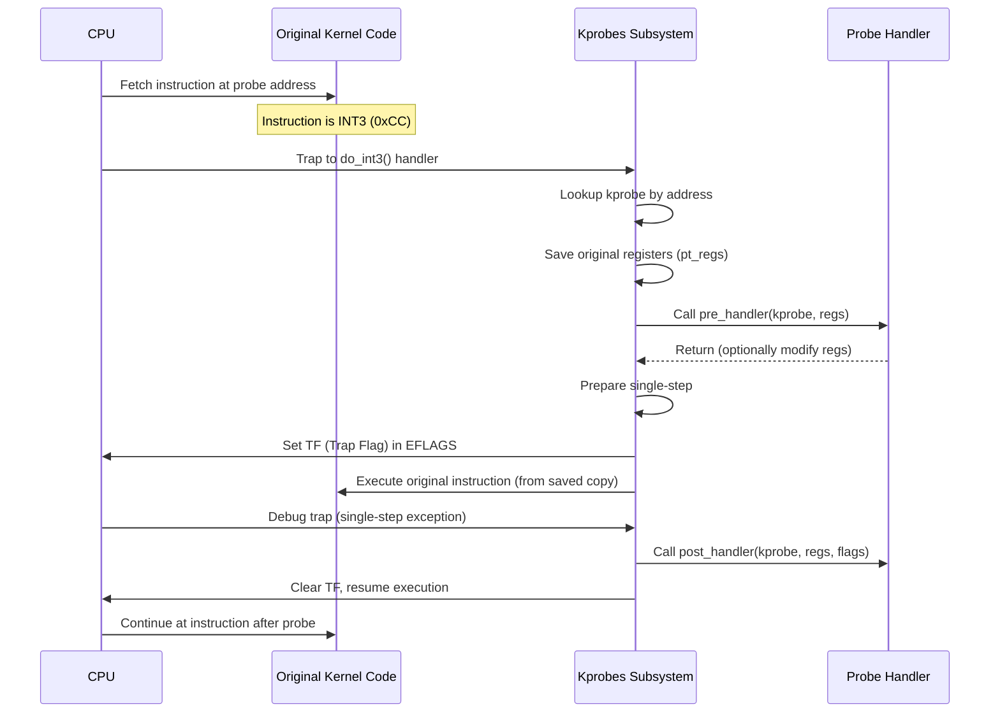
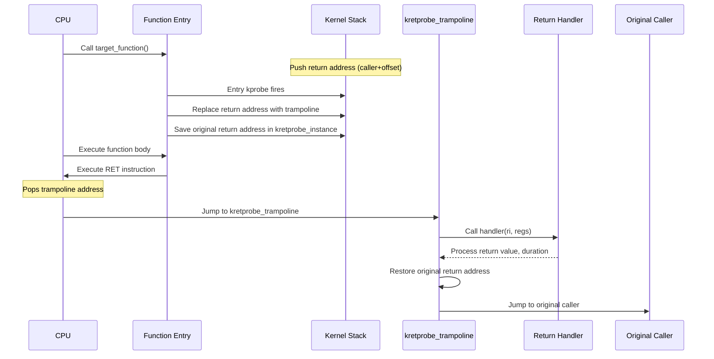

# Lesson 2: Kprobes Basics

## 1. First-Principles Intuition & Invariants

Dynamic instrumentation of production kernels requires mechanisms that impose zero static overhead, minimal dynamic overhead, and operate without source modification or recompilation. Kprobes achieves this by exploiting the kernel's existing exception handling infrastructure to redirect control flow at arbitrary instruction addresses. This design enables runtime insertion of instrumentation probes into kernel code paths that would otherwise require invasive modifications to observe.

The fundamental problem is observability of kernel-internal state and control flow in live systems. Traditional approaches—printk debugging, static tracepoints, kernel recompilation—each fail critical production requirements. Printk introduces I/O overhead and requires reboot. Static tracepoints require predicting instrumentation points at compile time. Kernel recompilation violates stability guarantees and deployment constraints. Kprobes solves this by treating the kernel text segment as data: at runtime, we locate instruction addresses of interest, replace them with breakpoint instructions, and register handlers that execute on breakpoint exceptions.

The theoretical foundation rests on three principles:

**Instruction-level interception**: Modern processors provide single-instruction breakpoint mechanisms (x86's `int3`, ARM's `brk`, RISC-V's `ebreak`) that trap into exception handlers with microsecond-scale overhead. By replacing target instructions with breakpoints, we redirect control flow without rewriting surrounding code.

**Single-step emulation**: After breakpoint handling, we must restore original program flow. Kprobes saves the original instruction, executes probe handlers, then either single-steps the original instruction in a safe context or simulates its effects before resuming normal execution.

**Atomicity and SMP safety**: Instruction patching must be atomic across CPUs. Modern architectures provide cache-coherent instruction streams, but patching still requires cross-CPU synchronization primitives (`stop_machine()`, text_poke mechanisms) to prevent races where one CPU executes half-patched instructions.

**Key invariants**:
- Probe insertion/removal must not corrupt kernel text or data
- Probe handlers execute in kernel context with original register state accessible
- Original instruction semantics are preserved (either via single-step or emulation)
- Multiple probes can coexist at different addresses without interference
- The system remains schedulable and interruptible during probe execution (non-NMI context)

**Architectural constraints**: Not all instructions are probeable. Control flow instructions (jumps, calls, returns) and position-dependent instructions require special handling or are blacklisted. Instructions in critical kernel paths (interrupt entry, page fault handlers) may be unprobeable to avoid infinite recursion or system instability.

## 2. Core Architecture & Mechanics

### 2.1 Probe Types and Semantics

Kprobes provides three primary probe types, each with distinct use cases and implementation mechanics:

**Kprobe** (function entry/arbitrary instruction): Fires when execution reaches a specified kernel address. The probe handler receives a `struct pt_regs *` containing CPU register state at the moment of interception. Handlers can inspect arguments (function parameters in registers/stack), modify registers, or record events. The typical use case is instrumenting function entry points to observe arguments or count invocations.

**Kretprobe** (function exit): Fires when a function returns. Implemented via trampoline: on function entry, Kprobe replaces the return address on the stack with a trampoline address. When the function executes `ret`, it jumps to the trampoline, which invokes the kretprobe handler, then restores the original return address and continues. This mechanism captures return values and function duration without modifying the function body.

**Jprobe** (deprecated, removed in 5.x kernels): Allowed handlers to execute with the exact register state of the probed function, effectively "hijacking" execution. Complex to implement safely and prone to breakage; replaced by Kprobes with better register access interfaces.

### 2.2 Breakpoint-Based Implementation

The Linux kprobes subsystem implements probe interception through a multi-stage breakpoint mechanism:



**Detailed flow**:

1. **Registration**: `register_kprobe(&kp)` allocates a `struct kprobe`, validates the target address, and atomically replaces the first byte of the target instruction with `0xCC` (x86 `int3`). The original byte is saved in `kp.opcode`.

2. **Breakpoint exception**: When CPU executes `int3`, hardware traps into `do_int3()` in `arch/x86/kernel/traps.c`. The kernel recognizes this as a kprobe breakpoint and invokes `kprobe_int3_handler()`.

3. **Pre-handler invocation**: Kprobes looks up the probe by address in a hash table (`kprobe_table`), finds the matching `struct kprobe`, and calls `kp->pre_handler(kp, regs)`. The handler can inspect/modify `regs` (function arguments, return address, etc.).

4. **Instruction emulation or single-step**: Kprobes must now execute the original instruction that was replaced by `int3`. Two strategies exist:
   - **Single-step**: Set the CPU's trap flag (TF in EFLAGS on x86), restore the original instruction bytes in a safe copy, execute that instruction, then trap back into the kernel on the next instruction. This approach is simple but has overhead.
   - **Emulation**: For certain instruction types (simple moves, arithmetic), kprobes can simulate the instruction's effect directly by modifying registers. This avoids the single-step trap overhead but requires per-architecture instruction decoders.

5. **Post-handler invocation**: After the original instruction executes, kprobes calls `kp->post_handler(kp, regs, flags)`. Handlers can observe the result of the instruction or perform cleanup.

6. **Resume**: CPU continues execution at the instruction following the probe point.

### 2.3 Kretprobe Trampoline Mechanism

Kretprobes intercept function returns without modifying function bodies. The implementation uses a return address hijacking technique:



**Implementation details**:

1. **Registration**: `register_kretprobe(&rp)` internally registers a kprobe at the function entry. The entry handler (`pre_handler`) allocates a `struct kretprobe_instance`, saves the original return address from the stack, and replaces it with the address of `kretprobe_trampoline`.

2. **Trampoline execution**: When the function executes `ret`, it pops the trampoline address and jumps there. The trampoline is a small assembly stub that saves registers, looks up the corresponding `kretprobe_instance`, invokes all registered return handlers, restores the original return address, and jumps there.

3. **Multi-instance handling**: If a function is recursively called or called concurrently on multiple CPUs, multiple `kretprobe_instance` structures are allocated. The trampoline uses a per-CPU list to track active instances and match return events to the correct probe.

### 2.4 Data Structures

**`struct kprobe`** (kernel/include/linux/kprobes.h):
```c
struct kprobe {
    struct hlist_node hlist;        // Hash table linkage
    kprobe_opcode_t *addr;          // Probe address
    const char *symbol_name;        // Optional symbol name
    unsigned int offset;            // Offset into symbol
    kprobe_pre_handler_t pre_handler;
    kprobe_post_handler_t post_handler;
    kprobe_opcode_t opcode;         // Saved original opcode
    struct arch_specific_insn ainsn; // Arch-specific (single-step buffer, etc.)
    u32 flags;
};
```

**`struct kretprobe`**:
```c
struct kretprobe {
    struct kprobe kp;               // Embedded entry probe
    kretprobe_handler_t handler;    // Return handler
    int maxactive;                  // Max concurrent instances
    int nmissed;                    // Missed returns (out of instances)
    struct hlist_head free_instances;
    raw_spinlock_t lock;
};
```

**`struct kretprobe_instance`**:
```c
struct kretprobe_instance {
    struct hlist_node hlist;
    struct kretprobe *rp;
    kprobe_opcode_t *ret_addr;      // Original return address
    struct task_struct *task;
    void *data;                     // Handler-specific data
};
```

The kprobe subsystem maintains a global hash table (`kprobe_table[]`) keyed by instruction address. This enables O(1) lookup on breakpoint exceptions. The table uses RCU for read-side lock-free access, critical for minimizing probe overhead.

### 2.5 Instruction Patching and SMP Safety

Atomic instruction modification across SMP systems is non-trivial. On x86, a single-byte write (`0xCC` for `int3`) is atomic, but multi-byte instruction replacement requires careful sequencing to avoid intermediate states where some CPUs see half-patched code.

**Text poking protocol** (`text_poke()` API):
1. Use `stop_machine()` to pause all CPUs except one
2. Modify instruction bytes with interrupts disabled
3. Issue instruction cache flushes (`sync_core()`)
4. Resume all CPUs

Modern kernels optimize this with batching: multiple probes are inserted/removed in a single `stop_machine()` call to amortize the overhead.

**Alternative: INT3-based patching** (used by ftrace and optprobes):
1. Write `int3` at target address (atomic single-byte write)
2. All CPUs now trap on this instruction (safe intermediate state)
3. Write remaining instruction bytes
4. Remove `int3` with final byte (atomic)

This avoids full system pauses for probe insertion.

### 2.6 Architecture-Specific Considerations

**x86/x86_64**:
- Breakpoint: `int3` (0xCC)
- Single-step: TF bit in EFLAGS
- Instruction length: variable (1-15 bytes), requires full disassembly
- Optprobes: Replace breakpoint with a direct jump to optimized probe code (eliminates exception overhead)

**ARM64**:
- Breakpoint: `brk` instruction
- Single-step: MDSCR_EL1.SS bit
- Fixed-length instructions (4 bytes) simplify patching
- No optprobes (exception overhead remains)

**RISC-V**:
- Breakpoint: `ebreak` instruction
- Single-step: via debug registers
- Fixed-length instructions (4 bytes in RV64)

## 3. High-Performance Optimization & Failure Modes

### 3.1 Performance Characteristics

Kprobe overhead consists of three components:

1. **Breakpoint exception**: ~100-500 CPU cycles on x86 (varies by microarchitecture). Includes trap entry, context save, handler dispatch, context restore, trap exit.

2. **Handler execution**: Depends on handler complexity. A simple counter increment: 10-20 cycles. Recording stack traces or complex event structures: 1000+ cycles.

3. **Single-step exception** (if used): Another ~100-500 cycles.

**Optprobes optimization**: On x86, optprobes replace the `int3` breakpoint with a 5-byte `jmp` instruction to a detour buffer containing:
```
call optimized_handler
jmp back_to_original_code
```
This eliminates breakpoint exception overhead, reducing latency by 50-70%. Enabled via `CONFIG_OPTPROBES` and automatic for suitable probe points.

**Kretprobe overhead**: Higher than kprobes due to trampoline indirection. Each return incurs:
- Stack manipulation (save/restore return address)
- Trampoline execution (~100 cycles)
- Handler invocation
- Instance lookup (~50 cycles with hashing)

**Scalability limits**: The kprobe subsystem uses a global hash table with per-bucket spinlocks. Under high contention (many probes firing simultaneously on many CPUs), lock contention can become a bottleneck. For extreme-scale tracing (10,000+ probe fires/sec), consider aggregating events in per-CPU buffers before writing to shared structures.

### 3.2 Failure Modes and Mitigation

**Probe registration failures**:
- **Invalid address**: Address not in kernel text segment. Mitigation: `kallsyms_lookup_name()` validates symbols before registration.
- **Blacklisted address**: Probing the kprobes subsystem itself or critical exception handlers causes recursion. Mitigation: `kprobes_blacklist[]` prevents registration at sensitive addresses.
- **Non-probeable instruction**: Instructions in kprobe infrastructure or CPU-specific blacklists. Mitigation: Registration returns `-EINVAL` with diagnostic message.

**Runtime failures**:
- **Handler bugs**: Null pointer dereferences, infinite loops, or memory corruption in handlers crash the kernel. Mitigation: Handlers run in kernel context with no memory protection; rigorous testing and defensive coding (bounds checks, null checks) are mandatory.
- **Stack overflow**: Deep recursion in handlers can exhaust kernel stack (typically 8-16 KB). Mitigation: Keep handlers shallow; use `NOKPROBE_SYMBOL()` to prevent recursive probing of helper functions.
- **Deadlock**: Handler acquires locks that conflict with locks held at probe point. Mitigation: Handlers should avoid blocking operations; use lock-free data structures (per-CPU buffers, atomic operations) where possible.

**Kretprobe-specific failures**:
- **Instance exhaustion**: If a function is called recursively more than `maxactive` times, kretprobe runs out of instances and increments `rp->nmissed`. Returns are not tracked. Mitigation: Increase `maxactive` (default: typically 2x NR_CPUS) or use alternative tracing methods for deeply recursive functions.
- **Return address corruption**: If a function modifies its return address (tail calls, longjmp), kretprobe may jump to the wrong address or crash. Mitigation: Audit target functions; avoid probing functions that manipulate stack frames.

**Concurrency issues**:
- **SMP races**: Probe insertion while other CPUs execute the target function. Mitigation: `stop_machine()` or INT3-based patching ensures atomic updates.
- **Preemption**: Handler preempted while manipulating shared data. Mitigation: Disable preemption in critical sections (`preempt_disable()/preempt_enable()`) or use spinlocks.

### 3.3 Production Hardening

**Resource limits**: Limit the number of active probes via `/proc/sys/debug/kprobes-optimization` and custom checks. Monitor `nmissed` counters to detect instance exhaustion.

**Error injection testing**: Use fault injection frameworks (e.g., `CONFIG_FAULT_INJECTION`) to test probe error paths: registration failures, handler errors, instance allocation failures.

**Probe lifecycle management**: Always unregister probes (`unregister_kprobe()`, `unregister_kretprobe()`) before module unload. Failure to do so leaves dangling pointers and crashes when the probe fires.

**Debugging probes**: Enable `CONFIG_KPROBES_SANITY_TEST` and `CONFIG_DEBUG_KPROBES` for additional runtime checks. Use `dmesg` and `/sys/kernel/debug/kprobes/list` to inspect active probes.

### 3.4 Integration with BPF

Modern eBPF leverages kprobes as an attachment mechanism: BPF programs attach to kprobes and execute in the probe handler context. The kprobe+BPF combination provides:
- **Safety**: BPF verifier ensures termination and memory safety
- **Performance**: BPF JIT compiles programs to native code
- **Flexibility**: BPF maps enable complex aggregation and filtering

Example: BPF program attached to kprobe on `do_sys_open()` to trace file opens:
```c
SEC("kprobe/do_sys_open")
int trace_open(struct pt_regs *ctx) {
    const char *filename = (const char *)PT_REGS_PARM2(ctx);
    bpf_trace_printk("open: %s\n", filename);
    return 0;
}
```

The BPF verifier ensures the program cannot crash the kernel, making kprobe+BPF safer than raw kprobes for production use.

## 4. Practical Usage Patterns

### 4.1 Raw Kprobe Example (Kernel Module)

```c
#include <linux/kernel.h>
#include <linux/module.h>
#include <linux/kprobes.h>

static struct kprobe kp = {
    .symbol_name = "do_sys_open",
};

static int handler_pre(struct kprobe *p, struct pt_regs *regs) {
    // On x86_64, first argument (dfd) is in RDI, second (filename) in RSI
    const char __user *filename = (const char __user *)regs->si;
    char buf[256];
    
    if (strncpy_from_user(buf, filename, sizeof(buf)) > 0) {
        pr_info("kprobe: open(%s)\n", buf);
    }
    
    return 0;  // Must return 0 to continue execution
}

static int __init kprobe_init(void) {
    int ret;
    kp.pre_handler = handler_pre;
    
    ret = register_kprobe(&kp);
    if (ret < 0) {
        pr_err("register_kprobe failed: %d\n", ret);
        return ret;
    }
    
    pr_info("Kprobe registered at %p\n", kp.addr);
    return 0;
}

static void __exit kprobe_exit(void) {
    unregister_kprobe(&kp);
    pr_info("Kprobe unregistered\n");
}

module_init(kprobe_init);
module_exit(kprobe_exit);
MODULE_LICENSE("GPL");
```

### 4.2 Kretprobe Example (Function Timing)

```c
#include <linux/kernel.h>
#include <linux/module.h>
#include <linux/kprobes.h>
#include <linux/sched.h>

static struct kretprobe rp = {
    .handler = ret_handler,
    .maxactive = 20,
};

struct my_data {
    ktime_t entry_time;
};

static int entry_handler(struct kretprobe_instance *ri, struct pt_regs *regs) {
    struct my_data *data;
    
    data = (struct my_data *)ri->data;
    data->entry_time = ktime_get();
    return 0;
}

static int ret_handler(struct kretprobe_instance *ri, struct pt_regs *regs) {
    struct my_data *data = (struct my_data *)ri->data;
    ktime_t delta = ktime_sub(ktime_get(), data->entry_time);
    
    pr_info("do_sys_open took %lld ns\n", ktime_to_ns(delta));
    return 0;
}

static int __init kretprobe_init(void) {
    int ret;
    
    rp.kp.symbol_name = "do_sys_open";
    rp.entry_handler = entry_handler;
    rp.data_size = sizeof(struct my_data);
    
    ret = register_kretprobe(&rp);
    if (ret < 0) {
        pr_err("register_kretprobe failed: %d\n", ret);
        return ret;
    }
    
    pr_info("Kretprobe registered\n");
    return 0;
}

static void __exit kretprobe_exit(void) {
    unregister_kretprobe(&rp);
    pr_info("Kretprobe unregistered, missed: %d\n", rp.nmissed);
}

module_init(kretprobe_init);
module_exit(kretprobe_exit);
MODULE_LICENSE("GPL");
```

### 4.3 BPF Kprobe Example (via bpftrace)

```bash
# Trace all open() syscalls with filename and process
bpftrace -e 'kprobe:do_sys_open { printf("%-6d %-16s %s\n", pid, comm, str(arg1)); }'

# Histogram of read() sizes
bpftrace -e 'kprobe:vfs_read { @bytes = hist(arg2); }'

# Trace function latency
bpftrace -e 'kprobe:do_sys_open { @start[tid] = nsecs; }
             kretprobe:do_sys_open /@start[tid]/ {
                 @latency_ns = hist(nsecs - @start[tid]);
                 delete(@start[tid]);
             }'
```

### 4.4 BPF Kprobe Example (C + libbpf)

```c
// kprobe_example.bpf.c
#include <linux/bpf.h>
#include <bpf/bpf_helpers.h>
#include <bpf/bpf_tracing.h>

struct {
    __uint(type, BPF_MAP_TYPE_HASH);
    __uint(max_entries, 10240);
    __type(key, u32);
    __type(value, u64);
} open_count SEC(".maps");

SEC("kprobe/do_sys_open")
int BPF_KPROBE(trace_open, int dfd, const char *filename) {
    u32 pid = bpf_get_current_pid_tgid() >> 32;
    u64 *count, one = 1;
    
    count = bpf_map_lookup_elem(&open_count, &pid);
    if (count) {
        __sync_fetch_and_add(count, 1);
    } else {
        bpf_map_update_elem(&open_count, &pid, &one, BPF_ANY);
    }
    
    return 0;
}

char _license[] SEC("license") = "GPL";
```

Compile and load:
```bash
clang -O2 -g -target bpf -c kprobe_example.bpf.c -o kprobe_example.bpf.o
bpftool prog load kprobe_example.bpf.o /sys/fs/bpf/kprobe_example
bpftool map show
```

## 5. Comparison with Alternatives

**Kprobes vs Tracepoints**:
- Tracepoints: Static, stable ABI, low overhead (~10-50 cycles), limited to predefined points
- Kprobes: Dynamic, no stable ABI, higher overhead (~100-500 cycles), probe anywhere
- **When to use**: Tracepoints for production monitoring; kprobes for ad-hoc debugging and kernel internals without tracepoints

**Kprobes vs Ftrace**:
- Ftrace: Function-level tracing via compiler-inserted nops (`-pg` flag), records all function calls
- Kprobes: Instruction-level tracing, more flexible but higher overhead
- **When to use**: Ftrace for call graphs and function timing; kprobes for specific event capture

**Kprobes vs SystemTap/DTrace**:
- SystemTap: High-level scripting language, compiles to kernel modules with kprobes backend
- DTrace: Similar but with safety guarantees; Linux port incomplete
- **When to use**: SystemTap for complex scripts; raw kprobes for minimal overhead and no dependencies

**Kprobes vs Uprobes**:
- Uprobes: Userspace equivalent of kprobes, probes user application code
- Kprobes: Kernel-only
- **When to use**: Uprobes for application tracing; kprobes for kernel internals

## 6. References and Further Reading

- **Linux Kernel Documentation**: `Documentation/trace/kprobes.rst` — Comprehensive reference
- **"Understanding the Linux Kernel" (3rd Ed.)** by Bovet & Cesati — Exception handling and interrupt mechanisms (Chapter 4)
- **"BPF Performance Tools" by Brendan Gregg** — Production BPF+kprobe patterns (Chapters 2, 13-15)
- **"Linux Kernel Development" (3rd Ed.) by Robert Love** — Kernel architecture and module programming (Chapters 10, 17)
- **Papers**:
  - "Kprobes: A Kernel Debugging Facility" (OLS 2005) — Original kprobes design
  - "Optimizing Kprobes" (Linux Plumbers 2009) — Optprobes optimization
- **Source code**: `kernel/kprobes.c`, `arch/x86/kernel/kprobes/`, `samples/kprobes/`
