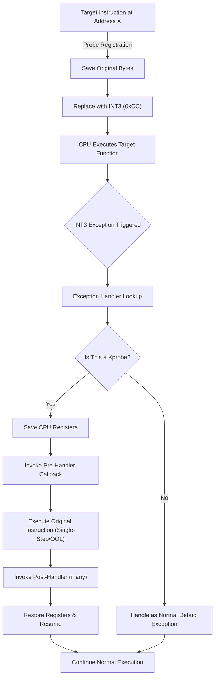
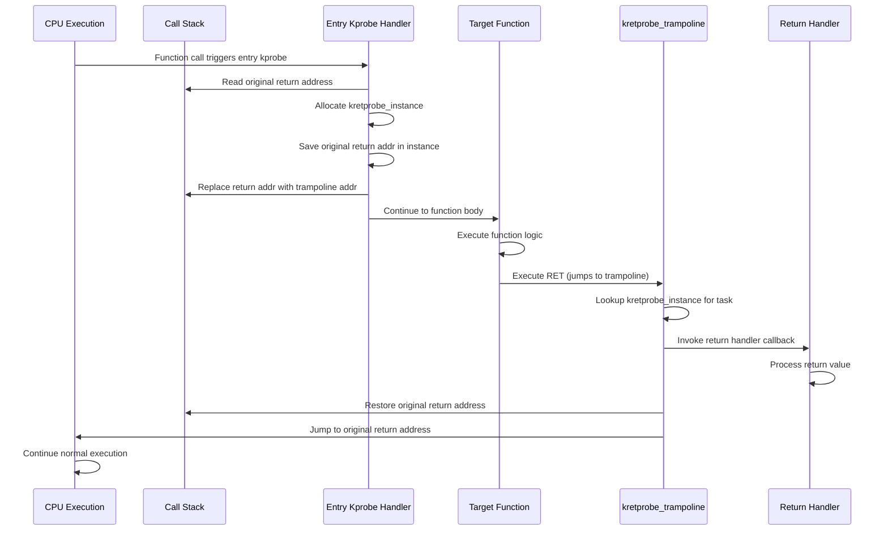
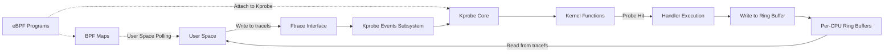

# Lesson 3: Advanced Kprobes Techniques

## 1. First-Principles Intuition & Invariants

Dynamic tracing represents a fundamental capability in systems observability: the ability to extract runtime information from executing code without prior instrumentation. Unlike static instrumentation (where trace points are compiled into the binary) or source-level modification, dynamic tracing operates on live, executing code—inserting observation points at arbitrary addresses during runtime. This distinction is critical in production environments where recompilation is infeasible, downtime is unacceptable, and the target code may be proprietary or closed-source.

Kprobes (kernel probes) constitute the Linux kernel's infrastructure for dynamic instrumentation. They operate by temporarily replacing target instructions with trap instructions (breakpoints), transferring control to probe handlers when execution reaches those addresses. While basic Kprobes provide instruction-level interception, advanced variants—kretprobes (return probes), and the now-deprecated jprobes—enable comprehensive function tracing, including argument capture, return value inspection, and execution timing.

**The Core Invariant: Non-Interference**

The fundamental invariant governing Kprobes is semantic preservation: a probe must never alter the observable behavior of the probed function. This requirement manifests in several technical constraints:

1. **Register State Preservation**: All CPU registers must be saved upon probe entry and restored upon exit. The probed function must observe identical register contents as if the probe did not exist.

2. **Stack Frame Integrity**: The stack pointer and frame pointer must remain consistent. Probe handlers execute in the context of the interrupted function but cannot corrupt its stack frame.

3. **Memory Ordering Guarantees**: On multi-core systems, memory barriers and atomic operations ensure that probe installation/removal does not create race conditions with concurrent execution of the probed function.

4. **Execution Atomicity**: Probe installation must be atomic at the instruction level. Partial probe installation could cause a CPU to execute a half-written instruction, resulting in undefined behavior or kernel panic.

**Architectural Foundation: Instruction Replacement and Control Flow Hijacking**

Kprobes function by exploiting the CPU's trap/exception mechanism. On x86-64 architectures, the kernel replaces the first byte of the target instruction with `0xCC` (the `int3` opcode), which generates a debug exception. The original instruction bytes are saved in the `kprobe` structure for later restoration. When execution reaches the trap:

1. CPU generates a debug exception, transferring control to the kernel's exception handler
2. The handler consults the Kprobes subsystem to identify whether this trap corresponds to an active probe
3. If matched, the system invokes the pre-handler callback, passing saved register state
4. The original instruction executes via single-stepping or out-of-line execution
5. Post-handlers (if any) execute after the original instruction completes
6. Normal execution resumes at the next instruction

This mechanism imposes minimal overhead when a probe is not hit (no overhead) and bounded overhead when triggered (typically microseconds for simple handlers).

**Security and Isolation Boundaries**

Kprobes operate within the kernel's privilege level, granting handlers unrestricted access to kernel memory. This power necessitates strict access controls: only privileged processes (CAP_SYS_ADMIN or CAP_BPF with appropriate security module permissions) can register probes. Modern kernels restrict Kprobes on security-sensitive functions (those marked with `__kprobes` or `NOKPROBE_SYMBOL`) to prevent recursive probing that could compromise kernel integrity or facilitate privilege escalation.



## 2. Core Architecture & Mechanics

### Kprobe Data Structures and Registration

The kernel represents each probe with `struct kprobe` (defined in `include/linux/kprobes.h`):

```c
struct kprobe {
    struct hlist_node hlist;           // Hash table linkage
    kprobe_opcode_t *addr;             // Target instruction address
    const char *symbol_name;           // Symbol name (alternative to addr)
    unsigned int offset;               // Offset within symbol
    kprobe_pre_handler_t pre_handler;  // Pre-execution callback
    kprobe_post_handler_t post_handler;// Post-execution callback
    kprobe_opcode_t opcode;            // Saved original opcode
    struct arch_specific_insn ainsn;   // Architecture-specific data
    u32 flags;                         // Probe state flags
};
```

Registration follows this sequence:

1. **Address Resolution**: If `symbol_name` is provided, the kernel resolves it to a virtual address using `kallsyms_lookup_name()`. The `offset` field allows probing at specific byte offsets within functions.

2. **Validation**: The kernel verifies the target address is probeable (not in a blacklisted function, not in read-only memory marked as non-executable, properly aligned).

3. **Opcode Preservation**: The original instruction bytes are copied to `ainsn.insn` for out-of-line execution or single-stepping.

4. **Atomic Replacement**: Using `text_poke()` or equivalent architecture-specific mechanism, the kernel atomically writes the breakpoint instruction. This operation uses cross-CPU synchronization to ensure no CPU executes the target address during modification.

5. **Hash Table Insertion**: The probe is inserted into a per-CPU hash table indexed by target address for O(1) lookup during exception handling.

### Kretprobes: Tracing Function Returns

Return probes (kretprobes) enable tracing function exits, capturing return values and measuring execution time. Unlike simple Kprobes, kretprobes must intercept the function's return path—a non-trivial challenge because functions may have multiple return points (multiple `ret` instructions) and the return address is stored on the stack.

**Implementation Mechanism**

Kretprobes work by hijacking the return address on the stack:

```c
struct kretprobe {
    struct kprobe kp;                  // Embedded kprobe for function entry
    kretprobe_handler_t handler;       // Return handler callback
    kretprobe_handler_t entry_handler; // Optional entry handler
    int maxactive;                     // Max concurrent instances
    int nmissed;                       // Count of missed returns
    struct hlist_head free_instances;  // Pool of kretprobe_instance
    raw_spinlock_t lock;               // Protects instance lists
};

struct kretprobe_instance {
    struct hlist_node hlist;           // Linkage
    struct kretprobe *rp;              // Parent kretprobe
    kprobe_opcode_t *ret_addr;         // Original return address
    struct task_struct *task;          // Task this instance belongs to
    char data[0];                      // Per-instance data
};
```

When a kretprobe is registered:

1. A Kprobe is placed at the function's entry point
2. When the entry Kprobe fires, the pre-handler:
   - Allocates a `kretprobe_instance` from the free pool
   - Saves the original return address from the stack
   - Replaces the return address on the stack with the address of a trampoline function (`kretprobe_trampoline`)
   - Associates the instance with the current task

3. When the function executes `ret`, control transfers to the trampoline
4. The trampoline:
   - Looks up the `kretprobe_instance` for the current task
   - Invokes the return handler, passing the instance (which contains the original return address and any entry-handler data)
   - Restores the original return address
   - Executes an indirect jump to the saved return address, resuming normal execution

5. The instance is returned to the free pool for reuse

**Handling Concurrent Invocations**

Functions may be called recursively or concurrently across CPUs. The `maxactive` parameter specifies how many simultaneous instances the kretprobe can handle. If all instances are in use when the function is entered, the return probe is "missed" (tracked in `nmissed`), and no return handler executes for that invocation. This design prevents memory exhaustion while maintaining correctness.

```c
// Example: Tracing sys_open with argument and return value capture
#include <linux/kprobes.h>
#include <linux/kernel.h>

static int entry_handler(struct kretprobe_instance *ri, struct pt_regs *regs)
{
    // On x86-64, first argument (filename) is in RDI
    char *filename = (char *)regs->di;
    pr_info("sys_open called with filename: %s\n", filename);
    return 0;
}

static int ret_handler(struct kretprobe_instance *ri, struct pt_regs *regs)
{
    // Return value is in RAX
    long retval = regs_return_value(regs);
    pr_info("sys_open returned: %ld\n", retval);
    return 0;
}

static struct kretprobe my_kretprobe = {
    .kp.symbol_name = "do_sys_open",
    .handler = ret_handler,
    .entry_handler = entry_handler,
    .maxactive = 20,  // Support up to 20 concurrent calls
};

static int __init kretprobe_init(void)
{
    int ret = register_kretprobe(&my_kretprobe);
    if (ret < 0) {
        pr_err("register_kretprobe failed, returned %d\n", ret);
        return ret;
    }
    pr_info("Planted return probe at %s\n", my_kretprobe.kp.symbol_name);
    return 0;
}

static void __exit kretprobe_exit(void)
{
    unregister_kretprobe(&my_kretprobe);
    pr_info("kretprobe unregistered. Missed %d returns\n", my_kretprobe.nmissed);
}

module_init(kretprobe_init);
module_exit(kretprobe_exit);
MODULE_LICENSE("GPL");
```



### Jprobes: Function Entry Hijacking (Deprecated)

Jprobes provided a mechanism to intercept function calls and inspect arguments with convenient access to the function's parameters as local variables. They worked by replacing the function's entry instruction with a jump to a handler that had the same signature as the target function. After the handler executed, the original function would run.

**Important**: Jprobes were removed from the Linux kernel in version 5.0 due to architectural limitations and reliability issues. They could not reliably handle functions with optimized calling conventions or tail-call optimizations. Modern alternatives include:

- **Kretprobes with entry handlers** for argument inspection
- **eBPF kprobes** with CO-RE (Compile Once, Run Everywhere) for safer argument access
- **Ftrace function hooks** for performance-critical tracing

For historical understanding, the jprobe mechanism worked as follows:

1. A breakpoint was placed at the function entry
2. When triggered, the handler copied the stack frame and jumped to a user-defined function with matching signature
3. The user function could inspect arguments directly as local variables
4. Upon return, the system restored the original stack and executed the target function

The fundamental flaw was that this approach made fragile assumptions about calling conventions, stack layout, and compiler optimizations—assumptions frequently violated by modern compilers.

### Integration with Ftrace

Ftrace (function tracer) is the kernel's built-in tracing infrastructure, supporting function graph tracing, latency tracing, and event tracing. Kprobes and Ftrace operate at different abstraction layers but can be composed:

- **Ftrace** operates at function boundaries using compiler-inserted instrumentation (`-pg` flag, generating `mcount` or `fentry` call sites) or dynamic patching of function prologs
- **Kprobes** can attach to arbitrary instruction addresses within functions

Modern kernels allow Kprobes to be exposed through Ftrace's unified interface via `kprobe_events`. This enables users to define Kprobes using Ftrace's syntax and consume probe data through the Ftrace ring buffer:

```bash
# Create a kprobe event for tcp_sendmsg
echo 'p:my_tcp_probe tcp_sendmsg size=%dx' > /sys/kernel/debug/tracing/kprobe_events

# Enable the event
echo 1 > /sys/kernel/debug/tracing/events/kprobes/my_tcp_probe/enable

# Read trace output
cat /sys/kernel/debug/tracing/trace
```

This integration provides:
- Unified data collection through Ftrace's per-CPU ring buffers
- Automatic timestamp correlation with other Ftrace events
- Access to Ftrace's filtering and aggregation capabilities



### Out-of-Line Execution vs Single-Stepping

When a Kprobe fires, the original instruction at the probe point must still execute. The kernel uses two strategies:

**Single-Stepping**: The CPU's debug facilities (trap flag on x86) execute one instruction at a time. After the pre-handler runs, the kernel:
1. Restores the original instruction temporarily
2. Sets the CPU's single-step flag
3. Executes the instruction
4. Takes a single-step exception
5. Runs post-handlers
6. Reinstalls the breakpoint

This approach is simple but slow due to multiple exception cycles.

**Out-of-Line Execution (Preferred)**: The original instruction is copied to a separate buffer (`ainsn.insn`) and possibly adjusted for PC-relative addressing. The pre-handler returns a special code indicating out-of-line execution. The kernel then:
1. Transfers control to the copied instruction in the buffer
2. The copied instruction executes natively (no exceptions)
3. A jump at the end of the buffer transfers control back to the post-handler path
4. Execution resumes after the original probe point

Out-of-line execution reduces overhead by avoiding single-step exceptions, but requires architecture-specific instruction emulation for certain instruction types (PC-relative jumps, RIP-relative addressing on x86-64).

## 3. High-Performance Optimization & Failure Modes

### Performance Considerations

Kprobe overhead consists of:
1. **Exception handling**: CPU pipeline flush, privilege level transition, register save/restore
2. **Handler execution**: User-defined callback processing time
3. **Hash table lookup**: Finding the kprobe structure for the triggered address
4. **Lock contention**: Serialization during probe registration/unregistration

Typical overhead per probe hit: 1-5 microseconds on modern CPUs, depending on handler complexity.

**Optimization Strategies**

1. **Minimize Handler Work**: Keep handlers short and non-blocking. Offload complex processing to user space via ring buffers or BPF maps.

2. **Use Kretprobes Judiciously**: Return probes have higher overhead than entry probes due to stack manipulation and instance management. Profile to ensure the observability value justifies the cost.

3. **Batch Data Collection**: Instead of emitting data on every probe hit, accumulate statistics in per-CPU variables and periodically flush to user space.

4. **Pre-Filtering in Handler**: Implement early-exit conditions in handlers to avoid unnecessary processing:

```c
static int pre_handler(struct kprobe *p, struct pt_regs *regs)
{
    // Only trace for specific PID
    if (current->pid != target_pid)
        return 0;
    
    // Handler logic for target PID
    // ...
    return 0;
}
```

5. **Leverage eBPF**: Modern BPF-based kprobes offer significantly lower overhead through JIT compilation, in-kernel aggregation, and verifier-enforced safety guarantees. eBPF programs attached to Kprobes can perform filtering, aggregation, and histogram generation entirely in kernel space.

**Comparing Kprobes vs. eBPF Kprobes**

| Aspect | Traditional Kprobes | eBPF Kprobes |
|--------|-------------------|--------------|
| Handler Language | C (kernel module) | Restricted C (BPF) |
| Safety | Relies on programmer | Verifier-enforced |
| Performance | ~2-5 μs overhead | ~0.5-2 μs overhead |
| Data Collection | Ring buffer/netlink | BPF maps (hash, array, ring buffer) |
| Deployment | Requires module load | Loadable without reboot |
| Kernel Panics | Possible with buggy handler | Prevented by verifier |

### Failure Modes and Mitigations

**1. Race Conditions During Probe Installation**

On SMP systems, a CPU might execute the target instruction while another CPU is installing the probe. The kernel uses cross-CPU synchronization (`text_poke_bp()` on x86) to ensure atomicity:

- Send IPI to all CPUs to synchronize
- Install the breakpoint instruction atomically
- Use memory barriers to ensure visibility
- Flush instruction caches across all CPUs

**2. Probe Handler Crashes**

If a probe handler dereferences invalid memory or triggers an oops, the kernel may panic or become unstable. Mitigations:

- **Defensive Programming**: Validate all pointers using `probe_kernel_read()` (now `copy_from_kernel_nofault()`) before dereferencing
- **eBPF Verifier**: BPF programs are statically analyzed to prevent invalid memory access
- **Handler Timeouts**: Some kernel configurations detect handlers that run too long and forcibly disable the probe

```c
// Safe memory access in Kprobe handler
static int pre_handler(struct kprobe *p, struct pt_regs *regs)
{
    char filename[256];
    long ret;
    
    // Unsafe: char *name = (char *)regs->di;
    // Safe:
    ret = copy_from_kernel_nofault(filename, (void *)regs->di, sizeof(filename));
    if (ret) {
        pr_warn("Failed to read filename pointer\n");
        return 0;
    }
    
    pr_info("Filename: %s\n", filename);
    return 0;
}
```

**3. Return Address Corruption (Kretprobes)**

If a kretprobe instance is not properly freed (e.g., function longjmps or exits abnormally without returning), the return address remains modified. This can cause:

- Control flow to trampoline when it shouldn't, resulting in a crash
- Memory leaks from unreturned instances

Mitigations:
- Task exit hooks clean up all kretprobe instances associated with dying tasks
- The `maxactive` parameter bounds memory consumption
- Modern kernels use task-local storage to track instances more reliably

**4. Probe Blacklisting Violations**

Probing certain kernel functions can cause recursive traps or deadlocks:

- Probing the Kprobe exception handler itself (infinite recursion)
- Probing spinlock functions while holding locks (deadlock)
- Probing NMI handlers (timing-critical, non-reentrant code)

The kernel maintains a blacklist of unprobeable functions marked with `NOKPROBE_SYMBOL()`. Attempting to probe these functions returns `-EINVAL` during registration.

**5. Instruction Emulation Errors**

Out-of-line execution requires copying and potentially adjusting instructions. Errors can occur with:

- Complex instructions with multiple memory operands
- Instructions that read the instruction pointer (PC-relative addressing)
- Privileged instructions not intended to execute in the copied context

Modern kernels have extensive instruction decoders, but exotic instruction sequences can still cause issues. Always test probes thoroughly in non-production environments.

**6. Performance Degradation in High-Throughput Paths**

Placing Kprobes in hot paths (e.g., network packet processing, scheduler fast path) can cause severe performance degradation. Profile the system under realistic load to identify unacceptable overhead.

### Debugging Kprobe Issues

**Enable Kprobe Debugging**:
```bash
# View registered Kprobes
cat /sys/kernel/debug/kprobes/list

# View Kprobe statistics
cat /sys/kernel/debug/kprobes/stats

# Enable verbose Kprobe logging
echo 8 > /proc/sys/kernel/printk  # Set log level
dmesg -w  # Watch kernel log
```

**eBPF Kprobe Example with Error Handling**:

```c
// BPF program: trace_tcp_sendmsg.bpf.c
#include <vmlinux.h>
#include <bpf/bpf_helpers.h>
#include <bpf/bpf_tracing.h>

struct event {
    u32 pid;
    u32 size;
    char comm[16];
};

struct {
    __uint(type, BPF_MAP_TYPE_RINGBUF);
    __uint(max_entries, 256 * 1024);
} events SEC(".maps");

SEC("kprobe/tcp_sendmsg")
int BPF_KPROBE(trace_tcp_sendmsg, struct sock *sk, struct msghdr *msg, size_t size)
{
    struct event *e;
    
    e = bpf_ringbuf_reserve(&events, sizeof(*e), 0);
    if (!e)
        return 0;
    
    e->pid = bpf_get_current_pid_tgid() >> 32;
    e->size = size;
    bpf_get_current_comm(&e->comm, sizeof(e->comm));
    
    bpf_ringbuf_submit(e, 0);
    return 0;
}

char LICENSE[] SEC("license") = "GPL";
```

```python
#!/usr/bin/env python3
# User-space consumer: trace_tcp_sendmsg.py
from bcc import BPF
import sys

# Modern approach using libbpf-based loading
bpf_text = """
#include <uapi/linux/ptrace.h>
#include <net/sock.h>
#include <linux/tcp.h>

struct event_t {
    u32 pid;
    u32 size;
    char comm[TASK_COMM_LEN];
};

BPF_RINGBUF_OUTPUT(events, 8);

int trace_tcp_sendmsg(struct pt_regs *ctx, struct sock *sk, struct msghdr *msg, size_t size) {
    struct event_t event = {};
    
    event.pid = bpf_get_current_pid_tgid() >> 32;
    event.size = size;
    bpf_get_current_comm(&event.comm, sizeof(event.comm));
    
    events.ringbuf_output(&event, sizeof(event), 0);
    return 0;
}
"""

b = BPF(text=bpf_text)
b.attach_kprobe(event="tcp_sendmsg", fn_name="trace_tcp_sendmsg")

print("Tracing tcp_sendmsg... Hit Ctrl-C to end.")

def print_event(cpu, data, size):
    event = b["events"].event(data)
    print(f"PID {event.pid:6d} ({event.comm.decode()}) sent {event.size} bytes")

b["events"].open_ring_buffer(print_event)

try:
    while True:
        b.ring_buffer_poll()
except KeyboardInterrupt:
    pass
```

### Advanced Pattern: Conditional Kprobes with eBPF

Modern production tracing combines kprobes with eBPF for filtering, aggregation, and minimal overhead:

```c
// Histogram of TCP send sizes by process
// tcp_send_histogram.bpf.c
#include <vmlinux.h>
#include <bpf/bpf_helpers.h>
#include <bpf/bpf_tracing.h>

struct {
    __uint(type, BPF_MAP_TYPE_HASH);
    __uint(max_entries, 10240);
    __type(key, u32);    // PID
    __type(value, u64);  // Total bytes sent
} send_bytes SEC(".maps");

struct {
    __uint(type, BPF_MAP_TYPE_HASH);
    __uint(max_entries, 10240);
    __type(key, u32);    // PID
    __type(value, u64);  // Count of sends
} send_count SEC(".maps");

SEC("kprobe/tcp_sendmsg")
int BPF_KPROBE(tcp_sendmsg_enter, struct sock *sk, struct msghdr *msg, size_t size)
{
    u32 pid = bpf_get_current_pid_tgid() >> 32;
    u64 *bytes, *count;
    u64 zero = 0;
    
    // Aggregate bytes sent
    bytes = bpf_map_lookup_elem(&send_bytes, &pid);
    if (bytes) {
        __sync_fetch_and_add(bytes, size);
    } else {
        u64 init_val = size;
        bpf_map_update_elem(&send_bytes, &pid, &init_val, BPF_ANY);
    }
    
    // Aggregate send count
    count = bpf_map_lookup_elem(&send_count, &pid);
    if (count) {
        __sync_fetch_and_add(count, 1);
    } else {
        u64 init_val = 1;
        bpf_map_update_elem(&send_count, &pid, &init_val, BPF_ANY);
    }
    
    return 0;
}

char LICENSE[] SEC("license") = "GPL";
```

This approach performs all aggregation in kernel space, dramatically reducing data transfer to user space and enabling real-time analysis of high-frequency events.

### Summary: When to Use Advanced Kprobe Techniques

- **Kretprobes**: When you need return values, execution timing, or must correlate entry/exit events
- **eBPF Kprobes**: For production environments requiring safety guarantees and high performance
- **Traditional Kprobes**: For kernel module development, complex handlers requiring kernel APIs not available in eBPF, or when targeting very old kernel versions (< 4.x)
- **Ftrace Integration**: When correlating Kprobe data with other kernel tracing events or leveraging existing Ftrace-based tooling

Advanced Kprobes provide surgical precision in observing kernel behavior, but require careful design to maintain system stability and performance. Always validate probe placement, test handlers thoroughly, and monitor overhead in production deployments.
