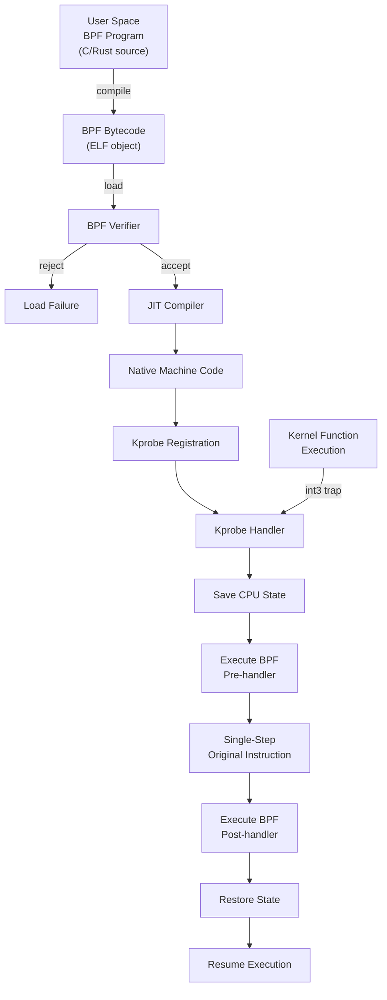

# Lesson 4: Integrating Kprobes with eBPF

## 1. First-Principles Architecture

Dynamic instrumentation in modern operating systems requires two fundamental capabilities: the ability to intercept execution at arbitrary points (instrumentation points) and the ability to execute safe, verified code at those points without crashing the kernel. Kprobes provides the former; eBPF provides the latter.

### The Instrumentation Problem

Traditional kernel tracing mechanisms fall into two categories, each with critical limitations:

**Static tracepoints** are predetermined instrumentation points hardcoded into the kernel source. While safe and stable across kernel versions, they provide visibility only where developers anticipated the need. Adding new tracepoints requires kernel recompilation.

**Dynamic instrumentation** via kernel modules can probe arbitrary functions but requires loading unverified native code into kernel space. A single bug in tracing code can crash the entire system. This unrestricted access makes dynamic instrumentation operationally risky in production.

Kprobes with eBPF solves this by combining arbitrary instrumentation points (Kprobes) with a verified, bounded execution environment (eBPF). The eBPF verifier guarantees that probe handlers terminate, access only valid memory, and cannot corrupt kernel state.

### Kprobes Mechanism

Kprobes works by dynamically replacing the first instruction of a target function with a breakpoint instruction (`int3` on x86, `brk` on ARM64). When execution hits this breakpoint:

1. CPU traps to the Kprobes handler in kernel space
2. Kprobes saves the processor state (registers, flags)
3. Kprobes executes the registered pre-handler (eBPF program)
4. Kprobes single-steps the original instruction in an out-of-line buffer
5. Kprobes executes the registered post-handler (eBPF program)
6. Execution resumes at the instruction following the probe point

This breakpoint-based approach works for any kernel function without requiring source modification. The original instruction is preserved in an "out-of-line" execution buffer to avoid infinite recursion.

**Kretprobes** (return probes) use a trampoline mechanism: when a probed function is called, Kprobes replaces the return address on the stack with the address of a trampoline function. When the target function returns, control transfers to the trampoline, which invokes the eBPF return handler before returning to the original caller.

### eBPF Verification and Safety

eBPF programs must pass the verifier before attachment. The verifier performs static analysis to prove:

- **Termination**: All execution paths reach a `BPF_EXIT` instruction within the instruction limit (1 million instructions as of Linux 5.10+, previously 4096)
- **Memory safety**: All memory accesses are bounded and use valid pointers
- **No unbounded loops**: Loops must have a provable upper bound (or use bounded loop constructs added in Linux 5.3+)
- **Valid helpers**: Only whitelisted helper functions are called with correct argument types

The verifier uses abstract interpretation, tracking the possible range of values in each register at each instruction. If the verifier cannot prove safety, the program is rejected.



## 2. Data Structures and Memory Model

### Kprobe Internal Representation

The kernel represents each kprobe with the `struct kprobe`:

```c
struct kprobe {
    struct hlist_node hlist;           // Hash table linkage
    kprobe_opcode_t *addr;             // Probed address
    const char *symbol_name;           // Symbol name (optional)
    kprobe_pre_handler_t pre_handler;  // Pre-handler callback
    kprobe_post_handler_t post_handler;// Post-handler callback
    kprobe_opcode_t opcode;            // Saved original instruction
    struct arch_specific_insn ainsn;   // Out-of-line instruction buffer
};
```

Kprobes maintains a global hash table (`kprobe_table`) indexed by probe address for O(1) lookup during trap handling. The hash table size is tuned based on `CONFIG_KPROBES_HASH_BITS` (typically 16, yielding 65,536 buckets).

The `ainsn.insn` field points to the out-of-line execution buffer—a small memory region where the original instruction (and its following instruction if multi-byte) is copied for safe single-step execution.

### eBPF Program Attachment

When attaching an eBPF program to a kprobe, the kernel uses the `perf_event` subsystem as an abstraction layer:

```c
struct perf_event {
    struct rb_node group_node;
    struct list_head sibling_list;
    struct perf_event_attr attr;        // Event attributes
    struct bpf_prog *prog;              // Attached eBPF program
    void *overflow_handler;             // Event handler (kprobe handler)
};
```

The `perf_event_open()` syscall with `PERF_TYPE_SOFTWARE` and `PERF_COUNT_SW_BPF_OUTPUT` creates a perf event, then `ioctl(PERF_EVENT_IOC_SET_BPF)` attaches the BPF program. The kernel's kprobe infrastructure then invokes the BPF program via the perf event's overflow handler.

### BPF Maps for Data Collection

eBPF programs cannot directly call `printk` or write to arbitrary memory. Instead, they communicate via BPF maps—kernel data structures accessible from both eBPF programs and user space. Common map types for kprobes:

**BPF_MAP_TYPE_HASH**: Hash table for key-value storage (e.g., tracking per-process statistics)
**BPF_MAP_TYPE_ARRAY**: Fixed-size array (e.g., per-CPU counters)
**BPF_MAP_TYPE_PERF_EVENT_ARRAY**: Efficient channel for streaming events to user space
**BPF_MAP_TYPE_STACK_TRACE**: Stores kernel stack traces

```c
struct bpf_map {
    const struct bpf_map_ops *ops;
    struct bpf_map *inner_map_meta;
    atomic64_t refcnt;
    u32 key_size;
    u32 value_size;
    u32 max_entries;
    u32 map_flags;
    int spin_lock_off;
    int timer_off;
    u32 id;
    char name[BPF_OBJ_NAME_LEN];
};
```

### Memory Ordering and Concurrency

Kprobes can fire on any CPU at any time, making concurrency critical. eBPF programs must use BPF helper functions for atomic operations:

- `bpf_spin_lock/bpf_spin_unlock`: Per-map-element spinlocks for critical sections
- `__sync_fetch_and_add`: Atomic increment via compiler builtins (translated to BPF_XADD)

The BPF verifier enforces that spinlocks are always released before program exit and that memory access within critical sections is bounded.

## 3. Production-Grade Implementation

### Complete Kprobe-eBPF Tracer in C

This example traces `do_sys_openat2` (the kernel function underlying `open`/`openat` syscalls) and logs the filename, PID, and CPU to a perf event buffer.

```c
// kprobe_openat.c
#include <linux/bpf.h>
#include <linux/ptrace.h>
#include <bpf/bpf_helpers.h>
#include <bpf/bpf_tracing.h>

#define TASK_COMM_LEN 16
#define MAX_FILENAME_LEN 256

struct event {
    u32 pid;
    u32 cpu;
    char comm[TASK_COMM_LEN];
    char filename[MAX_FILENAME_LEN];
};

struct {
    __uint(type, BPF_MAP_TYPE_PERF_EVENT_ARRAY);
    __uint(key_size, sizeof(u32));
    __uint(value_size, sizeof(u32));
} events SEC(".maps");

// Kprobe on do_sys_openat2(int dfd, const char __user *filename, struct open_how *how)
SEC("kprobe/do_sys_openat2")
int kprobe_openat(struct pt_regs *ctx)
{
    struct event e = {};
    
    // Extract arguments (architecture-specific register access)
    // On x86_64: arg1=rdi, arg2=rsi, arg3=rdx
    const char __user *filename_ptr = (const char *)PT_REGS_PARM2(ctx);
    
    e.pid = bpf_get_current_pid_tgid() >> 32;
    e.cpu = bpf_get_smp_processor_id();
    
    bpf_get_current_comm(&e.comm, sizeof(e.comm));
    
    // Copy filename from user space (bounded read)
    long ret = bpf_probe_read_user_str(&e.filename, sizeof(e.filename), filename_ptr);
    if (ret < 0) {
        e.filename[0] = '\0';
    }
    
    // Submit event to perf ring buffer
    bpf_perf_event_output(ctx, &events, BPF_F_CURRENT_CPU, &e, sizeof(e));
    
    return 0;
}

char LICENSE[] SEC("license") = "GPL";
```

**Compilation** (requires LLVM/Clang with BPF target):

```bash
clang -O2 -g -target bpf -D__TARGET_ARCH_x86 \
    -I/usr/include/bpf \
    -c kprobe_openat.c -o kprobe_openat.o
```

### User-Space Loader in Python (bcc)

```python
#!/usr/bin/env python3
from bcc import BPF
import ctypes as ct

# Load the BPF program
b = BPF(src_file="kprobe_openat.c")

# Attach kprobe to do_sys_openat2
b.attach_kprobe(event="do_sys_openat2", fn_name="kprobe_openat")

class Event(ct.Structure):
    _fields_ = [
        ("pid", ct.c_uint32),
        ("cpu", ct.c_uint32),
        ("comm", ct.c_char * 16),
        ("filename", ct.c_char * 256),
    ]

def print_event(cpu, data, size):
    event = ct.cast(data, ct.POINTER(Event)).contents
    print(f"[CPU {event.cpu}] PID {event.pid:6d} ({event.comm.decode('utf-8', 'replace'):16s}) opened: {event.filename.decode('utf-8', 'replace')}")

# Open perf event buffer
b["events"].open_perf_buffer(print_event)

print("Tracing openat syscalls... Ctrl-C to stop")
while True:
    try:
        b.perf_buffer_poll()
    except KeyboardInterrupt:
        exit()
```

### Advanced: Kretprobe for Latency Measurement

Measuring function execution time requires correlating entry and exit. Use a BPF hash map keyed by thread ID:

```c
struct {
    __uint(type, BPF_MAP_TYPE_HASH);
    __type(key, u32);          // TID
    __type(value, u64);        // Entry timestamp
    __uint(max_entries, 10240);
} start_ts SEC(".maps");

struct {
    __uint(type, BPF_MAP_TYPE_HISTOGRAM);
    __type(key, u64);
    __type(value, u64);
} latency_hist SEC(".maps");

SEC("kprobe/do_sys_openat2")
int trace_entry(struct pt_regs *ctx)
{
    u32 tid = bpf_get_current_pid_tgid();
    u64 ts = bpf_ktime_get_ns();
    bpf_map_update_elem(&start_ts, &tid, &ts, BPF_ANY);
    return 0;
}

SEC("kretprobe/do_sys_openat2")
int trace_return(struct pt_regs *ctx)
{
    u32 tid = bpf_get_current_pid_tgid();
    u64 *start_ts_ptr = bpf_map_lookup_elem(&start_ts, &tid);
    
    if (!start_ts_ptr)
        return 0;
    
    u64 delta_ns = bpf_ktime_get_ns() - *start_ts_ptr;
    u64 delta_us = delta_ns / 1000;
    
    // Update histogram bucket (power-of-2 bucketing)
    u64 slot = delta_us;
    if (slot > 1) {
        slot = 1 << (64 - __builtin_clzll(slot - 1));
    }
    
    u64 *count = bpf_map_lookup_elem(&latency_hist, &slot);
    if (count) {
        __sync_fetch_and_add(count, 1);
    }
    
    bpf_map_delete_elem(&start_ts, &tid);
    return 0;
}
```

## 4. Performance Characteristics and Optimization

### Probe Overhead Breakdown

Each kprobe invocation incurs:

1. **Trap handling**: ~150-300 CPU cycles for context switch into kprobe handler
2. **eBPF execution**: Depends on program complexity; simple programs: 20-50ns, complex: 100-500ns
3. **Map operations**: Hash lookup ~30-50ns, array access ~10-20ns, perf event output ~200-500ns
4. **Return to probed code**: ~150-300 cycles

On a 3GHz CPU, a minimal kprobe adds approximately **200-400ns** overhead per invocation. For functions called millions of times per second, this overhead becomes significant.

### Mitigation Strategies

**Sampling**: Instead of tracing every invocation, use BPF's `bpf_get_prandom_u32()` to sample probabilistically:

```c
if ((bpf_get_prandom_u32() % 100) != 0)
    return 0;  // Trace only 1% of invocations
```

**Filtering**: Apply filters in BPF to avoid expensive operations for uninteresting events:

```c
u32 pid = bpf_get_current_pid_tgid() >> 32;
if (pid != target_pid)
    return 0;
```

**Per-CPU maps**: Use `BPF_MAP_TYPE_PERCPU_ARRAY` or `BPF_MAP_TYPE_PERCPU_HASH` to eliminate lock contention. Each CPU maintains its own copy of the map:

```c
struct {
    __uint(type, BPF_MAP_TYPE_PERCPU_ARRAY);
    __type(key, u32);
    __type(value, u64);
    __uint(max_entries, 256);
} percpu_counters SEC(".maps");
```

User space aggregates per-CPU values when reading the map.

**Batch operations**: The `BPF_MAP_TYPE_PERF_EVENT_ARRAY` uses a per-CPU ring buffer. Setting appropriate buffer sizes (via `perf_event_attr.sample_period`) reduces context switches between kernel and user space.

### Verifier Complexity and Instruction Limits

The eBPF verifier's runtime is O(n²) in the number of instructions due to its abstract interpretation algorithm tracking all possible execution paths. Programs with many branches exponentially increase verification time.

**Workarounds**:

- **Function calls**: Use BPF-to-BPF function calls (available since Linux 4.16) to split complex programs into smaller, verifiable units
- **Tail calls**: Use `bpf_tail_call()` to chain multiple programs, resetting the instruction counter
- **Compiler optimization**: Use `-O2` optimization to reduce instruction count via dead code elimination and inlining

### Memory Footprint

Each attached kprobe consumes:

- **Kprobe struct**: ~200 bytes
- **Out-of-line execution buffer**: 16-32 bytes per probe
- **BPF program**: Varies; typical programs: 1-10KB after JIT compilation
- **BPF maps**: User-defined; hash maps grow dynamically up to `max_entries`

Systems with thousands of probes can consume hundreds of MB. Use `bpftool prog show` and `bpftool map show` to audit memory usage.

## 5. Failure Modes and Debugging

### Common Failure Scenarios

**Verifier rejection: "unbounded loop"**: Loops must have compile-time provable bounds. Use `#pragma unroll` or bounded iterators:

```c
// Rejected:
for (int i = 0; i < len; i++) { ... }

// Accepted:
#pragma unroll
for (int i = 0; i < 16; i++) {
    if (i >= len) break;
    ...
}
```

**Verifier rejection: "invalid access to packet"**: All memory accesses must be bounds-checked. The verifier cannot infer that `ptr + offset` is valid without explicit comparison:

```c
// Rejected:
char *filename = (char *)PT_REGS_PARM2(ctx);
char c = filename[0];

// Accepted:
char *filename = (char *)PT_REGS_PARM2(ctx);
char c;
bpf_probe_read_user(&c, 1, filename);
```

**NULL pointer dereference**: The verifier tracks pointer nullability. Always check map lookups:

```c
u64 *val = bpf_map_lookup_elem(&my_map, &key);
if (!val)
    return 0;
*val += 1;  // Safe: verifier knows val is non-NULL
```

**Stack overflow**: BPF stack is limited to 512 bytes. Large structs must be dynamically allocated via `bpf_map_lookup_elem` with a percpu map as a scratch space.

### Debugging Techniques

**bpftool**: Inspect loaded programs and maps:

```bash
bpftool prog list
bpftool prog dump xlated id <ID>    # Dump translated BPF instructions
bpftool prog dump jited id <ID>     # Dump JIT-compiled native code
bpftool map dump id <ID>            # Dump map contents
```

**Trace pipe**: BPF programs can use `bpf_trace_printk()` for debugging (limited to 3 arguments, formats to `/sys/kernel/debug/tracing/trace_pipe`):

```c
bpf_trace_printk("PID %d opened file\n", pid);
```

**Verifier logs**: When loading fails, retrieve detailed verifier logs:

```python
try:
    b = BPF(src_file="program.c")
except Exception as e:
    print(e)  # Contains full verifier log
```

**BTF (BPF Type Format)**: Modern kernels with BTF support provide type information for kernel structures, enabling CO-RE (Compile Once – Run Everywhere). Use `bpftool btf dump file /sys/kernel/btf/vmlinux` to inspect available types.

### Race Conditions and TOCTOU

Kprobes introduce a time-of-check-to-time-of-use window. Between the probe handler reading a pointer and dereferencing it, the pointed-to memory may be freed. Always use `bpf_probe_read_*` helpers, which handle page faults gracefully:

```c
// Unsafe:
struct task_struct *task = (void *)bpf_get_current_task();
char comm[16];
__builtin_memcpy(comm, task->comm, 16);  // May fault if task is freed

// Safe:
struct task_struct *task = (void *)bpf_get_current_task();
char comm[16];
bpf_probe_read_kernel(comm, 16, &task->comm);  // Handles faults
```

### Kernel Version Compatibility

Kprobe addresses and function signatures change across kernel versions. Strategies for portability:

**CO-RE with libbpf**: Use BTF-based relocations to abstract structure offsets:

```c
struct task_struct *task = (void *)bpf_get_current_task();
pid_t pid = BPF_CORE_READ(task, pid);  // Offset resolved at load time
```

**Symbol resolution**: Attach by symbol name rather than hardcoded address:

```python
b.attach_kprobe(event="do_sys_openat2", fn_name="handler")
```

If the symbol doesn't exist (e.g., older kernels use `do_sys_open`), fallback logic is required.

## 6. Advanced Patterns

### Stack Unwinding

Capture kernel stack traces for performance profiling:

```c
struct {
    __uint(type, BPF_MAP_TYPE_STACK_TRACE);
    __uint(key_size, sizeof(u32));
    __uint(value_size, PERF_MAX_STACK_DEPTH * sizeof(u64));
    __uint(max_entries, 10000);
} stack_traces SEC(".maps");

SEC("kprobe/function_to_trace")
int trace_stack(struct pt_regs *ctx)
{
    u32 key = 0;
    u64 stack_id = bpf_get_stackid(ctx, &stack_traces, BPF_F_FAST_STACK_CMP);
    
    // Use stack_id as key in another map to aggregate counts
    return 0;
}
```

User space resolves instruction addresses to symbols using `/proc/kallsyms`.

### Multi-Kprobe Correlation

Track request latency across multiple kernel functions (e.g., block I/O subsystem):

```c
struct bio_info {
    u64 start_ts;
    u64 sector;
    u32 pid;
};

struct {
    __uint(type, BPF_MAP_TYPE_HASH);
    __type(key, void *);  // struct bio pointer
    __type(value, struct bio_info);
    __uint(max_entries, 10240);
} bio_tracker SEC(".maps");

SEC("kprobe/submit_bio")
int trace_submit_bio(struct pt_regs *ctx)
{
    void *bio = (void *)PT_REGS_PARM1(ctx);
    struct bio_info info = {};
    info.start_ts = bpf_ktime_get_ns();
    info.pid = bpf_get_current_pid_tgid() >> 32;
    bpf_map_update_elem(&bio_tracker, &bio, &info, BPF_ANY);
    return 0;
}

SEC("kprobe/bio_endio")
int trace_bio_endio(struct pt_regs *ctx)
{
    void *bio = (void *)PT_REGS_PARM1(ctx);
    struct bio_info *info = bpf_map_lookup_elem(&bio_tracker, &bio);
    if (!info)
        return 0;
    
    u64 latency = bpf_ktime_get_ns() - info->start_ts;
    // Log or histogram latency
    
    bpf_map_delete_elem(&bio_tracker, &bio);
    return 0;
}
```

### Filtering by Cgroup

Trace only processes in a specific cgroup (e.g., a container):

```c
#include <linux/bpf.h>
#include <bpf/bpf_helpers.h>

SEC("kprobe/function_name")
int trace_with_cgroup(struct pt_regs *ctx)
{
    u64 cgroup_id = bpf_get_current_cgroup_id();
    
    // Compare against target cgroup ID (passed via map or config)
    if (cgroup_id != target_cgroup)
        return 0;
    
    // Continue tracing
    return 0;
}
```

Cgroup IDs can be retrieved from `/proc/<pid>/cgroup` or `stat -c %i /sys/fs/cgroup/...`.

## 7. Security and Isolation

### Privilege Requirements

Loading eBPF programs requires `CAP_BPF` (Linux 5.8+) or `CAP_SYS_ADMIN`. Kprobe attachment additionally requires `CAP_PERFMON` (or `CAP_SYS_ADMIN` on older kernels) since kprobes can access sensitive kernel data.

Unprivileged eBPF (via `sysctl kernel.unprivileged_bpf_disabled=0`) is restricted to socket filters and cannot attach kprobes.

### Attack Surface

Kprobes can potentially be abused for privilege escalation if:

1. The verifier has a bug allowing unsafe memory access
2. JIT compiler generates incorrect machine code
3. Helper functions have exploitable vulnerabilities

Mitigation: Enable `kernel.kptr_restrict=2` to hide kernel pointers from unprivileged users, and use kernel hardening options (`CONFIG_BPF_JIT_ALWAYS_ON`, `CONFIG_BPF_UNPRIV_DEFAULT_OFF`).

### Spectre Mitigations

eBPF JIT must include speculative execution mitigations. The verifier inserts speculation barriers (`lfence` on x86) after conditional branches to prevent Spectre-v1 attacks. This adds ~5-10 cycles per branch.

## 8. Real-World Use Cases

### Performance Profiling

Netflix uses eBPF kprobes for continuous profiling in production. By sampling stack traces at 49 Hz across all CPUs, they identify CPU hotspots with <0.1% overhead. The sampling frequency avoids aliasing with common timer frequencies (50Hz, 60Hz).

### Security Monitoring

Falco (CNCF project) uses kprobes to monitor syscalls for anomalous behavior (e.g., unexpected file access, network connections). By filtering in-kernel, it reduces event volume from millions/sec to hundreds/sec.

### Network Performance Analysis

Cloudflare's `bpftrace` scripts trace TCP retransmissions by probing `tcp_retransmit_skb`:

```bpftrace
kprobe:tcp_retransmit_skb
{
    $sk = (struct sock *)arg0;
    $inet = (struct inet_sock *)$sk;
    printf("Retransmit: %s:%d\n",
        ntop(AF_INET, $inet->inet_daddr),
        $inet->inet_dport);
}
```

This pinpoints sources of packet loss in real-time.

## 9. Future Directions

**eBPF in User Space**: Projects like `ubpf` bring eBPF's safety guarantees to user-space programs, enabling safe plugin architectures.

**Kprobes on User Functions (uprobes)**: Similar to kprobes but for user-space functions. Requires `uprobe` events and `PT_REGS` context differs (user registers vs kernel registers).

**Sleepable eBPF**: Linux 5.10+ supports sleepable BPF programs (fentry/fexit on sleepable functions), enabling longer-running analysis without blocking.

**Memory Tagging (MTE)**: On ARM64 with MTE, BPF programs can verify memory tag validity, catching use-after-free at probe time.

## 10. Summary

Integrating Kprobes with eBPF combines arbitrary kernel instrumentation with verified, safe code execution. This enables:

- **Dynamic tracing** without kernel modules or recompilation
- **Production-safe observability** via the BPF verifier's safety guarantees
- **High-performance data collection** using per-CPU maps and efficient ring buffers
- **Flexible analysis** through programmable in-kernel processing

The key invariants ensuring correctness:

1. **Breakpoint atomicity**: Probe insertion uses atomic instruction replacement to avoid race conditions
2. **Out-of-line execution**: Original instructions execute in an isolated buffer to prevent recursion
3. **Verification-enforced safety**: The BPF verifier guarantees termination, bounded memory access, and no kernel corruption
4. **Context preservation**: Kprobes save and restore full CPU state across probe invocation

Understanding these mechanisms allows practitioners to build robust, efficient tracing systems for modern cloud infrastructure, from latency profiling to security monitoring to capacity planning.
