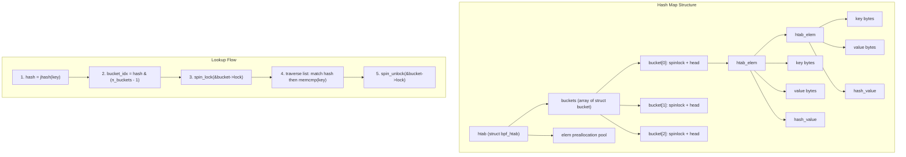
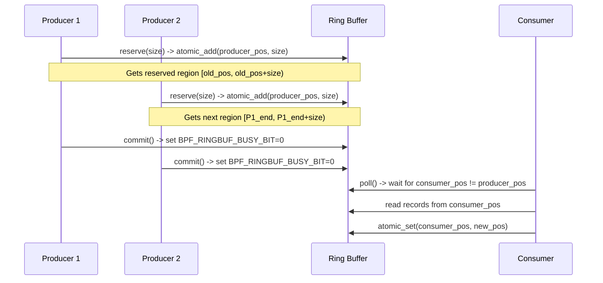

# Lesson 5: Debugging and Troubleshooting eBPF Maps

## 1. First-Principles Intuition & Invariants

eBPF maps represent the primary persistent state mechanism for in-kernel eBPF programs, bridging the gap between ephemeral program execution contexts and long-lived data structures accessible from both kernel and user space. Unlike traditional kernel data structures that exist solely in kernel memory with access mediated by system calls, eBPF maps expose a typed, verifier-validated interface that permits safe concurrent access across multiple execution contexts while maintaining strict memory safety guarantees.

The fundamental architecture of eBPF maps rests on three core invariants:

**Memory Safety Through Static Verification**: The eBPF verifier enforces bounded memory access at load time. Every map access path must prove to the verifier that it respects the map's declared key and value sizes, cannot cause buffer overflows, and maintains pointer validity across all possible execution paths. This static analysis occurs before any eBPF bytecode executes, transforming potential runtime crashes into load-time rejections. The verifier tracks register states through an abstract interpretation of the eBPF instruction stream, modeling pointer arithmetic and memory regions to ensure that map helper calls like `bpf_map_lookup_elem()` receive valid arguments.

**Concurrent Access Without Race Conditions**: eBPF maps must handle concurrent access from multiple CPUs executing eBPF programs, kernel threads performing background operations, and user-space processes reading or updating map contents via `bpf()` system calls. This concurrency model relies on per-map-type synchronization primitives. Hash tables use spinlocks or RCU-protected hash chains, per-CPU maps eliminate contention entirely by maintaining CPU-local copies, and array maps depend on atomic CPU instructions for safe updates. The map implementation guarantees that a lookup operation either sees a fully committed prior update or returns no match—partial writes or torn reads cannot occur.

**Bounded Resource Consumption**: Every eBPF map declares its maximum size at creation time, establishing an upper bound on kernel memory consumption. Hash maps specify `max_entries`, arrays declare a fixed element count, and ring buffers define their capacity in bytes. These bounds prevent unbounded memory growth and ensure that map operations can fail predictably when capacity is exhausted. The kernel tracks these allocations against resource limits, and the verifier enforces that eBPF programs handle lookup failures and insertion errors correctly.

Understanding these invariants is foundational to debugging because violations manifest as specific failure modes: verifier rejection indicates memory safety violations, data corruption or inconsistent reads point to concurrency bugs, and `-ENOMEM` or `-E2BIG` errors signal resource exhaustion.

## 2. Core Architecture & Mechanics

eBPF maps exist as kernel objects managed by the eBPF subsystem, with their lifecycle decoupled from individual program execution. The kernel maintains a global map registry indexed by file descriptors, allowing user space to create, configure, and access maps through the `bpf()` system call. Each map type implements a standard interface defined in `include/linux/bpf.h`:

```c
struct bpf_map_ops {
    int (*map_alloc_check)(union bpf_attr *attr);
    struct bpf_map *(*map_alloc)(union bpf_attr *attr);
    void (*map_release)(struct bpf_map *map, struct file *map_file);
    void (*map_free)(struct bpf_map *map);
    
    void *(*map_lookup_elem)(struct bpf_map *map, void *key);
    int (*map_update_elem)(struct bpf_map *map, void *key, void *value, u64 flags);
    int (*map_delete_elem)(struct bpf_map *map, void *key);
    
    int (*map_get_next_key)(struct bpf_map *map, void *key, void *next_key);
    int (*map_push_elem)(struct bpf_map *map, void *value, u64 flags);
    int (*map_pop_elem)(struct bpf_map *map, void *value);
    int (*map_peek_elem)(struct bpf_map *map, void *value);
};
```

The operations pointer defines the behavior for each map type. Hash tables, arrays, ring buffers, and specialized maps like LRU hash tables or bloom filters each provide their own implementation of these hooks.

### Hash Map Internal Structure

The `BPF_MAP_TYPE_HASH` implementation uses a pre-allocated array of hash buckets, each containing a linked list of hash table entries. The bucket count is rounded up to the nearest power of two for efficient modulo operations via bitmasking. Each entry stores the full key, value, and hash code to handle collisions through chaining:



The lookup operation computes the jhash (Jenkins hash) of the key, uses the lower bits to index into the bucket array, acquires the bucket's spinlock, and linearly searches the collision chain. This design trades memory (pre-allocated element pool) for predictable performance—no dynamic allocation occurs during insertion under normal operation.

**Critical Implementation Detail**: Hash maps pre-allocate all `max_entries` elements at creation time when using the default non-`BPF_F_NO_PREALLOC` flag. This ensures that insertions cannot fail due to memory pressure during packet processing, but requires `max_entries * (sizeof(key) + sizeof(value) + overhead)` bytes of kernel memory upfront. The overhead includes the `htab_elem` structure (pointers, hash value, RCU head) which is typically 48-64 bytes per entry on 64-bit systems.

### Array Map Structure

Array maps (`BPF_MAP_TYPE_ARRAY`) provide O(1) access through direct indexing into a contiguous memory region. The map stores elements in a single allocation:

```c
struct bpf_array {
    struct bpf_map map;
    u32 elem_size;
    u32 index_mask;  /* map->max_entries - 1, for bounds check */
    char value[0] __aligned(8);  /* elem_size * max_entries bytes */
};
```

Array lookups validate the index with `if (unlikely(index >= array->map.max_entries)) return NULL;` then compute the element address as `value + index * elem_size`. Updates use atomic operations for primitive types or spinlocks for larger values, depending on size and alignment.

**Per-CPU Arrays**: The `BPF_MAP_TYPE_PERCPU_ARRAY` variant allocates a separate array for each CPU, eliminating cache line contention and lock overhead. The kernel uses `__alloc_percpu()` to distribute arrays across NUMA nodes, and lookups use `this_cpu_ptr()` to access the local copy. This design is critical for high-frequency counters and statistics where lock contention would throttle performance.

### Ring Buffer Architecture

The `BPF_MAP_TYPE_RINGBUF` introduced in Linux 5.8 provides a lock-free, multi-producer, single-consumer MPSC queue optimized for variable-sized records. The buffer uses two atomic pointers—`consumer_pos` and `producer_pos`—and a reservation protocol:



Producers atomically increment `producer_pos` to reserve space, write their data, then clear a busy bit in the record header to signal completion. The consumer waits for committed records (busy bit clear) before reading. This design avoids locks but requires careful memory ordering—`smp_store_release()` and `smp_load_acquire()` ensure that record data is visible before the busy bit clears.

**Failure Mode**: If producers reserve space faster than consumers drain it, `bpf_ringbuf_reserve()` returns `NULL`. eBPF programs must handle this by either dropping events, falling back to alternative logging, or implementing backpressure mechanisms.

## 3. High-Performance Optimization & Failure Modes

### Concurrency Patterns and Contention Analysis

eBPF maps operate in highly concurrent environments where contention directly impacts packet processing latency and throughput. Understanding the concurrency model for each map type is essential for diagnosing performance degradation.

**Hash Map Spinlock Contention**: Standard hash maps protect each bucket with a spinlock. Under high contention, multiple CPUs executing eBPF programs may serialize waiting for the same bucket lock. This manifests as elevated `perf` measurements for spinlock wait time:

```bash
# Profile spinlock contention across all CPUs
sudo perf record -e 'sched:sched_stat_wait' -a -g -- sleep 10
sudo perf report --sort comm,symbol | grep htab
```

If the output shows significant time in `_raw_spin_lock` or `htab_map_update_elem`, the hash function may be distributing keys poorly, causing hot buckets. Solutions include increasing `max_entries` to expand the bucket array, switching to `BPF_MAP_TYPE_PERCPU_HASH` if the use case permits per-CPU state, or redesigning the key structure to improve hash distribution.

**Per-CPU Map Scalability**: Per-CPU maps eliminate lock contention entirely but at the cost of memory—each CPU maintains its own copy, multiplying memory usage by the CPU count. On systems with 64+ CPUs, a per-CPU hash map with 1M entries and 64-byte values consumes `64 * 1M * (key_size + 64 + overhead)` bytes. Additionally, user-space aggregation becomes more expensive as it must iterate over all CPU copies.

**RCU-Protected Hash Maps**: Some workloads use RCU (Read-Copy-Update) instead of spinlocks for lookups, allowing concurrent reads without locks. Writers still require mutual exclusion, but readers can proceed in parallel. The trade-off is that deletions must wait for an RCU grace period before freeing memory, delaying memory reclamation. This is appropriate for read-heavy workloads where occasional writes can tolerate higher latency.

### Memory Allocation and Resource Exhaustion

eBPF maps impose kernel memory pressure, particularly with pre-allocated maps. The kernel tracks these allocations against `RLIMIT_MEMLOCK`, a per-user limit that prevents runaway memory consumption. If map creation fails with `-EPERM` or `-ENOMEM`, the issue may be insufficient `memlock` limits:

```bash
# Check current memlock limit
ulimit -l

# Increase memlock limit (root required)
sudo sh -c 'ulimit -l unlimited'

# Or set in /etc/security/limits.conf
* soft memlock unlimited
* hard memlock unlimited
```

For production systems, calculate required memory as:

```text
total_map_memory = Σ (max_entries * (key_size + value_size + elem_overhead))
```

where `elem_overhead` is approximately 64 bytes for hash maps (includes `htab_elem` structure, RCU head, and alignment padding).

**Failure Mode: Silent Insertion Failures**: When a hash map reaches `max_entries`, `bpf_map_update_elem()` returns `-E2BIG`. eBPF programs must explicitly check the return value and handle the failure. A common bug is ignoring the return value, causing silent data loss:

```c
// WRONG: ignores return value
bpf_map_update_elem(&my_map, &key, &value, BPF_ANY);

// CORRECT: handles failure
if (bpf_map_update_elem(&my_map, &key, &value, BPF_ANY) != 0) {
    // Log to trace_pipe, increment error counter, or trigger fallback
    bpf_printk("map update failed: key=%llu\n", key);
}
```

### Verifier Constraints and Debugging Rejections

The eBPF verifier enforces strict constraints on map access patterns. Common rejection scenarios include:

**Unbounded Loops**: The verifier requires all loops to have a bounded iteration count. A loop that iterates over a hash map using `bpf_map_get_next_key()` must impose an explicit iteration limit or use a helper like `bpf_for_each_map_elem()` (Linux 5.13+) which the verifier understands as bounded.

**Invalid Key Pointers**: Map helpers require that key and value pointers reference valid stack or map memory. Passing a pointer derived from packet data without proper bounds checking causes rejection:

```c
// WRONG: packet pointer used as key
struct ethhdr *eth = (void *)(long)skb->data;
void *val = bpf_map_lookup_elem(&my_map, &eth->h_dest, sizeof(eth->h_dest));

// CORRECT: copy to stack first
struct ethhdr *eth = (void *)(long)skb->data;
__u8 mac[6];
if ((void *)(eth + 1) > data_end) return XDP_DROP;
__builtin_memcpy(mac, eth->h_dest, sizeof(mac));
void *val = bpf_map_lookup_elem(&my_map, mac, sizeof(mac));
```

**Alignment Requirements**: Some architectures require naturally aligned pointers. The verifier rejects map accesses with misaligned keys or values. Use `__attribute__((aligned(8)))` in structure definitions to ensure correct alignment.

### Advanced Debugging Tools and Techniques

**bpftool map dump and inspection**: The `bpftool` utility provides real-time map introspection without requiring code changes:

```bash
# List all maps
sudo bpftool map list

# Dump map contents (for small maps)
sudo bpftool map dump id 42

# Show map metadata
sudo bpftool map show id 42 --json | jq

# Monitor map updates in real-time (Linux 5.15+)
sudo bpftool map event

# Pin map to filesystem for cross-program sharing
sudo bpftool map pin id 42 /sys/fs/bpf/my_map
```

**BTF-Enabled Pretty Printing**: When maps are created with BTF (BPF Type Format) information, `bpftool` can pretty-print structures instead of raw hex dumps:

```c
// Compile with BTF: clang -g -O2 -target bpf -c prog.c -o prog.o
struct conn_stats {
    __u64 packets;
    __u64 bytes;
    __u32 flags;
} __attribute__((aligned(8)));

// bpftool automatically formats the structure
```

**trace_pipe Logging**: eBPF programs can emit debug messages to `/sys/kernel/debug/tracing/trace_pipe` using `bpf_printk()`. This is crucial for diagnosing runtime behavior:

```c
__u64 *count = bpf_map_lookup_elem(&stats, &key);
if (!count) {
    bpf_printk("lookup failed for key=%llu\n", key);
    return 0;
}
bpf_printk("found count=%llu for key=%llu\n", *count, key);
```

Read logs with:

```bash
sudo cat /sys/kernel/debug/tracing/trace_pipe
```

**Verifier Log Analysis**: When the verifier rejects a program, the full verification log reveals the exact instruction and register state at failure:

```bash
# Capture verifier log
sudo bpftool prog load prog.o /sys/fs/bpf/myprog 2>&1 | tee verifier.log

# The log shows register states at each instruction:
# 0: (bf) r6 = r1
# 1: (61) r1 = *(u32 *)(r6 +0)
# 2: (bf) r2 = r10
# 3: (07) r2 += -4
# 4: (62) *(u32 *)(r10 -4) = 0
# 5: (85) call bpf_map_lookup_elem#1
# R1=map_value(id=0,off=0,ks=4,vs=8,imm=0) R2=fp-4 R6=ctx(id=0,off=0,imm=0) R10=fp0
```

Each line shows the register types and ranges the verifier has inferred. A rejection indicates that some register does not satisfy the preconditions for a subsequent operation.

### Performance Benchmarking and Profiling

Quantifying map performance under realistic load is essential for capacity planning. The following benchmarks measure operations per second for different map types:

```c
// Benchmark hash map lookup throughput
#include <linux/bpf.h>
#include <bpf/bpf_helpers.h>

struct {
    __uint(type, BPF_MAP_TYPE_HASH);
    __uint(max_entries, 1000000);
    __type(key, __u64);
    __type(value, __u64);
} bench_map SEC(".maps");

SEC("xdp")
int bench_lookup(struct xdp_md *ctx) {
    __u64 key = bpf_get_prandom_u32() % 1000000;
    __u64 *val = bpf_map_lookup_elem(&bench_map, &key);
    if (val) __sync_fetch_and_add(val, 1);
    return XDP_PASS;
}
```

Measure throughput with `xdp-bench` or custom packet generators, comparing hash map vs. per-CPU hash map vs. array performance under different key distributions and access patterns.

### Common Failure Patterns and Root Cause Analysis

**Symptom: Map Updates Succeed But Values Are Stale**
- **Root Cause**: Per-CPU maps were updated on one CPU but read from another. Per-CPU maps do not synchronize across CPUs.
- **Solution**: Use non-per-CPU maps if cross-CPU visibility is required, or aggregate per-CPU values in user space.

**Symptom: Frequent `-E2BIG` Errors**
- **Root Cause**: Map reached `max_entries` capacity. For hash maps, this is an absolute limit.
- **Solution**: Increase `max_entries`, implement an eviction policy (use `BPF_MAP_TYPE_LRU_HASH`), or switch to a ring buffer for streaming data.

**Symptom: eBPF Program Rejected with "R1 type=inv expected=map_value"`**
- **Root Cause**: The verifier could not prove that a register contains a valid map value pointer. Often caused by conditional logic where one branch produces a NULL pointer.
- **Solution**: Ensure all code paths assign valid pointers before use. Add explicit NULL checks and early returns.

**Symptom: Unexplained Packet Drops in XDP Program**
- **Root Cause**: Map operation failed (returned NULL or error), but the program did not handle the failure and continued with an invalid pointer, causing a verifier-detected safety violation at runtime.
- **Solution**: Always check return values from `bpf_map_lookup_elem()` and handle NULL returns explicitly.

**Symptom: High CPU Usage in Kernel Space**
- **Root Cause**: Excessive spinlock contention or inefficient hash function causing long collision chains.
- **Solution**: Profile with `perf record -e cycles:k -a -g`, analyze call graphs for hot spots in map operations, and consider alternative map types or data structures.

## 4. Practical Debugging Workflow

Effective debugging follows a structured progression from high-level symptoms to root cause identification:

1. **Confirm Map Existence and Configuration**: Use `bpftool map list` to verify that the map was created with expected parameters. Check `max_entries`, `key_size`, `value_size`, and map type.

2. **Inspect Map Contents**: Dump the map with `bpftool map dump` to verify that expected keys and values exist. For large maps, sample random keys or use `bpf_map_get_next_key()` programmatically.

3. **Enable eBPF Program Logging**: Add `bpf_printk()` statements at critical points: before and after map operations, when handling errors, and when making decisions based on map contents. Monitor `/sys/kernel/debug/tracing/trace_pipe`.

4. **Analyze Verifier Logs**: If the program fails to load, examine the verifier log line by line. Identify the register state at the failing instruction and trace backward to understand why the verifier could not prove safety.

5. **Profile Performance**: Use `perf` to measure time spent in map operations. Record `perf record -e cycles:k -a -g` during load and analyze the report for bottlenecks in `htab_map_lookup_elem`, spinlock functions, or memory allocation.

6. **Validate Concurrency Assumptions**: If data corruption or inconsistency is observed, audit the synchronization model. Per-CPU maps may have stale data due to CPU migration. Non-per-CPU maps may have race conditions if custom locking is used incorrectly.

7. **Correlate with System Metrics**: Check system-wide metrics—CPU usage, memory pressure, network throughput—to identify whether map issues correlate with resource saturation or external load spikes.

This systematic approach isolates the failure domain, transforming vague symptoms like "the program doesn't work" into specific, actionable hypotheses like "bucket 42 has 1000+ entries causing O(n) lookup time" or "the verifier rejected the program because register R1 could be NULL at line 87."

## 5. Production Hardening and Best Practices

Deploying eBPF maps in production requires careful attention to resource limits, error handling, and observability.

**Set Explicit Resource Limits**: Define `max_entries` based on worst-case load, not typical load. Monitor map occupancy with `bpftool` or custom user-space agents that periodically read map statistics.

**Implement Graceful Degradation**: When map operations fail (insertion returns `-E2BIG`, lookup returns `NULL`), have a fallback strategy. This might be dropping low-priority events, logging to a separate overflow buffer, or triggering rate limiting.

**Use LRU Maps for Bounded State**: The `BPF_MAP_TYPE_LRU_HASH` automatically evicts least-recently-used entries when the map is full. This trades determinism for resilience—inserts never fail, but old entries may be evicted unexpectedly.

**Enable BTF for Debugging**: Compile eBPF programs with debug info (`-g` flag) and use `bpftool gen skeleton` to generate C headers with BTF. This enables pretty-printed map dumps and improves verifier error messages.

**Monitor Verifier Complexity**: The verifier has bounded analysis time to prevent DoS attacks. Complex programs with many branches or loops may exceed these limits, causing load failures. Simplify hot paths and factor out cold paths into separate helper functions.

**Test Under Load**: Validate map behavior under realistic packet rates and access patterns. Use tools like `xdp-bench` or custom traffic generators to stress-test maps at target throughput levels. Measure tail latencies, not just averages—99th percentile lookup time reveals contention that averages hide.

By combining deep architectural understanding with systematic debugging workflows and robust production practices, you can leverage eBPF maps as high-performance, reliable state management primitives in kernel instrumentation and networking applications.
