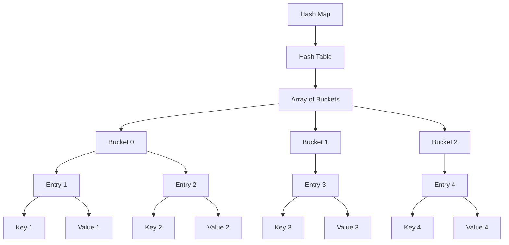

# Lesson 5: Debugging and Troubleshooting eBPF Maps

## 1. First-Principles Intuition & Invariants

In the realm of high-performance computing and network function virtualization, eBPF (Extended Berkeley Packet Filter) has emerged as a powerful tool for dynamic instrumentation and monitoring. At the heart of eBPF's capabilities lie its maps, which serve as the primary data structures for storing and retrieving data across eBPF programs. These maps are not mere containers; they are the backbone of eBPF's ability to maintain state and perform efficient lookups, aggregations, and transformations. Understanding the intricacies of eBPF maps is crucial for leveraging their full potential, but it also presents a significant challenge when diagnosing issues. This lesson delves into the methods and tools available for debugging and troubleshooting eBPF maps, ensuring that you can navigate the complexities of these high-performance data structures with confidence.

eBPF maps are designed to be accessed from both user-space and kernel-space, allowing for seamless integration with eBPF programs. They support a variety of data structures, including hash maps, arrays, per-CPU hash maps, and more, each optimized for specific use cases. The choice of map type can significantly impact the performance and behavior of an eBPF program, making it essential to understand the underlying mechanics and potential failure modes. The theoretical grounding of eBPF maps is rooted in the principles of hash tables, red-black trees, and lockless data structures, which are adapted to the unique constraints and requirements of the kernel environment.

One of the key invariants in eBPF maps is their ability to maintain consistency and atomicity across concurrent accesses. This is achieved through a combination of locking mechanisms, such as spinlocks and RCU (Read-Copy-Update), and lockless data structures, such as the BPF RingBuf. These mechanisms ensure that eBPF maps can be accessed efficiently and safely by multiple eBPF programs and kernel threads simultaneously. However, this also introduces potential points of contention and failure, particularly in high-concurrency scenarios.

Another critical invariant is the memory safety and integrity of eBPF maps. The eBPF verifier performs a series of static analyses to ensure that eBPF programs do not access memory out of bounds or perform other unsafe operations. This verification process is crucial for maintaining the security and stability of the system, but it also imposes certain constraints on the types of operations that can be performed on eBPF maps. Understanding these constraints and their implications is essential for diagnosing and resolving issues related to eBPF maps.

## 2. Core Architecture & Mechanics

To effectively debug and troubleshoot eBPF maps, it is essential to have a deep understanding of their internal architecture and mechanics. At a high level, eBPF maps are implemented as kernel data structures that are exposed to eBPF programs through a set of predefined operations, such as lookup, update, and delete. These operations are performed using a set of BPF helper functions, which are invoked by eBPF programs to interact with the maps.

The internal data structures used by eBPF maps vary depending on the map type. For example, hash maps are implemented using hash tables, while arrays are implemented using contiguous memory regions. Each map type has its own set of optimizations and trade-offs, which are tailored to the specific use case. For instance, hash maps are optimized for fast lookups and insertions, while arrays are optimized for fast random access.

To illustrate the internal architecture of eBPF maps, consider the case of a hash map. A hash map in eBPF is implemented using a hash table, which consists of an array of buckets, each of which can contain a linked list of entries. When an eBPF program performs a lookup operation on a hash map, it computes the hash value of the key and uses it to determine the index of the bucket in the array. It then traverses the linked list in the bucket to find the entry with the matching key. If the entry is found, the value associated with the key is returned; otherwise, the lookup operation fails.

The following Mermaid diagram illustrates the internal architecture of a hash map in eBPF:

In this diagram, the hash map is implemented using a hash table, which consists of an array of buckets. Each bucket can contain a linked list of entries, which are identified by their keys and values. When an eBPF program performs a lookup operation on the hash map, it computes the hash value of the key and uses it to determine the index of the bucket in the array. It then traverses the linked list in the bucket to find the entry with the matching key.

The mechanics of eBPF maps are further complicated by the need to support concurrent accesses. To ensure consistency and atomicity, eBPF maps use a combination of locking mechanisms and lockless data structures. For example, hash maps use spinlocks to protect the linked lists in each bucket, while arrays use atomic operations to update the entries. These mechanisms ensure that eBPF maps can be accessed efficiently and safely by multiple eBPF programs and kernel threads simultaneously.

## 3. High-Performance Optimization & Failure Modes

One of the key challenges in debugging and troubleshooting eBPF maps is understanding the high-performance optimizations and failure modes that can impact their behavior. eBPF maps are designed to be accessed from both user-space and kernel-space, which introduces potential points of contention and failure, particularly in high-concurrency scenarios. To address these challenges, eBPF maps use a combination of locking mechanisms, lockless data structures, and other optimizations to ensure efficient and safe access.

One of the most critical optimizations in eBPF maps is the use of lockless data structures. Lockless data structures, such as the BPF RingBuf, allow multiple eBPF programs and kernel threads to access the maps concurrently without the need for locks. This can significantly improve the performance of eBPF programs, particularly in high-concurrency scenarios. However, lockless data structures also introduce potential points of contention and failure, particularly in the presence of memory reordering and other concurrency issues.

To diagnose and resolve issues related to lockless data structures, it is essential to understand the underlying mechanics and potential failure modes. For example, the BPF RingBuf uses a set of atomic operations to manage the read and write pointers, which ensures that multiple eBPF programs and kernel threads can access the buffer concurrently without the need for locks. However, this also introduces potential points of contention and failure, particularly in the presence of memory reordering and other concurrency issues.

Another critical optimization in eBPF maps is the use of hash tables and other data structures that are optimized for fast lookups and insertions. For example, hash maps use hash tables, which are optimized for fast lookups and insertions, while arrays use contiguous memory regions, which are optimized for fast random access. These optimizations can significantly improve the performance of eBPF programs, but they also introduce potential points of contention and failure, particularly in the presence of hash collisions and other issues.

To diagnose and resolve issues related to hash tables and other data structures, it is essential to understand the underlying mechanics and potential failure modes. For example, hash maps use hash tables, which are optimized for fast lookups and insertions, but they can also suffer from hash collisions, which can degrade performance and introduce potential points of contention and failure. To address these issues, eBPF maps use a combination of techniques, such as chaining and open addressing, to handle hash collisions and ensure efficient and safe access.

In addition to the high-performance optimizations and failure modes discussed above, eBPF maps also introduce potential points of contention and failure related to memory safety and integrity. The eBPF verifier performs a series of static analyses to ensure that eBPF programs do not access memory out of bounds or perform other unsafe operations. This verification process is crucial for maintaining the security and stability of the system, but it also imposes certain constraints on the types of operations that can be performed on eBPF maps. Understanding these constraints and their implications is essential for diagnosing and resolving issues related to eBPF maps.

To diagnose and resolve issues related to memory safety and integrity, it is essential to understand the underlying mechanics and potential failure modes. For example, the eBPF verifier performs a series of static analyses to ensure that eBPF programs do not access memory out of bounds or perform other unsafe operations. This verification process is crucial for maintaining the security and stability of the system, but it also imposes certain constraints on the types of operations that can be performed on eBPF maps. To address these issues, eBPF maps use a combination of techniques, such as bounds checking and memory protection, to ensure memory safety and integrity.

In summary, debugging and troubleshooting eBPF maps requires a deep understanding of their internal architecture and mechanics, as well as the high-performance optimizations and failure modes that can impact their behavior. By understanding the underlying mechanics and potential failure modes, you can diagnose and resolve issues related to eBPF maps with confidence, ensuring that you can leverage their full potential for high-performance computing and network function virtualization.
