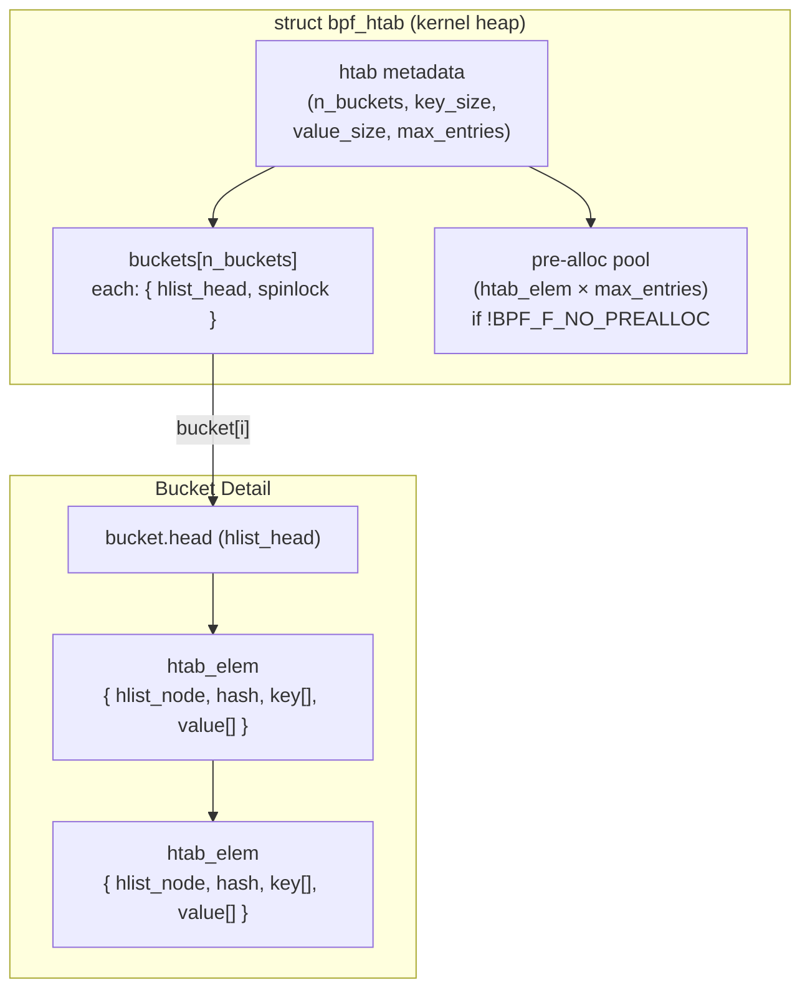
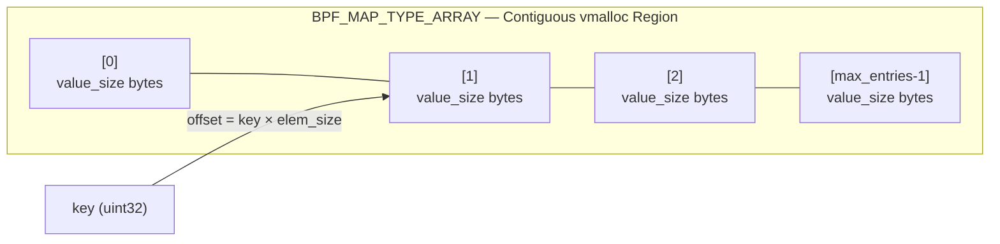
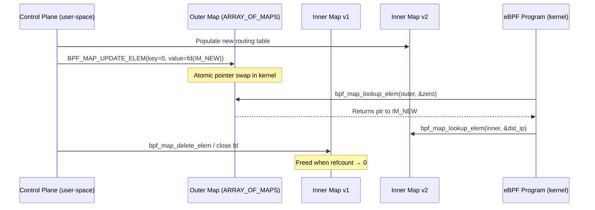
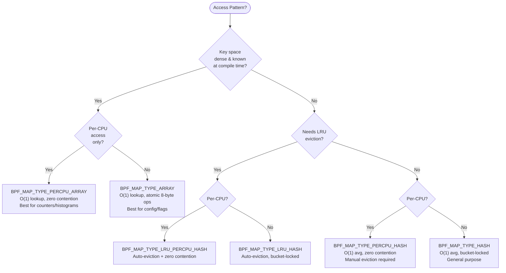
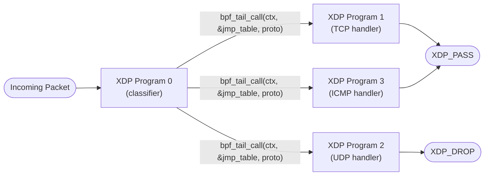
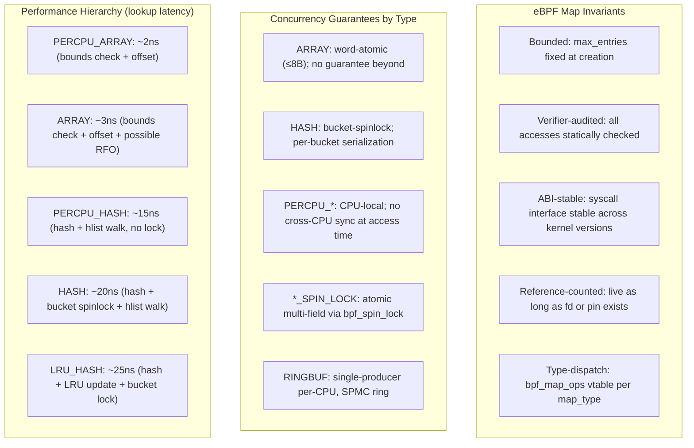

# Lesson 6: eBPF Maps — Case Studies, Architecture, and Production Best Practices

## 1. First-Principles Intuition and Invariants

eBPF maps are the **primary IPC and state-sharing mechanism** between eBPF programs running in kernel context and user-space control planes. Understanding them from first principles requires understanding why the kernel needed a new data-abstraction layer at all, rather than reusing existing kernel structures.

### Why Not Reuse Existing Kernel Structures?

Traditional kernel data structures — `struct hlist_head`, `struct rb_root`, `struct list_head` — are designed for in-kernel consumption by trusted code. They carry no notion of bounded size, no ABI-stable syscall interface for user-space introspection, and no mechanism for safe, verifier-checked concurrent access from sandboxed programs. Using them from an eBPF program would require exposing raw kernel pointers to unverified code, which is precisely what the BPF verifier was designed to prevent.

eBPF maps solve this by presenting a **typed, file-descriptor-backed, ABI-stable key/value abstraction** that is:

- **Bounded at creation time** — `max_entries` is set once via `BPF_MAP_CREATE` and never changes at runtime. This gives the verifier and the kernel allocator a hard upper bound on memory consumption, making resident set size predictable and preventing unbounded growth from causing OOM conditions.
- **Kernel-owned, user-visible** — Maps live in kernel memory but are referenced via file descriptors pinned in the BPF filesystem (`/sys/fs/bpf`). They are reference-counted and persist as long as at least one fd or pinned path holds them alive, independent of the lifetime of any individual eBPF program.
- **Verifier-auditable** — All map accesses in eBPF bytecode are statically checked by the verifier. The verifier tracks pointer provenance: a pointer returned by `bpf_map_lookup_elem()` is marked as potentially NULL and must be null-checked before dereferencing, or the program is rejected. This eliminates entire classes of use-after-free and out-of-bounds bugs at load time rather than at runtime.
- **Type-polymorphic at the syscall layer** — The `bpf(2)` syscall operates on `union bpf_attr`, and `BPF_MAP_CREATE` selects among over 25 map types (as of Linux 6.x) through the `map_type` field. The semantics of `BPF_MAP_LOOKUP_ELEM`, `BPF_MAP_UPDATE_ELEM`, and `BPF_MAP_DELETE_ELEM` are identical at the syscall interface regardless of the backing implementation.

### The Concurrency Invariant

The concurrency story for eBPF maps is nuanced and frequently misunderstood. The claim that maps are "lockless" is type-dependent:

- **`BPF_MAP_TYPE_ARRAY`** — Lookups and updates to individual elements are atomic at the word level (for values ≤ 8 bytes) because x86-64 guarantees atomic aligned loads/stores. For larger values, there is **no** atomicity guarantee; two CPUs can see a torn write.
- **`BPF_MAP_TYPE_HASH`** — Implemented as a bucket-locked hash table (`htab`). Each bucket has a spinlock (`struct bucket`), so concurrent updates to different buckets proceed in parallel, but updates to the same bucket are serialized. This is not lockless; it is fine-grained locking.
- **`BPF_MAP_TYPE_PERCPU_HASH` / `BPF_MAP_TYPE_PERCPU_ARRAY`** — Each CPU operates on a CPU-local copy of the value. No cross-CPU synchronization is required during eBPF program execution. User-space aggregation is deferred to `bpf_map_lookup_elem()`, which reads all per-CPU values in a single syscall and returns them as an array of `num_possible_cpus()` values. This is the correct model for performance-critical counters and histograms.
- **`BPF_MAP_TYPE_LRU_HASH`** — Uses a per-CPU LRU list to evict the least-recently-used element when the map is full, trading strict consistency for bounded memory without user-space intervention.
- **Spin-lock annotated maps** — Since Linux 5.1, map values can embed a `struct bpf_spin_lock` as their first field. eBPF programs call `bpf_spin_lock()` / `bpf_spin_unlock()` to protect multi-word updates atomically within a single map lookup. This is the correct primitive when you need atomic read-modify-write on a value larger than 8 bytes.

The key invariant is: **the unit of atomicity in eBPF maps is the element, not the map**. Full-map consistency must be built on top using per-element spin locks or by switching to a double-buffered approach (two array maps swapped by a pointer in a `BPF_MAP_TYPE_ARRAY_OF_MAPS`).

---

## 2. Core Architecture and Mechanics

### The `bpf(2)` Syscall and Map Lifecycle

All map operations flow through a single multiplexed syscall. The kernel-side dispatch table is `bpf_map_ops`, a vtable populated per map type. Understanding this vtable is essential for predicting performance characteristics.

```c
/* From include/linux/bpf.h (simplified) */
struct bpf_map_ops {
    /* Called once at BPF_MAP_CREATE time */
    int (*map_alloc_check)(union bpf_attr *attr);
    struct bpf_map *(*map_alloc)(union bpf_attr *attr);
    void (*map_release)(struct bpf_map *map, struct file *map_file);
    void (*map_free)(struct bpf_map *map);

    /* Hotpath: invoked from eBPF programs via inlined JIT helpers */
    void *(*map_lookup_elem)(struct bpf_map *map, void *key);
    int   (*map_update_elem)(struct bpf_map *map, void *key,
                             void *value, u64 flags);
    int   (*map_delete_elem)(struct bpf_map *map, void *key);

    /* Called from user-space via BPF_MAP_LOOKUP_ELEM syscall */
    int   (*map_lookup_elem_sys_only)(struct bpf_map *map,
                                      void *key, void *value);

    /* Iteration */
    int   (*map_get_next_key)(struct bpf_map *map,
                               void *key, void *next_key);
};
```

The critical insight is that `map_lookup_elem` is called **from JIT-compiled eBPF bytecode at kernel execution time**, not via the syscall path. The JIT compiler inlines the helper call. For `BPF_MAP_TYPE_ARRAY`, the entire lookup reduces to a bounds check plus a base-pointer offset computation — a handful of instructions. For `BPF_MAP_TYPE_HASH`, it involves a hash computation plus a bucket spinlock acquire/release.

### Map Creation: The `BPF_MAP_CREATE` Path

```c
/* Minimal correct usage from user-space in C */
#include <linux/bpf.h>
#include <sys/syscall.h>
#include <unistd.h>
#include <stdint.h>
#include <stdio.h>
#include <errno.h>
#include <string.h>

static inline int bpf_syscall(enum bpf_cmd cmd, union bpf_attr *attr,
                               unsigned int size) {
    return (int)syscall(__NR_bpf, cmd, attr, size);
}

int create_hash_map(uint32_t key_size, uint32_t value_size,
                    uint32_t max_entries) {
    union bpf_attr attr = {
        .map_type    = BPF_MAP_TYPE_HASH,
        .key_size    = key_size,
        .value_size  = value_size,
        .max_entries = max_entries,
        /* BPF_F_NO_PREALLOC defers per-element allocation to insert time.
         * Without this flag, the kernel pre-allocates all max_entries
         * elements at map creation, guaranteeing O(1) insert but
         * consuming memory upfront. Use pre-allocation for latency-
         * sensitive paths; NO_PREALLOC for sparse maps with high
         * max_entries bounds. */
        .map_flags   = BPF_F_NO_PREALLOC,
    };

    int fd = bpf_syscall(BPF_MAP_CREATE, &attr, sizeof(attr));
    if (fd < 0) {
        fprintf(stderr, "BPF_MAP_CREATE failed: %s\n", strerror(errno));
        return -1;
    }
    return fd;
}
```

**Pre-allocation vs. `BPF_F_NO_PREALLOC`** is one of the most consequential tuning decisions. Pre-allocated hash maps call `kmalloc` for all `max_entries` elements at creation time — insert latency becomes a constant-time memory copy from a pre-allocated pool. `BPF_F_NO_PREALLOC` calls `kmalloc` on the first insert, introducing per-insert allocation latency and the possibility that a `BPF_MAP_UPDATE_ELEM` call from an eBPF program fails under memory pressure (the helper returns a negative errno). **Never use `BPF_F_NO_PREALLOC` on the eBPF program's data path in production.**

### Internal Layout: Hash Map (`BPF_MAP_TYPE_HASH`)

The kernel implementation lives in `kernel/bpf/hashtab.c`. The structure is an open-addressed chaining hashtable with per-bucket spinlocks.



Each `htab_elem` stores its key and value as flexible trailing arrays — the element is a single `kmalloc` allocation of size `sizeof(struct htab_elem) + round_up(key_size, 8) + value_size`. The hash is computed with `jhash` (Bob Jenkins hash) over the raw key bytes.

**Lookup path** (from eBPF program, JIT-compiled):

1. Compute `hash = jhash(key, key_size, htab->hashrnd)`.
2. Compute `bucket_index = hash & (n_buckets - 1)` — n_buckets is always a power of two.
3. Acquire `bucket->lock` (spinlock, disables preemption on that CPU).
4. Walk `bucket->head` hlist, comparing `elem->hash == hash && memcmp(elem->key, key, key_size) == 0`.
5. Release `bucket->lock`.
6. Return pointer to `elem->value[]` or NULL.

The returned pointer is **into kernel memory**. The verifier marks it as a "map value pointer" with known bounds `[0, value_size)`. Any access outside those bounds is rejected at verification time.

### Internal Layout: Array Map (`BPF_MAP_TYPE_ARRAY`)

Array maps (`kernel/bpf/arraymap.c`) are the simplest and fastest map type. The backing store is a single `vmalloc` allocation of `max_entries × round_up(value_size, 8)` bytes.



The lookup from an eBPF program compiles to:

```asm
; Pseudocode of JIT output for array map lookup
; R1 = pointer to map, R2 = pointer to key
mov  eax, [R2]            ; load key (u32)
cmp  eax, [R1 + max_entries_offset]  ; bounds check
jae  out_of_bounds
imul eax, elem_size       ; offset = key * elem_size
lea  R0, [R1 + data_offset + rax]   ; R0 = &map->value[key]
; R0 is now a bounded map-value pointer; NULL is never returned
```

Array maps **never return NULL** for in-bounds keys. This is a verifier-visible property: if the eBPF program does a bounds-checked array lookup, the verifier knows the result is non-NULL and does not require a null check, eliminating a branch on the hot path.

### Per-CPU Maps: Architecture and Aggregation

Per-CPU maps allocate `num_possible_cpus()` independent value slots per key. During eBPF program execution on CPU *k*, the program accesses only slot *k* — no cache line can be shared with another CPU's slot because values are padded to `SMP_CACHE_BYTES` (typically 64 bytes).

```mermaid
graph TD
    subgraph sub_bpf_map_type_percpu_array ["BPF_MAP_TYPE_PERCPU_ARRAY"]
        direction TB
        KEY2["key = 7"]
        subgraph sub_cpu_0__numa_node_0 ["CPU 0 (NUMA node 0)"]
            V0["value[7] @ cpu0_base + 7×stride"]
        end
        subgraph sub_cpu_1__numa_node_0 ["CPU 1 (NUMA node 0)"]
            V1["value[7] @ cpu1_base + 7×stride"]
        end
        subgraph sub_cpu_2__numa_node_1 ["CPU 2 (NUMA node 1)"]
            V2["value[7] @ cpu2_base + 7×stride"]
        end
        subgraph sub_cpu_3__numa_node_1 ["CPU 3 (NUMA node 1)"]
            V3["value[7] @ cpu3_base + 7×stride"]
        end
        KEY2 --> V0
        KEY2 --> V1
        KEY2 --> V2
        KEY2 --> V3
    end

    USERSPACE["User-space:\nbpf_map_lookup_elem(fd, &key, values_array)\nreturns values_array["num_possible_cpus()"]"]
    V0 --> USERSPACE
    V1 --> USERSPACE
    V2 --> USERSPACE
    V3 --> USERSPACE
```

The user-space aggregation pattern for per-CPU counters is:

```c
#include <bpf/libbpf.h>
#include <stdio.h>
#include <stdlib.h>

/*
 * Aggregate per-CPU counters into a single sum.
 * map_fd: fd of a BPF_MAP_TYPE_PERCPU_ARRAY where value is uint64_t.
 * key:    array index to aggregate.
 */
uint64_t aggregate_percpu_counter(int map_fd, uint32_t key) {
    int ncpus = libbpf_num_possible_cpus();
    if (ncpus < 0) {
        fprintf(stderr, "libbpf_num_possible_cpus: %d\n", ncpus);
        return 0;
    }

    /* values must be aligned to 8 bytes and padded to CPU stride.
     * libbpf's bpf_map_lookup_elem handles this internally when
     * the map fd is used via the libbpf wrapper. For raw syscall,
     * you must allocate ncpus × roundup(value_size, 8) bytes. */
    uint64_t *values = calloc(ncpus, sizeof(uint64_t));
    if (!values)
        return 0;

    if (bpf_map_lookup_elem(map_fd, &key, values) != 0) {
        free(values);
        return 0;
    }

    uint64_t total = 0;
    for (int i = 0; i < ncpus; i++)
        total += values[i];

    free(values);
    return total;
}
```

### Map-in-Map: `BPF_MAP_TYPE_ARRAY_OF_MAPS` and `BPF_MAP_TYPE_HASH_OF_MAPS`

Introduced in Linux 4.12, map-in-map allows an outer map to hold file descriptors referencing inner maps. The canonical use case is **atomic map swapping**: a user-space control plane creates a new inner map, populates it, then atomically updates the outer map's slot 0 to point to the new inner map. eBPF programs on the data path always dereference the outer map first, then the inner map, so they observe either the old or new inner map but never a partially-updated state.



---

## 3. The eBPF Verifier: Static Analysis of Map Access

The verifier is not a "DAG verifier" — this is a common simplification that obscures the actual mechanism. The verifier performs **abstract interpretation** over the eBPF bytecode's control-flow graph (CFG). It is not limited to DAGs; it handles loops in kernels ≥ 5.3 via bounded loop analysis (the loop iteration count must be provably bounded at verification time, either by a constant bound or via `bpf_loop()` helper introduced in 5.17).

### Pointer Tracking and Map Value Safety

For every instruction, the verifier maintains a **register state**: each of the 11 BPF registers is typed as one of:

| Type | Meaning |
|---|---|
| `NOT_INIT` | Uninitialized; any read is a verifier error |
| `SCALAR_VALUE` | An integer with optional known range `[smin, smax]` |
| `PTR_TO_MAP_VALUE` | Pointer into a map value; bounds `[0, value_size)` |
| `PTR_TO_MAP_VALUE_OR_NULL` | Return of `map_lookup_elem`; must be null-checked |
| `PTR_TO_CTX` | Pointer to the program's context (skb, xdp_md, etc.) |
| `PTR_TO_STACK` | Pointer into BPF stack frame |
| `PTR_TO_PACKET` | Pointer into packet data; requires dynamic bounds check |

When the JIT'd program calls `bpf_map_lookup_elem()`, the verifier sets the return register (R0) to `PTR_TO_MAP_VALUE_OR_NULL`. Any subsequent dereference of R0 without an intervening null check (`if (R0 == NULL) goto ...`) causes the verifier to reject the program with `"R0 invalid mem access 'map_value_or_null'"`.

After the null check, the verifier promotes R0's type to `PTR_TO_MAP_VALUE` and tracks the offset. An access `R0 + 8` is legal only if `8 + access_size ≤ value_size`. This check is purely static; it incurs zero runtime overhead.

### Verifier Example: Safe vs. Rejected Program

```c
/* eBPF C source compiled with clang -target bpf */
#include <linux/bpf.h>
#include <bpf/bpf_helpers.h>

struct {
    __uint(type, BPF_MAP_TYPE_HASH);
    __uint(max_entries, 1024);
    __type(key,   __u32);
    __type(value, __u64);
} my_map SEC(".maps");

/* REJECTED by verifier: missing null check */
SEC("xdp")
int xdp_bad(struct xdp_md *ctx) {
    __u32 key = 42;
    __u64 *val = bpf_map_lookup_elem(&my_map, &key);
    /* Verifier error: "R0 invalid mem access 'map_value_or_null'" */
    *val += 1;
    return XDP_PASS;
}

/* ACCEPTED by verifier: proper null check */
SEC("xdp")
int xdp_good(struct xdp_md *ctx) {
    __u32 key = 42;
    __u64 *val = bpf_map_lookup_elem(&my_map, &key);
    if (!val)
        return XDP_PASS;   /* null branch: return early */
    /* Here, verifier knows val: PTR_TO_MAP_VALUE, offset=0, size=8 */
    __sync_fetch_and_add(val, 1);  /* atomic increment */
    return XDP_PASS;
}
```

The `__sync_fetch_and_add` compiles to a `lock xadd` instruction on x86-64, providing atomic read-modify-write for the 8-byte value. For values protected by `bpf_spin_lock`, use `bpf_spin_lock()` / `bpf_spin_unlock()` instead.

---

## 4. High-Performance Optimization Patterns

### 4.1 Choosing the Right Map Type for the Access Pattern



### 4.2 Eliminating False Sharing with Per-CPU Maps

The canonical performance anti-pattern is using a plain `BPF_MAP_TYPE_ARRAY` as a global counter in a high-packet-rate XDP program:

```c
/* ANTI-PATTERN: shared array map as counter — severe cache thrashing
 * on multi-core systems at > ~1 Mpps per core */
struct {
    __uint(type, BPF_MAP_TYPE_ARRAY);
    __uint(max_entries, 1);
    __type(key,   __u32);
    __type(value, __u64);
} pkt_count SEC(".maps");

SEC("xdp")
int count_bad(struct xdp_md *ctx) {
    __u32 key = 0;
    __u64 *cnt = bpf_map_lookup_elem(&pkt_count, &key);
    if (cnt)
        __sync_fetch_and_add(cnt, 1);  /* cache-line ping-pong */
    return XDP_PASS;
}
```

The `lock xadd` instruction forces a cache-coherency transaction (MESI protocol RFO — Read For Ownership) on every packet across all CPUs sharing the cache line. At 10 Gbps line rate with 64-byte packets (~14 Mpps), this saturates the memory interconnect.

The correct pattern uses `BPF_MAP_TYPE_PERCPU_ARRAY`:

```c
/* CORRECT: per-CPU counter, aggregated in user-space */
struct {
    __uint(type, BPF_MAP_TYPE_PERCPU_ARRAY);
    __uint(max_entries, 1);
    __type(key,   __u32);
    __type(value, __u64);
} pkt_count_percpu SEC(".maps");

SEC("xdp")
int count_good(struct xdp_md *ctx) {
    __u32 key = 0;
    __u64 *cnt = bpf_map_lookup_elem(&pkt_count_percpu, &key);
    if (cnt)
        (*cnt)++;   /* non-atomic; this CPU owns this slot */
    return XDP_PASS;
}
```

No lock prefix, no RFO, no cache-line contention. The increment is a single `add [mem], 1` instruction. User-space sums the per-CPU slots as shown in §2.

### 4.3 Batch Operations (Linux 5.6+)

For user-space polling loops that must read thousands of map entries per iteration, the `BPF_MAP_LOOKUP_BATCH` / `BPF_MAP_UPDATE_BATCH` syscall commands reduce the per-entry syscall overhead dramatically. Each `BPF_MAP_LOOKUP_BATCH` call transfers up to `count` entries in a single syscall invocation.

```c
#include <bpf/libbpf.h>
#include <stdlib.h>
#include <string.h>
#include <stdio.h>
#include <errno.h>

/*
 * Drain all entries from a BPF_MAP_TYPE_HASH map using batch lookup.
 * This is O(n) in total entries with O(1) syscalls per batch, vs.
 * O(n) syscalls with BPF_MAP_GET_NEXT_KEY + BPF_MAP_LOOKUP_ELEM.
 */
void drain_hash_map(int map_fd, uint32_t key_size, uint32_t value_size,
                    uint32_t max_entries) {
    const uint32_t BATCH = 256;
    void *keys   = malloc(BATCH * key_size);
    void *values = malloc(BATCH * value_size);
    void *in_batch  = NULL;  /* NULL = start from beginning */
    void *out_batch = malloc(key_size);  /* opaque cursor */

    if (!keys || !values || !out_batch) goto cleanup;

    uint64_t total = 0;
    while (1) {
        uint32_t count = BATCH;
        int err = bpf_map_lookup_batch(map_fd,
                                        in_batch, out_batch,
                                        keys, values, &count,
                                        NULL /* opts */);
        if (err && errno != ENOENT) {
            perror("bpf_map_lookup_batch");
            break;
        }

        for (uint32_t i = 0; i < count; i++) {
            /* Process entry: key at keys + i*key_size,
             *                value at values + i*value_size */
            total++;
        }

        if (err == 0 && count < BATCH) break;  /* last batch */
        if (errno == ENOENT) break;             /* map exhausted */

        /* Advance cursor: out_batch becomes next in_batch */
        memcpy(in_batch = out_batch, out_batch, key_size);
    }

    printf("Drained %lu entries\n", total);

cleanup:
    free(keys); free(values); free(out_batch);
}
```

> **Note:** `BPF_MAP_LOOKUP_BATCH` on `BPF_MAP_TYPE_HASH` does not guarantee a consistent snapshot. Entries inserted or deleted during iteration may or may not be observed. For consistent snapshots, use a map-in-map swap pattern (§2).

### 4.4 Tail Calls and Map-Chaining for Modular Programs

`BPF_MAP_TYPE_PROG_ARRAY` stores references to other eBPF programs, enabling **tail calls** via `bpf_tail_call()`. A tail call replaces the current program's stack frame with the callee's — it does not consume additional kernel stack. The chain depth is limited to 33 tail calls (Linux default; configurable per-program via `BPF_F_ALLOW_OVERRIDE`).



The jump table is populated from user-space using standard map update operations, allowing programs to be hot-swapped without reloading the entry-point program.

---

## 5. Production Case Studies

### Case Study 1: XDP DDoS Mitigation with LRU Hash Maps

A stateful connection tracker for SYN flood mitigation requires tracking per-source-IP connection state with automatic expiry. The state must be accessible at line rate on the XDP hook (before `sk_buff` allocation).

```c
/* Connection state for SYN flood mitigation */
struct conn_state {
    __u64  first_seen_ns;    /* ktime_get_ns() at first SYN */
    __u32  syn_count;        /* SYNs seen in window */
    __u32  flags;
    struct bpf_spin_lock lock;  /* protects syn_count + flags */
};

struct {
    __uint(type, BPF_MAP_TYPE_LRU_HASH);
    __uint(max_entries, 1 << 20);  /* 1M entries, ~88 MB */
    __type(key,   __u32);          /* source IPv4 */
    __type(value, struct conn_state);
} conn_track SEC(".maps");

/*
 * BPF_MAP_TYPE_LRU_HASH automatically evicts the LRU entry when the
 * map is full, using a per-CPU LRU list with a global fallback list.
 * This avoids user-space GC entirely for connection tracking.
 *
 * max_entries sizing: each htab_elem is approximately:
 *   sizeof(htab_elem) + roundup(key_size,8) + value_size
 *   ≈ 48 + 8 + (24+4) = ~84 bytes per entry
 *   1M entries ≈ 84 MB resident.
 * Verify with: bpftool map show id <id>
 */
```

The LRU eviction policy in `BPF_MAP_TYPE_LRU_HASH` uses a **two-tier structure**: each CPU maintains a local LRU list of `lru_local_free_cnt` (default 128) free elements. When the local list is exhausted, the CPU steals elements from the global LRU list under a global lock. This amortizes global lock contention: at steady state, most insertions draw from the CPU-local free list.

### Case Study 2: System Call Tracing with Ring Buffer Maps

`BPF_MAP_TYPE_RINGBUF` (Linux 5.8) supersedes `BPF_MAP_TYPE_PERF_EVENT_ARRAY` for event streaming because:

1. **Single ring buffer, shared across CPUs** — no per-CPU ring means no reordering complexity in user-space. Events are ordered by submission time.
2. **Zero-copy notification** — the eBPF program calls `bpf_ringbuf_submit()` which writes directly to the ring buffer's memory-mapped region. User-space polls via `epoll` on the ring buffer fd with zero additional copies.
3. **Reservation model** — `bpf_ringbuf_reserve()` returns a pointer to pre-allocated ring buffer space. The eBPF program fills it in place and calls `bpf_ringbuf_submit()` or `bpf_ringbuf_discard()`. This avoids a double-copy through a temporary stack buffer.

```c
/* Kernel-side: tracing execve with ringbuf */
struct event {
    __u32 pid;
    __u32 uid;
    char  comm[16];
    char  filename[256];
};

struct {
    __uint(type, BPF_MAP_TYPE_RINGBUF);
    /* size must be a power of two and a multiple of PAGE_SIZE.
     * Rule of thumb: (max_events_per_second × sizeof(event) × 2)
     * rounded up to the next power-of-two page multiple.
     * 4 MB handles ~8000 events/sec of this event size. */
    __uint(max_entries, 4 * 1024 * 1024);
} events SEC(".maps");

SEC("tracepoint/syscalls/sys_enter_execve")
int trace_execve(struct trace_event_raw_sys_enter *ctx) {
    struct event *e;

    /* Reserve space: does NOT block; returns NULL if ring full.
     * BPF_RB_NO_WAKEUP defers epoll notification for batching.
     * BPF_RB_FORCE_WAKEUP unconditionally wakes up consumers.
     * 0 (default) wakes up only if no other pending wakeup. */
    e = bpf_ringbuf_reserve(&events, sizeof(*e), 0);
    if (!e)
        return 0;  /* drop event if ring full; increment a counter */

    e->pid = bpf_get_current_pid_tgid() >> 32;
    e->uid = bpf_get_current_uid_gid() & 0xFFFFFFFF;
    bpf_get_current_comm(&e->comm, sizeof(e->comm));

    /* Read filename from user-space pointer in syscall args */
    bpf_probe_read_user_str(e->filename, sizeof(e->filename),
                             (void *)ctx->args[0]);

    bpf_ringbuf_submit(e, 0);
    return 0;
}
```

User-space consumption via libbpf's ring buffer manager:

```c
#include <bpf/libbpf.h>
#include <stdio.h>
#include <signal.h>

static volatile bool running = true;

static int handle_event(void *ctx, void *data, size_t size) {
    struct event *e = data;
    printf("pid=%-6u uid=%-6u comm=%-16s file=%s\n",
           e->pid, e->uid, e->comm, e->filename);
    return 0;
}

static void sig_handler(int sig) { running = false; }

int main(void) {
    /* Assume skel is loaded and attached */
    struct ring_buffer *rb;
    int map_fd = /* bpf_obj_get or skel->maps.events fd */ -1;

    signal(SIGINT, sig_handler);

    rb = ring_buffer__new(map_fd, handle_event, NULL, NULL);
    if (!rb) {
        fprintf(stderr, "ring_buffer__new failed\n");
        return 1;
    }

    while (running) {
        /* Polls epoll, dispatches callbacks. Timeout = 100ms. */
        int err = ring_buffer__poll(rb, 100);
        if (err < 0 && err != -EINTR) {
            fprintf(stderr, "ring_buffer__poll: %d\n", err);
            break;
        }
    }

    ring_buffer__free(rb);
    return 0;
}
```

### Case Study 3: Network Flow Accounting with Spin-Lock Protected Struct

When a flow record must be updated atomically and contains multiple fields (bytes, packets, last-seen timestamp), neither atomic intrinsics nor per-CPU maps suffice — per-CPU maps require aggregation, losing per-flow precision. The correct tool is `bpf_spin_lock`:

```c
struct flow_key {
    __u32 src_ip;
    __u32 dst_ip;
    __u16 src_port;
    __u16 dst_port;
    __u8  proto;
    __u8  _pad[3];
};

struct flow_stats {
    struct bpf_spin_lock lock;  /* MUST be first field */
    __u64 bytes;
    __u64 packets;
    __u64 last_seen_ns;
};

struct {
    __uint(type, BPF_MAP_TYPE_HASH);
    __uint(max_entries, 1 << 18);  /* 256K flows */
    __type(key,   struct flow_key);
    __type(value, struct flow_stats);
} flow_table SEC(".maps");

SEC("xdp")
int track_flow(struct xdp_md *ctx) {
    void *data     = (void *)(long)ctx->data;
    void *data_end = (void *)(long)ctx->data_end;

    /* Minimal header parsing (IPv4/TCP, no options) */
    struct ethhdr *eth = data;
    if ((void *)(eth + 1) > data_end) return XDP_PASS;
    if (eth->h_proto != __constant_htons(ETH_P_IP)) return XDP_PASS;

    struct iphdr *ip = (void *)(eth + 1);
    if ((void *)(ip + 1) > data_end) return XDP_PASS;

    struct flow_key key = {
        .src_ip = ip->saddr,
        .dst_ip = ip->daddr,
        .proto  = ip->protocol,
    };

    if (ip->protocol == IPPROTO_TCP) {
        struct tcphdr *tcp = (void *)ip + (ip->ihl * 4);
        if ((void *)(tcp + 1) > data_end) return XDP_PASS;
        key.src_port = tcp->source;
        key.dst_port = tcp->dest;
    }

    struct flow_stats *stats = bpf_map_lookup_elem(&flow_table, &key);
    if (!stats) {
        struct flow_stats new_stats = {};
        bpf_map_update_elem(&flow_table, &key, &new_stats,
                            BPF_NOEXIST);
        stats = bpf_map_lookup_elem(&flow_table, &key);
        if (!stats) return XDP_PASS;
    }

    __u32 pkt_len = data_end - data;

    bpf_spin_lock(&stats->lock);
    stats->bytes    += pkt_len;
    stats->packets  += 1;
    stats->last_seen_ns = bpf_ktime_get_ns();
    bpf_spin_unlock(&stats->lock);

    return XDP_PASS;
}
```

> **Important:** The `struct bpf_spin_lock` field must appear at offset 0 of the value struct. The verifier enforces this. The lock is non-reentrant (attempting to acquire it twice from the same program will deadlock and the verifier will reject the program). Programs holding a spin lock cannot call any helper that may sleep or trigger a context switch.

---

## 6. Failure Modes and Operational Diagnostics

### Failure Mode Taxonomy

| Failure Mode | Root Cause | Detection | Mitigation |
|---|---|---|---|
| Map full (`ENOSPC` / `-E2BIG`) | `max_entries` undersized; no eviction | eBPF helper returns non-zero; `bpftool map show` | Use `BPF_MAP_TYPE_LRU_HASH`; increase `max_entries`; add counter for failed inserts |
| Torn reads/writes | Multi-word value updated non-atomically on shared map | Data analysis (inconsistent counters) | Use `bpf_spin_lock` or per-CPU maps |
| Verifier rejection | Out-of-bounds access, missing null check, unbounded loop | `strace bpf()` captures verifier log; `libbpf` prints it via log callback | Read verifier output; add null checks; bound loops |
| Memory exhaustion at creation | `max_entries` × element size exceeds `RLIMIT_MEMLOCK` | `EPERM` or `ENOMEM` on `BPF_MAP_CREATE` | Increase memlock via `setrlimit`; use `BPF_F_NO_PREALLOC` for sparse maps |
| LRU thrashing | Eviction rate exceeds insertion rate; working set > map size | Monitor eviction counter via dedicated counter map | Increase `max_entries`; tune `lru_local_free_cnt` |
| Ring buffer overflow | Producer faster than consumer | `bpf_ringbuf_reserve()` returns NULL | Monitor drop counter; increase ring size; reduce event rate |

### Diagnostic Tooling

```bash
# Inspect all loaded maps: id, type, key/value sizes, usage
bpftool map show

# Dump all entries of map id 42 as JSON
bpftool map dump id 42 --json | jq '.[] | {key, value}'

# Pin a map to the BPF filesystem for persistence across program reloads
bpftool map pin id 42 /sys/fs/bpf/my_flow_table

# Monitor map memory usage via kernel memory accounting
# Each map appears as a memcg charge under the creating process's cgroup
cat /sys/kernel/debug/bpf/maps  # requires CONFIG_DEBUG_FS

# Check verifier log for a rejected program (requires CAP_BPF or CAP_SYS_ADMIN)
# libbpf automatically prints the log on load failure when log_level > 0
```

Programmatic verifier log capture with libbpf:

```c
#include <bpf/libbpf.h>
#include <stdio.h>

static int libbpf_print_fn(enum libbpf_print_level level,
                            const char *format, va_list args) {
    if (level == LIBBPF_DEBUG)
        return 0;  /* suppress debug noise; set to != 0 for full trace */
    return vfprintf(stderr, format, args);
}

int main(void) {
    libbpf_set_print(libbpf_print_fn);

    struct bpf_object *obj = bpf_object__open("my_prog.bpf.o");
    if (libbpf_get_error(obj)) {
        fprintf(stderr, "bpf_object__open failed\n");
        return 1;
    }

    /* On load failure, libbpf prints the verifier log to stderr
     * via the registered print function. */
    if (bpf_object__load(obj)) {
        fprintf(stderr, "Load failed; check verifier output above\n");
        bpf_object__close(obj);
        return 1;
    }

    bpf_object__close(obj);
    return 0;
}
```

---

## 7. Summary of Invariants and Decision Framework



The design philosophy of eBPF maps — bounded allocation, static verification of access, file-descriptor lifecycle, and type-polymorphic operations — reflects a careful balance between safety and performance that is unique in the kernel's data structure landscape. Mastery of which map type fits a given access pattern, combined with awareness of the concurrency semantics and the verifier's requirements, is what separates correct, performant eBPF programs from ones that either fail to load or silently produce wrong results under multi-core contention.
