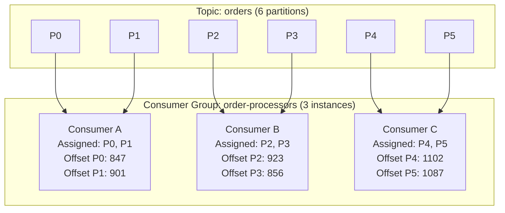

# Lesson 1: Event Primitives, Models, and Temporal Semantics

## 1. First-Principles Intuition & Invariants

Event-driven infrastructure represents a fundamental departure from the procedural request-response paradigm that has dominated software architecture for decades. To understand event-driven systems at their foundation, we must recognize that events are not merely messages or notifications—they are immutable facts that describe state transitions in distributed systems. An event declares that something happened at a specific point in time, and once that fact exists, it cannot be altered or erased. This immutability property forms the bedrock invariant upon which all event-driven reasoning is constructed.

The shift from imperative command semantics to declarative event semantics fundamentally changes how we reason about system behavior. In traditional architectures, a client instructs a service to perform an action: "create this user," "update this inventory count," "delete this record." The service executes the command, mutates its internal state, and returns a success or failure response. State exists only as the current snapshot within database tables, and historical transitions are lost unless explicitly logged. In contrast, event-driven systems invert this model. Components emit events declaring facts: "user-created," "inventory-decremented," "record-deleted." These events are persisted in an append-only log that becomes the system's source of truth. Current state is not stored directly but rather derived by replaying the sequence of events from the beginning of time—or more pragmatically, from the most recent snapshot.

This architectural pattern emerges naturally when building systems that must handle asynchronous workflows, maintain audit trails, support temporal queries, or scale horizontally across geographic boundaries. Consider a distributed order fulfillment system spanning multiple datacenters. When a customer places an order, that action generates an "order-placed" event containing the order identifier, customer details, line items, and timestamp. This event propagates to inventory management, payment processing, warehouse allocation, and analytics subsystems. Each consumer processes the event independently, updating its own local state and potentially emitting new events in response. The inventory service decrements stock counts and emits "inventory-reserved." The payment service charges the customer's account and emits "payment-authorized." The warehouse service assigns the order to a fulfillment center and emits "shipment-scheduled." At no point does the originating order service directly invoke methods on these downstream systems or wait synchronously for their responses. The event log serves as the single authoritative timeline, and eventual consistency emerges as each component processes events at its own pace.

The temporal semantics of event-driven systems demand rigorous reasoning about causality and ordering. Unlike monolithic applications where method calls execute within a single process address space governed by sequential consistency, distributed event-driven systems operate across network partitions where clocks drift, messages arrive out of order, and components fail independently. Two events emitted by different producers may appear in different sequences to different consumers depending on network latency, queue processing rates, and broker replication lag. This non-determinism cannot be eliminated—it is an intrinsic property of distributed systems governed by the fundamental constraints articulated in the CAP theorem and the impossibility results of Fischer, Lynch, and Paterson.

To impose order on this inherent chaos, event-driven systems employ explicit ordering guarantees encoded directly into their architecture. The weakest guarantee is no ordering—events may be delivered in arbitrary sequence. This model offers maximum throughput and horizontal scalability but places the burden of correlation and causality reasoning entirely on consumers. The next level is partition-ordered delivery, where events sharing a common partition key (such as customer identifier or order number) are guaranteed to arrive in the sequence they were produced. This guarantee enables stateful processing of related events while still allowing independent partitions to scale horizontally. At the strongest end of the spectrum lies total ordering, where all events across all producers are delivered to all consumers in identical sequence. This guarantee enables linearizable reasoning and simplifies consumer logic but fundamentally limits scalability because it requires a single serialization point—typically a single-threaded log appender or consensus protocol coordinator.

Event schemas define the structural contract between producers and consumers. Unlike RPC interfaces where caller and callee must agree on method signatures at compile time, event schemas must evolve gracefully across time because producers and consumers deploy independently and events persist indefinitely in logs. A consumer deployed today must correctly process events emitted months or years ago by producers running earlier schema versions. This requirement demands backward and forward compatibility mechanisms. Backward compatibility ensures new consumers can process old events, while forward compatibility allows old consumers to gracefully ignore or default new fields they don't understand. Schema evolution strategies range from additive-only policies (new fields must be optional with sensible defaults) to formal schema registries that enforce compatibility rules using Avro, Protocol Buffers, or JSON Schema validation.

The theoretical foundation of event-driven computation traces back to the lambda architecture proposed by Nathan Marz, which distinguished between a batch layer processing complete historical datasets and a speed layer handling real-time streams. The batch layer recomputes views from scratch periodically, providing correctness guarantees, while the speed layer incrementally updates approximate views, providing low latency. Jay Kreps later refined this model into the kappa architecture, which eliminates the batch layer entirely by treating all data as an infinite stream and deriving materialized views through stream processing alone. The kappa architecture recognizes that reprocessing historical events is simply stream processing with the playback speed turned up—the same code paths handle both real-time and historical data.

Event sourcing takes these principles to their logical extreme by making the event log the primary data structure of the entire system. Rather than storing aggregate state in normalized database tables, event sourcing persists only the events themselves. To reconstruct the current state of an entity, the system replays all events associated with that entity's identifier from the beginning of the log. This approach provides perfect audit trails, enables temporal queries ("what was the account balance at 3 PM on March 15th?"), supports debugging through deterministic replay, and facilitates schema migration by reprocessing historical events with updated business logic. The cost is increased read latency for aggregate reconstruction, which is typically mitigated through snapshot-based optimization: periodically persisting aggregate state snapshots and replaying only events since the most recent snapshot.

The immutability invariant of events has profound implications for system correctness and operational reasoning. In traditional databases, UPDATE and DELETE operations destroy information. If a bug causes incorrect updates, recovery requires restoring from backups—if recent backups exist and if the corruption was detected before backups rotated. In event-sourced systems, bugs cannot destroy historical facts. If incorrect events were emitted, compensating events can be appended to correct the logical state, but the historical record remains intact. If a bug in event processing logic is discovered, the system can rewind to before the bug was introduced and reprocess events with corrected logic. This property transforms how teams approach operational incidents: recovery becomes deterministic replay rather than emergency restoration.

The contract between event producers and consumers differs fundamentally from the contract between API clients and servers. In request-response APIs, the server bears responsibility for validating requests, enforcing business rules, and returning authoritative success or failure responses. The client blocks waiting for the response and retries on failure. In event-driven systems, producers emit events declaring facts without waiting for acknowledgment from consumers. Validation and business rule enforcement must occur before emission, because once an event enters the log, it becomes immutable truth. Consumers process events at will and cannot reject them—they must handle every event, even malformed or unexpected ones, through explicit dead-letter queues or error-handling logic. This shift in responsibility demands more sophisticated producer validation and more robust consumer error handling than traditional synchronous architectures.

## 2. Core Architecture & Mechanics

The fundamental data structure underlying event-driven infrastructure is the append-only log. This deceptively simple abstraction—a totally ordered sequence of records that supports only append operations and sequential reads—provides the foundation for distributed consensus, stream processing, and event sourcing. The log's append-only nature enables aggressive optimization: writes always proceed to the end, eliminating random disk seeks; reads typically scan sequentially, maximizing throughput; and immutability permits lockless concurrent reads without coordination overhead.

```text
Append-Only Event Log Structure
═══════════════════════════════════════════════════════════════════════════

Log Segment 0 (sealed, immutable)
┌────────────────────────────────────────────────────────────────┐
│ Offset │ Timestamp      │ Key        │ Value                    │
├────────┼────────────────┼────────────┼──────────────────────────┤
│ 0      │ 1704931200000  │ order-123  │ {"event":"order-placed"} │
│ 1      │ 1704931201500  │ order-123  │ {"event":"payment-auth"} │
│ 2      │ 1704931203000  │ order-456  │ {"event":"order-placed"} │
└────────┴────────────────┴────────────┴──────────────────────────┘
                              ↓
                        Index by Key
              ┌──────────────┬──────────────┐
              │ order-123: 0 │ order-456: 2 │
              └──────────────┴──────────────┘

Log Segment 1 (active, accepting appends)
┌────────────────────────────────────────────────────────────────┐
│ Offset │ Timestamp      │ Key        │ Value                    │
├────────┼────────────────┼────────────┼──────────────────────────┤
│ 3      │ 1704931205000  │ order-123  │ {"event":"item-shipped"} │
│ 4      │ 1704931207000  │ order-456  │ {"event":"payment-auth"} │
│ 5      │ [appending...] │            │                          │
└────────┴────────────────┴────────────┴──────────────────────────┘
                              ↑
                        Write Head
```

Each log entry contains at minimum an offset (monotonically increasing integer position), a timestamp (milliseconds since epoch), an optional partition key, and the event payload. The offset serves as the primary addressing mechanism—consumers track their position by persisting the last processed offset and resuming from that position after restarts. Timestamps enable temporal queries and time-based retention policies but do not determine ordering; offset sequence is the authoritative order. Partition keys enable parallel processing by routing related events to the same partition while maintaining ordering guarantees within that partition.

Event brokers implement the log abstraction through segmented files and memory-mapped I/O. Apache Kafka, the canonical implementation of this model, organizes topics into partitions, with each partition backed by a sequence of segment files. New events append to the active segment, and when that segment reaches a configured size threshold (typically 1 GB), it is sealed and a new active segment is created. Sealed segments are immutable and can be aggressively cached in the operating system's page cache. Consumers typically read from the page cache rather than disk, achieving near-memory throughput as long as consumers lag only slightly behind producers. When consumers fall far behind and must read historical segments no longer in cache, performance degrades to disk bandwidth, but sequential reads still far outperform random access patterns.

The partition model enables horizontal scaling by distributing partitions across multiple broker nodes. Each partition has a designated leader that handles all reads and writes, with follower replicas asynchronously replicating log entries. This single-leader-per-partition design simplifies consistency reasoning—all events for a given partition are serialized through a single node—while still allowing aggregate throughput to scale linearly with cluster size by increasing partition count. The tradeoff is that ordering guarantees exist only within partitions, not across them. Applications requiring total ordering must use a single partition, accepting the throughput limit of a single broker node.

Consumer group semantics enable parallel processing with exactly-once delivery guarantees. A consumer group consists of multiple consumer instances cooperating to process a topic. The broker assigns each partition to exactly one consumer in the group, ensuring that each event is processed by precisely one consumer instance. When a consumer joins or leaves the group, the broker triggers a rebalance operation that redistributes partition assignments. This automatic load balancing allows scaling consumer throughput by adding instances to the group, up to the number of partitions in the topic.



Exactly-once semantics—the guarantee that each event is processed precisely once despite failures and retries—requires careful coordination between event processing and offset commits. The naive approach of processing an event and then committing its offset to the broker suffers from a race condition: if the consumer crashes after processing but before committing, the event will be reprocessed on restart, yielding at-least-once semantics. If the consumer commits the offset before processing and then crashes, the event is lost, yielding at-most-once semantics. True exactly-once requires transactional coupling of business logic side effects and offset commits. Modern stream processors achieve this through two-phase commit protocols: business logic writes are staged in a transaction, the offset commit is added to the same transaction, and the entire transaction is atomically committed. If any component fails, the entire transaction rolls back and replay proceeds from the last committed offset.

Event schema evolution mechanisms preserve compatibility across producer and consumer versions. Avro, widely adopted in event-driven systems, encodes schemas using JSON definitions and data using a compact binary format. Each message either embeds its schema or references a schema identifier from a central registry. Avro's schema resolution algorithm allows a reader schema (consumer's expected structure) to differ from the writer schema (producer's actual structure) as long as compatibility rules are satisfied. Adding optional fields with default values maintains backward compatibility because old consumers use defaults for new fields they don't recognize. Removing optional fields maintains forward compatibility because new consumers can tolerate their absence in old events. Field reordering is permitted because Avro matches fields by name, not position, unlike Protocol Buffers which uses field numbers.

Dead-letter queue patterns provide graceful degradation when consumers encounter unparseable events or events that violate business invariants. Rather than blocking the entire partition on a single malformed event, the consumer publishes the problematic event to a separate dead-letter topic along with error diagnostics and continues processing subsequent events. Operations teams monitor dead-letter queues and investigate anomalies. Systematic patterns in dead-letter events often reveal schema incompatibilities, producer bugs, or unanticipated edge cases in business logic. The dead-letter queue preserves these events for forensic analysis and potential replay after fixes are deployed.

Event enrichment and transformation patterns enable decoupling between producer schemas and consumer requirements. Rather than forcing producers to emit events containing every field every consumer might need, intermediary stream processors can subscribe to raw events, enrich them with data from external systems, and publish augmented events to derived topics. For example, a raw "order-placed" event might contain only customer and product identifiers. An enrichment processor joins this event with customer profile data from a key-value store and product catalog data from another topic, then publishes an enriched "order-placed-enriched" event containing full customer names, email addresses, product descriptions, and pricing. Downstream consumers read the enriched topic rather than performing joins themselves, reducing latency and consolidating join logic.

Compacted topics enable efficient storage of entity state snapshots alongside event streams. Standard log retention policies delete events after a configured time period or size threshold, treating all events equally. Compacted topics apply a different retention policy: retain the most recent event for each key indefinitely while garbage collecting older events with the same key. This approach transforms a topic into a distributed key-value store where the value is the most recent event for each key. Compacted topics serve as changelog streams—new consumers can subscribe, read the entire compacted history to build initial state, then continue processing real-time updates. This pattern bridges the gap between event streaming and state management, enabling hybrid architectures.

## 3. High-Performance Optimization & Failure Modes

Maximizing event throughput requires optimizing the entire data path from producer memory through network serialization, broker disk I/O, replication, and consumer deserialization. The bottleneck often lies not in computational capacity but in the mechanical physics of disk seeks and network round-trips. Understanding these constraints enables architectural choices that dramatically improve performance.

Producer batching and compression are essential for high-throughput scenarios. Rather than issuing a network request for each event, producers accumulate events in memory buffers and flush batches periodically or when buffer size thresholds are exceeded. A producer might buffer 100 events over 10 milliseconds, compress the batch using LZ4 or Snappy, and transmit the compressed batch in a single request. This approach amortizes network overhead, reduces broker write amplification, and enables compression algorithms to exploit redundancy across multiple events. The tradeoff is increased latency—events wait in memory buffers before transmission—but for throughput-oriented workloads, batching can improve aggregate bandwidth by 10-20x compared to unbatched transmission.

Zero-copy transfer mechanisms eliminate redundant memory copies in the broker data path. Traditional I/O pipelines copy data multiple times: from network socket to kernel buffer, kernel buffer to application heap, application heap to file buffer, file buffer to disk. Each copy consumes CPU cycles and pollutes caches. Modern brokers leverage operating system primitives like Linux sendfile and mmap to transfer data directly from network socket to disk file without transitioning through application memory. The broker verifies checksums and appends metadata but never deserializes event payloads. This zero-copy architecture allows a single broker node to sustain hundreds of megabytes per second of throughput with minimal CPU overhead.

Partition selection strategies balance load across partitions while preserving ordering guarantees where needed. The simplest strategy is round-robin assignment, rotating events across partitions in sequence. This approach maximizes parallelism but destroys all ordering guarantees. Key-based partitioning applies a hash function to the event key and assigns the event to the partition corresponding to the hash modulo partition count. Events with the same key always route to the same partition, preserving ordering for related events while still distributing load. The risk is unbalanced partitions if keys are not uniformly distributed—a customer identifier key where 20% of orders come from a single large enterprise customer will concentrate load on one partition while others idle.

Consumer lag monitoring exposes backpressure and capacity constraints. Lag measures the difference between the latest offset produced to a partition and the latest offset consumed by a consumer group. Zero lag indicates the consumer is fully caught up, processing events in real-time. Increasing lag signals that producers are generating events faster than consumers can process them, eventually leading to resource exhaustion as consumer memory buffers overflow and processing latency grows unbounded. Alerting on sustained lag increases allows teams to scale consumer groups or optimize processing logic before user-visible impact occurs.

Rebalancing storms occur when consumer group instability triggers cascading rebalances. Each time a consumer joins or leaves a group, all consumers must halt processing, commit their current offsets, wait for the broker to compute new partition assignments, and resume from their assigned partitions. If consumers have large memory buffers or long processing loops, they may miss the heartbeat deadline during rebalance, causing the broker to assume they failed and trigger another rebalance. This cascading effect can cause an entire consumer group to thrash, making no forward progress. Mitigation requires tuning heartbeat intervals, session timeouts, and maximum poll intervals to accommodate realistic processing times, and designing consumers to respond promptly to rebalance notifications.

Clock skew and timestamp semantics complicate temporal reasoning in distributed systems. Event timestamps can reflect producer time (when the event was created), broker time (when the event was written to the log), or consumer time (when the event was processed). Producer timestamps are subject to clock drift—if producer clocks are not synchronized via NTP, events from different producers may appear out of chronological order even though they are correctly ordered by log offset. Broker timestamps are consistent within a broker but may skew across datacenters. Watermarking algorithms address this by tracking the minimum timestamp observed across all partitions in a given time window, allowing consumers to safely perform time-based aggregations once the watermark advances past the aggregation boundary.

Poison pill events—malformed payloads that crash consumer processes—can halt entire pipelines. If a serialization bug in a producer emits a corrupt event and the consumer's deserialization logic throws an unhandled exception, the consumer process terminates, restarts, reprocesses the same event, crashes again, and loops indefinitely. Circuit breaker patterns mitigate this by catching deserialization exceptions, logging the problematic event, advancing the offset past it, and continuing. For business-critical pipelines, sending the poison pill to a dead-letter queue for manual investigation prevents data loss while maintaining pipeline availability.

Thundering herd problems arise when many consumers simultaneously restart and begin reading historical data. If an entire consumer group is redeployed, all instances start from their last committed offsets and issue read requests to the broker. If those offsets point to old log segments that have been evicted from page cache, the broker must serve the reads from disk. Dozens of concurrent sequential reads thrash disk head movement, degrading throughput from hundreds of MB/s to single-digit MB/s. Graceful restart strategies stagger consumer restarts, allowing the page cache to warm up progressively, or pre-warm cache by reading log segments into memory before consumers reconnect.

Event replay scenarios enable reprocessing historical data with updated business logic. When a bug in consumer code is discovered, developers can fix the logic, reset consumer offsets to a point before the bug was introduced, and replay events forward with corrected processing. This capability is transformative for debugging and evolving business rules, but requires careful attention to idempotency. Replaying an "order-placed" event must not place duplicate orders or double-charge customers. Consumers achieve idempotency by checking deduplication stores (often the offset itself or an event ID) before applying side effects, or by designing operations that are naturally idempotent (setting a value rather than incrementing it, for example).

Backpressure propagation prevents cascading failures when downstream consumers cannot keep pace with upstream producers. Without backpressure, a slow consumer fills its memory buffers, triggers out-of-memory errors, crashes, and restarts only to immediately exhaust memory again. Explicit backpressure mechanisms allow consumers to signal to producers (or intermediary brokers) that they are overloaded, causing producers to slow their emission rate. In practice, event brokers decouple producers from consumers enough that direct backpressure is rare—instead, monitoring systems detect increasing consumer lag and trigger horizontal scaling of consumer groups or degradation of non-critical workloads to preserve capacity for critical paths.

Retention policies balance storage cost against audit trail duration. Retaining events indefinitely provides perfect auditability and unlimited replay capability but incurs unbounded storage cost. Time-based retention (delete events older than 30 days) bounds storage but destroys historical data. Size-based retention (retain the most recent 1 TB per partition) provides predictable storage but unpredictable time windows—high-throughput partitions retain only hours of data while low-throughput partitions retain months. Compacted retention (retain the latest event per key) suits changelog use cases but destroys the complete event history. Production systems often combine policies: retaining recent events with fine-grained time-based retention and archiving older events to object storage with coarse-grained batch access.

Geographic replication extends event-driven architectures across datacenters and cloud regions. Active-passive replication continuously copies events from a primary datacenter to a secondary for disaster recovery. If the primary fails, operations teams fail over to the secondary, accepting some data loss for events not yet replicated. Active-active replication allows producers and consumers in multiple datacenters to read and write concurrently, but introduces complex conflict resolution when events are produced to the same partition key in different locations. Conflict-free replicated data type techniques and last-write-wins policies provide eventual consistency but require careful reasoning about business semantics to avoid incorrect outcomes.
