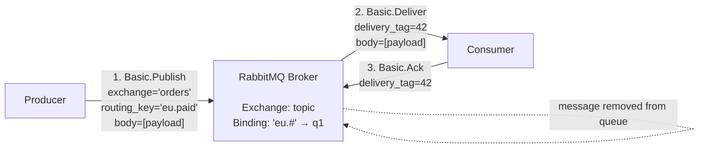

# Lesson 2: Message Brokers, Pub-Sub Protocols, and Delivery Guarantees

## 1. First-Principles Intuition & Invariants

Every distributed system eventually confronts the same physical reality: two processes that need to coordinate cannot share memory, cannot rely on a synchronous call completing before a failure occurs, and cannot assume the network between them is reliable. The naïve solution — direct RPC — collapses under any of these conditions because it couples the availability of the caller to the availability of the callee. A message broker exists precisely to dissolve that coupling. It interposes a durable intermediary between producer and consumer, transforming what would have been a synchronous dependency graph into a set of independent, temporally decoupled processes that communicate through shared, persistent state.

Understanding why this matters at a systems level requires going back to the hardware. A modern datacenter network delivers a round-trip time somewhere between 50 microseconds and 1 millisecond within a rack and 1–5 milliseconds cross-availability-zone. These numbers sound small until you are composing a request path that fans out to thirty microservices. At that point, the tail latency of the slowest service sets the floor for the entire request, and any retry storm — caused by a momentarily overloaded node — can cascade backward through the call graph like a wave. The broker absorbs those bursts. Its job is not speed; it is isolation, durability, and flow control.

The publish-subscribe model formalizes this isolation into a contract with three named roles: the **producer** (publisher) that emits events without knowledge of downstream consumers, the **topic** or **exchange** that acts as an addressable channel with routing semantics, and the **consumer** (subscriber) that expresses interest in a channel and receives a copy of every matching message. This decoupling is spatial — the producer does not hold a reference to any consumer — and temporal — the consumer need not be running when the producer emits. The broker bridges both dimensions by persisting messages until a consumer is ready to process them.

The core invariant that every broker implementation must reason about is the **delivery guarantee**, and there are three canonical levels. At-most-once delivery allows message loss: the broker fires and forgets, trading reliability for the lowest possible overhead. At-least-once delivery prevents loss but permits duplicates: the broker retains a message until it receives an acknowledgment from the consumer, retransmitting on timeout. Exactly-once delivery prevents both loss and duplication, which requires coordination across producer, broker, and consumer using distributed transactions or idempotency tokens — a significantly heavier protocol. Each guarantee maps to a different engineering tradeoff, and the right choice is determined by whether the downstream consumer is naturally idempotent and whether the cost of a duplicate side effect exceeds the cost of the coordination overhead required to prevent it.

Backpressure is the other invariant no broker can ignore. A broker that accepts messages at an unbounded rate and stores them on heap memory will eventually exhaust that memory and either crash or begin dropping messages — both of which violate the durability contract. Proper backpressure means the broker must surface its own queue depth to producers and have a mechanism to slow or block ingestion when the consumer falls behind. This is not a courtesy feature; it is a correctness requirement for any system that claims at-least-once semantics under sustained load.

---

## 2. Core Architecture & Mechanics

### The Kafka Protocol: Log-Structured Partitioned Storage

Apache Kafka's internal architecture is best understood as a distributed, replicated commit log. Its fundamental insight is that an append-only log on a local disk is both the fastest data structure available on commodity hardware and an inherently ordered, replayable record of events. Everything else in Kafka — consumer groups, offsets, partition leaders — exists to make that log accessible at distributed scale.

Each **topic** in Kafka is divided into one or more **partitions**. A partition is a totally ordered, immutable sequence of records stored as a set of segment files on the broker's local filesystem. Within a segment, each record occupies a contiguous byte region containing a fixed-size header (magic byte, attributes, timestamp delta, offset delta, key length, value length) followed by variable-length key and value payloads. The broker never modifies written segments; it only appends to the active segment and, when that segment reaches its configured size limit (`log.segment.bytes`, default 1 GB), rotates to a new one. Retention is handled by deleting or compacting the oldest segments asynchronously.

The performance of this design is not accidental. Kafka exploits the operating system's page cache aggressively. When a producer writes to a partition, the broker issues a `write(2)` syscall that copies data into the kernel's page cache; the fsync is deferred to a configurable interval or batch size. When a consumer reads from the same partition, the broker issues a `sendfile(2)` syscall that transfers data directly from the page cache to the network socket via zero-copy DMA, bypassing any userspace buffer. On a broker where producers and consumers are in rough parity, the data never touches disk at all — it flows from producer network card, through kernel page cache, to consumer network card entirely in kernel memory.

```
Kafka Partition Segment Layout (physical on disk)
─────────────────────────────────────────────────
  Segment 0  [00000000000000000000.log]
  ┌─────────────────────────────────────────────┐
  │ Batch Header (8 bytes: baseOffset)           │
  │ Batch Header (4 bytes: batchLength)          │
  │ Batch Header (4 bytes: partitionLeaderEpoch) │
  │ Batch Header (1 byte:  magic=2)              │
  │ Batch Header (4 bytes: crc32c)               │
  │ Batch Header (2 bytes: attributes)           │
  │ Batch Header (4 bytes: lastOffsetDelta)      │
  │ Batch Header (8 bytes: baseTimestamp)        │
  │ Batch Header (8 bytes: maxTimestamp)         │
  │ Batch Header (8 bytes: producerId)           │
  │ Batch Header (2 bytes: producerEpoch)        │
  │ Batch Header (4 bytes: baseSequence)         │
  │ Batch Header (4 bytes: recordCount)          │
  ├─────────────────────────────────────────────┤
  │ Record[0]: len, attrs, timestampDelta,       │
  │            offsetDelta, keyLen, key,         │
  │            valueLen, value, headers[]        │
  │ Record[1]: ...                               │
  └─────────────────────────────────────────────┘

  Segment 0  [00000000000000000000.index]   (sparse offset → filePosition)
  Segment 0  [00000000000000000000.timeindex] (timestamp → offset)
```

Consumer position is tracked by a single integer: the **offset**, which is the record's position within its partition. Consumers commit their offsets back to Kafka itself (stored in the internal `__consumer_offsets` topic), which means the broker is stateless with respect to consumer progress. This is architecturally significant: Kafka can replay any historical range of a partition to any consumer by simply seeking to the requested offset, enabling both reprocessing and audit use cases that a traditional queue cannot support.

Replication operates at the partition level. Each partition has one **leader** and zero or more **followers** determined by the controller (now implemented through KRaft, Kafka's internal Raft consensus mechanism that replaced ZooKeeper). Producers write exclusively to the leader; followers fetch from the leader identically to consumers. The **in-sync replica set (ISR)** is the set of followers whose replication lag is below `replica.lag.time.max.ms`. A producer configured with `acks=all` (equivalently `acks=-1`) receives an acknowledgment only when every member of the ISR has written the batch to its log, which provides the durability guarantee. With `min.insync.replicas=2` and a replication factor of 3, the cluster can tolerate one broker failure without losing acknowledged data.

### AMQP 0-9-1: Exchange Routing and Channel Multiplexing

The Advanced Message Queuing Protocol 0-9-1, the wire protocol underlying RabbitMQ, takes a fundamentally different approach. Where Kafka delegates routing decisions to producers (who choose the partition) and consumers (who choose the offset), AMQP centralizes routing in the broker through the **exchange** abstraction. A producer publishes a message to a named exchange with a **routing key**. The exchange evaluates binding rules against that key and delivers a copy of the message to every queue whose binding matches.

AMQP defines four exchange types. A **direct** exchange routes a message to every queue bound with a routing key equal to the message's routing key — a point-to-point channel. A **fanout** exchange ignores the routing key entirely and delivers to all bound queues simultaneously, which is the purest publish-subscribe topology. A **topic** exchange treats routing keys as dot-delimited strings (`orders.europe.paid`) and matches them against binding patterns containing the wildcards `*` (one word) and `#` (zero or more words), enabling hierarchical content-based routing. A **headers** exchange ignores the routing key and matches on arbitrary message header key-value pairs, trading routing flexibility for a performance cost proportional to the number of headers evaluated.

The AMQP connection model multiplexes multiple independent logical channels over a single TCP connection. Each **channel** is an independent sequence of commands and responses; channel IDs are 16-bit unsigned integers, allowing up to 65,535 channels per connection. This design amortizes TCP connection overhead across many parallel flows. The command set is binary and frame-based: every frame carries a type (method, header, body, heartbeat), a channel ID, and a payload. A published message is transmitted as a sequence of frames: a **method** frame (`Basic.Publish`) containing the exchange name and routing key, a **header** frame carrying content properties (content-type, delivery-mode, priority, expiration), and one or more **body** frames containing the raw payload.

Consumer acknowledgment in AMQP 0-9-1 is explicit and delivery-scoped. The broker assigns each delivered message a **delivery tag**, a per-channel monotonically increasing integer. The consumer sends `Basic.Ack` with the delivery tag (and optionally the `multiple` flag to acknowledge all tags up to and including that value) to signal successful processing. If the consumer's TCP connection drops before an acknowledgment arrives, the broker re-queues all unacknowledged messages from that channel and delivers them to the next available consumer. This is the mechanism that realizes at-least-once semantics: the broker retains custody of the message until proof of processing arrives.



### MQTT: Persistent Sessions and QoS State Machines

MQTT is a binary publish-subscribe protocol designed around constrained networks and embedded clients. Its defining feature is the three-tier **Quality of Service (QoS)** model, each tier of which is a distinct stateful protocol exchange between client and broker.

QoS 0 is fire-and-forget: the publisher sends a `PUBLISH` packet and the broker delivers it once to subscribed clients with no acknowledgment in either direction. Network loss results in permanent message loss. QoS 1 guarantees at-least-once delivery through a two-way handshake. The publisher sends `PUBLISH` with a `PacketIdentifier` and waits for `PUBACK` from the broker; the broker sends `PUBLISH` to subscribers and waits for `PUBACK` from each. If the acknowledgment does not arrive before a timeout, both sides retransmit the packet with the `DUP` flag set, which is the recipient's signal that this may be a duplicate. QoS 2 achieves exactly-once delivery through a four-way handshake: `PUBLISH` → `PUBREC` → `PUBREL` → `PUBCOMP`. The `PUBREC` signals receipt; the sender stores the `PacketIdentifier` and sends `PUBREL`; the receiver delivers the message to the application and responds `PUBCOMP`; only then does the sender discard its record of the exchange. This four-way handshake ensures that even if either party crashes and reconnects, the state machine can resume without producing a duplicate delivery.

The **persistent session** mechanism is equally important for reliability in constrained environments. When a client connects with `CleanSession=0`, the broker retains the client's subscriptions and any QoS 1 or QoS 2 messages that arrived while the client was offline, delivering them upon reconnection. This turns the broker into a durable outbox for each individual client, a behavior with no direct analog in Kafka's log model and a fundamentally different scaling characteristic: broker memory consumption grows linearly with the number of offline persistent sessions that have accumulated undelivered messages.

### Exactly-Once Semantics: Idempotent Producers and Transactions

Achieving exactly-once semantics at the application level requires coordination at every stage of the pipeline. Kafka's implementation, introduced in version 0.11, is the most fully realized example in production use and is worth examining at the protocol level.

The **idempotent producer** is the foundation. Each producer is assigned a **ProducerID (PID)** by the broker on initialization. Every batch the producer sends carries the PID and a monotonically increasing **sequence number** per partition. The broker maintains the last committed sequence number for each `(PID, partition)` pair. When a batch arrives, the broker rejects it if its sequence is less than or equal to the last committed sequence (a duplicate) and raises an error if the sequence is more than one greater than the last committed sequence (a gap indicating a lost batch). This eliminates duplicates caused by producer retries within a single session at zero additional latency cost — the state check is O(1) on a broker-local in-memory map.

**Transactional producers** extend idempotency across multiple partitions and optionally across the `__consumer_offsets` topic. A producer opens a transaction with `InitProducerIdRequest`, publishes to multiple partitions, and then commits the transaction with `EndTxnRequest(commit=true)`. The broker records the transaction state in a dedicated **transaction log** partition. Consumers configured with `isolation.level=read_committed` only see records from committed transactions; records from open or aborted transactions are invisible until the transaction either commits or the transaction timeout expires. This creates a consistent snapshot boundary across all partitions touched by the transaction and is the mechanism that enables the consume-transform-produce pattern used in Kafka Streams to deliver exactly-once processing guarantees across a full pipeline.

The following producer configuration achieves idempotent, transactional delivery:

```java
Properties props = new Properties();
props.put(ProducerConfig.BOOTSTRAP_SERVERS_CONFIG,  "kafka-0:9092,kafka-1:9092,kafka-2:9092");
props.put(ProducerConfig.KEY_SERIALIZER_CLASS_CONFIG,   "org.apache.kafka.common.serialization.StringSerializer");
props.put(ProducerConfig.VALUE_SERIALIZER_CLASS_CONFIG, "org.apache.kafka.common.serialization.ByteArraySerializer");

// Idempotent producer: PID + sequence numbers, retries without duplicates.
props.put(ProducerConfig.ENABLE_IDEMPOTENCE_CONFIG,         true);
// acks=all implied by idempotence; every ISR member must confirm.
props.put(ProducerConfig.ACKS_CONFIG,                       "all");
// Bounded retry window; idempotency makes retries safe.
props.put(ProducerConfig.RETRIES_CONFIG,                    Integer.MAX_VALUE);
// In-flight requests per partition: must be 1 for ordering + idempotency.
props.put(ProducerConfig.MAX_IN_FLIGHT_REQUESTS_PER_CONNECTION, 1);

// Transactional ID: stable across restarts, scopes the transaction log entry.
props.put(ProducerConfig.TRANSACTIONAL_ID_CONFIG, "order-processor-instance-0");

// Throughput tuning: batch up to 64 KB or wait up to 5 ms before sending.
props.put(ProducerConfig.BATCH_SIZE_CONFIG,    65536);
props.put(ProducerConfig.LINGER_MS_CONFIG,     5);
props.put(ProducerConfig.COMPRESSION_TYPE_CONFIG, "lz4");

KafkaProducer<String, byte[]> producer = new KafkaProducer<>(props);
producer.initTransactions();

try {
    producer.beginTransaction();

    ProducerRecord<String, byte[]> orderEvent = new ProducerRecord<>(
        "orders", "order-id-7291", serializeOrder(order));
    ProducerRecord<String, byte[]> auditEvent = new ProducerRecord<>(
        "audit-log", "order-id-7291", serializeAudit(order));

    producer.send(orderEvent);
    producer.send(auditEvent);

    // Atomically commit consumer offset alongside the produced records.
    // Guarantees the consume-transform-produce loop is exactly-once end-to-end.
    Map<TopicPartition, OffsetAndMetadata> offsetsToCommit = new HashMap<>();
    offsetsToCommit.put(
        new TopicPartition("raw-events", 0),
        new OffsetAndMetadata(currentOffset + 1));
    producer.sendOffsetsToTransaction(offsetsToCommit, consumerGroupMetadata);

    producer.commitTransaction();
} catch (ProducerFencedException | OutOfOrderSequenceException e) {
    // Another instance with the same transactional ID has taken over.
    // This instance must shut down; it cannot recover.
    producer.close();
    throw new FatalProcessorException("Producer fenced, shutting down", e);
} catch (KafkaException e) {
    // Transient error; abort and retry the entire consume-transform-produce cycle.
    producer.abortTransaction();
    throw new RetryableProcessorException("Transaction aborted, will retry", e);
}
```

A fully functional RabbitMQ consumer with manual acknowledgment and dead-letter routing demonstrates the equivalent at-least-once pattern on the AMQP side:

```java
ConnectionFactory factory = new ConnectionFactory();
factory.setHost("rabbitmq.internal");
factory.setPort(5672);
factory.setVirtualHost("/");
factory.setUsername("svc-orders");
factory.setPassword(System.getenv("RABBITMQ_PASSWORD"));
factory.setAutomaticRecoveryEnabled(true);
factory.setNetworkRecoveryInterval(2000);

try (Connection connection = factory.newConnection();
     Channel channel = connection.createChannel()) {

    // Exchange: topic type for hierarchical routing.
    channel.exchangeDeclare("orders", BuiltinExchangeType.TOPIC, true);

    // Dead-letter exchange receives messages rejected or expired from q.orders.eu.
    channel.exchangeDeclare("orders.dlx", BuiltinExchangeType.FANOUT, true);
    channel.queueDeclare("q.orders.eu.dead", true, false, false, null);
    channel.queueBind("q.orders.eu.dead", "orders.dlx", "");

    // Main queue with dead-letter and per-message TTL policy.
    Map<String, Object> queueArgs = new HashMap<>();
    queueArgs.put("x-dead-letter-exchange",    "orders.dlx");
    queueArgs.put("x-message-ttl",             60_000);       // 60-second TTL
    queueArgs.put("x-max-length",              100_000);       // backpressure cap
    queueArgs.put("x-overflow",                "reject-publish"); // publisher gets channel.close on overflow
    channel.queueDeclare("q.orders.eu", true, false, false, queueArgs);
    channel.queueBind("q.orders.eu", "orders", "eu.#");

    // prefetchCount=10: broker delivers at most 10 unacknowledged messages
    // to this consumer at a time. This is AMQP's backpressure mechanism.
    channel.basicQos(10);

    DeliverCallback deliverCallback = (consumerTag, delivery) -> {
        long deliveryTag = delivery.getEnvelope().getDeliveryTag();
        boolean redelivered  = delivery.getEnvelope().isRedeliver();
        try {
            Order order = deserializeOrder(delivery.getBody());
            processOrder(order);
            // ACK: message removed from queue permanently.
            channel.basicAck(deliveryTag, false);
        } catch (TransientProcessingException e) {
            // NACK with requeue=true: message returns to front of queue.
            // Guard against infinite retry loops with a redelivery counter
            // stored in the message headers or a separate Redis key.
            channel.basicNack(deliveryTag, false, !redelivered);
        } catch (PermanentProcessingException e) {
            // NACK with requeue=false: broker routes to dead-letter exchange.
            channel.basicNack(deliveryTag, false, false);
        }
    };

    channel.basicConsume("q.orders.eu", false, deliverCallback, consumerTag -> {});
    // Block the calling thread; real production code would run this in a
    // dedicated executor and await a shutdown latch.
    Thread.currentThread().join();
}
```

---

## 3. High-Performance Optimization & Failure Modes

### Partition Sizing, Consumer Group Parallelism, and Throughput Ceiling

A Kafka topic's maximum consumer-side throughput is bounded by its partition count. The Kafka consumer group protocol assigns each partition to exactly one consumer within a group at any moment, so a topic with eight partitions cannot be consumed in parallel by more than eight consumers in the same group regardless of how many consumer instances exist. Undersized partition counts are one of the most common sources of throughput ceilings in production Kafka deployments, and they are expensive to fix after the fact: repartitioning requires creating a new topic, mirroring data, and cutting over producers and consumers — an operational event, not a configuration change.

The producer side has its own throughput mechanics. Kafka's `linger.ms` and `batch.size` settings govern how much data is accumulated into a single RecordBatch before it is sent to the broker. A `linger.ms` of zero means the producer sends a batch immediately whenever `send()` is called, which maximizes latency per message but minimizes batching efficiency. At high message rates this produces a large number of small network round-trips and prevents LZ4 or Snappy compression from achieving meaningful ratios because there is too little data per batch for the compressor to find repeated patterns. Setting `linger.ms` to 5–20 milliseconds and `batch.size` to 64–256 KB allows the producer to accumulate a full batch before sending, increasing compression ratios to 3:1 or better for JSON payloads and dramatically increasing broker-side write throughput per network round-trip.

On the broker side, the most consequential configuration is `num.network.threads` and `num.io.threads`. The network threads handle socket accepts and reads from the network; the I/O threads handle disk reads and produce requests. The default ratio (3 network threads, 8 I/O threads) works well for balanced workloads but should be tuned when the broker is primarily a producer target (increase I/O threads) or primarily serving consumers replaying historical data (increase network threads and ensure the relevant segments are still hot in the page cache). The page cache is the broker's read cache, and its effectiveness degrades immediately if the broker process is collocated with any memory-hungry workload. In production, Kafka brokers run on dedicated nodes with no other significant processes, and the JVM heap is kept deliberately small (4–6 GB) so that the kernel can allocate the remaining physical RAM entirely to page cache.

### Consumer Lag and the Backpressure Contract

Consumer lag — the difference between the partition's latest offset and the consumer's committed offset — is the primary health signal for a Kafka-based event pipeline. A lag that grows monotonically indicates that the consumer is processing slower than the producer is writing. The correct response depends on the cause. If the consumer's processing logic is CPU-bound, adding consumer instances (up to the partition count) increases parallelism. If it is I/O-bound on a downstream database write, the solution may be consumer-side batching: accumulating records in a local buffer and flushing them in a single multi-row insert, trading individual message latency for bulk write efficiency. If the lag is caused by a consumer that has stopped entirely — a crashed JVM, a deadlocked thread pool — the Kafka group coordinator detects the absence of heartbeats within `session.timeout.ms` (default 45 seconds) and triggers a **rebalance**, reassigning the stalled consumer's partitions to healthy instances.

Rebalances are the most disruptive routine event in a Kafka consumer group. During a rebalance, all consumers in the group stop processing and renegotiate partition assignments. In a large consumer group processing high-throughput partitions, a rebalance can stall the entire pipeline for seconds while the new assignment propagates and each consumer seeks to its last committed offset. The modern mitigation is **cooperative incremental rebalancing** (enabled by setting `partition.assignment.strategy` to `CooperativeStickyAssignor`), which revokes and reassigns only the partitions that must move, allowing consumers to continue processing their retained partitions throughout the rebalance. This reduces the stop-the-world window to the latency of a single round-trip to the group coordinator for most rebalance events.

### RabbitMQ Queue Mirroring, Quorum Queues, and Flow Control

Classic mirrored queues in RabbitMQ have a known availability hazard: if the leader node loses contact with its mirrors, it continues to accept messages from producers; when the network heals and the mirrors resync, they must replay their queue contents from the leader, potentially under heavy traffic. The **Quorum Queue**, introduced in RabbitMQ 3.8, replaces this model with a Raft-based replication protocol. A quorum queue requires a majority of its configured replicas (for example, 3 of 5) to confirm a write before the broker acknowledges it to the producer, providing crash safety guarantees equivalent to a Kafka partition with `acks=all` and `min.insync.replicas=2`.

RabbitMQ's flow control mechanism operates at the connection level when a broker node's memory consumption or disk space crosses a configurable high-watermark threshold (default 40% of available RAM). When triggered, the broker sends a `Connection.Blocked` notification to all publisher connections, which causes the AMQP client library to pause the calling thread's `basicPublish` calls. When the resource pressure clears, the broker sends `Connection.Unblocked` and publishing resumes. This is a coarse-grained mechanism: it blocks all publishers equally regardless of which queues are under pressure. Per-queue credit-based flow control, applied through the `x-max-length` and `x-overflow=reject-publish` arguments shown in the consumer example above, provides finer granularity by turning overflow into a producer-side exception rather than a silent discard.

### MQTT at Scale: Session State Storage and Broker Clustering

MQTT brokers face a scaling challenge that neither Kafka nor RabbitMQ encounters in the same form: maintaining persistent session state for potentially millions of simultaneously connected but mostly idle IoT clients. Each persistent session requires the broker to store the client's subscription list and the queue of undelivered QoS 1 and QoS 2 messages. For a broker serving 500,000 clients, this means 500,000 in-memory subscription trees and potentially millions of queued message records. This state cannot live purely in broker process memory if the broker cluster is to survive node failures.

Production MQTT deployments externalize this state to a shared backend. EMQX uses a Mnesia/ETS-based distributed in-memory store replicated across cluster nodes. VerneMQ uses a LevelDB-backed persistent session store. In either case, the subscribe-notify path is: client connects to any cluster node → node looks up the client's session in the shared store → node registers the client's current TCP connection endpoint → when a message arrives for a topic, the broker responsible for that topic's retained message or subscription index fans it out to the nodes holding the relevant subscriber connections → those nodes push `PUBLISH` frames down the respective TCP sockets. The bottleneck in this architecture is not individual PUBLISH throughput but the fan-out query across the subscription tree when a topic receives a message from thousands of publishers simultaneously.

### Failure Mode Catalog

The most common production failure in Kafka is **unclean leader election**. Under normal operation, only ISR members are eligible to become partition leaders. If `unclean.leader.election.enable=true` (it defaults to false in modern Kafka versions), a broker that has fallen behind the ISR can be elected leader, instantaneously truncating all records it was not yet replicated. This turns a temporary network partition — a recoverable event — into permanent, silent data loss. The correct posture for any pipeline where message loss is unacceptable is `unclean.leader.election.enable=false`, accepting that the partition will be unavailable until an ISR member recovers rather than electing a stale leader.

In RabbitMQ, the most dangerous failure mode is a **split-brain partition** in a classic mirrored queue cluster. If the network between two RabbitMQ nodes is interrupted, both nodes may believe they are the legitimate queue leader and accept writes independently. When the partition heals, one node's writes will be discarded during resync. Quorum queues eliminate this failure mode because the Raft protocol requires a leader to hold a lease from a majority of replicas to accept writes; a minority partition cannot proceed. Operators should set `cluster_partition_handling = pause_minority` in the RabbitMQ configuration to cause the minority side to stop accepting client connections immediately when a network partition is detected, rather than allowing it to diverge silently.

The failure mode common to all MQTT brokers in high-fan-out scenarios is **slow subscriber contagion**. When one subscriber falls behind — due to a sluggish consumer application, a stalled TCP window, or a flapping network — the broker's per-subscriber delivery queue grows. If this queue is bounded with `x-max-length` or an equivalent per-subscriber quota, the broker drops or parks messages for that subscriber without affecting others. If it is unbounded, the growing queue consumes broker memory proportional to the message rate times the subscriber's lag time, eventually triggering flow control that affects all subscribers on the same broker node. The engineering discipline here is identical across all three protocols: **every queue must be bounded**. Unbounded queues are not a performance configuration; they are a correctness hazard that will eventually manifest as broker OOM, dropped connections, or cascading stalls under any realistic failure scenario.

The delivery guarantee is ultimately only as strong as the weakest link in the pipeline. A Kafka producer configured with `acks=all` and `enable.idempotence=true` provides durable, deduplicated delivery to the broker, but if the downstream consumer processes a record and crashes before committing its offset, the record will be redelivered on restart. That consumer must be idempotent — either because its processing operation is naturally idempotent (incrementing a counter via a `CRDT` merge function) or because it maintains a deduplications table keyed on a stable message identifier. No protocol feature substitutes for this invariant. The broker can guarantee at-most-once or at-least-once delivery of bytes to a process; whether the application processes those bytes exactly once is a property that must be engineered at every node in the pipeline, not delegated entirely to the transport layer.
