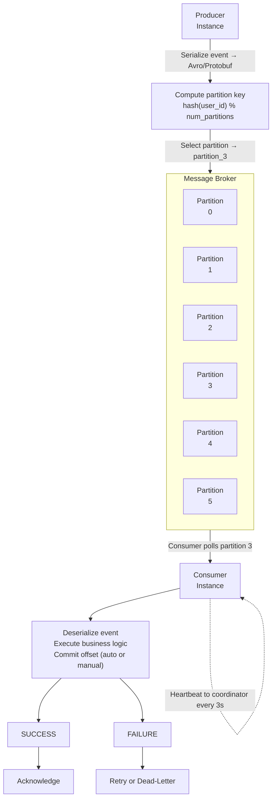

# Lesson 5: Failure Modes, Resilience Patterns, Idempotency, and Observability

## 1. First-Principles Intuition & Invariants

Event-driven architectures embrace asynchrony as a first-class design constraint, trading the deterministic call-and-response semantics of synchronous RPC for the compositional flexibility of decoupled producers and consumers. This decoupling brings profound benefits: elastic scaling, fault isolation, and the ability to evolve services independently without coordinated deployments. Yet asynchrony introduces a fundamental tension between operational complexity and system reliability. When a producer emits an event into a message broker, it relinquishes direct control over delivery guarantees, consumer processing semantics, and end-to-end latency. The event enters a distributed state machine governed by network partitions, broker replication protocols, consumer group rebalancing, and the unpredictable interleaving of concurrent processing threads.

At the heart of this complexity lies the acknowledgment protocol, the critical synchronization primitive that mediates between at-least-once delivery guarantees and exactly-once processing semantics. In systems like Apache Kafka, RabbitMQ, or AWS SQS, consumers must explicitly acknowledge successful processing before the broker commits offset advancement or removes messages from the queue. This acknowledgment contract creates an intricate failure surface: if a consumer crashes after processing but before acknowledging, the message reappears for reprocessing. If the consumer acknowledges prematurely and then fails during a downstream database write, the event is lost forever. If network latency delays acknowledgment beyond the broker's visibility timeout, the message becomes visible to other consumers, triggering duplicate processing even when the original consumer eventually succeeds.

The foundational invariant that governs resilient event processing is idempotency: the mathematical property that applying an operation multiple times produces the same result as applying it once. In distributed systems, idempotency transforms an impossible problem—preventing duplicate delivery across network partitions—into a tractable one: ensuring duplicate delivery causes no harm. An idempotent consumer can safely process the same event multiple times, either because the operation is naturally idempotent (setting a user's email address to a specific value) or because the consumer explicitly guards against replay using deduplication state (checking a processed event ID before executing side effects).

Observability in event-driven systems demands a paradigm shift from request-response tracing to asynchronous event correlation. A single user action might trigger a cascade of events flowing through multiple services, each with its own retry logic, dead-letter handling, and failure recovery. Traditional distributed tracing, designed for synchronous call graphs, struggles to represent these non-linear execution paths where events fan out across multiple consumers, some of which may process events out of order due to partition rebalancing or retry delays. Modern observability strategies must capture not just trace spans but also event metadata: partition keys, offset positions, producer timestamps, consumer lag metrics, and correlation identifiers that thread through the entire event chain.

The challenge of reasoning about failure modes in event systems stems from the combinatorial explosion of failure scenarios. A single event can fail at the producer (serialization error, broker unavailable), during transport (network partition, message corruption), at the broker (disk full, replication lag), or in the consumer (deserialization error, business logic exception, downstream dependency timeout). Each failure mode demands a different recovery strategy: transient network errors warrant exponential backoff retry, poison messages require dead-letter isolation, and systematic deserialization failures signal schema evolution mismatches that need operational intervention. Designing resilient event systems requires not just handling known failures but architecting for graceful degradation when unknown failure modes emerge from the interaction of distributed components.

The interplay between idempotency and retry logic creates subtle correctness constraints. Consider a consumer that processes payment events by charging a credit card and then storing the transaction in a database. If the credit card charge succeeds but the database write fails, retrying the entire operation would double-charge the customer unless the consumer maintains external deduplication state or designs the payment provider integration to return the original transaction ID on duplicate requests. This pattern—where side effects must be made conditional on prior success checks—pervades event-driven architectures and demands rigorous design discipline. The consumer must either implement idempotent APIs at every integration boundary or maintain stateful deduplication that survives consumer restarts and rebalancing.

Observability becomes the operational contract that allows human operators to diagnose these intricate failure modes in production. When a consumer falls behind and accumulated lag threatens SLA violations, operators need real-time visibility into partition-level offset positions, consumer group membership, processing rates per instance, and error rates bucketed by exception type. When a dead-letter queue fills with poison messages, operators need structured logs that capture the original event payload, deserialization errors, stack traces, and correlation IDs that trace back to the originating producer. When distributed traces reveal high tail latencies in event processing, operators need metrics that decompose latency into constituent phases: time spent waiting in broker queues, consumer deserialization overhead, business logic execution, downstream API calls, and commit/acknowledgment round-trips.

The resilience patterns that emerge from these constraints—circuit breakers, bulkheads, rate limiters, and graceful degradation—are not abstractions layered atop event systems but intrinsic design elements woven into their architecture. A circuit breaker that trips after repeated failures to a downstream payment API prevents cascading failures but must integrate with retry logic to avoid permanently parking events in dead-letter queues. A bulkhead that isolates consumer thread pools by event type prevents a slow poison message in one partition from starving processing capacity for healthy partitions. A rate limiter that throttles event consumption based on downstream API quotas prevents overload but must coordinate with producer backpressure to avoid unbounded queue growth in the broker.

## 2. Core Architecture & Mechanics

The architecture of a resilient event-driven system rests on layered failure detection and recovery mechanisms that span producers, brokers, and consumers. At the lowest layer, TCP keepalive probes and broker heartbeat protocols detect network partitions and dead connections. Above this, consumer group coordination protocols like Kafka's group membership protocol or RabbitMQ's exclusive queue semantics detect crashed consumers and trigger partition rebalancing. At the application layer, consumer acknowledgment timeouts and dead-letter routing detect business logic failures and route poison messages away from healthy processing paths.

The lifecycle of an event begins with producer serialization and partitioning. Modern event systems like Kafka require producers to specify a partition key that determines which broker partition receives the event. This partition assignment has profound implications for ordering guarantees and failure isolation. Events with the same partition key are delivered to a single consumer instance within a consumer group, preserving strict ordering but creating a head-of-line blocking risk: if that consumer crashes or processes slowly, all events for that partition key experience latency. Producers typically compute partition keys using consistent hashing over domain identifiers like user IDs or tenant IDs, trading global ordering for horizontal scalability.



When a consumer fetches events from a broker partition, it receives a batch of messages along with their offset positions within the partition's append-only log. The consumer processes each message and must decide when to commit the offset advancement back to the broker. This commit strategy represents a fundamental tradeoff between throughput and reliability. Auto-commit modes periodically commit offsets on a fixed interval, maximizing throughput but risking message loss if the consumer crashes between commit intervals. Manual commit allows the consumer to commit only after successful processing, guaranteeing at-least-once delivery but introducing latency from the round-trip acknowledgment.

The implementation of idempotent consumers requires explicit deduplication state. A robust pattern maintains a distributed cache or database table keyed by event identifiers, typically UUIDs or monotonically increasing sequence numbers assigned by the producer. Before executing business logic, the consumer checks this deduplication table and skips processing if the event ID already exists. This check-and-process pattern must be wrapped in a transaction to prevent race conditions where two consumer instances process the same event concurrently after both pass the deduplication check.

```rust
use std::collections::HashSet;
use std::sync::{Arc, Mutex};
use uuid::Uuid;
use serde::{Deserialize, Serialize};

#[derive(Debug, Clone, Serialize, Deserialize)]
struct PaymentEvent {
    event_id: Uuid,
    user_id: u64,
    amount_cents: u64,
    currency: String,
    timestamp: u64,
}

struct IdempotentPaymentConsumer {
    processed_events: Arc<Mutex<HashSet<Uuid>>>,
    payment_gateway: Arc<PaymentGatewayClient>,
    database: Arc<DatabaseClient>,
}

impl IdempotentPaymentConsumer {
    async fn process_event(&self, event: PaymentEvent) -> Result<(), ProcessingError> {
        let event_id = event.event_id;
        
        // Check deduplication state before processing
        {
            let mut processed = self.processed_events.lock().unwrap();
            if processed.contains(&event_id) {
                println!("Event {} already processed, skipping", event_id);
                return Ok(());
            }
        }
        
        // Begin distributed transaction
        let mut txn = self.database.begin_transaction().await?;
        
        // Double-check within transaction to prevent races
        let already_processed = txn.check_event_processed(event_id).await?;
        if already_processed {
            txn.rollback().await?;
            return Ok(());
        }
        
        // Execute business logic with idempotent APIs
        let charge_result = self.payment_gateway
            .charge_with_idempotency_key(
                event.user_id,
                event.amount_cents,
                &event.currency,
                event_id.to_string(), // Use event ID as idempotency key
            )
            .await?;
        
        // Store transaction record
        txn.insert_payment_record(
            event.user_id,
            charge_result.transaction_id,
            event.amount_cents,
            event.timestamp,
        ).await?;
        
        // Mark event as processed
        txn.mark_event_processed(event_id).await?;
        
        // Commit transaction atomically
        txn.commit().await?;
        
        // Update in-memory cache after successful commit
        {
            let mut processed = self.processed_events.lock().unwrap();
            processed.insert(event_id);
        }
        
        Ok(())
    }
}

#[derive(Debug)]
enum ProcessingError {
    DatabaseError(String),
    PaymentGatewayError(String),
    SerializationError(String),
}
```

Retry logic introduces exponential backoff to prevent thundering herd problems when downstream dependencies fail. A naive retry loop that immediately retries failed operations can overwhelm recovering services and prolong outages. Exponential backoff doubles the delay between successive retries, starting from a base delay of typically 100-500 milliseconds and capping at a maximum delay of 30-60 seconds. Adding jitter—random noise to the computed delay—further desynchronizes retry attempts across consumer instances and prevents periodic load spikes.

```rust
use std::time::Duration;
use rand::Rng;

struct ExponentialBackoff {
    base_delay_ms: u64,
    max_delay_ms: u64,
    max_attempts: u32,
    current_attempt: u32,
}

impl ExponentialBackoff {
    fn new(base_delay_ms: u64, max_delay_ms: u64, max_attempts: u32) -> Self {
        Self {
            base_delay_ms,
            max_delay_ms,
            max_attempts,
            current_attempt: 0,
        }
    }
    
    fn next_delay(&mut self) -> Option<Duration> {
        if self.current_attempt >= self.max_attempts {
            return None;
        }
        
        let exponential_delay = self.base_delay_ms * (2_u64.pow(self.current_attempt));
        let capped_delay = exponential_delay.min(self.max_delay_ms);
        
        // Add jitter: random value between 0 and capped_delay
        let mut rng = rand::thread_rng();
        let jittered_delay = rng.gen_range(0..=capped_delay);
        
        self.current_attempt += 1;
        Some(Duration::from_millis(jittered_delay))
    }
    
    fn reset(&mut self) {
        self.current_attempt = 0;
    }
}

async fn process_with_retry<F, T, E>(
    mut operation: F,
    mut backoff: ExponentialBackoff,
) -> Result<T, E>
where
    F: FnMut() -> Result<T, E>,
{
    loop {
        match operation() {
            Ok(result) => {
                backoff.reset();
                return Ok(result);
            }
            Err(err) => {
                if let Some(delay) = backoff.next_delay() {
                    println!("Operation failed, retrying after {:?}", delay);
                    tokio::time::sleep(delay).await;
                } else {
                    println!("Max retry attempts exceeded");
                    return Err(err);
                }
            }
        }
    }
}
```

Dead-letter queues provide a safety valve for events that repeatedly fail processing despite retries. When a consumer exhausts its retry budget or encounters a non-retriable error like deserialization failure or schema validation rejection, it routes the event to a dedicated dead-letter topic or queue. This isolation prevents poison messages from blocking healthy event processing while preserving the failed event for offline analysis and manual reprocessing. Dead-letter queues should capture rich diagnostic metadata: the original event payload, the exception stack trace, the consumer instance ID, timestamps of each retry attempt, and correlation IDs linking to distributed traces.

```rust
use serde::{Deserialize, Serialize};

#[derive(Debug, Clone, Serialize, Deserialize)]
struct DeadLetterEnvelope {
    original_event: Vec<u8>, // Raw bytes of failed event
    error_message: String,
    stack_trace: String,
    consumer_instance_id: String,
    retry_count: u32,
    first_attempt_timestamp: u64,
    last_attempt_timestamp: u64,
    partition_key: String,
    correlation_id: String,
    trace_id: String,
    span_id: String,
}

async fn handle_processing_failure(
    event_bytes: &[u8],
    error: &ProcessingError,
    retry_count: u32,
    metadata: &EventMetadata,
    dead_letter_producer: &DeadLetterProducer,
) -> Result<(), PublishError> {
    let envelope = DeadLetterEnvelope {
        original_event: event_bytes.to_vec(),
        error_message: format!("{:?}", error),
        stack_trace: std::backtrace::Backtrace::capture().to_string(),
        consumer_instance_id: metadata.consumer_instance_id.clone(),
        retry_count,
        first_attempt_timestamp: metadata.first_attempt_timestamp,
        last_attempt_timestamp: chrono::Utc::now().timestamp_millis() as u64,
        partition_key: metadata.partition_key.clone(),
        correlation_id: metadata.correlation_id.clone(),
        trace_id: metadata.trace_id.clone(),
        span_id: metadata.span_id.clone(),
    };
    
    dead_letter_producer.publish(envelope).await
}
```

Circuit breakers prevent cascading failures by detecting repeated failures to downstream dependencies and temporarily halting requests to give the failing service time to recover. A circuit breaker maintains three states: closed (normal operation), open (rejecting all requests), and half-open (testing recovery with a limited number of probe requests). The state machine transitions from closed to open after a configurable failure threshold, remains open for a timeout period, then transitions to half-open to test if the downstream service has recovered. If probe requests succeed, the circuit transitions back to closed; if they fail, it returns to open and resets the timeout.

```rust
use std::sync::{Arc, Mutex};
use std::time::{Duration, Instant};

#[derive(Debug, Clone, Copy, PartialEq)]
enum CircuitState {
    Closed,
    Open,
    HalfOpen,
}

struct CircuitBreaker {
    state: Arc<Mutex<CircuitBreakerState>>,
    failure_threshold: u32,
    timeout: Duration,
    half_open_max_attempts: u32,
}

struct CircuitBreakerState {
    current_state: CircuitState,
    failure_count: u32,
    success_count: u32,
    last_failure_time: Option<Instant>,
    half_open_attempts: u32,
}

impl CircuitBreaker {
    fn new(failure_threshold: u32, timeout: Duration, half_open_max_attempts: u32) -> Self {
        Self {
            state: Arc::new(Mutex::new(CircuitBreakerState {
                current_state: CircuitState::Closed,
                failure_count: 0,
                success_count: 0,
                last_failure_time: None,
                half_open_attempts: 0,
            })),
            failure_threshold,
            timeout,
            half_open_max_attempts,
        }
    }
    
    async fn call<F, T, E>(&self, operation: F) -> Result<T, CircuitBreakerError<E>>
    where
        F: FnOnce() -> Result<T, E>,
    {
        // Check current state
        let should_attempt = {
            let mut state = self.state.lock().unwrap();
            
            match state.current_state {
                CircuitState::Closed => true,
                CircuitState::Open => {
                    // Check if timeout has elapsed
                    if let Some(last_failure) = state.last_failure_time {
                        if last_failure.elapsed() >= self.timeout {
                            state.current_state = CircuitState::HalfOpen;
                            state.half_open_attempts = 0;
                            true
                        } else {
                            false
                        }
                    } else {
                        false
                    }
                }
                CircuitState::HalfOpen => {
                    if state.half_open_attempts < self.half_open_max_attempts {
                        state.half_open_attempts += 1;
                        true
                    } else {
                        false
                    }
                }
            }
        };
        
        if !should_attempt {
            return Err(CircuitBreakerError::CircuitOpen);
        }
        
        // Execute operation
        match operation() {
            Ok(result) => {
                self.record_success();
                Ok(result)
            }
            Err(err) => {
                self.record_failure();
                Err(CircuitBreakerError::OperationFailed(err))
            }
        }
    }
    
    fn record_success(&self) {
        let mut state = self.state.lock().unwrap();
        
        match state.current_state {
            CircuitState::HalfOpen => {
                state.success_count += 1;
                if state.success_count >= self.half_open_max_attempts {
                    state.current_state = CircuitState::Closed;
                    state.failure_count = 0;
                    state.success_count = 0;
                    state.half_open_attempts = 0;
                }
            }
            CircuitState::Closed => {
                state.failure_count = 0;
            }
            _ => {}
        }
    }
    
    fn record_failure(&self) {
        let mut state = self.state.lock().unwrap();
        
        state.failure_count += 1;
        state.last_failure_time = Some(Instant::now());
        
        match state.current_state {
            CircuitState::Closed => {
                if state.failure_count >= self.failure_threshold {
                    state.current_state = CircuitState::Open;
                }
            }
            CircuitState::HalfOpen => {
                state.current_state = CircuitState::Open;
                state.half_open_attempts = 0;
            }
            _ => {}
        }
    }
}

#[derive(Debug)]
enum CircuitBreakerError<E> {
    CircuitOpen,
    OperationFailed(E),
}
```

Distributed tracing in event systems extends the OpenTelemetry trace propagation model to asynchronous message flows. Producers inject trace context into event headers before publishing, encoding the trace ID, span ID, and trace flags as metadata. Consumers extract this trace context when processing events and create child spans that link back to the producer's span. This parent-child relationship allows distributed tracing systems to reconstruct the entire event flow across service boundaries, even when events fan out to multiple consumers or processing is delayed by hours due to consumer lag.

```rust
use opentelemetry::{
    trace::{Span, SpanKind, Tracer, TracerProvider},
    Context, KeyValue,
};
use opentelemetry_sdk::trace::{Config, TracerProvider as SdkTracerProvider};
use opentelemetry_otlp::WithExportConfig;
use std::collections::HashMap;

struct TracedEventProducer {
    tracer: opentelemetry::global::BoxedTracer,
    kafka_producer: Arc<KafkaProducerClient>,
}

impl TracedEventProducer {
    async fn publish_event(&self, event: PaymentEvent) -> Result<(), PublishError> {
        let tracer = &self.tracer;
        
        // Create producer span
        let mut span = tracer
            .span_builder("publish_payment_event")
            .with_kind(SpanKind::Producer)
            .with_attributes(vec![
                KeyValue::new("event.id", event.event_id.to_string()),
                KeyValue::new("event.type", "payment"),
                KeyValue::new("user.id", event.user_id as i64),
                KeyValue::new("amount.cents", event.amount_cents as i64),
            ])
            .start(tracer);
        
        // Serialize event
        let event_bytes = serde_json::to_vec(&event)
            .map_err(|e| PublishError::SerializationError(e.to_string()))?;
        
        // Inject trace context into message headers
        let cx = Context::current_with_span(span);
        let mut headers = HashMap::new();
        
        opentelemetry::global::get_text_map_propagator(|propagator| {
            propagator.inject_context(&cx, &mut headers);
        });
        
        // Publish to Kafka with trace headers
        let result = self.kafka_producer
            .publish(
                "payment-events",
                event.user_id.to_string(), // partition key
                event_bytes,
                headers,
            )
            .await;
        
        match &result {
            Ok(_) => {
                span.set_attribute(KeyValue::new("publish.success", true));
            }
            Err(e) => {
                span.set_attribute(KeyValue::new("publish.success", false));
                span.record_error(e);
            }
        }
        
        span.end();
        result
    }
}

struct TracedEventConsumer {
    tracer: opentelemetry::global::BoxedTracer,
    payment_processor: Arc<IdempotentPaymentConsumer>,
}

impl TracedEventConsumer {
    async fn consume_event(
        &self,
        event_bytes: &[u8],
        headers: &HashMap<String, String>,
    ) -> Result<(), ProcessingError> {
        let tracer = &self.tracer;
        
        // Extract parent trace context from headers
        let parent_cx = opentelemetry::global::get_text_map_propagator(|propagator| {
            propagator.extract(headers)
        });
        
        // Deserialize event
        let event: PaymentEvent = serde_json::from_slice(event_bytes)
            .map_err(|e| ProcessingError::SerializationError(e.to_string()))?;
        
        // Create consumer span as child of producer span
        let mut span = tracer
            .span_builder("process_payment_event")
            .with_kind(SpanKind::Consumer)
            .with_attributes(vec![
                KeyValue::new("event.id", event.event_id.to_string()),
                KeyValue::new("event.type", "payment"),
                KeyValue::new("user.id", event.user_id as i64),
            ])
            .start_with_context(tracer, &parent_cx);
        
        // Process event with active span context
        let cx = Context::current_with_span(span.clone());
        let _guard = cx.attach();
        
        let result = self.payment_processor.process_event(event).await;
        
        match &result {
            Ok(_) => {
                span.set_attribute(KeyValue::new("processing.success", true));
            }
            Err(e) => {
                span.set_attribute(KeyValue::new("processing.success", false));
                span.record_error(e);
            }
        }
        
        span.end();
        result
    }
}
```

Consumer lag metrics form the operational foundation for detecting processing bottlenecks and capacity planning. Lag represents the delta between the broker's high-water mark (the latest committed offset in a partition) and the consumer's current position. When lag grows unbounded, it signals that consumers cannot keep pace with producer throughput, whether due to slow business logic, downstream dependency latency, or insufficient consumer parallelism. Monitoring systems should expose per-partition lag, aggregated consumer group lag, and lag trend analysis to distinguish temporary spikes from systemic underprovisioning.

```yaml
# Prometheus metrics exposition for Kafka consumer
apiVersion: v1
kind: ConfigMap
metadata:
  name: consumer-metrics-config
  namespace: event-processing
data:
  prometheus.yml: |
    # Consumer lag by partition
    kafka_consumer_lag_milliseconds{
      consumer_group="payment-processor",
      topic="payment-events",
      partition="3"
    } 15234

    # Consumer processing rate
    kafka_consumer_records_consumed_total{
      consumer_group="payment-processor",
      topic="payment-events"
    } 1583924

    # Consumer error rate by type
    kafka_consumer_errors_total{
      consumer_group="payment-processor",
      error_type="deserialization_error"
    } 47

    # Consumer rebalance frequency
    kafka_consumer_rebalances_total{
      consumer_group="payment-processor"
    } 8
```

## 3. High-Performance Optimization & Failure Modes

Optimizing event processing throughput requires balancing consumer parallelism against downstream dependency capacity and partition count. Each consumer instance within a consumer group processes events from one or more partitions, with the broker's group coordinator dynamically assigning partitions to maintain balanced load distribution. Scaling consumer instances beyond the partition count provides no additional parallelism since idle consumers receive no partition assignments. The optimal configuration typically provisions consumer instances equal to partition count multiplied by a small overprovisioning factor (1.2-1.5x) to handle rebalancing and instance failures.

Batch processing amortizes fixed per-message overhead like network round-trips, deserialization, and transaction commits across multiple events. Consumers can fetch hundreds or thousands of messages in a single broker poll, process them in memory, and commit offsets once at the end of the batch. This batching dramatically reduces commit overhead but introduces latency since events wait in memory until the entire batch completes. The batch size tuning requires profiling the tradeoff between throughput (larger batches) and tail latency (smaller batches that complete faster).

```rust
use std::time::Duration;

struct BatchedEventConsumer {
    kafka_consumer: Arc<KafkaConsumerClient>,
    payment_processor: Arc<IdempotentPaymentConsumer>,
    batch_size: usize,
    batch_timeout: Duration,
}

impl BatchedEventConsumer {
    async fn consume_batch(&self) -> Result<usize, ConsumerError> {
        let mut events = Vec::with_capacity(self.batch_size);
        let deadline = tokio::time::Instant::now() + self.batch_timeout;
        
        // Fetch events until batch is full or timeout expires
        while events.len() < self.batch_size {
            let remaining = deadline.saturating_duration_since(tokio::time::Instant::now());
            if remaining.is_zero() {
                break;
            }
            
            match tokio::time::timeout(
                remaining,
                self.kafka_consumer.poll()
            ).await {
                Ok(Ok(Some(record))) => events.push(record),
                Ok(Ok(None)) => break,
                Ok(Err(e)) => return Err(ConsumerError::PollError(e)),
                Err(_) => break, // timeout
            }
        }
        
        if events.is_empty() {
            return Ok(0);
        }
        
        // Process batch in parallel with bounded concurrency
        let semaphore = Arc::new(tokio::sync::Semaphore::new(10));
        let mut tasks = Vec::new();
        
        for record in events.iter() {
            let processor = self.payment_processor.clone();
            let permit = semaphore.clone().acquire_owned().await.unwrap();
            let event_bytes = record.value.clone();
            
            tasks.push(tokio::spawn(async move {
                let _permit = permit;
                let event: PaymentEvent = serde_json::from_slice(&event_bytes)?;
                processor.process_event(event).await
            }));
        }
        
        // Wait for all processing to complete
        let results = futures::future::join_all(tasks).await;
        
        // Check for failures
        let mut success_count = 0;
        for result in results {
            match result {
                Ok(Ok(_)) => success_count += 1,
                Ok(Err(e)) => eprintln!("Processing error: {:?}", e),
                Err(e) => eprintln!("Task panic: {:?}", e),
            }
        }
        
        // Commit offset only if all events processed successfully
        if success_count == events.len() {
            let last_offset = events.last().unwrap().offset;
            self.kafka_consumer.commit_offset(last_offset).await?;
        }
        
        Ok(success_count)
    }
}
```

Graceful degradation strategies allow event systems to maintain partial functionality during downstream failures. When a payment gateway becomes unavailable, a consumer might route payment events to a local queue for deferred processing rather than immediately sending them to the dead-letter queue. When a database experiences elevated latency, consumers might reduce batch sizes or implement adaptive throttling based on measured latency percentiles. When trace sampling overheads impact throughput, consumers can dynamically adjust sampling rates to maintain target processing rates while preserving observability for error cases.

Partition key design profoundly impacts failure isolation and load distribution. Skewed partition keys where a small number of keys generate disproportionate event volumes create hot partitions that overload individual consumers while leaving others idle. For example, hashing user IDs in a social network with celebrity accounts produces hot partitions that receive millions of events for popular users while ordinary user partitions remain nearly empty. Techniques like composite partition keys (combining user ID with a random shard ID) or consistent hashing with virtual nodes distribute load more evenly at the cost of losing strict per-user ordering.

Message retention policies balance storage costs against replayability requirements. Kafka retains all messages up to a configured retention period (typically days or weeks), allowing consumers to replay historical events by resetting their offset positions. This replay capability supports powerful operational patterns: consumers can be rewound to reprocess events after fixing bugs, alternative consumer implementations can be validated against production traffic, and data pipelines can backfill derived datasets from event history. However, indefinite retention accumulates unbounded storage costs and complicates compliance with data deletion regulations like GDPR.

Schema evolution introduces backward and forward compatibility constraints that manifest as runtime failures when producers and consumers drift out of sync. Avro and Protocol Buffers provide built-in schema evolution rules: adding optional fields preserves backward compatibility (old consumers can read new messages), while removing required fields breaks compatibility. Schema registries like Confluent Schema Registry enforce compatibility policies at schema registration time, rejecting incompatible schema changes before they reach production. Consumers should implement defensive deserialization that handles missing fields gracefully rather than throwing exceptions that trigger dead-letter routing.

```rust
use serde::{Deserialize, Serialize};

// Version 1: Original schema
#[derive(Debug, Clone, Serialize, Deserialize)]
struct PaymentEventV1 {
    event_id: uuid::Uuid,
    user_id: u64,
    amount_cents: u64,
    currency: String,
    timestamp: u64,
}

// Version 2: Added optional fields for backward compatibility
#[derive(Debug, Clone, Serialize, Deserialize)]
struct PaymentEventV2 {
    event_id: uuid::Uuid,
    user_id: u64,
    amount_cents: u64,
    currency: String,
    timestamp: u64,
    
    // New optional fields with default values
    #[serde(default)]
    payment_method: Option<String>,
    
    #[serde(default)]
    merchant_id: Option<u64>,
    
    #[serde(default)]
    metadata: HashMap<String, String>,
}

// Defensive deserialization that handles both versions
fn deserialize_payment_event(bytes: &[u8]) -> Result<PaymentEventV2, DeserializationError> {
    // Try V2 first
    match serde_json::from_slice::<PaymentEventV2>(bytes) {
        Ok(event) => Ok(event),
        Err(_) => {
            // Fall back to V1 and convert
            let v1: PaymentEventV1 = serde_json::from_slice(bytes)?;
            Ok(PaymentEventV2 {
                event_id: v1.event_id,
                user_id: v1.user_id,
                amount_cents: v1.amount_cents,
                currency: v1.currency,
                timestamp: v1.timestamp,
                payment_method: None,
                merchant_id: None,
                metadata: HashMap::new(),
            })
        }
    }
}
```

Observability for event systems requires multi-dimensional metric aggregation across partitions, consumer groups, topics, and event types. Critical metrics include consumer lag per partition, processing latency histograms, error rates by exception class, rebalance frequency, and batch size distributions. These metrics must be correlated with resource utilization (CPU, memory, network) to diagnose capacity constraints and with distributed traces to attribute latency to specific processing stages.

Structured logging in event consumers should capture contextual metadata that enables post-hoc analysis. Each log entry should include the event ID, correlation ID, trace ID, partition key, offset position, consumer instance ID, and processing timestamp. When errors occur, logs must capture the full event payload (respecting PII redaction policies), exception stack traces, and any intermediate state that aids debugging. Centralized log aggregation systems like Elasticsearch or Loki enable operators to query logs across distributed consumer instances and correlate failures with specific events or time windows.

```rust
use tracing::{info, error, warn, instrument};
use tracing_subscriber::{layer::SubscriberExt, util::SubscriberInitExt};

#[instrument(
    name = "process_payment_event",
    skip(processor, event),
    fields(
        event.id = %event.event_id,
        user.id = event.user_id,
        amount.cents = event.amount_cents,
        partition.key = %partition_key,
        offset = offset,
        consumer.instance = %instance_id,
    )
)]
async fn process_payment_event_instrumented(
    processor: &IdempotentPaymentConsumer,
    event: PaymentEvent,
    partition_key: &str,
    offset: i64,
    instance_id: &str,
) -> Result<(), ProcessingError> {
    info!("Starting payment event processing");
    
    let start = std::time::Instant::now();
    
    match processor.process_event(event.clone()).await {
        Ok(_) => {
            let elapsed = start.elapsed();
            info!(
                processing_time_ms = elapsed.as_millis(),
                "Payment event processed successfully"
            );
            Ok(())
        }
        Err(e) => {
            error!(
                error = ?e,
                processing_time_ms = start.elapsed().as_millis(),
                event_payload = ?event,
                "Payment event processing failed"
            );
            Err(e)
        }
    }
}

fn initialize_telemetry() {
    tracing_subscriber::registry()
        .with(
            tracing_subscriber::EnvFilter::try_from_default_env()
                .unwrap_or_else(|_| "info".into()),
        )
        .with(tracing_subscriber::fmt::layer().json())
        .init();
}
```

The ultimate failure mode in event systems is the silent correctness violation: events are acknowledged and offsets committed, but business logic produces incorrect results due to race conditions, stale caches, or inconsistent distributed state. Detecting these violations requires end-to-end invariant checking through reconciliation pipelines that periodically compare event-derived state against authoritative sources. For payment systems, reconciliation compares the sum of processed payment events against bank settlement totals. For inventory systems, reconciliation verifies that event-sourced inventory counts match physical warehouse scans. These reconciliation processes form the last line of defense against data corruption that evades runtime error detection.
