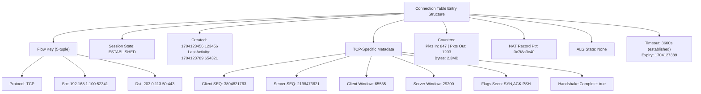
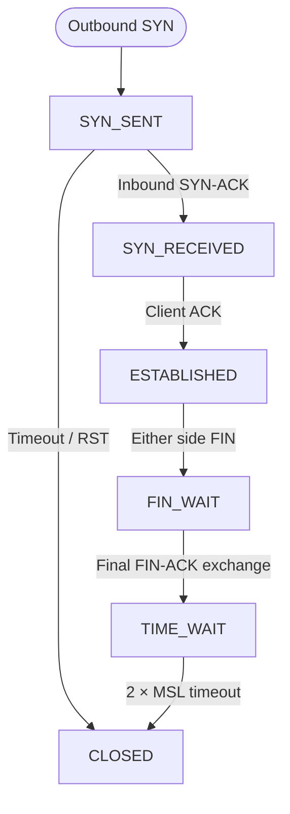

# Lesson 2: Stateful Inspection, Connection Tracking, Session Management

## 1. First-Principles Intuition & Invariants

The earliest packet filters operated as stateless decision engines, examining each datagram in isolation without retaining memory of prior traffic. A simple ACL rule permitting TCP port 80 inbound would authorize any packet claiming destination port 80, regardless of whether that packet belonged to a legitimate connection initiated by an internal client or represented an unsolicited intrusion attempt. This stateless model forced administrators into a cruel dilemma: either open high-numbered ephemeral ports wholesale to permit response traffic, creating vast attack surface, or deploy complex bidirectional rule sets that still could not distinguish genuine replies from spoofed packets riding the correct five-tuple coordinates.

Stateful inspection resolves this foundational tension by elevating the firewall from a per-packet filter into a connection-aware session arbiter. Rather than evaluating datagrams in isolation, the stateful engine constructs an in-memory representation of every active network flow, tracking the progression of TCP handshakes, monitoring sequence number evolution, and correlating request-response pairs for connectionless protocols. When an outbound SYN packet departs from an internal host toward a remote web server, the firewall records the nascent connection in its state table, noting the source IP, source port, destination IP, destination port, and protocol—the canonical five-tuple that uniquely identifies a bidirectional flow. Upon receiving the return SYN-ACK, the firewall consults this session table, validates that the response corresponds to a tracked outbound request, and permits the packet without requiring an explicit inbound rule. The connection state acts as a dynamic, temporary authorization that expires when the flow terminates or a configurable timeout elapses.

This state machine approach introduces three fundamental invariants that define stateful firewall behavior. First, the directionality invariant asserts that only explicitly permitted traffic may initiate new connections, while response traffic flows implicitly follow established state. An internal client opening an HTTPS session to an external server creates state that permits return traffic without separate inbound rules, but an external attacker cannot manufacture the same state by injecting a SYN-ACK; the firewall rejects unsolicited responses because no corresponding outbound request exists in the session table. Second, the temporal consistency invariant requires that session state must reflect the actual protocol lifecycle. TCP connections progress through defined state transitions—SYN_SENT, ESTABLISHED, FIN_WAIT, TIME_WAIT—and the firewall must track these phases to distinguish legitimate teardown sequences from malicious attempts to inject packets into closed connections. Third, the resource bounding invariant recognizes that state tables consume finite memory and lookup performance degrades as tables grow; the firewall must implement aggressive timeout policies and connection limits to prevent state table exhaustion attacks where adversaries flood the system with half-open connections or UDP noise.

The security value of stateful inspection derives from its ability to enforce implicit causality: packets must arrive in the context of legitimate protocol exchanges rather than materializing as isolated forgeries. A TCP ACK packet arriving without a corresponding SYN-SYN-ACK handshake in the state table represents either a scan, a spoofing attempt, or stale traffic from a dead connection, and the firewall drops it unconditionally. Similarly, ICMP error messages referencing nonexistent flows or UDP responses without matching requests never reach internal hosts. This causal enforcement narrows the attacker's operational space dramatically; instead of crafting arbitrary packets that satisfy static ACL predicates, adversaries must either hijack legitimate sessions—requiring sequence number prediction or man-in-the-middle positioning—or exhaust state table resources to degrade protection. Stateful inspection transforms the firewall from a coarse-grained perimeter boundary into a fine-grained protocol enforcer that validates not just packet headers but the entire conversation context.

## 2. Core Architecture & Mechanics

The heart of a stateful firewall lies in its connection tracking table, a high-performance in-memory data structure mapping five-tuple flow identifiers to session metadata. Each entry represents a bidirectional communication channel and stores the protocol type, source and destination addresses and ports, current connection state, creation timestamp, last activity timestamp, byte and packet counters for traffic accounting, and pointers to any associated NAT translation records or application-layer gateway state. Modern implementations employ hash tables with chaining or concurrent lock-free structures to support millions of simultaneous connections while maintaining sub-microsecond lookup latency. The hash function typically combines all five tuple elements through XOR and modular arithmetic, distributing flows uniformly across buckets to minimize collision chains.



When a packet arrives at the firewall's ingress interface, the connection tracking engine extracts the five-tuple and hashes it to locate the corresponding table entry. If a match exists and the packet's characteristics align with the session's current state—TCP sequence numbers fall within the expected window, UDP timestamps fall within idle timeout bounds, protocol flags make sense given the state machine phase—the firewall forwards the packet to the egress interface and updates the session's last activity timestamp. If no entry exists, the engine evaluates the packet against the configured rule base. For TCP, a SYN packet may create new state if a rule permits the connection's initiation, installing a session entry in SYN_SENT state and recording the initial sequence number. For UDP, which lacks explicit connection semantics, the firewall creates pseudo-connection state when an outbound datagram passes, installing an entry that expires rapidly if no response arrives. ICMP presents unique challenges; the firewall must associate ICMP echo requests with replies by tracking query identifiers and must correlate ICMP errors with the original flows they reference by parsing the payload's embedded IP and transport headers.

TCP connection tracking implements a rigorous state machine that mirrors the protocol's own lifecycle. A client-initiated flow begins when the firewall observes a SYN packet departing the protected network, transitioning the session from nonexistent to SYN_SENT. The firewall records the client's initial sequence number and source port, creating a half-open entry that awaits the server's SYN-ACK response. When the return packet arrives, the engine validates that the acknowledgment number matches the client's sequence plus one, extracts the server's initial sequence number, and promotes the session to SYN_RECEIVED. The client's final ACK completes the three-way handshake, elevating the state to ESTABLISHED and enabling full bidirectional data flow. During this phase, the firewall tracks sequence numbers continuously, maintaining a sliding window that accommodates TCP's cumulative acknowledgment semantics while rejecting packets with sequence numbers wildly outside the expected range—a defense against blind injection attacks where adversaries guess sequence numbers to insert malicious data into established streams.



Connection teardown requires equally careful tracking to prevent premature state deletion that would block legitimate late-arriving packets or extended timeouts that waste memory on dead sessions. When either endpoint sends a FIN packet, the firewall transitions the connection to FIN_WAIT, allowing continued data flow in the opposite direction to accommodate half-close scenarios. Both sides must exchange FIN and ACK packets before the connection reaches TIME_WAIT, a state that persists for twice the Maximum Segment Lifetime to handle delayed duplicates. A RST packet at any point immediately destroys state, reflecting TCP's abrupt termination semantics. Enterprise firewalls often implement aggressive timeout policies that close idle connections more quickly than the standard 2MSL duration, balancing state table efficiency against compatibility with applications that hold connections open for extended periods without traffic.

UDP tracking operates without the luxury of explicit handshakes or teardowns, forcing the firewall to infer connection semantics from traffic patterns. When an outbound UDP packet departs, the engine creates a session entry in a pseudo-ESTABLISHED state and starts an idle timer, typically ranging from 30 to 180 seconds. Each subsequent packet in either direction resets this timer, allowing long-lived UDP flows like DNS zone transfers or VoIP streams to persist. If the timeout expires without activity, the firewall silently deletes the entry. This model works well for request-response protocols but struggles with asymmetric UDP patterns, such as multicast streams where responses arrive from different addresses than the original destination. Advanced implementations support configurable UDP session helpers that recognize application-specific patterns—for instance, allowing DNS responses from any server IP when the client queries multiple nameservers in succession.

ICMP connection tracking presents the most complex challenge because ICMP serves dual roles as both a standalone diagnostic protocol and a feedback mechanism for other protocols. Echo request-reply pairs map naturally to the request-response model: when an internal host pings an external target, the firewall creates temporary state linking the ICMP identifier and sequence number, permitting only matching echo replies. ICMP error messages, however, reference the original packet that triggered the error by including its IP header and first eight bytes of payload in the ICMP packet body. The firewall must parse this embedded header, extract the five-tuple, and verify that a corresponding connection exists in the state table before forwarding the error to the original sender. This deep packet inspection prevents attackers from injecting forged ICMP unreachables or TTL exceeded messages to disrupt legitimate flows or perform path MTU discovery attacks.

Application Layer Gateways extend stateful inspection into protocols that embed addressing information in payload data or negotiate secondary channels. FTP's control and data channel split epitomizes the problem: the client opens a TCP connection to port 21 for commands, then either accepts an inbound data connection from the server (active mode) or opens a new outbound connection to a server-specified port (passive mode). The firewall's FTP ALG monitors PORT and PASV commands on the control channel, parses the negotiated IP and port from the ASCII payload, and dynamically installs temporary state table entries permitting the anticipated data connection. SIP for VoIP, H.323 for video conferencing, and RTSP for streaming media all require similar ALG intervention to handle their signaling-data plane separation. While ALGs enable these protocols to traverse stateful firewalls, they introduce fragility; ALG parsing failures can block legitimate traffic, and encrypted control channels defeat payload inspection entirely, forcing administrators to open wide port ranges or deploy protocol-aware proxies.

## 3. High-Performance Optimization & Failure Modes

State table scalability determines the maximum connection capacity and throughput of a stateful firewall, making it the primary bottleneck in high-traffic environments. A naive hash table implementation with global locking serializes all connection lookups and state mutations, collapsing throughput as CPU cores contend for the lock. Modern designs employ per-CPU or per-bucket locking, sharding the state table across multiple hash tables indexed by flow hash modulo CPU count, allowing parallel lookups on disjoint flows. Lock-free algorithms using compare-and-swap operations eliminate synchronization overhead entirely but introduce complexity in handling concurrent updates to shared entries. Memory allocation strategies also impact performance; pre-allocating a fixed pool of connection entries trades memory efficiency for deterministic allocation latency, while dynamic allocation risks fragmentation and unpredictable delays during high connection churn.

```c
/* High-performance connection tracking hash table with per-bucket locking */

#include <stdint.h>
#include <pthread.h>
#include <time.h>

#define CT_TABLE_SIZE 1048576  /* 1M buckets for millions of concurrent flows */
#define CT_CHAIN_MAX 8         /* Max entries per bucket before resize warning */

typedef enum {
    CT_STATE_NEW,
    CT_STATE_SYN_SENT,
    CT_STATE_SYN_RECV,
    CT_STATE_ESTABLISHED,
    CT_STATE_FIN_WAIT,
    CT_STATE_TIME_WAIT,
    CT_STATE_CLOSED
} ct_state_t;

typedef struct ct_flow_key {
    uint32_t src_addr;
    uint32_t dst_addr;
    uint16_t src_port;
    uint16_t dst_port;
    uint8_t protocol;
} __attribute__((packed)) ct_flow_key_t;

typedef struct ct_tcp_metadata {
    uint32_t client_seq;
    uint32_t server_seq;
    uint16_t client_window;
    uint16_t server_window;
    uint8_t flags_seen;
    uint8_t handshake_complete;
} ct_tcp_metadata_t;

typedef struct ct_entry {
    ct_flow_key_t key;
    ct_state_t state;
    struct timespec created;
    struct timespec last_activity;
    uint64_t packets_in;
    uint64_t packets_out;
    uint64_t bytes_total;
    uint32_t timeout_seconds;
    union {
        ct_tcp_metadata_t tcp;
        uint16_t icmp_id;  /* For ICMP echo tracking */
    } proto_data;
    struct ct_entry *next;  /* Chain for hash collisions */
} ct_entry_t;

typedef struct ct_bucket {
    ct_entry_t *head;
    pthread_rwlock_t lock;
    uint32_t entry_count;
} ct_bucket_t;

typedef struct ct_table {
    ct_bucket_t *buckets;
    uint32_t bucket_count;
    uint64_t total_entries;
    uint64_t lookups;
    uint64_t hits;
    uint64_t misses;
} ct_table_t;

/* FNV-1a hash for flow keys */
static inline uint32_t ct_hash_flow(const ct_flow_key_t *key) {
    uint32_t hash = 2166136261u;
    const uint8_t *data = (const uint8_t *)key;
    for (size_t i = 0; i < sizeof(ct_flow_key_t); i++) {
        hash ^= data[i];
        hash *= 16777619u;
    }
    return hash;
}

/* Initialize connection tracking table */
ct_table_t *ct_table_init(uint32_t bucket_count) {
    ct_table_t *table = calloc(1, sizeof(ct_table_t));
    if (!table) return NULL;
    
    table->bucket_count = bucket_count;
    table->buckets = calloc(bucket_count, sizeof(ct_bucket_t));
    if (!table->buckets) {
        free(table);
        return NULL;
    }
    
    for (uint32_t i = 0; i < bucket_count; i++) {
        pthread_rwlock_init(&table->buckets[i].lock, NULL);
    }
    
    return table;
}

/* Lookup flow in connection table (read-only, uses read lock) */
ct_entry_t *ct_lookup(ct_table_t *table, const ct_flow_key_t *key) {
    uint32_t hash = ct_hash_flow(key);
    uint32_t bucket_idx = hash % table->bucket_count;
    ct_bucket_t *bucket = &table->buckets[bucket_idx];
    
    pthread_rwlock_rdlock(&bucket->lock);
    __atomic_add_fetch(&table->lookups, 1, __ATOMIC_RELAXED);
    
    ct_entry_t *entry = bucket->head;
    while (entry) {
        if (memcmp(&entry->key, key, sizeof(ct_flow_key_t)) == 0) {
            __atomic_add_fetch(&table->hits, 1, __ATOMIC_RELAXED);
            pthread_rwlock_unlock(&bucket->lock);
            return entry;
        }
        entry = entry->next;
    }
    
    __atomic_add_fetch(&table->misses, 1, __ATOMIC_RELAXED);
    pthread_rwlock_unlock(&bucket->lock);
    return NULL;
}

/* Insert new connection entry (write lock required) */
ct_entry_t *ct_insert(ct_table_t *table, const ct_flow_key_t *key, 
                      ct_state_t initial_state, uint32_t timeout) {
    uint32_t hash = ct_hash_flow(key);
    uint32_t bucket_idx = hash % table->bucket_count;
    ct_bucket_t *bucket = &table->buckets[bucket_idx];
    
    ct_entry_t *new_entry = calloc(1, sizeof(ct_entry_t));
    if (!new_entry) return NULL;
    
    memcpy(&new_entry->key, key, sizeof(ct_flow_key_t));
    new_entry->state = initial_state;
    clock_gettime(CLOCK_MONOTONIC, &new_entry->created);
    new_entry->last_activity = new_entry->created;
    new_entry->timeout_seconds = timeout;
    
    pthread_rwlock_wrlock(&bucket->lock);
    new_entry->next = bucket->head;
    bucket->head = new_entry;
    bucket->entry_count++;
    __atomic_add_fetch(&table->total_entries, 1, __ATOMIC_RELAXED);
    pthread_rwlock_unlock(&bucket->lock);
    
    return new_entry;
}

/* Update activity timestamp and counters (write lock held by caller) */
void ct_update_activity(ct_entry_t *entry, size_t pkt_len, int direction) {
    clock_gettime(CLOCK_MONOTONIC, &entry->last_activity);
    if (direction == 0) {
        entry->packets_in++;
    } else {
        entry->packets_out++;
    }
    entry->bytes_total += pkt_len;
}

/* Remove expired entries (garbage collection sweep) */
void ct_expire_entries(ct_table_t *table) {
    struct timespec now;
    clock_gettime(CLOCK_MONOTONIC, &now);
    
    for (uint32_t i = 0; i < table->bucket_count; i++) {
        ct_bucket_t *bucket = &table->buckets[i];
        pthread_rwlock_wrlock(&bucket->lock);
        
        ct_entry_t **current = &bucket->head;
        while (*current) {
            ct_entry_t *entry = *current;
            double elapsed = (now.tv_sec - entry->last_activity.tv_sec) +
                           (now.tv_nsec - entry->last_activity.tv_nsec) / 1e9;
            
            if (elapsed > entry->timeout_seconds || entry->state == CT_STATE_CLOSED) {
                *current = entry->next;
                free(entry);
                bucket->entry_count--;
                __atomic_sub_fetch(&table->total_entries, 1, __ATOMIC_RELAXED);
            } else {
                current = &entry->next;
            }
        }
        
        pthread_rwlock_unlock(&bucket->lock);
    }
}
```

Timeout management balances resource efficiency against protocol compatibility. Aggressive timeouts reclaim state table memory quickly but risk prematurely closing idle connections that applications expect to persist. Conservative timeouts waste resources on dead sessions and create opportunities for state table exhaustion attacks. The optimal strategy varies by protocol: TCP ESTABLISHED connections might timeout after 24 hours of inactivity, reflecting the protocol's keep-alive semantics, while UDP sessions expire after 60 seconds to avoid lingering stale entries. TCP connections in transient states like SYN_SENT or FIN_WAIT use much shorter timeouts—typically 30-60 seconds—to accelerate cleanup of half-open connections from port scans or failed handshakes. TIME_WAIT state traditionally persists for 240 seconds (2*MSL), but many firewalls reduce this to 60-120 seconds in practice, trading strict RFC compliance for improved state table turnover.

State table exhaustion represents the primary attack vector against stateful firewalls. An adversary floods the firewall with connection initiation packets—SYN floods for TCP, arbitrary datagrams for UDP—consuming state table entries without completing handshakes or generating response traffic. Once the table fills, the firewall can no longer track new legitimate connections and either drops all new flows or falls back to stateless filtering, negating its security value. Defending against exhaustion requires multiple countermeasures. Connection rate limiting caps the number of new sessions per source IP per time window, blocking hosts that attempt to open thousands of connections in seconds. SYN cookies eliminate the need to store state for incomplete TCP handshakes by encoding connection parameters in the sequence number, allowing the firewall to reconstruct state only when the client completes the handshake with a valid ACK. Random early expiration probabilistically drops a small fraction of idle connections before their timeout expires, creating headroom for new flows during sustained load.

```c
/* SYN cookie implementation for stateless TCP handshake tracking */

#include <stdint.h>
#include <string.h>
#include <openssl/md5.h>

#define SYN_COOKIE_SECRET_LEN 16
#define SYN_COOKIE_MSS_BITS 2

static uint8_t syn_cookie_secret[SYN_COOKIE_SECRET_LEN];
static const uint16_t mss_table[4] = {536, 1300, 1440, 1460};

/* Initialize secret key for cookie generation (once at startup) */
void syn_cookie_init(void) {
    /* In production, use cryptographically secure random source */
    for (int i = 0; i < SYN_COOKIE_SECRET_LEN; i++) {
        syn_cookie_secret[i] = rand() & 0xFF;
    }
}

/* Encode MSS value into 2-bit index */
static uint8_t encode_mss(uint16_t mss) {
    for (int i = 3; i >= 0; i--) {
        if (mss >= mss_table[i]) return i;
    }
    return 0;
}

/* Generate SYN cookie sequence number */
uint32_t syn_cookie_generate(uint32_t saddr, uint32_t daddr, 
                             uint16_t sport, uint16_t dport,
                             uint32_t client_seq, uint16_t mss) {
    MD5_CTX md5;
    uint8_t hash[MD5_DIGEST_LENGTH];
    uint32_t count = time(NULL) / 60;  /* Rotate secret every minute */
    
    MD5_Init(&md5);
    MD5_Update(&md5, &saddr, sizeof(saddr));
    MD5_Update(&md5, &daddr, sizeof(daddr));
    MD5_Update(&md5, &sport, sizeof(sport));
    MD5_Update(&md5, &dport, sizeof(dport));
    MD5_Update(&md5, &count, sizeof(count));
    MD5_Update(&md5, syn_cookie_secret, SYN_COOKIE_SECRET_LEN);
    MD5_Final(hash, &md5);
    
    /* Bottom 24 bits from hash, top 3 bits from count, 2 bits MSS, 
       top 3 bits encode timestamp to detect stale cookies */
    uint32_t cookie = (*(uint32_t *)hash & 0x00FFFFFF);
    cookie |= ((count & 0x1F) << 27);
    cookie |= (encode_mss(mss) << 24);
    
    return cookie;
}

/* Validate SYN cookie and extract MSS */
int syn_cookie_check(uint32_t saddr, uint32_t daddr,
                     uint16_t sport, uint16_t dport,
                     uint32_t seq, uint16_t *mss_out) {
    uint32_t cookie = seq - 1;  /* Subtract 1 because client ACKs seq+1 */
    uint32_t count_from_cookie = (cookie >> 27) & 0x1F;
    uint32_t current_count = time(NULL) / 60;
    
    /* Reject cookies older than 4 minutes (current + 3 previous windows) */
    if ((current_count - count_from_cookie) > 3) {
        return -1;
    }
    
    /* Reconstruct and verify hash portion */
    MD5_CTX md5;
    uint8_t hash[MD5_DIGEST_LENGTH];
    
    MD5_Init(&md5);
    MD5_Update(&md5, &saddr, sizeof(saddr));
    MD5_Update(&md5, &daddr, sizeof(daddr));
    MD5_Update(&md5, &sport, sizeof(sport));
    MD5_Update(&md5, &dport, sizeof(dport));
    MD5_Update(&md5, &count_from_cookie, sizeof(count_from_cookie));
    MD5_Update(&md5, syn_cookie_secret, SYN_COOKIE_SECRET_LEN);
    MD5_Final(hash, &md5);
    
    uint32_t expected = (*(uint32_t *)hash & 0x00FFFFFF);
    uint32_t actual = cookie & 0x00FFFFFF;
    
    if (expected != actual) {
        return -1;  /* Cookie validation failed */
    }
    
    /* Extract MSS from cookie */
    uint8_t mss_idx = (cookie >> 24) & 0x03;
    *mss_out = mss_table[mss_idx];
    
    return 0;  /* Cookie valid */
}
```

Connection tracking bypass vulnerabilities emerge when the firewall's state machine diverges from the actual TCP implementation on target hosts. Different operating systems exhibit subtle variations in how they handle ambiguous or malformed packets—overlapping TCP segments with inconsistent data, out-of-order arrivals, packets with contradictory flags. An attacker crafts packets that the firewall interprets as harmless but that the target reassembles into malicious payloads, exploiting the semantic gap between middlebox and endpoint. Evasion techniques include sending data in tiny fragments that the firewall reassembles differently than the target, inserting packets with invalid checksums that the firewall forwards but the target discards, or using RST packets with slightly incorrect sequence numbers that the firewall accepts as valid teardown but the target ignores. Robust connection tracking requires strict adherence to RFC specifications and validation of all protocol edge cases, rejecting ambiguous traffic rather than making liberal assumptions about endpoint behavior.

NAT integration with connection tracking creates additional complexity because the firewall must maintain bidirectional address translation state alongside session state. When an internal host at 192.168.1.100:52341 opens a connection to an external server, the firewall not only tracks the session but also allocates an external IP and port—perhaps 203.0.113.5:12000—and installs translation rules in both directions. Inbound packets destined for 203.0.113.5:12000 must be translated to 192.168.1.100:52341 before connection table lookup, while outbound packets from that internal address must be translated in the opposite direction. This dual-table architecture demands careful synchronization; deleting a connection table entry without removing the corresponding NAT binding orphans translation state, potentially causing port exhaustion. Port allocation strategies also affect scalability: sequential allocation simplifies bookkeeping but enables port prediction attacks, while random allocation complicates debugging but strengthens security.

Session management in clustered firewall deployments requires state synchronization across multiple physical devices to maintain service continuity during failover. Active-passive clusters keep the standby firewall's state table synchronized with the primary through continuous replication, allowing it to assume traffic forwarding within seconds of primary failure without disrupting existing connections. Active-active clusters distribute traffic across multiple firewalls using consistent hashing or flow affinity, but this creates the risk of asymmetric routing where forward and return paths traverse different devices. If each firewall maintains independent state tables, the return path firewall drops packets belonging to connections it never saw initiated. Solutions include either synchronizing state across all cluster members—expensive in terms of network bandwidth and computational overhead—or using a shared external state store like a distributed cache, which introduces its own latency and failure modes. Large-scale environments often accept that failover will disrupt some existing connections, relying on application-layer retry logic rather than attempting perfect state preservation.
