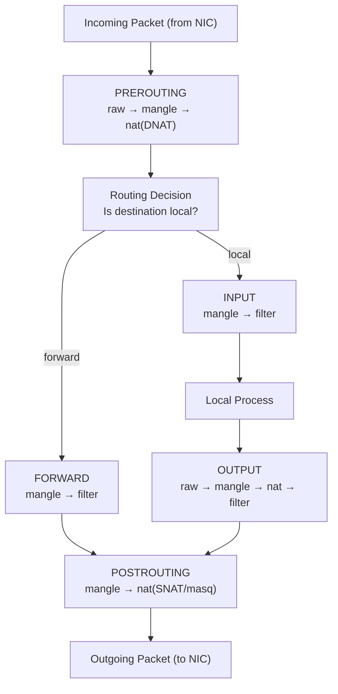
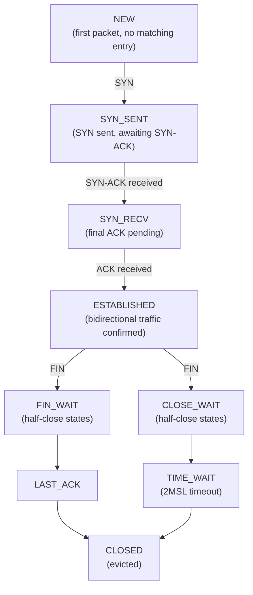
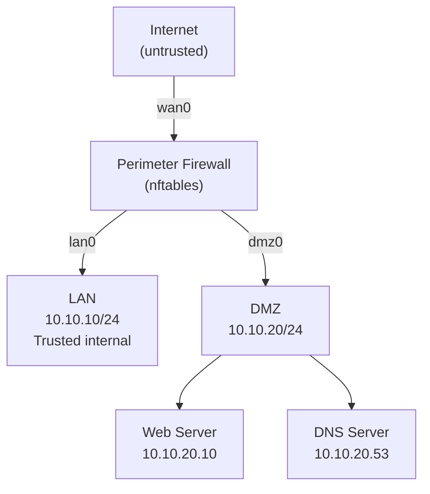
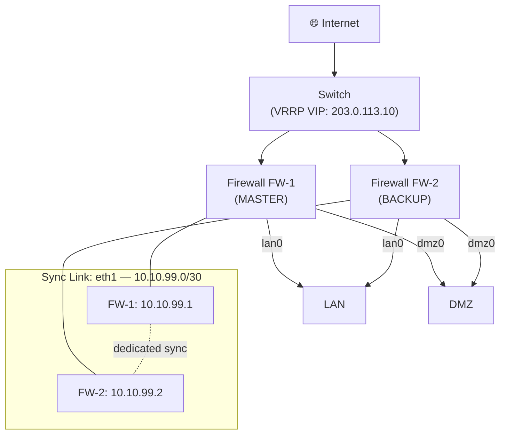

# Lesson 3: Firewall Architectures, Deployment Models, Network Segmentation

## 1. First-Principles Intuition & Invariants

A firewall is a policy enforcement point positioned at a trust boundary. That definition sounds deceptively simple, but every architectural decision in firewall engineering—where to place the device, how to partition networks, how to synchronize state across redundant nodes, how to scale inspection throughput—stems from the tension between two fundamental properties: the granularity of the trust boundary and the cost of enforcing policy at that granularity. A single perimeter firewall at the internet edge makes policy reasoning trivial because there is one chokepoint, one rule set, one place where the default-deny invariant lives. But that same centralization creates a single point of failure, a performance bottleneck under high packet rates, and—most critically—a model that assumes everything inside the perimeter is trustworthy. The moment an attacker breaches the perimeter through a compromised web server, phished credentials, or a vulnerable VPN gateway, they gain unrestricted lateral movement across the internal network. The perimeter model fails not because firewalls are ineffective, but because it treats the network as a binary trust domain: trusted inside, untrusted outside.

The shift toward defense in depth and network segmentation emerged from recognizing that networks are not binary trust domains but graduated ones. A database server holding payment card data has a different trust level than a developer jump host, which in turn differs from a public-facing load balancer. Internal segmentation firewalls (ISFWs) enforce policy at these internal trust boundaries, creating compartments that contain lateral movement. If an attacker compromises a web server in the DMZ, an internal segmentation firewall between the DMZ and the application tier prevents direct access to the database layer—forcing the attacker to traverse a new policy enforcement point with its own default-deny rule set and its own connection state tracking.

The architectural invariants that govern all firewall designs, regardless of deployment model, are fourfold. First, default-deny: any traffic not explicitly permitted is dropped. This is not a configuration preference but a logical necessity, because an allowlist model scales with the number of services (which is bounded and knowable) while a denylist model scales with the number of threats (which is unbounded and unknowable). Second, stateful inspection: the firewall must track the lifecycle of each connection through its conntrack table, distinguishing the first SYN of a new TCP handshake from the data segments of an established session, and only permitting return traffic for connections that were initiated in an allowed direction. Third, least-privilege routing: the firewall should not only filter by port and address but should also ensure that only the minimum necessary network paths exist between zones. Fourth, separation of control plane and data plane: the interface through which an operator manages the firewall rule set must be administratively and often physically separate from the interface through which production traffic flows, so that a compromise of the data plane does not grant access to the control plane.

The evolution from perimeter-only architectures toward distributed enforcement follows a clear trajectory driven by the economics of blast radius. A perimeter firewall has a blast radius equal to the entire internal network. Adding a single internal segmentation firewall between the DMZ and the internal network reduces the blast radius of a DMZ compromise to the DMZ itself. Microsegmentation—enforcing policy at the individual workload or pod level—reduces the blast radius to a single workload, but at the cost of managing potentially thousands of distributed rule sets. The centralized model optimizes for operational simplicity and single-pane-of-glass visibility; the distributed model optimizes for blast radius containment and horizontal scaling. Every production architecture sits somewhere on this spectrum, and the engineering challenge is choosing the right point for a given threat model, operational capacity, and performance budget.

The conntrack table is the single most important data structure in any stateful firewall. It is a hash table keyed on the five-tuple (protocol, source address, source port, destination address, destination port), with each entry recording the connection's current state, timeout, byte and packet counters, and the NAT transformations applied. When the kernel receives a packet, it extracts the five-tuple, hashes it, and performs a lookup in the conntrack hash table. If the lookup succeeds, the packet is classified against an existing connection and the state machine advances. If the lookup fails and the packet is a SYN, a new entry is created in the NEW state. If the lookup fails and the packet is not a SYN, it is classified as INVALID and dropped. This means the conntrack table's capacity directly determines how many concurrent connections the firewall can track, and its hash distribution determines lookup performance under load. A full conntrack table is a catastrophic failure mode: every new connection attempt is dropped, and the firewall effectively becomes a denial-of-service vector against the very network it protects.

## 2. Core Architecture & Mechanics

The Linux netfilter framework provides five hook points embedded in the kernel's network stack, and every packet traverses a subset of these hooks depending on its destination. Understanding this traversal path is essential because firewall rules are attached to specific hooks, and a rule placed on the wrong hook will never match the traffic it is intended to filter.



The PREROUTING hook fires before the routing decision, making it the correct place for DNAT rules that redirect incoming traffic to internal addresses. The FORWARD hook fires only for packets transiting the firewall—packets that arrive on one interface and depart on another without being delivered to a local process. The LOCAL_IN hook fires for packets delivered to the firewall itself, such as SSH management sessions. The LOCAL_OUT hook fires for packets generated by local processes on the firewall. The POSTROUTING hook fires after routing and is the correct place for SNAT or masquerade rules that rewrite source addresses before packets leave the firewall.

Within each hook, nftables processes chains in priority order. The `filter` table holds the security policy—allow and drop decisions. The `nat` table holds address translation rules. The `raw` table runs before conntrack, allowing specific traffic to be exempted from connection tracking for performance. The `mangle` table modifies packet headers for QoS marking or special routing. The ordering within a single hook is deterministic: raw (-300) before mangle (-150) before nat (-100) before filter (0) before nat postrouting (100). This priority ordering matters because a packet may be modified by a nat rule before reaching a filter rule, and the filter rule must match against the post-NAT addresses.

The conntrack TCP state machine mirrors the TCP RFC 793 state machine but with firewall-specific extensions for timeout management and mid-connection classification.



Each state has an associated timeout that governs how long the conntrack entry persists without traffic. A connection in ESTABLISHED state defaults to a 432,000-second (5-day) timeout, which is appropriate for long-lived SSH sessions but problematic for firewalls with high connection churn because idle entries consume table slots. Tuning these timeouts downward—setting ESTABLISHED to 7,440 seconds (2 hours) for a high-throughput perimeter firewall—reclaims table entries from idle connections more aggressively. The TIME_WAIT timeout defaults to 120 seconds, which is generally acceptable but can be reduced on memory-constrained appliances. UDP entries default to a 30-second timeout, extended to 120 seconds if bidirectional traffic is observed (the "stream" state). ICMP entries time out after 30 seconds. These values are not arbitrary: they reflect the protocol semantics. TCP's TIME_WAIT exists to catch stray segments from the previous incarnation of the connection, so reducing it below 60 seconds risks accepting stale segments. UDP is connectionless, so the timeout is a heuristic that assumes a response within 30 seconds indicates an active "session."

A three-zone perimeter firewall with a DMZ is the canonical enterprise architecture. The firewall has three interfaces: `wan0` connected to the internet, `lan0` connected to the trusted internal network, and `dmz0` connected to a demilitarized zone hosting public-facing services. The DMZ exists because public-facing services must accept incoming connections from the internet, which makes them high-value targets. If a web server is compromised, the DMZ boundary ensures the attacker cannot reach the internal network without breaching a second policy enforcement point. The DMZ is a quarantine zone: services placed there are assumed to be potentially compromised and are given the minimum network access required to function.



The complete nftables ruleset for this architecture implements zone-based filtering with explicit directionality. Each traffic flow direction is a separate rule, and the default policy on the forward chain is DROP, meaning any flow not explicitly listed is silently discarded.

```nftables
#!/usr/sbin/nft -f

flush ruleset

# ============================================================
# NAT Table: address translation for DMZ inbound and LAN outbound
# ============================================================
table ip nat {
    chain prerouting {
        type nat hook prerouting priority -100; policy accept;

        # DNAT: forward HTTP/HTTPS to DMZ web server 10.10.20.10
        iifname "wan0" tcp dport { 80, 443 } dnat to 10.10.20.10

        # DNAT: SMTP to DMZ mail relay 10.10.20.25
        iifname "wan0" tcp dport 25 dnat to 10.10.20.25
    }

    chain postrouting {
        type nat hook postrouting priority 100; policy accept;

        # Masquerade LAN traffic exiting to WAN
        oifname "wan0" ip saddr 10.10.10.0/24 masquerade

        # Masquerade DMZ traffic exiting to WAN (for outbound updates)
        oifname "wan0" ip saddr 10.10.20.0/24 masquerade
    }
}

# ============================================================
# Filter Table: zone-based security policy
# ============================================================
table inet filter {

    # Named sets for reuse across chains
    set lan_net {
        type ipv4_addr
        flags interval
        elements = { 10.10.10.0/24 }
    }

    set dmz_net {
        type ipv4_addr
        flags interval
        elements = { 10.10.20.0/24 }
    }

    set mgmt_hosts {
        type ipv4_addr
        elements = { 10.10.10.100, 10.10.10.101 }
    }

    set blocked_scanners {
        type ipv4_addr
        flags interval, timeout
        timeout = 3600s
        elements = { 198.51.100.0/24, 203.0.113.50 }
    }

    # --- INPUT: traffic destined to the firewall itself ---
    chain input {
        type filter hook input priority 0; policy drop;

        iifname "lo" accept
        ct state invalid drop
        ct state established,related accept

        # Drop known scanners immediately
        ip saddr @blocked_scanners drop

        # ICMP: rate-limited for diagnostics
        icmp type { echo-request, destination-unreachable, time-exceeded } \
            limit rate 10/second burst 20 packets accept

        # SSH management: LAN management hosts only
        iifname "lan0" ip saddr @mgmt_hosts tcp dport 22 accept

        # Monitoring (Prometheus node_exporter + snmp_exporter)
        iifname "lan0" ip saddr 10.10.10.100 tcp dport { 9100, 9115 } accept

        # NTP from DMZ (firewall syncs time from DMZ NTP server)
        iifname "dmz0" ip saddr 10.10.20.123 udp dport 123 accept

        # Drop everything else with a log
        log prefix "FW-IN-DROP " level warn limit rate 5/second drop
    }

    # --- FORWARD: traffic transiting the firewall ---
    chain forward {
        type filter hook forward priority 0; policy drop;

        ct state invalid drop
        ct state established,related accept

        # Drop known scanners
        ip saddr @blocked_scanners drop

        # === WAN -> DMZ ===
        # HTTP/HTTPS to web server (DNAT'd by nat table)
        iifname "wan0" oifname "dmz0" ip daddr 10.10.20.10 \
            tcp dport { 80, 443 } ct state new accept

        # SMTP to mail relay
        iifname "wan0" oifname "dmz0" ip daddr 10.10.20.25 \
            tcp dport 25 ct state new accept

        # DNS queries to DMZ DNS resolver (UDP only, block zone transfers)
        iifname "wan0" oifname "dmz0" ip daddr 10.10.20.53 \
            udp dport 53 ct state new accept

        # === LAN -> WAN ===
        # Allow all outbound from LAN (NAT'd by postrouting)
        iifname "lan0" oifname "wan0" ip saddr @lan_net ct state new accept

        # === LAN -> DMZ ===
        # SSH from LAN to DMZ for administration
        iifname "lan0" oifname "dmz0" ip saddr @lan_net ip daddr @dmz_net \
            tcp dport 22 ct state new accept

        # DNS from LAN to DMZ DNS server
        iifname "lan0" oifname "dmz0" ip saddr @lan_net ip daddr 10.10.20.53 \
            { tcp dport 53, udp dport 53 } ct state new accept

        # HTTP/HTTPS from LAN to DMZ web server (internal testing)
        iifname "lan0" oifname "dmz0" ip saddr @lan_net ip daddr 10.10.20.10 \
            tcp dport { 80, 443 } ct state new accept

        # === DMZ -> WAN ===
        # DMZ outbound: HTTP/HTTPS for OS/package updates
        iifname "dmz0" oifname "wan0" ip saddr @dmz_net \
            tcp dport { 80, 443 } ct state new accept

        # DMZ DNS queries to WAN (DMZ DNS forwarder resolving external domains)
        iifname "dmz0" oifname "wan0" ip saddr 10.10.20.53 \
            { tcp dport 53, udp dport 53 } ct state new accept

        # DMZ NTP to WAN
        iifname "dmz0" oifname "wan0" ip saddr @dmz_net \
            udp dport 123 ct state new accept

        # === DMZ -> LAN ===
        # DEFAULT DENY: DMZ cannot initiate connections to LAN.
        # Return traffic for LAN->DMZ flows is handled by
        # ct state established,related above.

        # Log all unmatched forwarded traffic
        log prefix "FW-FWD-DROP " level warn limit rate 10/second drop
    }

    # --- OUTPUT: traffic from the firewall itself ---
    chain output {
        type filter hook output priority 0; policy accept;

        # The firewall can initiate to any destination for
        # updates, DNS resolution, NTP sync, and monitoring
        ct state new accept
    }
}
```

The critical design principle visible in this ruleset is the asymmetry between DMZ-to-LAN and LAN-to-DMZ flows. The DMZ has no rules permitting outbound traffic to the LAN. If a DMZ web server is compromised, the attacker cannot pivot directly to internal database servers, administrative hosts, or storage arrays. The only traffic flowing from DMZ to LAN is return traffic for connections initiated from the LAN, which the `ct state established,related` rule handles without exposing new attack surface. This is the segmentation invariant in action: traffic may flow from more-trusted to less-trusted zones with explicit permission, but never from less-trusted to more-trusted zones except as return traffic for an already-authorized flow.

Host-based firewalls complement network firewalls by enforcing policy at the operating system level, providing defense in depth against threats that bypass the network perimeter. On Linux, firewalld provides a zone-based abstraction over nftables, allowing administrators to assign network interfaces to zones and define per-zone service policies without writing raw nftables rules. The zone configuration below defines a custom zone for a DMZ-hosted web server that allows HTTP, HTTPS, and SSH from the internal management subnet, while dropping all traffic from other DMZ hosts.

```xml
<?xml version="1.0" encoding="utf-8"?>
<zone target="DROP">
  <short>dmz-web</short>
  <description>Zone for DMZ web servers: public HTTP/HTTPS,
  management SSH from internal subnet only</description>

  <service name="http"/>
  <service name="https"/>

  <rule family="ipv4" priority="0">
    <source address="10.10.10.0/24"/>
    <service name="ssh"/>
    <accept/>
  </rule>

  <rule family="ipv4" priority="0">
    <source address="10.10.10.100"/>
    <port protocol="tcp" port="9100"/>
    <accept/>
  </rule>

  <rule family="ipv4" priority="10">
    <source address="10.10.20.0/24"/>
    <drop/>
  </rule>

  <rule family="ipv6" priority="0">
    <source address="2001:db8:10::/64"/>
    <service name="ssh"/>
    <accept/>
  </rule>

  <rule family="ipv6" priority="10">
    <drop/>
  </rule>
</zone>
```

The `target="DROP"` attribute on the zone element sets the default policy: any packet not matching an explicit rule is dropped. Rules are evaluated in priority order, with lower numbers evaluated first. The SSH rule at priority 0 permits management access from the internal subnet, while the rule at priority 10 drops all traffic from the DMZ subnet, ensuring a compromised DMZ peer cannot reach this host. The final IPv6 rule drops all unmatched IPv6 traffic, preventing accidental exposure over IPv6 when the host has a dual-stack configuration but the IPv6 policy has not been fully designed.

In Kubernetes, the network segmentation model shifts from interface-based zone boundaries to label-based identity boundaries. Kubernetes NetworkPolicy is a declarative API that defines which pods may communicate with which other pods, enforced by the container network interface (CNI) plugin at the pod level. The default Kubernetes networking model is flat: every pod can reach every other pod. NetworkPolicy introduces opt-in segmentation by selecting pods with label selectors and specifying allowed ingress and egress peers. Once any NetworkPolicy selects a pod, that pod becomes isolated—it only accepts traffic explicitly allowed by a policy.

```yaml
---
apiVersion: networking.k8s.io/v1
kind: NetworkPolicy
metadata:
  name: default-deny-all
  namespace: production
spec:
  podSelector: {}
  policyTypes:
    - Ingress
    - Egress
---
apiVersion: networking.k8s.io/v1
kind: NetworkPolicy
metadata:
  name: frontend-ingress-egress
  namespace: production
spec:
  podSelector:
    matchLabels:
      tier: frontend
      app: web
  policyTypes:
    - Ingress
    - Egress
  ingress:
    - from:
        - namespaceSelector:
            matchLabels:
              name: ingress-nginx
          podSelector:
            matchLabels:
              app.kubernetes.io/name: ingress-nginx
      ports:
        - protocol: TCP
          port: 8080
  egress:
    - to:
        - podSelector:
            matchLabels:
              tier: backend
              app: api
      ports:
        - protocol: TCP
          port: 9090
    - to:
        - namespaceSelector:
            matchLabels:
              name: kube-system
          podSelector:
            matchLabels:
              k8s-app: kube-dns
      ports:
        - protocol: UDP
          port: 53
    - to:
        - ipBlock:
            cidr: 0.0.0.0/0
            except:
              - 10.0.0.0/8
              - 172.16.0.0/12
              - 192.168.0.0/16
      ports:
        - protocol: TCP
          port: 443
---
apiVersion: networking.k8s.io/v1
kind: NetworkPolicy
metadata:
  name: backend-ingress-egress
  namespace: production
spec:
  podSelector:
    matchLabels:
      tier: backend
      app: api
  policyTypes:
    - Ingress
    - Egress
  ingress:
    - from:
        - podSelector:
            matchLabels:
              tier: frontend
              app: web
      ports:
        - protocol: TCP
          port: 9090
  egress:
    - to:
        - podSelector:
            matchLabels:
              tier: database
              app: postgres
      ports:
        - protocol: TCP
          port: 5432
    - to:
        - namespaceSelector:
            matchLabels:
              name: kube-system
          podSelector:
            matchLabels:
              k8s-app: kube-dns
      ports:
        - protocol: UDP
          port: 53
```

This policy set implements a three-tier microsegmentation model. The `default-deny-all` policy selects all pods in the production namespace and sets both ingress and egress to deny-all as the baseline. The `frontend-ingress-egress` policy then opens specific flows: the frontend pods accept ingress only from the ingress-nginx controller namespace on port 8080, and their egress is restricted to the backend API pods on port 9090, kube-dns on UDP 53, and external HTTPS (443) to non-RFC1918 addresses. The `backend-ingress-egress` policy allows ingress only from the frontend pods on port 9090 and restricts egress to the PostgreSQL pods on port 5432 and kube-dns on UDP 53. The database tier—selected by its own NetworkPolicy—would accept ingress only from the backend pods and have egress restricted to kube-dns only.

The architectural difference between this model and a traditional perimeter firewall is the enforcement granularity. A traditional firewall enforces policy at a network boundary—traffic crossing from one subnet to another is inspected. Kubernetes NetworkPolicy enforces at the pod boundary—every pod pair is independently evaluated, and policy is applied before traffic even reaches the network fabric. This eliminates the concept of a "trusted internal network" entirely. There is no internal zone where all pods can freely communicate; every pod-to-pod flow is individually authorized. This is the microsegmentation ideal: blast radius is contained to a single pod, and lateral movement requires compromising the policy engine itself.

The trade-off is policy complexity. A traditional firewall with three zones requires at most nine rules to fully specify all zone-pair flows (three zones squared). A Kubernetes cluster with 50 microservices, each needing ingress and egress rules, requires on the order of 100 NetworkPolicy objects. At 500 microservices, the policy set exceeds 1,000 objects, and the CNI plugin must evaluate label-selector matches for every packet at line rate. This is where the centralized-versus-distributed enforcement trade-off becomes operationally critical: the CNI plugin distributes policy enforcement to every node, eliminating the central firewall bottleneck, but the policy management burden shifts to the operations team.

## 3. High-Performance Optimization & Failure Modes

The conntrack table is the primary performance bottleneck in any stateful firewall under high connection rates. The kernel allocates the conntrack hash table at module load time, and its size must be a power of two for efficient masking during hash computation. The default `nf_conntrack_max` is often 16,384 on consumer kernels and 262,144 on enterprise kernels, which is insufficient for a perimeter firewall handling tens of thousands of new connections per second. When the table fills, new connections are dropped silently—the SYN packet never reaches the application, and the client sees a timeout rather than a connection refused.

```bash
# /etc/sysctl.d/99-conntrack.conf
# Maximum entries in conntrack table
net.netfilter.nf_conntrack_max = 1048576

# Hash table bucket count (must be power of 2, ideally max/4)
# This cannot be changed at runtime; write to module parameter:
# echo 262144 > /sys/module/nf_conntrack/parameters/hashsize
# or set in /etc/modprobe.d/nf_conntrack.conf:
# options nf_conntrack hashsize=262144

# Timeout tuning for high-throughput perimeter firewall
net.netfilter.nf_conntrack_tcp_timeout_established = 7440
net.netfilter.nf_conntrack_tcp_timeout_time_wait = 120
net.netfilter.nf_conntrack_tcp_timeout_close_wait = 60
net.netfilter.nf_conntrack_tcp_timeout_fin_wait = 60
net.netfilter.nf_conntrack_tcp_timeout_last_ack = 30
net.netfilter.nf_conntrack_udp_timeout = 30
net.netfilter.nf_conntrack_udp_timeout_stream = 120
net.netfilter.nf_conntrack_icmp_timeout = 30
net.netfilter.nf_conntrack_generic_timeout = 600

# Disable conntrack for traffic that does not need state tracking
# (requires raw table rules to use NOTRACK)
# net.netfilter.nf_conntrack_acct = 0
# net.netfilter.nf_conntrack_checksum = 1
```

The relationship between `nf_conntrack_max` and the hash table size is critical for performance. The hash table has `hashsize` buckets, and each bucket is a linked list. When a connection lookup hashes to a bucket, the kernel walks the linked list comparing five-tuples. If the average chain length (nf_conntrack_max / hashsize) is too long, lookups become O(n) rather than O(1), and CPU utilization spikes under high connection counts. The optimal ratio is approximately 4:1—max entries to hash buckets—giving an average chain length of four. With `nf_conntrack_max = 1048576` and `hashsize = 262144`, the hash table consumes approximately 8 MB of kernel memory (262,144 buckets × 32 bytes per bucket), which is negligible on a modern server. Increasing `nf_conntrack_max` without proportionally increasing `hashsize` degrades lookup performance, so both parameters must be tuned together.

Monitoring conntrack utilization is essential for catching table exhaustion before it causes an outage.

```bash
# Current entry count vs. maximum
cat /proc/sys/net/netfilter/nf_conntrack_count
cat /proc/sys/net/netfilter/nf_conntrack_max

# Per-CPU statistics: look for "insert_failed" (table full)
cat /proc/net/stat/nf_conntrack

# Human-readable conntrack statistics
conntrack -S

# List all tracked connections (filtered by state)
conntrack -L -s ESTABLISHED
conntrack -L -p tcp --state TIME_WAIT

# Count connections by state
conntrack -L | awk '{print $4}' | sort | uniq -c | sort -rn

# Watch for conntrack table full events in kernel log
dmesg | grep "nf_conntrack: table full"
journalctl -k | grep conntrack
```

The `insert_failed` counter in `/proc/net/stat/nf_conntrack` is the definitive indicator of table exhaustion. If this counter increments, connections are being dropped because the table is full. The `early_drop` counter indicates the kernel is evicting the oldest uninitialized connections to make room for new ones—a last-resort measure that drops legitimate half-open connections. If either counter is non-zero, the `nf_conntrack_max` value is too low for the current traffic load.

nftables offers several performance optimizations that iptables cannot match. The most significant is native set support with multiple lookup algorithms. When matching against a list of addresses—such as a blocklist or a set of allowed management hosts—nftables compiles the set into a data structure optimized for lookup, rather than evaluating rules sequentially like iptables.

```nftables
table inet filter {
    # Performance set: uses the fastest available algorithm
    # For sets larger than ~256 entries, this selects a hash table
    set large_blocklist {
        type ipv4_addr
        flags interval
        auto-merge
        # 'performance' uses a hash table for O(1) lookups
        # 'rbtree' is a red-black tree for interval matching
        # 'fastest' auto-selects (default for most sets)
    }

    # Interval set with automatic merging of adjacent ranges
    set trusted_ranges {
        type ipv4_addr
        flags interval, timeout
        timeout = 1d
        auto-merge
        elements = {
            10.10.10.0/25,
            10.10.10.128/25,    # auto-merged with above to 10.10.10.0/24
            192.168.1.10-192.168.1.50
        }
    }

    # Map: associate addresses with metadata (e.g., VLAN tag, rate limit)
    map rate_limits {
        type ipv4_addr : verdict
        elements = {
            10.10.10.50 : accept,
            10.10.10.51 : drop,
            10.10.10.52 : jump quarantine_chain
        }
    }

    chain prerouting {
        type filter hook prerouting priority -300; policy accept;

        # NOTRACK: skip conntrack for traffic that doesn't need it
        # (e.g., SNMP polling, NTP, multicast)
        udp dport { 161, 162, 123 } notrack

        # Set lookup: O(1) regardless of set size
        ip saddr @large_blocklist drop

        # Map lookup: verdict map for per-source policy
        ip saddr vmap @rate_limits
    }
}
```

The `notrack` statement in the raw chain is a powerful optimization for traffic that does not require state tracking. SNMP traps, NTP queries, and multicast traffic are fire-and-forget protocols where the firewall has no reason to track connection state. By marking these flows with `notrack`, the packets bypass conntrack entirely, saving table entries for traffic that genuinely requires stateful inspection. On a firewall handling high volumes of monitoring traffic, this can reduce conntrack pressure by 20-30%.

High availability for perimeter firewalls requires two capabilities: failover of the traffic routing path (so traffic reaches the active firewall) and synchronization of conntrack state (so established connections survive the failover). The first is handled by VRRP through keepalived; the second by conntrackd.



The keepalived configuration defines VRRP instances for each firewall interface, ensuring that the virtual IP addresses move to the backup firewall if the master fails. The conntrackd configuration synchronizes the connection state table over a dedicated sync link, so the backup firewall has a complete copy of all active connections and can seamlessly continue filtering established sessions after failover.

```
# /etc/keepalived/keepalived.conf

global_defs {
    router_id FW_PERIMETER
    enable_script_security
    script_user root
}

vrrp_sync_group VG_PERIMETER {
    group {
        VI_WAN
        VI_LAN
        VI_DMZ
    }
    notify_master "/etc/conntrackd/notify.sh master"
    notify_backup "/etc/conntrackd/notify.sh backup"
    notify_fault  "/etc/conntrackd/notify.sh fault"
}

vrrp_instance VI_WAN {
    state MASTER
    interface wan0
    virtual_router_id 51
    priority 200
    advert_int 1
    authentication {
        auth_type PASS
        auth_pass K7x9mP2q
    }
    virtual_ipaddress {
        203.0.113.10/24 dev wan0
    }
    track_interface {
        wan0
        lan0
        dmz0
    }
}

vrrp_instance VI_LAN {
    state MASTER
    interface lan0
    virtual_router_id 52
    priority 200
    advert_int 1
    authentication {
        auth_type PASS
        auth_pass K7x9mP2q
    }
    virtual_ipaddress {
        10.10.10.1/24 dev lan0
    }
}

vrrp_instance VI_DMZ {
    state MASTER
    interface dmz0
    virtual_router_id 53
    priority 200
    advert_int 1
    authentication {
        auth_type PASS
        auth_pass K7x9mP2q
    }
    virtual_ipaddress {
        10.10.20.1/24 dev dmz0
    }
}
```

The `vrrp_sync_group` binds the three VRRP instances together, ensuring that if any interface fails on the master, all virtual IPs fail over to the backup as a unit. Without the sync group, a single interface failure could split the traffic path: inbound traffic might reach FW-1 via the WAN VIP while outbound traffic routes through FW-2 via the LAN VIP, causing asymmetric routing that breaks conntrack state on both firewalls. The `track_interface` directive extends this by monitoring all three interfaces—if any one goes down, the VRRP instance transitions to FAULT state and triggers failover.

```
# /etc/conntrackd/conntrackd.conf

Sync {
    Mode FTFW {
        ResendQueueSize 262144
        ResendBuffer 524288
        AckWindowSize 4096
        DisableExternalCache Off
    }

    UDP {
        IPv4_address 10.10.99.1
        IPv4_Destination_Address 10.10.99.2
        Port 3780
        Interface eth1
        SndSocketBuffer 2498304
        RcvSocketBuffer 2498304
        Checksum on
    }
}

General {
    Nice -1
    HashSize 32768
    HashLimit 32768
    LogFile on
    LockFile /var/lock/conntrackd.lock

    UNIX {
        Path /var/run/conntrackd.ctl
        Backlog 20
    }

    NetlinkBufferSize 2097152
    NetlinkBufferSizeMaxGrowth 89784320

    Filter From Userspace {
        Protocol Accept {
            TCP
            UDP
            ICMP
        }
        Address Ignore {
            IPv4_address 127.0.0.1
            IPv4_address 10.10.99.1
            IPv4_address 10.10.99.2
            IPv4_address 224.0.0.18
        }
    }
}
```

The FTFW (Fault Tolerant Firewall) mode provides reliable state synchronization with acknowledgment and retransmission. The `DisableExternalCache Off` setting enables an external cache that stores a snapshot of the connection table, reducing the time required to resynchronize after a failover from minutes to seconds. The `Address Ignore` filter excludes the firewall's own sync-link traffic and VRRP multicast (224.0.0.18) from the conntrack table, preventing the sync protocol itself from consuming conntrack entries.

The notify script transitions conntrackd between primary and backup roles during failover:

```bash
#!/bin/bash
# /etc/conntrackd/notify.sh

case "$1" in
    master)
        # Become primary: commit external cache to kernel
        /usr/sbin/conntrackd -c
        /usr/sbin/conntrackd -R
        logger -t conntrackd "Transitioned to MASTER - cache committed"
        ;;
    backup)
        # Become backup: flush local cache, await sync
        /usr/sbin/conntrackd -F
        logger -t conntrackd "Transitioned to BACKUP - cache flushed"
        ;;
    fault)
        /usr/sbin/conntrackd -F
        logger -t conntrackd "Transitioned to FAULT - cache flushed"
        ;;
esac

exit 0
```

When FW-1 fails and FW-2 becomes master, the notify script runs `conntrackd -c` (commit), which takes the external cache of synchronized connections and injects them into the kernel's live conntrack table. This is the critical moment: if the cache is stale or incomplete, established connections that were active on FW-1 will be classified as INVALID on FW-2 and dropped. The resynchronization process (`conntrackd -R`) requests a full state dump from the peer to fill any gaps, but this takes time proportional to the number of connections. On a firewall tracking 500,000 connections, a full resync can take 30-60 seconds, during which some connections may time out and be dropped.

The primary failure modes for this architecture are fourfold. Conntrack table exhaustion occurs when the connection rate exceeds the table's capacity, causing the `insert_failed` counter to increment and new connections to be dropped. The mitigation is proactive: monitor the `nf_conntrack_count` metric against `nf_conntrack_max` with alerting at 70% utilization, tune timeouts downward to reclaim idle entries faster, and use `notrack` for protocols that do not require stateful inspection. Asymmetric routing occurs when inbound traffic traverses one firewall and outbound traffic traverses another, causing both firewalls to see only half of the connection and classify all packets as INVALID. The mitigation is VRRP sync groups that ensure all virtual IPs fail over as a unit, combined with routing configuration that forces symmetric paths. HA sync lag occurs when conntrackd cannot synchronize state fast enough during a burst of new connections, leaving the backup with stale state. The mitigation is increasing the sync link bandwidth, tuning `ResendQueueSize` and `NetlinkBufferSize`, and using the external cache to reduce resync time. Policy drift occurs when the nftables ruleset is modified on one firewall but not the other, causing divergent behavior after failover. The mitigation is configuration management—Ansible, Puppet, or a GitOps pipeline—that deploys rule changes to both firewalls atomically and validates rule set consistency with `nft -c -f` before committing.

```bash
#!/bin/bash
# /usr/local/sbin/firewall-health-check.sh
# Run via cron every 30 seconds or systemd timer

ALERT_EMAIL="oncall@example.com"
THRESHOLD_PCT=70

CURRENT=$(cat /proc/sys/net/netfilter/nf_conntrack_count)
MAX=$(cat /proc/sys/net/netfilter/nf_conntrack_max)
PCT=$((CURRENT * 100 / MAX))

if [ "$PCT" -gt "$THRESHOLD_PCT" ]; then
    logger -p user.warning -t fw-health \
        "conntrack at ${PCT}% (${CURRENT}/${MAX})"
    echo "conntrack at ${PCT}% (${CURRENT}/${MAX})" | \
        mail -s "FIREWALL ALERT: conntrack near capacity" "$ALERT_EMAIL"
fi

# Check for insert failures
INSERT_FAILED=$(conntrack -S | grep 'insert_failed' | awk '{print $2}')
if [ "$INSERT_FAILED" != "0" ] && [ -n "$INSERT_FAILED" ]; then
    logger -p user.crit -t fw-health \
        "conntrack insert_failed = ${INSERT_FAILED}"
    echo "conntrack insert_failed=${INSERT_FAILED}" | \
        mail -s "FIREWALL CRITICAL: connections being dropped" "$ALERT_EMAIL"
fi

# Verify HA peer is reachable
PEER_STATE=$(conntrackd -s 2>/dev/null | grep 'peer' | awk '{print $NF}')
if [ "$PEER_STATE" != "connected" ]; then
    logger -p user.warning -t fw-health \
        "conntrackd peer not connected: ${PEER_STATE}"
fi

# Verify nftables ruleset is loaded and consistent
if ! nft list ruleset | grep -q "table inet filter"; then
    logger -p user.crit -t fw-health "nftables filter table missing"
    echo "nft filter table missing" | \
        mail -s "FIREWALL CRITICAL: ruleset not loaded" "$ALERT_EMAIL"
fi
```

The health check script monitors all four failure modes: conntrack utilization, insert failures, HA peer connectivity, and ruleset integrity. Deployed via a systemd timer at 30-second intervals, it provides early warning before a capacity issue becomes a service-affecting outage. The `nft list ruleset` check at the end catches a subtle failure mode: if a rule set reload fails partway through (for example, due to a syntax error in an updated ruleset file), the `flush ruleset` at the top of the file may execute but the subsequent table definitions may fail, leaving the firewall with no filter table and an effective allow-all policy. Validating the ruleset with `nft -c -f /etc/nftables.conf` before applying it, and checking that the filter table exists after application, prevents this catastrophic scenario.
