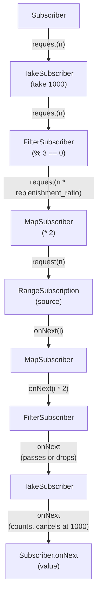
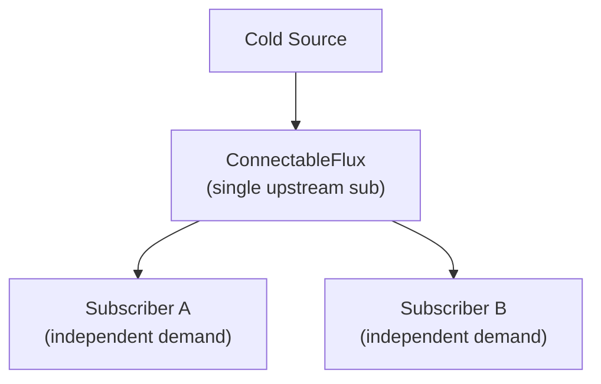
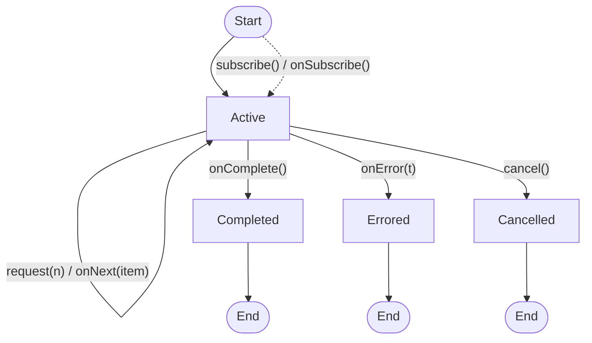

# Lesson 1: Reactive Flux Primitives and Observable Streams

## 1. First-Principles Intuition & Invariants

There is a fundamental tension at the heart of every distributed system: producers generate data at rates governed by their own physics, and consumers process data at rates governed by theirs. When those rates diverge, the system must choose between dropping data, blocking producers, buffering indefinitely, or signaling demand explicitly. Every architecture you have ever built takes a position on this tradeoff, whether deliberately or by accident. Reactive programming, and Project Reactor's Flux in particular, makes that position explicit, composable, and enforceable in the type system.

To understand why Flux matters to infrastructure engineers specifically, consider a Kubernetes controller reconciling a large cluster state. The API server emits a stream of watch events whose rate is entirely outside the controller's control. A naive implementation hands each event to a goroutine or thread pool, which works until a thundering herd of pod deletions arrives and the downstream work queue saturates memory. The controller was written with an implicit assumption: that the event rate would remain bounded below the processing rate. Reactive streams shatter that assumption deliberately and replace it with a contract.

That contract is specified in the Reactive Streams specification (JVM: `org.reactivestreams`, Kotlin Flows, .NET Rx.NET), and Project Reactor implements it completely. The specification defines four interfaces: `Publisher<T>`, `Subscriber<T>`, `Subscription`, and `Processor<T, R>`. Their interaction protocol is deceptively simple. A `Subscriber` calls `Subscription.request(n)`, signaling that it can accept at most `n` items. The `Publisher` delivers at most `n` items. No item crosses the wire without demand. This is the demand protocol, and it is the mathematical bedrock on which everything else in Flux rests.

The mathematical structure underlying reactive composition is a category of asynchronous sequences equipped with a monad-like bind operation. If you have used Haskell's `IO` monad or Rust's `Future` combinators, the shape will feel familiar. A `Flux<T>` is not a collection and not a future; it is a *description* of a sequence that has not yet been executed. This distinction between description and execution is the first invariant every Flux practitioner must internalize. When you write `Flux.fromIterable(list).map(f).filter(g)`, nothing has happened. You have constructed an operator graph, a directed acyclic graph of transformations, that will only begin emitting when a `Subscriber` attaches and issues a demand signal. This lazy assembly-time / eager subscription-time split is the source of both Flux's power and its most common debugging confusion.

The second invariant is *sequential delivery*. No matter how many threads participate in a Flux pipeline, the Reactive Streams specification guarantees that `onNext` signals are delivered to a given subscriber sequentially and never concurrently. This eliminates an entire class of race conditions that plague thread-pool-based event processing, but it does not eliminate all races. The boundary between operators and the thread scheduler remains a source of subtle bugs, which we will examine concretely in section three.

The third invariant distinguishes **cold** from **hot** observables, a distinction that carries immediate operational weight. A cold `Flux` is one where the data source is *per-subscription*. Each subscriber that attaches triggers an independent execution of the source, with its own demand signals, its own buffering, and its own lifecycle. `Flux.fromCallable(() -> fetchPageFromDatabase(offset))` is cold: each subscriber gets its own database cursor. A hot `Flux` is one where the source exists independently of any subscriber. A Kafka topic partition, a WebSocket stream, a Kubernetes watch feed — these are fundamentally hot. Data is produced whether or not anyone is subscribed, and a late subscriber misses events that arrived before its subscription. Conflating these two semantics is one of the most consequential mistakes in reactive infrastructure design, because the backpressure contract operates differently in each case.

## 2. Core Architecture & Mechanics

### The Operator Fusion Chain

A Flux pipeline is a linked list of operator nodes assembled at subscription time. When you write a chain like `Flux.range(1, 1_000_000).map(i -> i * 2).filter(i -> i % 3 == 0).take(1000)`, Reactor assembles this into an operator assembly. Each operator implements `CorePublisher` and wraps a downstream `CoreSubscriber`. Subscription initiates a recursive `subscribe()` call that walks the chain from downstream to upstream, wiring each operator's inner subscriber to the previous stage. The demand signal travels upstream through `request(n)` calls; data travels downstream through `onNext(T)` calls.



Reactor performs **operator fusion** when adjacent operators implement compatible fuseable interfaces (`QueueSubscription`, `Fuseable.SYNC`, `Fuseable.ASYNC`). When two adjacent operators are both `SYNC`-fuseable, Reactor collapses the queue between them: instead of enqueuing into an intermediate queue and immediately dequeuing, `onNext` delivers directly through the chain without allocation. This is not a micro-optimization for infrastructure engineers. At 500,000 events per second through a pod scheduling pipeline, the difference between allocating an intermediate `ArrayBlockingQueue` node per event and not doing so is measurable in GC pause latency.

### Backpressure Mechanics: Buffering, Dropping, and Latest

Backpressure strategies are not policies you configure once at the subscriber. They are explicit operators you insert at the boundary between a hot source and a pressure-sensitive downstream. Reactor provides four first-class strategies through the `onBackpressure*` operators, each with distinct mechanical behavior and appropriate use cases in infrastructure pipelines.

`onBackpressureBuffer()` places an unbounded queue between the source and downstream. It satisfies the Reactive Streams contract by buffering all excess items until the subscriber issues demand. For a reconciler consuming Kubernetes API watch events, this is the correct choice when the event burst is known to be transient and bounded: a node failure may emit hundreds of pod events in a few seconds, but the reconciler will drain the buffer in the quiet period that follows. The danger is heap exhaustion when the quiet period never arrives. Reactor offers `onBackpressureBuffer(maxSize, overflowStrategy)` where `overflowStrategy` is a `BufferOverflowStrategy` enum choosing between dropping the oldest, dropping the newest, or signaling an error downstream.

`onBackpressureDrop()` discards items that arrive without outstanding demand. Its throughput behavior is correct from the producer's perspective (the source is never blocked) and from the consumer's perspective (demand is always honored), but information is permanently lost. For an infrastructure metric pipeline feeding a time-series database, dropping a Prometheus scrape under load is often preferable to OOM-killing the collector. For a distributed transaction log, it is catastrophic.

`onBackpressureLatest()` retains only the most recent item when demand is unavailable. This is the right primitive for state monitoring rather than event sourcing: a cluster health dashboard does not need every intermediate CPU reading; it needs the most recent one when it has capacity to render. The semantic is equivalent to a `conflated` channel in Kotlin coroutines.

`onBackpressureError()` signals `reactor.core.Exceptions.failWithOverflow()` immediately when an item arrives without outstanding demand. This is the correct choice for pipelines where data loss is a protocol violation — for instance, a stream processing pipeline that promises exactly-once delivery semantics. Surfacing overflow as an explicit error is more honest than silently dropping data and far easier to instrument.

### Cold vs. Hot Observables: Mechanics and Multicast

The transition from cold to hot is accomplished through `publish()`, which wraps a cold `Flux` in a `ConnectableFlux`. The `ConnectableFlux` holds a single subscription to the upstream source and multicasts to all downstream subscribers. It does not begin emitting until `connect()` is called (or `autoConnect(n)` triggers after `n` subscribers have attached). The internal implementation maintains a `DirectProcessor` or a `Sinks.many().multicast()` depending on Reactor version; in Reactor 3.4+ the `Sinks` API supersedes the deprecated processor classes entirely.



The demand semantics of a multicast `ConnectableFlux` are worth examining carefully. The `ConnectableFlux` requests from upstream the minimum of all subscribers' outstanding demand. If subscriber A requests 100 and subscriber B requests 10, the source emits 10 items. Subscriber A's outstanding demand decreases to 90, subscriber B's to 0. The source will not emit again until subscriber B issues more demand. This is called the **slow subscriber problem**, and it is one of the most operationally significant failure modes in infrastructure stream processing. A single lagging consumer in a multicast group throttles all other consumers to its rate.

The resolution depends on whether the pipeline can tolerate divergence between subscriber processing rates. `publish().autoConnect()` with `onBackpressureBuffer()` per subscriber isolates each consumer's demand, but each subscriber then maintains its own buffer and the source still emits only as fast as the slowest subscriber can drain. `share()` — which is shorthand for `publish().refCount()` — additionally manages connection lifecycle by disconnecting from the upstream when all subscribers have cancelled. For infrastructure pipelines where subscribers have meaningfully different processing rates, the correct architecture is usually to push multicast into the message broker layer (Kafka partitions, Redis Streams consumer groups) rather than solving it in the Flux operator graph.

### Subscription Lifecycle and Cancellation

The subscription lifecycle follows a strict state machine. A `Subscription` begins in the `REQUESTED` state upon `subscribe()`. It transitions through `CANCELLED` upon `cancel()` from downstream, or reaches terminal state via `onComplete()` or `onError(t)`. Once terminal, no further signals are valid, and any operator that emits after terminal is a protocol violation that Reactor will suppress with a `Hooks.onNextDropped` callback.



Cancellation is propagated upstream through the `Subscription.cancel()` method, and each operator in the chain is responsible for forwarding cancellation to its upstream subscription. This is not automatic: custom operators that hold external resources (database cursors, file handles, network connections) must implement `CoreSubscriber` and handle cancellation in their `cancel()` override. Failure to do so is the most common source of resource leaks in Reactor-based infrastructure services. The `Flux.using(resourceSupplier, fluxFactory, resourceCleanup)` operator codifies the acquire-use-release pattern so that resource cleanup occurs on completion, error, and cancellation uniformly.

### Stream Composition: `flatMap`, `concatMap`, and `switchMap`

The three primary flattening operators represent fundamentally different concurrency and ordering semantics, and choosing incorrectly introduces either bugs or performance bottlenecks that are difficult to attribute without understanding the mechanics.

`flatMap(f)` subscribes to the inner `Publisher` returned by `f` eagerly and concurrently, up to `concurrency` (default 256) simultaneous inner subscriptions. Items from inner publishers are merged into the output stream in arrival order, not subscription order. For infrastructure use cases like issuing parallel HTTP health checks to a fleet of services and collecting results as they arrive, `flatMap` is correct. Its `prefetch` parameter (default 32) controls how many items each inner subscriber requests from its source before waiting for downstream demand; tuning this is critical for pipelines where inner publishers are backed by rate-limited external services.

`concatMap(f)` subscribes to inner publishers one at a time, waiting for each to complete before subscribing to the next. Order is fully preserved. The throughput cost is eliminated parallelism: inner publishers execute serially. For ordered log replay, schema migration steps, or any pipeline where the correctness of step N depends on the completion of step N-1, `concatMap` is the only safe choice.

`switchMap(f)` cancels the currently active inner subscription whenever a new upstream item arrives, subscribing to the new inner publisher instead. This is the correct operator for a search-as-you-type autocomplete service: when the user types the next character, any in-flight request for the previous query string is cancelled. In infrastructure terms, it models a "latest config wins" reconciliation pattern — if three configuration updates arrive in rapid succession, only the reconciliation triggered by the third update needs to complete.

## 3. High-Performance Optimization & Failure Modes

### Scheduler Assignment and Thread Affinity

The default Flux pipeline runs on whichever thread calls `subscribe()`. For blocking operations in infrastructure code — JDBC queries, synchronous gRPC stubs, legacy file I/O — this means blocking the calling thread until the operation completes, which will deadlock a Netty event loop thread in a reactive HTTP server and saturate an executor thread pool in a blocking application. The two operators that control thread assignment are `subscribeOn(Scheduler)` and `publishOn(Scheduler)`.

`subscribeOn(Scheduler)` affects which thread executes the subscription and upstream demand signals. It is most useful for cold sources that perform blocking I/O at subscription time: `Flux.fromCallable(this::blockingDbQuery).subscribeOn(Schedulers.boundedElastic())` moves the blocking call off the calling thread and onto a dedicated elastic thread pool sized to `max(10 * cpu_count, 200)`. Crucially, only the first `subscribeOn` in a chain has effect; subsequent ones are ignored, because the upstream source is already running on the first scheduler's thread.

`publishOn(Scheduler)` affects which thread delivers `onNext`, `onComplete`, and `onError` signals downstream from that point in the chain. Unlike `subscribeOn`, multiple `publishOn` operators in a chain each have effect: each one hands off the signal to its specified scheduler's thread pool. This models CPU-intensive parallel processing stages: a network ingestion stage can run on a Netty event loop thread via `publishOn(Schedulers.parallel())` and then hand off to a `boundedElastic` thread for a blocking enrichment step.

The bounded elastic scheduler (`Schedulers.boundedElastic()`) is the correct choice for blocking I/O in Reactor applications. It creates daemon threads on demand and queues tasks when the pool is saturated, with a default queue size of 100,000 tasks. For infrastructure services issuing many concurrent outbound calls to legacy blocking APIs, monitor the `reactor.schedulers.BoundedElasticScheduler.queuedTaskCount` metric via `Micrometer`; when it grows unboundedly under load, the downstream blocking system is the bottleneck and no amount of Flux tuning will solve it.

### The Slow Subscriber Problem at Production Scale

The slow subscriber problem in a multicast topology produces a characteristic failure signature: memory grows linearly with event rate, throughput of all consumers drops to the rate of the slowest one, and GC pauses begin appearing in the slowest consumer's JVM metrics before appearing in any other consumer. The correct diagnostic sequence begins with `Flux.log()`, which emits `INFO`-level log lines for every Reactive Streams signal including `request(n)` with the requested count. Inserting `.log("stage.name", Level.DEBUG)` between operators reveals which stage is issuing small or zero request counts, identifying the bottleneck.

```java
Flux<ClusterEvent> events = kubernetesWatchSource()
    .log("source", Level.DEBUG)
    .onBackpressureBuffer(10_000, BufferOverflowStrategy.DROP_OLDEST)
    .log("after-buffer", Level.DEBUG)
    .publishOn(Schedulers.boundedElastic())
    .flatMap(event -> reconcile(event), 32)
    .log("after-reconcile", Level.DEBUG);
```

This instrumented pipeline exposes the demand pattern at each boundary. When `after-buffer` logs `request(0)` while `source` logs `onNext` being dropped, the reconciliation stage is the bottleneck and the flatMap concurrency or the downstream reconcile function's latency must be addressed.

### Operator Misuse: `flatMap` Concurrency and Memory Blow-up

A `flatMap` with default concurrency of 256 and a prefetch of 32 will, in the worst case, hold 256 × 32 = 8,192 items in flight simultaneously. For infrastructure events that carry large payloads — raw Kubernetes YAML manifests, uncompressed log batches, protocol buffer blobs — this is 8,192 heap allocations of arbitrary size. Under a burst, this produces a sawtooth GC pattern: heap fills rapidly during the burst, GC runs, heap drops, burst continues. The fix is not to reduce concurrency blindly; reducing `flatMap` concurrency also reduces throughput. The correct fix is to ensure inner publishers are lazy and backpressure-transparent: the inner publisher should not buffer the entire result set in memory but stream it. For database-backed inner publishers, this means using a reactive database driver (R2DBC, reactive MongoDB driver) that honors demand through cursor-based pagination rather than loading all rows into a `List` before emitting.

### Error Handling and Pipeline Resilience

Reactor's error propagation model delivers all errors to `onError(t)` and terminates the subscription. This is correct for single-item pipelines but catastrophically wrong for long-lived infrastructure streams where a single malformed event should not tear down the entire reconciliation loop. The `onErrorContinue(predicate, biConsumer)` operator intercepts errors that match a predicate and drops the offending item while continuing the stream. Its semantics are subtle: it reaches *upstream* into the operator that caused the error and replaces the error signal with a drop, which means it cannot be used safely with all operators. The `onErrorResume(fallback)` operator is safer: it terminates the current sequence on error and subscribes to a fallback publisher, which can be the original source restarted with `Flux.defer()`.

```java
Flux<ReconcileResult> resilientReconciler(Flux<ClusterEvent> source) {
    return Flux.defer(() -> source
        .flatMap(event -> reconcile(event)
            .onErrorResume(ex -> {
                log.error("reconcile failed for {}: {}", event.uid(), ex.getMessage());
                return Mono.empty();
            }),
            32
        )
    ).retry(5, ex -> ex instanceof TransientNetworkException)
     .retryWhen(Retry.backoff(10, Duration.ofMillis(100))
         .maxBackoff(Duration.ofSeconds(30))
         .filter(ex -> ex instanceof ApiServerUnavailableException));
}
```

This pattern isolates per-event errors inside the `flatMap` body so they produce `Mono.empty()` without terminating the outer stream, while delegating transient infrastructure failures (API server restarts, network partitions) to `retryWhen` with exponential backoff. The `Flux.defer()` wrapper ensures that each retry re-subscribes to a fresh source rather than reusing a cancelled subscription. This is the production-grade pattern for Kubernetes controller reconciliation loops, Kafka consumer pipelines, and any long-lived reactive infrastructure service.

### Measuring and Validating Backpressure with Micrometer

Reactor integrates with Micrometer through the `reactor.tools:reactor-tools` artifact and the `Metrics` operator. Inserting `.metrics()` into a pipeline registers gauges and timers under the `reactor.*` meter namespace: `reactor.flow.duration` measures time-to-completion, and custom tags can be injected via `.tag("pipeline", "cluster-reconciler")` on the upstream source. For backpressure specifically, the most valuable metric is the buffer size ahead of a pressure boundary, which requires a custom operator or a `StepVerifier` test harness that counts dropped events via the `onBackpressureBuffer` overflow handler:

```java
AtomicLong droppedEvents = new AtomicLong(0);

Flux<ClusterEvent> monitored = source
    .onBackpressureBuffer(
        10_000,
        dropped -> droppedEvents.incrementAndGet(),
        BufferOverflowStrategy.DROP_OLDEST
    );

Metrics.gauge("reconciler.backpressure.dropped", droppedEvents);
```

Tracking this counter in production is a leading indicator of capacity exhaustion. When `reconciler.backpressure.dropped` begins incrementing, the reconciliation throughput is insufficient for the event rate and the system is operating in a degraded state. The correct response is to increase `flatMap` concurrency if the downstream system has headroom, reduce event rate by implementing a debounce with `sample(Duration)` or `debounce(Duration)` if idempotent event collapsing is safe, or to horizontally scale the consumer by partitioning the event space across multiple pods each running an isolated Flux pipeline against a subset of Kubernetes namespaces or resource kinds.

The mathematical guarantees of Reactive Streams, the mechanical precision of Reactor's operator fusion, and the explicit backpressure vocabulary of `onBackpressure*` operators together give infrastructure engineers a language for expressing flow control that is composable, testable, and observable. The primitives covered here — cold vs. hot sourcing, multicast lifecycle, scheduler assignment, and the three flattening operators — are not abstractions to learn and forget. They are the vocabulary you reach for every time a production service exhibits sawtooth heap growth, cascading request timeouts, or mysteriously lagging consumers. Understanding them at the mechanical level is the difference between tuning a parameter until the symptoms disappear and understanding why the system behaved correctly all along.
