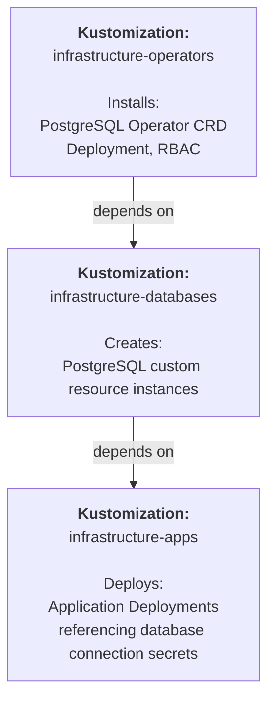

# Lesson 2: Flux as GitOps Reconciliation Engine

## 1. First-Principles Intuition & Invariants

At its conceptual foundation, Flux operates as a **level-triggered reconciliation engine** that continuously drives cluster state toward a desired configuration declared in Git repositories. Unlike imperative orchestration systems that execute sequences of commands and forget their history, Flux embodies the control theory principle of **continuous feedback loops**: it perpetually observes both the declared intent stored in version control and the actual runtime state of Kubernetes resources, computing the delta between them, and applying corrective actions until convergence is achieved. This architectural pattern eliminates configuration drift not through periodic enforcement sweeps but through **monotonic state advancement** governed by Git commit histories as the single source of truth.

The fundamental invariant underlying Flux's operation is that **Git commits represent immutable checkpoints of desired cluster state**, and every resource in the cluster must eventually reflect the configuration encoded at the current HEAD of its associated Git branch. This invariant transforms infrastructure management from an art of manual kubectl invocations and Helm chart installations into a discipline of version-controlled declarative manifests. When an engineer merges a pull request modifying a Deployment's replica count or updating a ConfigMap's data payload, Flux detects the new commit within its configured polling interval, fetches the updated manifests, and applies them to the cluster through the Kubernetes API server. The cluster's actual state then converges toward the new desired state through Kubernetes' own reconciliation controllers, while Flux ensures that no manual changes persist—if an operator directly edits a resource with kubectl, Flux will revert that change on its next reconciliation cycle, restoring the Git-declared configuration.

This operational model solves several classes of production failure modes endemic to traditional infrastructure management. Configuration drift, where production environments slowly diverge from their intended specifications through accumulated manual patches and emergency fixes, becomes mechanically impossible because Flux continuously resets state to match Git. Audit trails emerge automatically from Git history rather than requiring separate change management databases—every modification to cluster state has an associated commit, author, timestamp, and review process. Disaster recovery scenarios transform from complex runbook procedures into simple operations: provision a new cluster, point Flux at the same Git repository, and wait for convergence. The entire production state rebuilds itself from declarative manifests without requiring operators to remember arcane sequences of imperative commands or locate backup archives.

The architecture distinguishes between **source controllers** that interact with external systems to fetch declarative manifests and **reconciliation controllers** that apply those manifests to Kubernetes clusters. Source controllers manage authentication, polling intervals, and change detection for Git repositories, Helm repositories, S3 buckets, and OCI artifacts. When a source controller detects new content—a Git commit advancing HEAD, a Helm chart version increment, or an OCI image tag update—it downloads the artifacts and computes a cryptographic hash representing the new state. This hash becomes the **revision identifier** that propagates through Flux's internal event system, triggering downstream reconciliation controllers to fetch and apply the new manifests.

Reconciliation controllers implement Kubernetes' standard controller pattern: they watch custom resources in the cluster, compare observed state against desired state encoded in those resources' specs, and execute actions to eliminate discrepancies. Flux's primary reconciliation controller, the Kustomization controller, consumes GitRepository or Bucket sources, applies Kustomize transformations, generates plain Kubernetes manifests, and submits them to the API server using **server-side apply** semantics. Server-side apply, introduced in Kubernetes 1.16 and graduating to stable in 1.22, allows multiple controllers to collaboratively manage the same resource by tracking field ownership through metadata. When Flux applies a Deployment manifest, it declares ownership over the fields it explicitly sets—container image, replica count, environment variables—while leaving other fields like status and metadata annotations for other controllers or operators to manage. This ownership model prevents conflicts and enables compositional infrastructure patterns where multiple systems contribute to a resource's final state.

The reconciliation loop operates as a **bounded retry state machine** with exponential backoff. Each Kustomization resource specifies an interval parameter, typically ranging from one to ten minutes in production deployments, defining the maximum time between reconciliation attempts. When Flux successfully applies manifests and all resources reach their ready state, the controller sleeps for the configured interval before checking again. If reconciliation fails—perhaps due to a malformed YAML syntax error, a missing CustomResourceDefinition, or API server throttling—Flux enters exponential backoff, doubling the wait time between retries up to a maximum threshold. This backoff prevents cascading failures where a broken commit causes Flux to hammer the API server with repeated failed apply operations, exhausting rate limits and degrading cluster responsiveness.

Flux's dependency model allows operators to encode ordering constraints between resources and repositories. A Kustomization can declare dependencies on other Kustomizations, forcing Flux to wait until the dependency reaches a ready state before attempting to reconcile the dependent resource. This dependency graph solves the classic Kubernetes bootstrapping problem: how do you deploy an application that requires a CRD when both the CRD and the application manifests live in the same Git repository? Without dependencies, Flux might attempt to create the application's custom resources before the CRD exists, causing validation failures. With an explicit dependency declaration, the application Kustomization waits for the CRD-installing Kustomization to complete, ensuring proper ordering without manual coordination.

The system's **eventual consistency guarantee** derives from the combination of Kubernetes' level-triggered controllers and Flux's continuous reconciliation. Level-triggered control, as opposed to edge-triggered control, means that controllers base their actions solely on current observed state rather than state transitions. If a reconciliation attempt fails midway through applying a set of manifests—perhaps the network connection drops after creating a Namespace but before creating the Deployment within it—the next reconciliation cycle will observe the partial state and complete the missing operations. This idempotency property ensures that transient failures cannot leave the cluster in permanently inconsistent states. Eventually, given sufficient time and absence of persistent errors, the cluster will converge to match the Git-declared configuration.

Cryptographic verification forms a critical security invariant throughout Flux's operation. Git commits can be GPG-signed, and Flux validates signatures before applying any manifests from a signed repository. OCI artifacts and Helm charts can be signed with Sigstore Cosign signatures, and Flux's OCI and Helm controllers verify these signatures against configured public keys before extracting content. This chain of trust ensures that only authorized changes propagate to production clusters—an attacker who compromises a Git hosting service cannot inject malicious manifests into a Flux-managed cluster without access to the signing keys, and any tampering with artifacts in transit or at rest will be detected through signature verification failures.

The reconciliation engine's performance characteristics scale linearly with the number of GitRepository and Kustomization resources rather than with the number of Kubernetes resources they manage. A cluster might contain ten thousand Pods across hundreds of Deployments and StatefulSets, but if those resources are generated from a single Kustomization pointing at a single Git repository, Flux performs only one Git fetch operation and one apply operation per reconciliation cycle. This architecture allows Flux to manage massive clusters efficiently, provided that manifests are organized into reasonably sized repository structures rather than scattering thousands of individual files across hundreds of Git repositories.

## 2. Core Architecture & Mechanics

Flux's architecture decomposes into a collection of specialized controllers, each implementing a narrow interface and communicating through Kubernetes API resources. This microservices-style decomposition within a single control plane allows independent scaling, failure isolation, and pluggable extensibility. The primary controllers in a standard Flux installation include the **source-controller**, **kustomize-controller**, **helm-controller**, **notification-controller**, and **image-automation-controller**, each running as a separate Deployment in the `flux-system` namespace.

The source-controller serves as Flux's interface to external content sources. It implements reconciliation loops for four primary custom resource types: GitRepository, HelmRepository, HelmChart, and Bucket. When an operator creates a GitRepository resource specifying a URL, branch, and optional authentication credentials, the source-controller clones the repository to a local storage volume, computes a SHA-256 hash of the repository contents, and updates the GitRepository's status with the current revision identifier. This revision takes the form of `<branch>@sha1:<commit>`, providing an immutable reference to the exact Git state. The source-controller then exposes the repository contents through an internal HTTP artifact server, allowing other Flux controllers to download tarballs of the repository at specific revisions without needing Git client capabilities or authentication credentials.

```yaml
apiVersion: source.toolkit.fluxcd.io/v1
kind: GitRepository
metadata:
  name: infrastructure-repo
  namespace: flux-system
spec:
  interval: 5m0s
  url: https://github.com/example-org/infrastructure
  ref:
    branch: main
  secretRef:
    name: git-credentials
  ignore: |
    .git/
    .github/
    **/*.md
```

The interval field controls polling frequency—every five minutes, the source-controller fetches the remote branch HEAD and compares it against the last-known commit SHA. If the SHAs differ, a new revision is published and an event is emitted to the notification-controller, which can forward the event to external systems through webhooks or messaging platforms. The ignore field accepts gitignore-style patterns, allowing operators to exclude documentation files, CI configuration, or other non-manifest content from the artifact tarball, reducing storage consumption and transfer bandwidth.

For private repositories requiring authentication, the secretRef points to a Kubernetes Secret containing credentials. The source-controller supports multiple authentication schemes including HTTPS basic auth with username and password, HTTPS bearer token auth for Git hosting services like GitHub and GitLab, and SSH key-based auth with support for ED25519, RSA, and ECDSA keys. When using SSH authentication, the Secret's data must include both a private key (`identity`) and a `known_hosts` file to prevent man-in-the-middle attacks. The source-controller validates the server's SSH host key against the known_hosts entries before accepting the connection.

The artifact server component within the source-controller exposes repository contents at internal URLs following the pattern `http://source-controller.flux-system.svc.cluster.local./gitrepository/flux-system/infrastructure-repo/<revision>.tar.gz`. These URLs are signed with HMAC tokens to prevent unauthorized access—only controllers presenting valid tokens can download artifacts. The artifact storage layer uses a content-addressable storage design where each unique revision maps to a deduplicated tarball on disk, minimizing storage overhead when multiple GitRepository resources reference the same underlying Git repository at different branches or tags.

The kustomize-controller consumes GitRepository artifacts and applies them to the cluster using Kustomize transformations and server-side apply. A Kustomization resource specifies a source reference, a path within that source, optional dependencies on other Kustomizations, and configuration for pruning, health checking, and validation.

```yaml
apiVersion: kustomize.toolkit.fluxcd.io/v1
kind: Kustomization
metadata:
  name: infrastructure-apps
  namespace: flux-system
spec:
  interval: 10m0s
  sourceRef:
    kind: GitRepository
    name: infrastructure-repo
  path: ./apps/production
  prune: true
  wait: true
  timeout: 5m0s
  dependsOn:
    - name: infrastructure-crds
  patches:
    - patch: |
        apiVersion: apps/v1
        kind: Deployment
        metadata:
          name: backend-api
        spec:
          replicas: 5
      target:
        kind: Deployment
        name: backend-api
  postBuild:
    substitute:
      CLUSTER_NAME: prod-us-east-1
      ENVIRONMENT: production
    substituteFrom:
      - kind: ConfigMap
        name: cluster-config
```

When this Kustomization reconciles, the kustomize-controller downloads the artifact tarball from the source-controller, extracts the `./apps/production` directory, executes Kustomize build operations including any patches or transformations, and generates a list of plain Kubernetes manifests. The controller then performs server-side apply for each manifest, setting the field manager identifier to `kustomize-controller` to declare ownership. The `prune: true` setting instructs Flux to track all resources created by this Kustomization and delete any previously-managed resources that no longer appear in the manifest set—if a Deployment existed in the previous Git revision but was removed in the current revision, Flux will delete it from the cluster during reconciliation.

The `wait: true` parameter activates Flux's health assessment logic. After applying manifests, the kustomize-controller enters a polling loop, repeatedly checking the status of each created resource until all reach a healthy state or the timeout expires. For Deployments, health means all replicas are available and ready. For StatefulSets, health requires all replicas to be ready and the currentReplicas count to match the desired replicas count. For Jobs, health means successful completion with exit code zero. Custom resources can advertise their readiness through standard Kubernetes status conditions—if a CRD defines a `Ready` condition of type `boolean` and sets it to `True`, Flux considers that resource healthy. This blocking behavior ensures that dependent resources do not reconcile until their dependencies are fully operational, preventing race conditions and partial deployment states.

The dependency graph, expressed through the `dependsOn` field, allows sophisticated orchestration patterns. Consider a multi-tier application deployment where a database operator CRD must be installed before database instance custom resources can be created, and application Deployments must wait for the database to reach ready status before starting. This three-level dependency chain can be encoded as:



Flux evaluates the dependency graph topologically, reconciling resources in phases such that no Kustomization begins reconciliation until all its dependencies report ready status. If a dependency reconciliation fails or times out, dependent Kustomizations remain in a suspended state, preventing cascading failures from propagating through the deployment pipeline.

The postBuild substitution mechanism provides a template variable expansion capability, allowing operators to inject dynamic values into manifests without maintaining per-environment Git branches. Substitution variables follow the syntax `${VARIABLE_NAME}`, and Flux replaces them with values from the substitute map or from referenced ConfigMaps and Secrets. This feature enables patterns like maintaining a single set of base manifests and overlaying environment-specific values at reconciliation time:

```yaml
apiVersion: v1
kind: ConfigMap
metadata:
  name: app-config
  namespace: production
data:
  api_endpoint: https://api.${CLUSTER_NAME}.example.com
  log_level: info
  environment: ${ENVIRONMENT}
```

When Flux processes this manifest, it expands the variables based on the postBuild configuration, generating the final ConfigMap with concrete values. This approach reduces Git repository branching complexity while preserving auditability—the substitution values themselves are versioned in Git either as inline maps or as ConfigMap definitions.

The notification-controller implements an event routing and alerting system, consuming status change events from all Flux controllers and forwarding them to external receivers. It supports webhooks, Slack, Microsoft Teams, Discord, generic HTTP endpoints, and Git commit status updates for GitHub, GitLab, and Bitbucket. When a Kustomization transitions from reconciling to failed status, the notification-controller can post a message to a Slack channel with the error details and a link to the relevant Git commit. When a Kustomization completes a successful reconciliation after a previous failure, it can send a recovery notification. These events provide operational visibility into Flux's activities without requiring operators to poll the Kubernetes API or examine controller logs.

```yaml
apiVersion: notification.toolkit.fluxcd.io/v1beta3
kind: Alert
metadata:
  name: infrastructure-alert
  namespace: flux-system
spec:
  eventSeverity: error
  eventSources:
    - kind: GitRepository
      name: '*'
    - kind: Kustomization
      name: '*'
  providerRef:
    name: slack-webhook
---
apiVersion: notification.toolkit.fluxcd.io/v1beta3
kind: Provider
metadata:
  name: slack-webhook
  namespace: flux-system
spec:
  type: slack
  channel: infrastructure-alerts
  secretRef:
    name: slack-webhook-url
```

This configuration establishes a notification pipeline where any error-severity event from any GitRepository or Kustomization resource in the flux-system namespace triggers a Slack notification. The alert filtering logic supports severity levels (info, error), event metadata filters, and inclusion/exclusion rules, allowing fine-grained control over which events generate notifications.

The image-automation-controller extends Flux's capabilities beyond pure GitOps synchronization into **automated image updates**. While traditional GitOps requires manual Git commits to update container image tags in manifests, the image-automation-controller can monitor container registries for new image tags matching semantic version patterns or lexicographic ordering rules, automatically update manifests in Git repositories, and commit those changes. This automation closes the continuous deployment loop for containerized applications: a CI pipeline builds and pushes a new container image with a semantic version tag like `v1.4.2`, Flux detects the new tag, updates the Deployment manifest in Git from `v1.4.1` to `v1.4.2`, commits the change, and reconciles the updated Deployment to the cluster—all without human intervention.

```yaml
apiVersion: image.toolkit.fluxcd.io/v1beta2
kind: ImageRepository
metadata:
  name: backend-api-images
  namespace: flux-system
spec:
  image: registry.example.com/apps/backend-api
  interval: 5m0s
  secretRef:
    name: registry-credentials
---
apiVersion: image.toolkit.fluxcd.io/v1beta2
kind: ImagePolicy
metadata:
  name: backend-api-policy
  namespace: flux-system
spec:
  imageRepositoryRef:
    name: backend-api-images
  policy:
    semver:
      range: '>=1.0.0 <2.0.0'
---
apiVersion: image.toolkit.fluxcd.io/v1beta2
kind: ImageUpdateAutomation
metadata:
  name: infrastructure-automation
  namespace: flux-system
spec:
  interval: 10m0s
  sourceRef:
    kind: GitRepository
    name: infrastructure-repo
  git:
    checkout:
      ref:
        branch: main
    commit:
      author:
        email: fluxbot@example.com
        name: Flux Image Automation
      messageTemplate: |
        Automated image update
        
        [ci skip]
    push:
      branch: main
  update:
    path: ./apps/production
    strategy: Setters
```

The ImageRepository resource scans a container registry at regular intervals, listing all available tags. The ImagePolicy evaluates those tags against a semantic versioning range constraint, selecting the newest tag that satisfies the constraint. The ImageUpdateAutomation resource ties everything together: it clones the Git repository, searches for image references in manifests within the specified path, updates those references to the tag selected by the ImagePolicy, commits the changes with a descriptive message, and pushes the commit to the remote repository. Flux's kustomize-controller then detects the new commit through its normal polling mechanism and reconciles the updated manifests to the cluster.

The internal communication between controllers flows through Kubernetes API resources and events. When the source-controller updates a GitRepository's status with a new revision, it also emits a Kubernetes Event object referencing that GitRepository. The kustomize-controller watches both GitRepository resources and their associated Events, triggering immediate reconciliation when a new revision appears rather than waiting for the next scheduled interval. This event-driven architecture reduces the latency between a Git commit and cluster state update from the worst-case scenario of the polling interval duration to the sub-second range, provided that Events propagate quickly through the cluster's etcd and API server components.

The controllers' internal state management relies on Kubernetes' status subresource pattern. Each custom resource has a spec section containing desired configuration and a status section containing observed state and reconciliation metadata. The status includes fields like `observedGeneration` (the spec generation number that was last reconciled), `conditions` (an array of status condition objects with type, status, reason, and message), and `lastAppliedRevision` (the source revision that produced the current cluster state). This status metadata enables sophisticated orchestration: a monitoring system can query Kustomization resources and determine whether they are up-to-date by comparing `status.lastAppliedRevision` against the latest revision reported by their source repository, detecting configuration drift if the cluster state lags behind Git.

## 3. High-Performance Optimization & Failure Modes

Flux's operational performance hinges on the efficiency of its Git operations, artifact caching strategies, and Kubernetes API interaction patterns. In production clusters managing hundreds of Kustomization resources across dozens of GitRepository sources, optimization of these mechanics becomes critical to maintaining sub-minute reconciliation latencies and preventing API server rate limiting or etcd overload.

Git repository polling intervals directly trade off between update latency and network overhead. A five-minute interval means that a Git commit takes an average of 2.5 minutes to propagate to the cluster, assuming uniform distribution of commit times relative to polling cycles. Organizations requiring faster update propagation can reduce polling intervals to one minute or thirty seconds, but must account for the increased load on Git hosting services and potential rate limiting. GitHub, for example, enforces authenticated API rate limits of 5,000 requests per hour per token—at a thirty-second polling interval, a single GitRepository consumes 120 requests per hour, allowing approximately 40 GitRepository resources per token before hitting rate limits. Scaling beyond this threshold requires either multiple authentication tokens distributed across GitRepository resources through label-based credential selection, or implementing webhook-based Git event receivers that trigger immediate reconciliation without polling.

Flux supports webhook receivers through the notification-controller's Receiver resource, which exposes an HTTPS endpoint that Git hosting services can call when repository changes occur. Configuring a webhook eliminates polling latency entirely—commits trigger reconciliation within seconds—and removes the polling load from both Flux and the Git hosting service. The receiver validates webhook payloads using HMAC signatures to prevent spoofing and extracts branch or tag information to determine which GitRepository resources should reconcile. This architecture supports massive repository counts without scaling API rate limit concerns, as the webhook mechanism inverts the communication pattern from pull-based polling to push-based event delivery.

Artifact caching in the source-controller determines storage growth characteristics and fetch performance. By default, the source-controller retains the last two revisions of each artifact, allowing rollback scenarios where a new Git commit introduces a broken configuration and operators need to quickly revert to the previous working state. Increasing the retention count provides deeper rollback history at the cost of storage consumption—a repository producing 100 MB tarballs retained through ten revisions consumes 1 GB per GitRepository resource. In clusters managing hundreds of repositories, this storage can scale to tens or hundreds of gigabytes. The source-controller's artifact storage volume should be provisioned with sufficient capacity and preferably backed by SSD storage to minimize tarball extraction latency during reconciliation.

Artifact compression reduces both storage overhead and network transfer time. The source-controller compresses artifact tarballs using gzip at compression level 6 by default, balancing compression ratio against CPU overhead. Manifests containing substantial YAML repetition, such as large ConfigMap data sections or many similar resource definitions, compress efficiently—achieving 5:1 or 10:1 compression ratios—while manifests with unique string content compress less effectively. Operators managing repositories with large binary assets or already-compressed content (container images, gzip archives, compiled binaries) should consider using the Bucket source type with external object storage rather than Git repositories, as Git's internal object storage and transfer protocols do not handle binary deltas efficiently.

Kustomize build performance scales with manifest complexity and the number of transformations applied. A Kustomization processing a directory with ten YAML files containing basic Deployment and Service definitions completes build operations in milliseconds, while a Kustomization applying dozens of strategic merge patches, JSON patches, and post-build substitutions across hundreds of files can require several seconds of CPU time. This build latency occurs within the kustomize-controller's reconciliation loop, delaying server-side apply operations. Profiling large Kustomization resources with the `flux trace` command reveals bottlenecks—often caused by excessive patch operations or complex templating logic—that can be optimized through restructuring manifest organization or precomputing transformations in CI pipelines.

Server-side apply batch sizes influence API server load and reconciliation latency. By default, Flux applies resources serially, submitting one API request per manifest. For Kustomizations managing hundreds of resources, this serial application can extend reconciliation duration to tens of seconds. The `spec.wait: false` setting disables health checking, allowing Flux to fire-and-forget all apply operations without blocking on resource ready status, reducing reconciliation time at the cost of visibility into deployment health. For scenarios requiring health checking, optimizing manifest ordering to place fast-starting resources (Namespaces, ConfigMaps, Secrets) before slow-starting resources (StatefulSets, complex Operators) minimizes the time spent in the health polling loop.

Dependency graph optimization prevents unnecessary reconciliation cascades. If a leaf-level Kustomization depends on a root-level Kustomization that reconciles infrequently, setting appropriate intervals prevents wasted work. A common anti-pattern involves setting all Kustomizations to the same short interval regardless of their update frequency—a CRD installation Kustomization that references a stable Git tag does not need to reconcile every minute, while an application Kustomization tracking a rapidly-evolving feature branch benefits from frequent reconciliation. Aligning intervals with actual change frequency reduces CPU consumption, API server load, and etcd write amplification.

Reconciliation failure modes require careful attention to prevent operational disruptions. When a GitRepository becomes unreachable due to network partitions, authentication failures, or hosting service outages, the source-controller enters exponential backoff, eventually polling only every few minutes. During this degraded state, Flux continues managing cluster resources based on the last successfully-fetched revision, maintaining configuration stability even as Git access fails. When connectivity restores, the source-controller immediately fetches the latest revision and triggers reconciliation, catching up any missed commits. This behavior provides **graceful degradation**—temporary Git hosting outages do not break running workloads or require manual intervention.

When a Kustomization references a source that produces invalid or malformed manifests, Flux's behavior depends on the validation stage at which the error occurs. Syntax errors in YAML, such as incorrect indentation or invalid UTF-8 sequences, cause Kustomize build failures before any API server interaction. These failures surface in the Kustomization's status conditions with detailed error messages pointing to the problematic file and line number. Semantic errors, such as referencing a nonexistent CustomResourceDefinition or violating a webhook admission rule, cause server-side apply failures after build operations succeed. These failures also surface in status conditions but require inspecting the API server's admission chain to diagnose root causes. Flux's retry logic ensures that once the underlying issue is corrected in Git, the next reconciliation cycle will succeed without requiring operator intervention.

Resource drift detection and remediation forms a critical operational capability. If an operator directly modifies a Deployment's replica count using kubectl, Flux's next reconciliation cycle will detect the deviation by comparing the server-side field manager metadata against the manifest content. Because Flux owns the `spec.replicas` field through its server-side apply operations, it will forcibly overwrite the operator's manual change, restoring the Git-declared value. This enforcement prevents configuration drift but can surprise operators unfamiliar with GitOps principles. Organizations adopting Flux must establish cultural norms around Git-first workflows, treating direct kubectl modifications as temporary debugging actions that will be automatically reverted rather than as permanent configuration changes.

For scenarios where certain resources should allow manual field modifications while still maintaining GitOps for other fields, Flux's server-side apply integration enables field-level granularity. An operator could manually manage a Deployment's `spec.replicas` field for immediate scaling response during incident mitigation, while Flux continues managing the container image, environment variables, and resource limits declared in Git. Achieving this split ownership requires careful coordination of field manager names and may involve configuring webhook mutators or policy engines to claim ownership of specific fields, preventing Flux from overwriting them. This pattern trades the purity of Git-as-single-source-of-truth for operational flexibility, and should be applied judiciously based on specific organizational requirements.

Suspended reconciliation provides an emergency brake for halting Flux operations without uninstalling the controllers or deleting resources. Setting a Kustomization's `spec.suspend: true` instructs Flux to stop reconciling that resource while preserving all existing cluster objects. This capability proves essential during critical incidents where automatic remediation might worsen the situation—if a buggy manifest causes a cascading failure and needs immediate investigation before any further changes propagate, suspending the responsible Kustomization freezes the state while engineers diagnose and fix the underlying issue. Resuming reconciliation simply requires setting `spec.suspend: false`, at which point Flux catches up any missed Git commits and restores normal operation.

Multi-tenancy patterns in Flux-managed clusters require careful attention to RBAC boundaries and source isolation. In a shared cluster serving multiple application teams, each team should manage their own GitRepository and Kustomization resources within their dedicated namespace, with RBAC policies preventing cross-namespace access. Flux's controllers run with cluster-admin privileges by default to support unrestricted resource management, but this privilege elevation creates security considerations—a compromised GitRepository could inject malicious manifests with cluster-scoped impact. Organizations implementing strict multi-tenancy should consider running separate Flux installations per tenant, each with RBAC-constrained service accounts that can only manage resources within their assigned namespaces, or deploying Kubernetes admission controllers that validate all Flux-applied manifests against organization policies before allowing them to persist in the cluster.

Observability of Flux operations extends beyond the notification-controller's alerting capabilities into metrics, traces, and structured logging. Flux controllers expose Prometheus metrics at `/metrics` endpoints, providing time-series data on reconciliation durations, error rates, and queue depths. A Prometheus query like `rate(gotk_reconcile_duration_seconds_sum{kind="Kustomization"}[5m])` reveals the average time spent reconciling Kustomization resources over the past five minutes, enabling capacity planning and performance regression detection. Flux also emits OpenTelemetry traces when configured with an OTLP exporter, allowing distributed tracing of reconciliation operations across controller boundaries—a single Git commit's propagation through source-controller artifact creation, kustomize-controller manifest application, and notification-controller event delivery can be visualized as a unified trace span hierarchy.

Disaster recovery and backup strategies for Flux-managed clusters focus on Git repository integrity rather than cluster state snapshots. Since Flux continuously rebuilds cluster state from Git, recovering from cluster loss scenarios reduces to provisioning new infrastructure, installing Flux, and pointing it at the existing Git repositories. No separate backup of Kubernetes resources or etcd snapshots is strictly necessary, provided that Git repositories remain intact and accessible. This architectural property dramatically simplifies disaster recovery compared to traditional stateful infrastructure—the recovery time objective becomes dominated by cluster provisioning time rather than data restoration time, often reducing hours-long recovery procedures to minutes. Organizations should ensure that Git hosting services themselves have robust backup and replication strategies, and consider maintaining mirror repositories in geographically distributed locations to guard against hosting service failures or regional outages.
