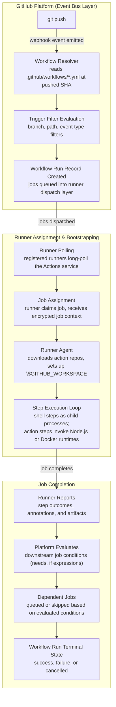
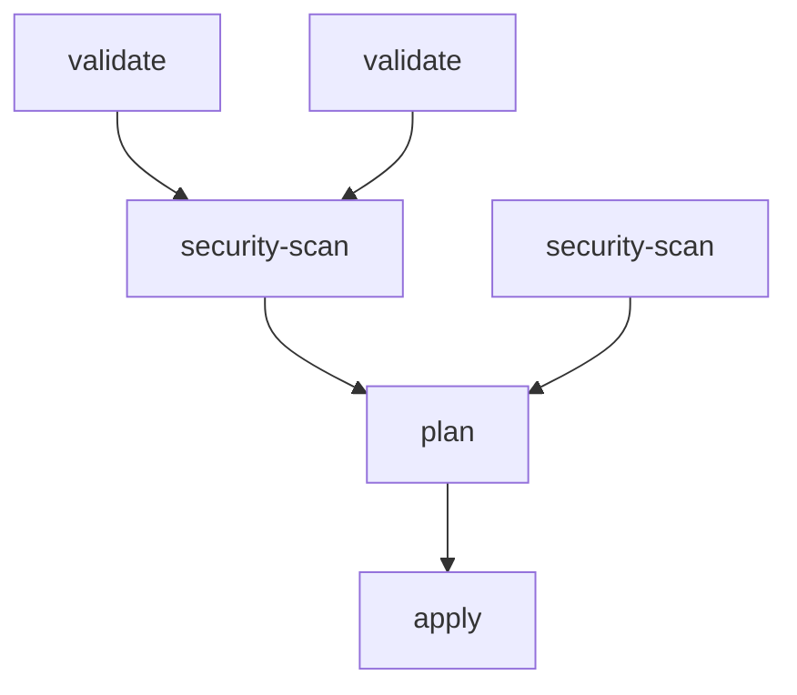

# Lesson 1: Workflow Architecture and Execution Model

## 1. First-Principles Intuition & Invariants

Every continuous integration and delivery system is, at its core, a reactive state machine: it sleeps until an event disturbs the system, then it transitions through a defined sequence of states to produce a deterministic outcome. GitHub Actions is no different in principle, but it is worth examining precisely what it means to build a CI/CD platform on top of a distributed event bus backed by a globally replicated version-control system. The decisions GitHub made about where to place the execution boundary, how to model parallelism, and how to express conditional logic are not arbitrary design choices—they reflect deep tradeoffs between reproducibility, throughput, and operational simplicity that systems engineers should understand mechanically before writing a single workflow file.

The foundational invariant of GitHub Actions is that a workflow is a pure function of a repository event and a ref. Given the same event payload and the same commit SHA, a correctly written workflow must produce the same observable behavior. This reproducibility guarantee is the reason the platform anchors every workflow execution to a specific commit: the workflow YAML file itself is read from the commit being processed, not from HEAD or from some mutable runtime configuration store. The practical consequence is that a push to a feature branch runs the workflow definition committed to that branch, not the definition on `main`. This is not a quirk—it is the enforcement of hermetic execution at the platform level, analogous to how a build system like Bazel identifies inputs by content hash rather than by mutable file path.

Understanding this requires thinking about GitHub's internal event delivery model. When a user pushes commits, opens a pull request, or manually triggers a workflow, GitHub's platform emits a webhook event into an internal routing layer. That event carries a JSON payload conforming to a documented schema—different schemas for `push`, `pull_request`, `workflow_dispatch`, `schedule`, `release`, and dozens of other event types. The routing layer inspects the repository's `.github/workflows/` directory at the event's target ref and materializes a set of workflow runs, one for each YAML file whose `on:` stanza matches the event. This materialization is not lazy: GitHub reads and parses those files synchronously during event processing, which means a syntax error in a workflow file manifests immediately as a run that fails to start rather than as a silent no-op.

The execution model partitions work across three distinct levels of granularity: the workflow, the job, and the step. A workflow is the top-level unit of configuration and corresponds to a single YAML file. A job is an independent unit of execution assigned to a runner—it carries its own environment, working directory, and filesystem namespace. A step is an atomic unit of work within a job: either a shell command or a reusable action invocation. This three-level hierarchy is not merely organizational. It maps directly to the platform's parallelism and isolation model. Jobs within the same workflow run concurrently by default on separate machines; steps within the same job run sequentially on the same machine, sharing filesystem state and environment variables. The boundary between jobs is a network boundary. The boundary between steps is a process boundary on a shared filesystem. Systems engineers should internalize this distinction immediately, because nearly every mistake in workflow design—from accidentally sharing state between jobs to redundantly downloading dependencies in every job—traces back to a misunderstanding of where these boundaries sit.

The `on:` key is the entry point to the platform's event subscription system, and it is considerably more expressive than it appears at first glance. It accepts a map from event type names to filter objects. For `push` and `pull_request`, those filters can include branch glob patterns, tag patterns, and path filters, all of which are evaluated server-side before a runner is ever allocated. A path filter like `paths: ['infra/**']` means that a push touching only application source files will not trigger the infrastructure workflow at all—the platform discards the event before queuing any work. This server-side filtering is a critical performance invariant: it keeps runner queues from flooding with irrelevant work, which matters enormously in a monorepo where dozens of workflows coexist and a single commit can touch files across multiple domains.

The `workflow_dispatch` event deserves particular attention for infrastructure engineers because it bridges the gap between event-driven automation and imperative operational control. A workflow with a `workflow_dispatch` trigger can expose typed input parameters—strings, booleans, choices, environments—that appear as form fields in the GitHub UI and as named keys in the `github.event.inputs` context. This makes it the correct mechanism for parameterized operational runbooks: manual infrastructure provisioning, database migrations, and emergency rollbacks. The alternative—using repository `workflow_dispatch` APIs from scripts—means you can call these workflows from other automation contexts while retaining the same YAML definition, the same audit trail in the Actions tab, and the same access control surface as any other workflow.

---

## 2. Core Architecture & Mechanics

### The Workflow Execution Lifecycle

To reason precisely about what happens between a git push and a completed job, it helps to trace the execution lifecycle end-to-end through GitHub's platform, the runner agent, and the host operating system.



The runner agent is a .NET process (open-sourced at `actions/runner`) that runs on the host machine and maintains a long-poll connection to GitHub's broker service. When a job becomes available, the broker assigns it to an idle runner by pushing a job execution payload over that connection. This payload includes the workflow definition fragment for that specific job, the encrypted values of all referenced secrets, the runtime context (repository metadata, event payload, ref information), and a short-lived GITHUB_TOKEN scoped to the specific run. The token's scope is not the user's personal access token—it is a machine credential issued by GitHub's internal OAuth infrastructure with permissions derived from the workflow's `permissions:` stanza and the repository's Actions settings.

The runner agent then materializes the job's working environment. For GitHub-hosted runners, this means a fresh virtual machine provisioned from a snapshot image (Ubuntu, Windows, or macOS), which provides strong isolation between runs but imposes a cold-start cost. For self-hosted runners on bare metal or Kubernetes pods, the working directory is cleaned between runs but the underlying filesystem persists, which makes caching strategies both more effective and more dangerous—a corrupted cache directory on a self-hosted runner poisons every subsequent run on that host until the directory is manually purged.

### Workflow Syntax as a Declarative State Machine

The YAML schema for a workflow is best understood as a declarative specification of a directed acyclic graph (DAG) of jobs with annotated edges. Consider this complete, production-grade workflow for validating and applying Terraform infrastructure changes:

```yaml
name: Infrastructure Validation and Deployment

on:
  push:
    branches:
      - main
    paths:
      - 'infra/terraform/**'
      - '.github/workflows/infra-deploy.yml'
  pull_request:
    branches:
      - main
    paths:
      - 'infra/terraform/**'
  workflow_dispatch:
    inputs:
      environment:
        description: 'Target deployment environment'
        type: choice
        options:
          - staging
          - production
        required: true
      apply:
        description: 'Execute terraform apply after plan'
        type: boolean
        default: false

permissions:
  id-token: write
  contents: read
  pull-requests: write

concurrency:
  group: infra-deploy-${{ github.ref }}
  cancel-in-progress: false

env:
  TF_VERSION: '1.8.3'
  AWS_REGION: 'us-east-1'
  TF_WORKING_DIR: './infra/terraform'

jobs:
  validate:
    name: Terraform Validate and Lint
    runs-on: ubuntu-24.04
    outputs:
      tf_changed: ${{ steps.changes.outputs.terraform }}
    steps:
      - name: Checkout repository
        uses: actions/checkout@v4
        with:
          fetch-depth: 0

      - name: Detect Terraform file changes
        id: changes
        uses: dorny/paths-filter@v3
        with:
          filters: |
            terraform:
              - 'infra/terraform/**'

      - name: Setup Terraform
        uses: hashicorp/setup-terraform@v3
        with:
          terraform_version: ${{ env.TF_VERSION }}
          terraform_wrapper: true

      - name: Terraform Format Check
        working-directory: ${{ env.TF_WORKING_DIR }}
        run: terraform fmt -check -recursive -diff

      - name: Terraform Init
        working-directory: ${{ env.TF_WORKING_DIR }}
        run: |
          terraform init \
            -backend=false \
            -input=false

      - name: Terraform Validate
        working-directory: ${{ env.TF_WORKING_DIR }}
        run: terraform validate -no-color

      - name: Run tflint
        uses: terraform-linters/setup-tflint@v4
        with:
          tflint_version: v0.51.0

      - name: TFLint Init
        working-directory: ${{ env.TF_WORKING_DIR }}
        run: tflint --init

      - name: TFLint Run
        working-directory: ${{ env.TF_WORKING_DIR }}
        run: tflint --format compact --no-color

  security-scan:
    name: Static Security Analysis
    runs-on: ubuntu-24.04
    needs: validate
    steps:
      - name: Checkout repository
        uses: actions/checkout@v4

      - name: Run Checkov
        uses: bridgecrewio/checkov-action@v12
        with:
          directory: ${{ env.TF_WORKING_DIR }}
          framework: terraform
          output_format: cli,sarif
          output_file_path: console,checkov-results.sarif
          soft_fail: false

      - name: Upload SARIF results
        uses: github/codeql-action/upload-sarif@v3
        if: always()
        with:
          sarif_file: checkov-results.sarif
          category: checkov-iac

  plan:
    name: Terraform Plan
    runs-on: ubuntu-24.04
    needs: [validate, security-scan]
    environment: ${{ github.event.inputs.environment || 'staging' }}
    outputs:
      plan_exitcode: ${{ steps.plan.outputs.exitcode }}
    steps:
      - name: Checkout repository
        uses: actions/checkout@v4

      - name: Configure AWS credentials via OIDC
        uses: aws-actions/configure-aws-credentials@v4
        with:
          role-to-assume: ${{ secrets.AWS_DEPLOY_ROLE_ARN }}
          role-session-name: GitHubActions-${{ github.run_id }}
          aws-region: ${{ env.AWS_REGION }}

      - name: Setup Terraform
        uses: hashicorp/setup-terraform@v3
        with:
          terraform_version: ${{ env.TF_VERSION }}
          terraform_wrapper: true

      - name: Terraform Init with backend
        working-directory: ${{ env.TF_WORKING_DIR }}
        run: |
          terraform init \
            -input=false \
            -backend-config="bucket=${{ secrets.TF_STATE_BUCKET }}" \
            -backend-config="key=infra/${{ github.event.inputs.environment || 'staging' }}/terraform.tfstate" \
            -backend-config="region=${{ env.AWS_REGION }}" \
            -backend-config="dynamodb_table=${{ secrets.TF_LOCK_TABLE }}"

      - name: Terraform Plan
        id: plan
        working-directory: ${{ env.TF_WORKING_DIR }}
        run: |
          terraform plan \
            -input=false \
            -no-color \
            -detailed-exitcode \
            -out=tfplan \
            -var="environment=${{ github.event.inputs.environment || 'staging' }}"
        continue-on-error: true

      - name: Upload plan artifact
        uses: actions/upload-artifact@v4
        with:
          name: tfplan-${{ github.run_id }}
          path: ${{ env.TF_WORKING_DIR }}/tfplan
          retention-days: 5

      - name: Post plan summary to PR
        uses: actions/github-script@v7
        if: github.event_name == 'pull_request'
        with:
          script: |
            const output = `#### Terraform Plan \`${{ steps.plan.outputs.exitcode }}\`
            <details><summary>Show Plan</summary>

            \`\`\`terraform
            ${{ steps.plan.outputs.stdout }}
            \`\`\`

            </details>

            *Triggered by: @${{ github.actor }}, Action: \`${{ github.event_name }}\`*`;

            github.rest.issues.createComment({
              issue_number: context.issue.number,
              owner: context.repo.owner,
              repo: context.repo.repo,
              body: output
            });

      - name: Fail on plan error
        if: steps.plan.outputs.exitcode == '1'
        run: exit 1

  apply:
    name: Terraform Apply
    runs-on: ubuntu-24.04
    needs: plan
    if: |
      github.event_name == 'workflow_dispatch' &&
      github.event.inputs.apply == 'true' &&
      needs.plan.outputs.plan_exitcode == '2'
    environment:
      name: ${{ github.event.inputs.environment }}
      url: https://console.aws.amazon.com/
    steps:
      - name: Checkout repository
        uses: actions/checkout@v4

      - name: Configure AWS credentials via OIDC
        uses: aws-actions/configure-aws-credentials@v4
        with:
          role-to-assume: ${{ secrets.AWS_DEPLOY_ROLE_ARN }}
          role-session-name: GitHubActions-Apply-${{ github.run_id }}
          aws-region: ${{ env.AWS_REGION }}

      - name: Setup Terraform
        uses: hashicorp/setup-terraform@v3
        with:
          terraform_version: ${{ env.TF_VERSION }}
          terraform_wrapper: true

      - name: Download plan artifact
        uses: actions/download-artifact@v4
        with:
          name: tfplan-${{ github.run_id }}
          path: ${{ env.TF_WORKING_DIR }}

      - name: Terraform Init with backend
        working-directory: ${{ env.TF_WORKING_DIR }}
        run: |
          terraform init \
            -input=false \
            -backend-config="bucket=${{ secrets.TF_STATE_BUCKET }}" \
            -backend-config="key=infra/${{ github.event.inputs.environment }}/terraform.tfstate" \
            -backend-config="region=${{ env.AWS_REGION }}" \
            -backend-config="dynamodb_table=${{ secrets.TF_LOCK_TABLE }}"

      - name: Terraform Apply
        working-directory: ${{ env.TF_WORKING_DIR }}
        run: |
          terraform apply \
            -input=false \
            -no-color \
            tfplan
```

This workflow is worth dissecting precisely because every structural decision it makes reflects a deliberate mapping from infrastructure engineering requirements to platform mechanics.

### The Job Dependency Graph

The `needs:` key is how GitHub Actions encodes the edges in the job DAG. Its semantics are precise: a job listed in `needs:` will not start until all listed dependencies have reached a terminal state. By default, the terminal state required is `success`. If any dependency finishes with `failure` or `cancelled`, the dependent job is skipped rather than run—a behavior that propagates downstream through the DAG via transitive dependency resolution. The platform evaluates the entire DAG at workflow start time and determines the full execution order before any runner is assigned.



The `plan` job declares `needs: [validate, security-scan]`, which means GitHub computes a fan-in join: both upstream jobs must succeed before `plan` is dispatched to a runner. This is the platform's native expression of a parallel-then-synchronize pattern. The `validate` and `security-scan` jobs run concurrently on separate runners, and GitHub holds the `plan` job in a pending state, consuming no runner resources, until both complete.

The `outputs:` mechanism on jobs enables data to flow across the DAG's edges without shared filesystem state—which does not exist between jobs, since each runs on a different machine. A job step writes an output by appending `key=value` to the file path stored in the `GITHUB_OUTPUT` environment variable. The runner collects all such outputs at job completion and stores them in the platform's run metadata. Downstream jobs access them via `needs.<job_id>.outputs.<output_name>`. The `plan_exitcode` output in the workflow above carries the semantic meaning of Terraform's three-way exit code: `0` means no changes needed, `1` means an error occurred, `2` means changes are pending. The `apply` job's `if:` condition checks this value explicitly, which prevents an apply from proceeding if the plan produced no diff—a silent correctness guard that most hand-rolled CI scripts omit.

### Context Objects and Expression Evaluation

GitHub Actions expressions—the `${{ }}` syntax—are evaluated by the platform's expression engine before the workflow YAML is dispatched to a runner. This evaluation happens at job queuing time, not at step execution time. The practical implication is that an `if:` condition on a job is evaluated by the platform's scheduling layer, not by the runner agent. A condition that references `needs.<job>.outputs.<key>` is evaluated after the upstream job completes and before the downstream job is queued.

The expression language has access to a set of context objects that serialize the execution environment's state into addressable JSON trees:

- `github` — the event payload, repository metadata, the triggering actor, the ref, and the SHA. This is the richest context object: `github.event` is the full webhook payload, so `github.event.pull_request.base.ref` is the branch being targeted in a pull request event.
- `env` — workflow-level and job-level environment variables.
- `secrets` — encrypted secret values, which are masked in log output by the runner agent.
- `vars` — plaintext repository and environment variables (non-sensitive configuration).
- `needs` — the status and outputs of upstream jobs, available only in jobs that declare a `needs:` relationship.
- `steps` — the status, outputs, and exit codes of previously completed steps within the current job.
- `runner` — the runner's operating system, architecture, and temporary directory path.
- `inputs` — the values of `workflow_dispatch` or `workflow_call` inputs.

The `if:` conditional on the `apply` job combines three independent conditions with boolean `&&`. The expression engine short-circuits on false, but all three conditions must evaluate to true for the job to proceed: the trigger must be a manual dispatch (not a push or pull request), the user must have explicitly set the `apply` input to `true`, and the upstream plan must have produced a pending changeset. This is a three-factor gate that prevents any single accidental condition from triggering a production infrastructure change.

### Concurrency Groups and Serialization

The `concurrency:` block at the top of this workflow solves a class of race condition that is easy to overlook until it causes a corrupted state file in production. Without concurrency control, two simultaneous pushes to `main`—or a push that arrives while a manually triggered apply is in progress—will dispatch two workflow runs that both attempt to operate on the same Terraform state. The `group:` key assigns a logical identifier to this workflow's runs, scoped to the git ref: all runs of `infra-deploy-${{ github.ref }}` on the `main` branch share the same concurrency group. GitHub's platform enforces that at most one run in a concurrency group executes at a time; additional runs are queued.

The `cancel-in-progress: false` setting is deliberate and meaningful. For a plan-and-apply workflow, cancelling an in-progress apply because a newer commit arrived would be catastrophic—Terraform holds a DynamoDB state lock during apply, and an interrupted apply can leave infrastructure in a partially converged state. The correct behavior is to queue the new run and let the in-progress apply complete. For a pure validation workflow that doesn't mutate infrastructure, `cancel-in-progress: true` is the right choice because it reclaims runner capacity immediately and ensures that only the latest commit's validation result matters.

### OIDC-Based Cloud Authentication

The authentication pattern used in the `plan` and `apply` jobs—`aws-actions/configure-aws-credentials` with `role-to-assume`—is worth examining mechanically because it represents the state of the art for secretless cloud access from CI runners, and because it rests on a specific interaction between GitHub's OIDC token service and AWS's identity federation layer.

GitHub Actions maintains an OIDC provider that issues short-lived JSON Web Tokens to workflow runs. When a job requests an OIDC token (which requires the `id-token: write` permission in the workflow's `permissions:` stanza), GitHub's token service issues a JWT whose claims include the repository name, the workflow ref, the environment name, and the triggering event type. These claims are cryptographically bound to GitHub's public key, which AWS validates via GitHub's OIDC discovery endpoint at `https://token.actions.githubusercontent.com/.well-known/openid-configuration`.

The AWS IAM role's trust policy is configured to permit assumption only when the OIDC token's `sub` claim matches a specific pattern—for example, `repo:myorg/infra:environment:production`. This means the role cannot be assumed by any other GitHub repository, any other environment, or any workflow run that lacks the `id-token: write` permission. No static credentials ever appear in the repository's secret store. The access key is never written to disk or transmitted over the network in plaintext. The session duration is bounded to the job's lifetime. This is a meaningfully stronger security posture than storing `AWS_ACCESS_KEY_ID` and `AWS_SECRET_ACCESS_KEY` as repository secrets, which are static credentials that persist until manually rotated.

---

## 3. High-Performance Optimization & Failure Modes

### Cache Architecture and Dependency Restoration

The single largest source of unnecessary latency in infrastructure workflows is redundant tool installation. Every job that initializes Terraform, downloads provider plugins, or installs linting tools from scratch adds two to four minutes of cold-start overhead that contributes nothing to the correctness of the pipeline. GitHub Actions provides a first-party cache mechanism built on a content-addressed object store keyed by an arbitrary string. The correctness contract is simple: a cache hit restores the archived directory to the specified path before any step runs; a cache miss falls through transparently, allowing the subsequent steps to populate the directory, after which the runner archives it at job completion.

The critical design decision is cache key composition. A key that is too coarse—for example, keyed only on the operating system—means that a change to `versions.tf` does not invalidate the provider cache, and jobs run with stale providers. A key that is too fine—for example, including the full git SHA—means every commit starts with a cache miss, which defeats the purpose entirely. The correct strategy for Terraform provider caching is to hash the lockfile:

```yaml
- name: Cache Terraform providers
  uses: actions/cache@v4
  with:
    path: |
      ${{ env.TF_WORKING_DIR }}/.terraform
      ~/.terraform.d/plugin-cache
    key: terraform-${{ runner.os }}-${{ hashFiles('infra/terraform/.terraform.lock.hcl') }}
    restore-keys: |
      terraform-${{ runner.os }}-
```

The `hashFiles()` function is evaluated by the runner at step execution time and produces a SHA-256 of the matched file's contents. When `.terraform.lock.hcl` changes—because a provider version was updated—the primary key misses and the runner falls back to the `restore-keys` prefix match, which finds the most recent cache entry for the same OS. The partially restored cache still contains the previous providers, so `terraform init` only downloads the new or changed providers rather than the full set. The `restore-keys:` fallback chain is an underused feature that approximates LRU cache semantics at the platform level.

### Artifact Passing Between Jobs

The plan artifact—the binary `tfplan` file—must be passed from the `plan` job to the `apply` job because those jobs run on separate machines with no shared filesystem. The `actions/upload-artifact` and `actions/download-artifact` actions implement this by storing the file in GitHub's artifact store (backed by Azure Blob Storage) and retrieving it by run-scoped name. The `retention-days: 5` setting limits storage costs, but the more important implication is that plan artifacts should never be retained indefinitely: a Terraform plan is computed against a specific state snapshot, and applying a stale plan against a state that has since diverged will produce incorrect results or outright errors.

A more robust pattern for large infrastructure teams is to sign the plan artifact with a workflow-specific HMAC derived from the run ID and a repository secret, then verify that signature in the apply job before proceeding. This prevents an attacker who has gained write access to the artifact store from substituting a malicious plan file. The plan file is a serialized representation of infrastructure mutations; treating it as a trusted artifact without verification is an operational security gap that the standard Actions documentation does not address.

### Conditional Job Execution and the Skip vs. Fail Distinction

The `if:` expression on the `apply` job uses `needs.plan.outputs.plan_exitcode == '2'`. Note that the comparison is against the string `'2'`, not the integer `2`. GitHub Actions expressions do not perform implicit numeric coercion: job outputs are always strings, because they are serialized through environment variables, which have no native type system. Comparing against an unquoted `2` will silently evaluate to `false` in most expression contexts, causing the apply job to be skipped without error. This is one of the most common type-confusion bugs in production Actions workflows, and it fails silently rather than loudly.

The distinction between a job that is skipped and a job that fails carries significant operational weight. A skipped job propagates `skipped` status through the DAG, and downstream jobs that specify `needs:` on a skipped job will also be skipped by default. A failed job propagates `failure`, which blocks all downstream dependents and marks the workflow run as failed. Infrastructure engineers who want an apply to be optional (for validation-only pull request runs) but required when triggered manually must express this explicitly:

```yaml
apply:
  needs: plan
  if: |
    always() &&
    needs.plan.result == 'success' &&
    github.event_name == 'workflow_dispatch' &&
    github.event.inputs.apply == 'true'
```

The `always()` function overrides the default behavior where a job is automatically skipped if any upstream job failed or was skipped. By calling `always()` and then explicitly checking `needs.plan.result == 'success'`, the job takes full responsibility for its own precondition evaluation. This pattern is particularly important in notification or cleanup jobs that must run regardless of upstream outcomes.

### Runner Sizing and Self-Hosted Runner Architecture

GitHub-hosted runners are fixed at 2 vCPUs and 7 GB of RAM for Linux (as of the current runner image specification). For workflows that invoke `terraform plan` against large state files with hundreds of resources, or that run parallel test suites with significant memory footprints, this is frequently a constraint. GitHub offers larger runners (up to 64 vCPUs for Linux) under their Teams and Enterprise plans, but the more scalable approach for infrastructure teams is a self-hosted runner fleet on Kubernetes using the `actions-runner-controller` (ARC) operator.

ARC manages a custom resource called `RunnerDeployment` or `AutoscalingRunnerSet` that provisions runner pods on demand, scales to zero between workloads, and can be assigned node affinities that place runners on specific instance types with local NVMe storage, high-memory configurations, or GPU capacity. Each runner pod is ephemeral: it registers with GitHub, accepts exactly one job, and then terminates. This one-job-per-pod model provides the same isolation guarantee as GitHub-hosted runners while enabling the caching and tool installation optimizations that benefit from persistent node-level storage (via mounted `emptyDir` volumes cached to node local storage, or via persistent volume claims shared across the pod's lifecycle).

The runner registration security model in a self-hosted context requires care. Runners authenticate to GitHub using a repository-scoped or organization-scoped registration token, which must be rotated and stored in a Kubernetes secret. The ARC operator handles this rotation automatically when configured with a GitHub App credential rather than a personal access token—a strongly preferred configuration because GitHub App credentials have fine-grained permissions, never expire implicitly, and produce audit log events tied to the application identity rather than a human user account.

### Workflow Failure Modes in Production

Several failure patterns appear reliably across large-scale infrastructure workflow deployments. The first is secret rotation lag: a workflow that embeds a cloud credential as a repository secret will fail silently during authentication if the credential is rotated in the cloud provider without updating the secret. The error message—an HTTP 403 from the cloud API—appears in a step log deep in the run, not at the workflow level. OIDC-based authentication eliminates this class of failure entirely because there are no static credentials to rotate.

The second is DAG deadlock through mutual `needs:` declarations. GitHub Actions detects circular dependencies at workflow parse time and fails the run immediately with a schema validation error, so true deadlock is impossible. However, it is possible to construct a DAG where every job is blocked on a job that is waiting for an environment protection rule approval, causing the run to hang until it reaches the workflow-level timeout (default 6 hours). Infrastructure teams should set explicit `timeout-minutes:` on jobs that interact with approval-gated environments and handle the timeout with a notification step using `if: always()`.

The third is cache poisoning on self-hosted runners that share a cache directory across concurrent workflow runs. The `actions/cache` action uses a lockfile to prevent simultaneous writes, but if a runner process is forcibly terminated during a cache save operation—by a node eviction or an OOM kill—the partially written cache archive can corrupt subsequent cache reads. The mitigation is to use cache keys that include a hash of the content being cached, so a corrupt entry will never match a future key, and to configure the runner pod with a resource limit that prevents OOM kills from occurring silently.

The fourth is expression injection via untrusted event data. The `github.event.pull_request.title` and `github.event.head_commit.message` fields contain user-supplied strings. If a workflow interpolates these values directly into a `run:` step, an attacker who controls the PR title can inject arbitrary shell commands:

```yaml
# DANGEROUS: direct interpolation of untrusted input
- run: echo "Processing PR: ${{ github.event.pull_request.title }}"

# SAFE: pass through environment variable, shell handles quoting
- run: echo "Processing PR: ${PR_TITLE}"
  env:
    PR_TITLE: ${{ github.event.pull_request.title }}
```

The safe pattern passes the untrusted value through an environment variable rather than interpolating it into the shell command string. Because the `env:` map values are set by the runner agent as actual OS environment variables before the shell process starts, shell word splitting and command substitution do not apply to them. This is the same input sanitization principle that applies to SQL query parameters: the boundary between trusted command structure and untrusted data must be enforced at the execution layer, not by escaping strings in the application layer.

Mastering these mechanics—the event routing model, the DAG evaluation semantics, the job isolation boundaries, the OIDC trust chain, and the failure modes that emerge at scale—gives infrastructure engineers the foundation to build workflows that behave deterministically under adversarial conditions, degrade gracefully when upstream services are unavailable, and scale to match the throughput demands of a large engineering organization without accumulating hidden operational debt in the CI layer.
