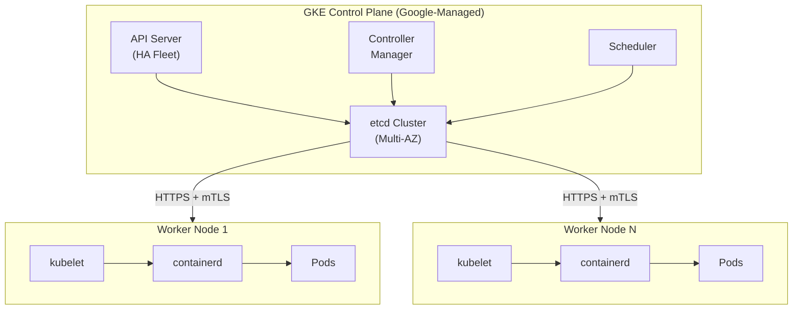

# Lesson 1: GKE Fundamentals: Kubernetes Primitives on Google Cloud

## 1. First-Principles Intuition & Invariants

Google Kubernetes Engine represents a profound philosophical shift in how distributed infrastructure operates. Where traditional virtual machine orchestration required imperative scripting—start this instance, configure that load balancer, attach these disks—Kubernetes and its managed GKE incarnation embrace declarative state reconciliation. The operator defines the desired end state of the system in YAML manifests, and a tireless control plane continuously observes reality, computes the delta, and actuates changes to converge toward that declared goal. This level-triggered reconciliation loop, borrowed from control theory and embedded systems design, tolerates transient network partitions, node failures, and human configuration drift without requiring complex error handling in application logic.

At its core, Kubernetes solves the bin-packing problem for containerized workloads across a heterogeneous cluster of compute nodes. Each node contributes CPU millicores, memory bytes, ephemeral storage, and extended resources like GPUs to a unified resource pool. The scheduler consumes pod specifications—immutable deployment units wrapping one or more containers—and binds them to nodes satisfying their resource requests, affinity rules, and topology constraints. This binding decision writes a NodeName field into the pod's etcd-backed specification, transforming the pod from pending to scheduled. The kubelet agent running on that node observes the new binding, instructs its container runtime to pull images and create namespaces, and reports status back through the API server's watch streams. The entire dance occurs without a central command issuing step-by-step instructions; instead, each component independently watches relevant objects and reacts to changes.

Google's GKE implementation elevates this model by assuming operational responsibility for the control plane itself. In a self-managed Kubernetes cluster, the operator provisions etcd clusters for persistent state, manages API server high availability across multiple zones, maintains controller manager and scheduler replicas, and handles certificate rotation and version upgrades. GKE abstracts all of this complexity: Google operates the control plane as a managed service, scaling it automatically based on cluster size, patching vulnerabilities within maintenance windows, and guaranteeing API server uptime through service level agreements. The cluster's etcd database runs on Google's internal infrastructure, replicated across multiple availability zones with sub-second failover guarantees. This separation of concerns allows infrastructure architects to focus on workload topology, network policy, and resource optimization rather than quorum mathematics and leader election protocols.

The architectural invariant underlying all Kubernetes operations is the API server's role as the system's sole source of truth. Every component—controllers, kubelets, CLI tools, custom operators—communicates exclusively through RESTful HTTPS requests to the API server's typed resource endpoints. The API server validates incoming writes against OpenAPI schemas, enforces admission control webhooks, persists accepted changes to etcd, and emits watch events over long-lived HTTP/2 streams. This design eliminates distributed consensus problems at the edge: controllers never coordinate directly with one another, and kubelets never query etcd. The API server's watch mechanism provides efficient change notifications without polling, leveraging etcd's MVCC revision numbers to stream only incremental updates. When a kubelet loses connectivity, it maintains a local cache of pod specifications and continues running existing workloads, automatically resyncing once the network heals.

GKE offers two distinct operational models that fundamentally alter the operator's responsibilities. Standard GKE clusters provide full access to node virtual machines, allowing SSH access, custom daemon sets, privileged containers, and manual scaling of node pools. The operator controls the node machine type, boot disk size, accelerator attachment, and OS image. This model suits organizations requiring kernel-level observability, specialized device drivers, or workloads with strict hardware affinity. In contrast, GKE Autopilot represents Google's opinionated prescription for production Kubernetes: the service provisions and scales nodes automatically based on pod resource requests, enforces security best practices through admission policies, and restricts privileged operations. Autopilot eliminates node management entirely—operators never specify machine types or node counts—and charges only for requested CPU and memory rather than provisioned nodes. This model optimizes for developer velocity and cost efficiency at the expense of low-level control, making it ideal for stateless microservices and containerized batch jobs.

The primitive building blocks of Kubernetes—Pods, Services, Deployments, ConfigMaps, Secrets—compose into complex distributed systems through their typed relationships and label selectors. A Pod represents the atomic unit of scheduling and resource isolation, mapping to a single Linux cgroup with shared network and IPC namespaces among its containers. Services provide stable network endpoints backed by dynamic pod sets, implemented through iptables NAT rules or IPVS load balancing on each node. Deployments declare desired replica counts and rolling update strategies, delegating pod lifecycle management to subordinate ReplicaSet controllers. This compositional architecture enables higher-order patterns: Horizontal Pod Autoscalers watch metrics and rewrite Deployment replicas, Ingress controllers translate HTTP routing rules into load balancer configurations, and custom operators extend the API with domain-specific resources. Every interaction flows through the API server's unified interface, making the system introspectable through standard tooling regardless of deployment complexity.

## 2. Core Architecture & Mechanics

The anatomy of a GKE cluster begins with its control plane topology, which differs fundamentally between Standard and Autopilot modes yet shares the same underlying components. Google operates the control plane on separate infrastructure from worker nodes, exposing only the API server endpoint to cluster users. This endpoint presents a standard Kubernetes API at a routable IP address, secured by TLS certificates and OAuth2 bearer tokens tied to Google Cloud IAM identities. When an infrastructure architect issues `kubectl apply -f deployment.yaml`, the kubectl binary parses the YAML, serializes it to JSON, and POSTs it to the appropriate API group endpoint—`/apis/apps/v1/namespaces/default/deployments` for a Deployment resource. The API server validates the schema, executes mutating admission webhooks to inject sidecar containers or modify security contexts, runs validating webhooks to enforce organizational policies, and finally commits the object to etcd with an incremental resource version number.

The controller manager hosts dozens of independent control loops, each watching specific resource types and executing reconciliation logic. The Deployment controller watches for Deployment objects, computes the desired ReplicaSet configuration based on the pod template and revision history, and creates or updates ReplicaSets accordingly. The ReplicaSet controller watches ReplicaSets, compares the current pod count against the desired replica number, and creates or deletes pod objects to match. The scheduler watches for pods with empty NodeName fields, runs filtering predicates to eliminate unsuitable nodes—those lacking sufficient CPU, memory, or matching taints—and scores remaining candidates using priority functions that balance resource utilization and spread across failure domains. The winning node gets written to the pod's NodeName field in a binding operation, an atomic compare-and-swap that prevents double-scheduling if multiple scheduler instances race.

On each worker node, the kubelet runs as the primary agent responsible for container lifecycle management. It watches the API server for pods bound to its node name, reconciling the actual container state against the declared specification. When a new pod appears, the kubelet instructs containerd—the container runtime implementing the Container Runtime Interface (CRI)—to pull the specified image from Container Registry, create a new pod sandbox with isolated network and IPC namespaces, and start each container in sequence according to init container ordering. The kubelet continuously probes containers using HTTP, TCP, or exec-based health checks defined in liveness and readiness probe configurations. A failing liveness probe triggers container restart with exponential backoff; a failing readiness probe removes the pod's IP from Service endpoints without restarting the container. These probe results feed back through the API server into Service controller logic, creating a closed-loop system that automatically routes traffic away from unhealthy instances.

Pod networking in GKE relies on the VPC-native cluster model, where each pod receives an IP address from the cluster's pod CIDR range allocated within the Google Cloud VPC. Google's GKE networking layer implements the Kubernetes CNI specification using Calico or native GKE networking, ensuring that pods can communicate directly with one another without NAT, and that Google Cloud load balancers can route traffic to pod IPs. Each node runs kube-proxy, which watches Service and Endpoints objects and programs iptables or IPVS rules to implement virtual IP load balancing. When a pod sends traffic to a Service ClusterIP, the packet traverses the node's iptables NAT table, which selects a random backend pod IP from the endpoint list and rewrites the destination address. This in-kernel load balancing distributes connections across pod replicas without requiring an external proxy, achieving microsecond-latency connection establishment.

Services expose three types of network endpoints: ClusterIP services provide stable internal virtual IPs for pod-to-pod communication, NodePort services expose a static port on every node's external IP, and LoadBalancer services provision a Google Cloud Network Load Balancer with an external IP that forwards traffic to NodePort allocations. The LoadBalancer type integrates deeply with Google Cloud's networking infrastructure: the GKE cloud controller manager watches for LoadBalancer services, makes API calls to create forwarding rules and backend services, and updates the Service status with the provisioned external IP. Health checks propagate from pod readiness probes through Service endpoints to load balancer backend health, creating end-to-end traffic management without manual configuration.

Deployments encode rolling update strategies that control how pod replicas transition between versions during application updates. The default RollingUpdate strategy configures maxSurge and maxUnavailable parameters: maxSurge allows temporary excess replicas during the rollout, while maxUnavailable limits how many replicas can be down simultaneously. When an architect updates the Deployment's pod template—changing an image tag, environment variable, or resource limit—the Deployment controller creates a new ReplicaSet with the updated template and orchestrates a controlled scale-up of the new ReplicaSet concurrent with scale-down of the old. The controller waits for new pods to pass readiness probes before continuing the rollout, automatically halting if readiness thresholds are not met. This declarative approach eliminates the need for custom deployment scripts; the operator simply updates the desired state and allows the controller to execute the transition safely.

ConfigMaps and Secrets decouple configuration data from container images, enabling the same image to run in development, staging, and production with environment-specific settings. A ConfigMap stores arbitrary key-value pairs or file contents, which can be injected into pods as environment variables or mounted as files through the downward API. Secrets follow the same pattern but encode values in base64 and integrate with Google Cloud's Secret Manager for external secret storage. The kubelet fetches ConfigMap and Secret data during pod initialization, mounting them into the container filesystem or populating environment variables before the main process starts. Updates to ConfigMaps do not automatically trigger pod restarts; the operator must implement a restart mechanism, such as rolling Deployment pods after configuration changes, or use an operator that watches ConfigMaps and annotates Deployments to trigger rollouts.

Resource requests and limits govern how the Kubernetes scheduler and kubelet allocate CPU and memory to containers. A request specifies the minimum guaranteed resources, influencing scheduling decisions and establishing the container's CPU weight in the Linux CFS scheduler. A limit defines the maximum resources the container can consume: CPU limits throttle the cgroup's CPU time, while memory limits trigger OOM-killer termination if exceeded. In GKE Autopilot, these requests directly determine node provisioning—pods requesting 2 CPU and 8 GiB memory will be scheduled on nodes sized to satisfy those exact requirements with minimal overhead. In Standard GKE, the operator pre-provisions node pools with specific machine types, and the scheduler must fit pods into available node capacity using a bin-packing algorithm that minimizes fragmentation.

## 3. High-Performance Optimization & Failure Modes

Optimizing GKE workload performance begins with precise resource modeling, a discipline that separates high-performing production systems from those plagued by OOM kills and throttling. Container resource requests should reflect the sustained baseline consumption measured under realistic load, not peak burst requirements. Setting requests too low causes underprovisioning, where the scheduler places too many pods on a single node, leading to CPU contention and memory pressure. Setting requests too high wastes capacity, as the scheduler reserves resources that pods never fully utilize. In GKE Autopilot, inflated requests translate directly to higher costs, since billing is tied to requested resources rather than actual usage. The optimal strategy involves load testing representative workloads with monitoring instrumentation—Prometheus exporters, Cloud Monitoring agents—to capture P50, P95, and P99 resource utilization percentiles, then setting requests slightly above P95 to accommodate normal variance.

CPU limits in containerized environments require careful consideration due to the Linux CFS scheduler's throttling behavior. When a container hits its CPU limit, the kernel throttles its cgroup by disabling scheduling for the remainder of the current period—typically 100 milliseconds. This throttling interacts poorly with latency-sensitive applications, where a brief burst of CPU usage during request processing can trigger throttling and inflate tail latencies. Many high-performance production environments omit CPU limits entirely, relying solely on requests to guarantee baseline allocation while allowing pods to burst into unused CPU capacity. This approach works well in GKE clusters where nodes run homogeneous workloads with predictable aggregate load; it fails catastrophically when a single noisy neighbor consumes all available CPU, starving other pods. Memory limits are non-negotiable: exceeding a memory limit triggers immediate OOM termination with no graceful degradation, making accurate memory request modeling critical for reliability.

Pod topology spread constraints and affinity rules control how the scheduler distributes replicas across the cluster's failure domains, balancing availability against resource efficiency. A typical production Deployment specifies podAntiAffinity rules that prevent replicas from co-locating on the same node or zone, ensuring that a single node failure does not take down the entire service. Topology spread constraints generalize this pattern, allowing declarative policies like "spread pods evenly across zones" or "limit skew between nodes to two replicas." GKE's multi-zonal Standard clusters automatically provision node pools across three zones in a region, providing the substrate for zone-aware scheduling. Autopilot clusters handle this automatically, spreading pods across zones based on resource requests without requiring explicit anti-affinity rules. The tradeoff is resource efficiency: strict anti-affinity rules may prevent optimal bin-packing, forcing the cluster to provision additional nodes to satisfy constraints even when aggregate capacity is available.

Service mesh architectures like Istio extend Kubernetes networking with sophisticated traffic management, observability, and security capabilities at the cost of increased complexity and resource overhead. Istio injects sidecar proxies into every pod, intercepting all inbound and outbound traffic through iptables redirection. These proxies implement circuit breaking, retries, timeouts, and mutual TLS authentication without requiring application code changes. The control plane distributes routing rules and security policies to proxies through the xDS protocol, enabling centralized configuration of distributed network behavior. In GKE, Istio can be provisioned as a managed add-on, with Google operating the control plane and handling version upgrades. The performance cost is non-trivial: each sidecar proxy consumes 50-200 MB of memory and adds sub-millisecond latency to every request. For latency-critical applications or clusters with thousands of pods, this overhead may be prohibitive, favoring simpler approaches like native Kubernetes Services and Network Policies.

Cluster autoscaling in Standard GKE adjusts the number of nodes in each node pool based on pending pod resource requests. When pods remain unscheduled due to insufficient capacity, the cluster autoscaler provisions new nodes from the pool, subject to configured minimum and maximum node counts. When node utilization drops below a threshold—typically when aggregate requests fall below 50% of node capacity—the autoscaler cordons and drains underutilized nodes, rescheduling pods onto remaining nodes before deleting the virtual machines. This process interacts with pod disruption budgets, which specify the minimum number of replicas that must remain available during voluntary disruptions like node drains. Autoscaling works best for workloads with fluctuating load patterns—web frontends, batch processing queues—and poorly for stateful systems with long-lived connections or local disk state. In Autopilot, node autoscaling is implicit: Google provisions and removes nodes automatically based on pod requests without exposing node-level concerns to the operator.

Persistent storage in Kubernetes abstracts underlying disk systems through Persistent Volumes (PVs) and Persistent Volume Claims (PVCs), enabling pods to retain state across restarts and rescheduling. In GKE, the CSI driver integrates with Google Cloud Persistent Disks, dynamically provisioning SSD or HDD-backed volumes when a pod creates a PVC. The volume lifecycle follows a state machine: a PVC in Pending state triggers the CSI driver to create a Persistent Disk, which the kubelet then attaches to the node and mounts into the pod's filesystem. When a pod is deleted, the volume remains bound to the PVC, allowing a replacement pod to reattach and access the same data. Storage classes define performance characteristics—SSD vs. HDD, regional replication—and reclaim policies that determine whether volumes are deleted or retained when their PVC is removed. Stateful workloads like databases require StatefulSets, which extend Deployments with stable network identities and ordered provisioning of per-replica PVCs.

Failure modes in Kubernetes clusters cascade through the layers of abstraction in predictable but often surprising ways. A node failure—complete loss of VM connectivity—triggers a five-minute timeout before the node controller marks the node as NotReady and begins evicting pods. This delay prevents spurious evictions during transient network partitions but means application downtime extends for several minutes before rescheduling occurs. Setting shorter timeouts increases the risk of split-brain scenarios where a partitioned node continues running pods while the cluster schedules replacements. Image pull errors represent another common failure mode: if a pod specifies an image that does not exist or cannot be pulled due to authentication failures, the kubelet will retry with exponential backoff indefinitely, leaving the pod in ImagePullBackOff state. Default ImagePullPolicy settings cache images locally, so a working pod can survive image registry outages, but new pods will fail to start until the registry recovers.

Resource exhaustion at the node level activates the kubelet's eviction manager, which terminates pods to reclaim memory or disk space and prevent kernel OOM kills or filesystem corruption. The eviction manager prioritizes pods based on QoS class: BestEffort pods—those without resource requests or limits—are evicted first, followed by Burstable pods exceeding their requests, and finally Guaranteed pods that specify requests equal to limits. This priority system protects critical infrastructure pods marked with high QoS and priority classes while allowing the cluster to overcommit resources for batch workloads. Monitoring eviction events through the Kubernetes event stream and alerting on high eviction rates prevents silent degradation where applications continuously restart due to resource contention.

The declarative model and eventual consistency semantics of Kubernetes create subtle ordering dependencies that manifest as transient failures during initial deployment or cluster-wide disruptions. A pod may start before its required ConfigMap or Secret has propagated to the node's kubelet cache, causing the pod to crash-loop until the configuration arrives. A Service may resolve to an empty endpoint set if the backing Deployment's pods have not yet passed readiness probes. Init containers provide a mechanism to enforce ordering, running to completion before application containers start, but they cannot wait for external dependencies like database availability. Readiness probes allow pods to signal when they are prepared to accept traffic, but they do not prevent the pod from consuming resources or entering CrashLoopBackOff if application initialization fails. Robust production deployments incorporate retry logic, exponential backoff, and graceful degradation into application code, treating the infrastructure layer as unreliable and eventually consistent rather than synchronous and transactional.
