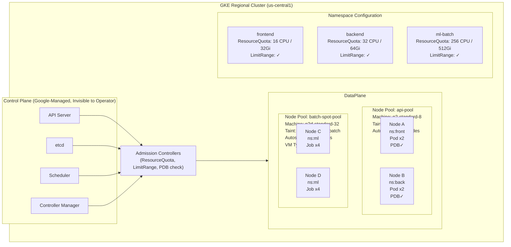

# Lesson 2: Cluster Architecture: Node Pools, Resource Quotas, Workload Isolation

## 1. First-Principles Intuition & Invariants

A Kubernetes cluster, taken at face value, is a distributed state machine whose control plane perpetually reconciles declared intent with observed reality. GKE externalizes the control plane entirely — the API server, etcd, the scheduler, and the controller manager all run as Google-managed infrastructure, invisible to the operator except through the lens of `kubectl` and Cloud Logging. What remains visible and fully operator-controlled is the data plane: the pools of virtual machines that execute actual workloads. Understanding GKE architecture at a production depth means understanding that the node is the fundamental unit of capacity, the node pool is the fundamental unit of homogeneity, and the namespace is the fundamental unit of isolation policy.

The invariant that underpins every resource decision in GKE is deceptively simple: a pod's resource requests determine *where* it lands, and a pod's resource limits determine *how much* it can consume. These two numbers are not the same thing, and conflating them is the root cause of a substantial class of production incidents. The scheduler reads requests and places the pod on a node that has sufficient *allocatable* capacity — a quantity that is itself less than the node's physical capacity, because the kubelet, the container runtime (containerd), and the operating system itself consume a reserved fraction of CPU and memory. GKE's kubelet reservation policy deducts a sliding-scale CPU reservation (6% of the first core, 1% of the next core, 0.5% thereafter) and a memory reservation that varies with total node RAM. On a machine with 16 GiB of RAM, the allocatable memory exposed to the scheduler may be closer to 14.5 GiB once system reserved, kube-reserved, and eviction threshold headroom are all subtracted. A scheduler that sees a node as schedulable may still be operating on 1.5 GiB less headroom than the operator assumes.

This gap between raw capacity and allocatable capacity is not a GKE-specific quirk; it is an invariant of every production Kubernetes deployment. What makes GKE distinctive is that the node pool abstraction enforces a second-order invariant: all nodes within a pool are identical in machine type, OS image, and node configuration. This homogeneity is what makes the cluster autoscaler's decisions tractable. When the autoscaler determines that a pending pod cannot be scheduled on existing nodes and decides to provision a new node, it must know exactly what machine type to provision. It cannot improvise. The pool's machine type therefore becomes a *contractual constraint* on the workloads assigned to it, and designing node pools incorrectly cascades into autoscaler misbehavior, pod evictions, and unpredictable latency.

The deeper invariant is economic and operational: heterogeneous workloads with different resource densities, availability requirements, and cost tolerances must not share the same node pool. A batch ML training job that benefits from preemptible N2D instances with 96 vCPUs should never compete for scheduling with a latency-sensitive API server that requires guaranteed CPU allocation on an E2 or N2 instance family with committed use. Node pools give GKE operators the mechanism to enforce this separation at the infrastructure layer, before any application-level policy is applied. This is not an aesthetic preference — it is the difference between a cluster that degrades gracefully under load and one that cascades into eviction storms when a noisy batch job exhausts the node's memory bandwidth.

---

## 2. Core Architecture & Mechanics

### Node Pool Design and Machine Type Selection

A GKE cluster can host multiple node pools, each with independent configuration for machine type, disk size and type, node image, autoscaling bounds, and node management settings. From the control plane's perspective, all nodes appear in the same cluster regardless of pool membership, but the scheduler's topology awareness and affinity mechanisms allow workloads to target specific pools by label. GKE automatically labels each node with `cloud.google.com/gke-nodepool: <pool-name>`, which becomes the basis for `nodeSelector` and `nodeAffinity` rules.

The machine type selection decision maps directly onto Google Cloud's compute taxonomy. The E2 family provides cost-optimized shared-core and standard instances appropriate for development clusters and low-traffic services where burst tolerance is acceptable. The N2 family (Intel Cascade Lake and Ice Lake) and N2D family (AMD EPYC Rome and Milan) offer predictable performance with NUMA-aware memory topology, making them suitable for production API tiers. The C2 and C2D families deliver the highest single-thread performance and are appropriate for compute-bound workloads. The A2 family, backed by NVIDIA A100 GPUs, serves ML training and inference at scale.

The relationship between vCPU count and allocatable CPU is not linear once hyperthreading and NUMA topology enter the picture. On a 32-vCPU N2D instance, the kernel exposes 32 logical cores across two NUMA nodes, each with 16 cores sharing an L3 cache. If a pod requests 20 CPUs and the Linux CFS scheduler distributes its threads across both NUMA nodes, memory accesses that cross NUMA boundaries will incur additional latency. For latency-critical workloads, requesting CPU in multiples of the NUMA-local core count — typically 8 or 16 on N2D — and combining this with Kubernetes Topology Manager policies (`single-numa-node` or `restricted`) prevents cross-NUMA scheduling at the kubelet level.

The following `gcloud` invocation creates a production cluster with a primary node pool for general API serving and establishes the structural baseline for the multi-pool architecture described in this lesson:

```bash
gcloud container clusters create prod-cluster \
  --region us-central1 \
  --release-channel regular \
  --workload-pool=PROJECT_ID.svc.id.goog \
  --enable-ip-alias \
  --enable-private-nodes \
  --master-ipv4-cidr 172.16.0.0/28 \
  --network prod-vpc \
  --subnetwork prod-subnet \
  --cluster-secondary-range-name pods \
  --services-secondary-range-name services \
  --num-nodes 2 \
  --machine-type n2-standard-8 \
  --disk-type pd-ssd \
  --disk-size 100 \
  --enable-autorepair \
  --enable-autoupgrade \
  --no-enable-basic-auth \
  --metadata disable-legacy-endpoints=true
```

Adding a preemptible spot node pool for batch workloads requires separate configuration that explicitly opts into Spot VM semantics and applies a taint to prevent general workloads from accidentally landing on these nodes:

```bash
gcloud container node-pools create batch-spot-pool \
  --cluster prod-cluster \
  --region us-central1 \
  --machine-type n2d-standard-32 \
  --disk-type pd-balanced \
  --disk-size 200 \
  --spot \
  --num-nodes 0 \
  --enable-autoscaling \
  --min-nodes 0 \
  --max-nodes 20 \
  --node-taints workload-type=batch:NoSchedule \
  --node-labels workload-type=batch,pool=spot \
  --workload-metadata=GKE_METADATA
```

The taint `workload-type=batch:NoSchedule` is a hard gate: the scheduler will not place any pod on these nodes unless the pod spec includes a matching toleration. This prevents a misconfigured API deployment from inadvertently consuming spot capacity and then experiencing an eviction mid-request when Google reclaims the VM.

### Resource Requests, Limits, and the QoS Hierarchy

The kubelet classifies every pod into one of three Quality of Service tiers at admission time, and this classification determines eviction priority under memory pressure. A pod is `Guaranteed` when every container in the pod declares equal requests and limits for both CPU and memory. It is `Burstable` when at least one container declares a request or limit without full equality. It is `BestEffort` when no container declares any requests or limits at all. When the node's memory approaches the eviction threshold, the kubelet evicts BestEffort pods first, then Burstable pods ordered by how far they exceed their requests, and only evicts Guaranteed pods as a last resort.

This classification has an important practical implication for multi-tenant clusters: a team that deploys a BestEffort pod is implicitly volunteering that pod as eviction fodder for the entire node. Under memory contention, their workload disappears without warning. For production services, every pod must be at minimum Burstable, and stateful services that cannot tolerate arbitrary restart must be Guaranteed.

The CPU request also participates in Linux CFS bandwidth control at the container runtime level. Under contention, the kernel's CFS scheduler distributes CPU shares proportionally to the `cpu.shares` cgroup value, which is derived from the pod's CPU request. A pod requesting 500m (0.5 CPU) receives half the CPU shares of a pod requesting 1000m. The CPU limit, by contrast, maps to `cpu.cfs_quota_us` and `cpu.cfs_period_us`, which together enforce a hard throttle: if a container exhausts its quota within the 100ms period, the kernel throttles it for the remainder of that period regardless of whether the node has idle CPU cycles. CPU throttling is one of the most pervasive and least visible performance degradation mechanisms in production Kubernetes clusters, and it manifests as intermittent high tail latency rather than obvious failure. Setting CPU limits too low relative to actual burst consumption is a correctness bug, not a conservative resource policy.

The correct mental model is to treat memory limits as a hard enforcement boundary (the OOM killer terminates the container when it crosses the limit) and CPU limits as a throttle that degrades latency without terminating the process. For latency-sensitive services, many production operators omit CPU limits entirely while still declaring CPU requests, accepting the theoretical risk of noisy neighbors in exchange for eliminating CFS throttling as a latency source. This is a defensible trade-off on dedicated node pools where workload density is controlled.

### Namespace Isolation and ResourceQuota Enforcement

A Kubernetes namespace is not a security boundary — it is a partitioning mechanism for names, policies, and quotas. Two pods in different namespaces on the same node share the same kernel, the same network stack, and the same cgroup hierarchy. The isolation that namespaces enforce is *administrative*, not *computational*. For teams operating a multi-tenant GKE cluster, the practical value of namespaces lies in the ability to attach ResourceQuota objects that cap total resource consumption per tenant, and LimitRange objects that inject default requests and limits for pods that omit them.

A ResourceQuota object is enforced by the admission controller at the moment a resource is created. If creating a new pod would cause the namespace's total CPU request to exceed the quota, the API server rejects the request with a `403 Forbidden` before the pod ever reaches the scheduler. This admission-time enforcement is what makes quotas reliable — they do not rely on a background reconciliation loop that might lag behind rapid burst creation. The following manifest establishes a quota appropriate for a medium-traffic backend service team:

```yaml
apiVersion: v1
kind: ResourceQuota
metadata:
  name: backend-team-quota
  namespace: backend
spec:
  hard:
    requests.cpu: "32"
    requests.memory: 64Gi
    limits.cpu: "64"
    limits.memory: 128Gi
    pods: "50"
    services: "10"
    persistentvolumeclaims: "20"
    count/deployments.apps: "15"
    count/statefulsets.apps: "5"
```

The quota draws a distinction between total requests and total limits, which allows tenants to overcommit limits (enabling burst) while capping guaranteed capacity. Setting `limits.cpu` to twice `requests.cpu` enforces a maximum overcommit ratio of 2:1. If the team attempts to deploy a pod with a CPU limit of 8 but a request of 1, the admission controller will accept it only if doing so keeps the namespace under both the aggregate request ceiling and the aggregate limit ceiling.

LimitRange objects complement ResourceQuota by ensuring that pods that do not declare their own resource requirements receive sane defaults, preventing BestEffort pods from silently appearing in a quota-enforced namespace:

```yaml
apiVersion: v1
kind: LimitRange
metadata:
  name: backend-defaults
  namespace: backend
spec:
  limits:
  - type: Container
    default:
      cpu: "500m"
      memory: "512Mi"
    defaultRequest:
      cpu: "100m"
      memory: "128Mi"
    max:
      cpu: "8"
      memory: "16Gi"
    min:
      cpu: "50m"
      memory: "64Mi"
  - type: Pod
    max:
      cpu: "16"
      memory: "32Gi"
  - type: PersistentVolumeClaim
    max:
      storage: "100Gi"
    min:
      storage: "1Gi"
```

The LimitRange's `default` field applies to the container's limit, while `defaultRequest` applies to its request. The `max` and `min` fields are hard gates: an admission request that exceeds `max` is rejected unconditionally, regardless of whether the quota has headroom.

### Pod Disruption Budgets and Stability Guarantees

A PodDisruptionBudget (PDB) defines a lower bound on the availability of a replicated workload during *voluntary* disruption events: node drains triggered by cluster upgrades, node pool migrations, or manual maintenance. The PDB does not protect against involuntary disruptions — hardware failures, OOM kills, or spot VM preemptions bypass the PDB mechanism entirely. This distinction is critical: a PDB provides upgrade safety, not fault tolerance. Fault tolerance requires sufficient replica count and proper anti-affinity rules.

The relationship between the PDB and the cluster upgrade mechanism deserves careful attention. When GKE performs an automatic node upgrade (triggered by the release channel cadence), it drains nodes one at a time by issuing a Kubernetes Evict API call for each pod. The eviction API is the mechanism that checks PDB compliance — it respects the budget, blocks if eviction would violate it, and retries until the budget permits eviction or a timeout is reached. A PDB with `minAvailable: 100%` on a Deployment with a single replica will block node drain indefinitely, which will block the cluster upgrade. This configuration is a deadlock, and GKE will eventually force-drain the node after a configurable timeout, potentially evicting the pod anyway.

The correct PDB configuration for a three-replica Deployment that must maintain at least two healthy pods during disruption is:

```yaml
apiVersion: policy/v1
kind: PodDisruptionBudget
metadata:
  name: api-server-pdb
  namespace: backend
spec:
  minAvailable: 2
  selector:
    matchLabels:
      app: api-server
      tier: production
```

An equivalent formulation expresses the budget as a maximum number of unavailable pods:

```yaml
apiVersion: policy/v1
kind: PodDisruptionBudget
metadata:
  name: api-server-pdb-alt
  namespace: backend
spec:
  maxUnavailable: 1
  selector:
    matchLabels:
      app: api-server
      tier: production
```

The `maxUnavailable: 1` form is generally preferable for Deployments because it scales naturally as the replica count grows — a Deployment that scales from 3 to 10 replicas still tolerates exactly one concurrent disruption without requiring PDB modification. The `minAvailable` form is more appropriate for StatefulSets where the absolute quorum size is a correctness invariant (a three-node etcd cluster must maintain at least two members, and this is an absolute requirement unrelated to replica count).

The following architecture diagram illustrates the relationship between node pools, namespaces, quotas, and PDBs across the full cluster topology:



---

## 3. High-Performance Optimization & Failure Modes

### Autoscaler Interaction with Node Pool Boundaries

The GKE cluster autoscaler operates at the node pool level, not the cluster level. When a pod enters `Pending` state because no existing node has sufficient allocatable resources, the autoscaler evaluates each node pool's configured machine type, computes whether a new node of that type would accommodate the pending pod, and provisions one if so. The critical failure mode here is a pod with requests that exceed the allocatable capacity of every configured node pool's machine type. Such a pod will pend forever, triggering repeated autoscaler evaluation cycles that conclude the pod is unschedulable. The autoscaler will log `pod didn't trigger scale-up` events, and the pod's events will show `Insufficient cpu` or `Insufficient memory` from the scheduler. The resolution is to either reduce the pod's requests or add a node pool with a larger machine type.

A subtler failure mode arises when a pod's combination of requests is schedulable in isolation but cannot be scheduled because of topology spread constraints or anti-affinity rules. Consider a Deployment with 10 replicas and a `topologySpreadConstraint` that requires pods to be distributed across at least three zones with a `maxSkew` of 1. If the cluster has nodes only in two zones, this constraint is unsatisfiable regardless of available capacity, and the autoscaler will provision nodes in the existing two zones without resolving the pending state. The fix requires ensuring that the node pool spans all three zones, which for regional clusters means creating the pool with `--region` rather than `--zone` so GKE distributes nodes across all zone-suffixes automatically.

The interaction between spot VM preemption and the autoscaler creates a feedback instability that must be explicitly managed. When Google reclaims a spot VM, GKE deletes the corresponding node and the pods on it are rescheduled. If this triggers an autoscaler scale-out that provisions new spot nodes, those nodes may also be reclaimed during periods of high spot demand, causing a cycle of provision-preempt-provision that wastes provisioning latency and destabilizes batch job completion time. The mitigation is to configure a preemption handler that gracefully checkpoints job state before the node is deleted. GKE sends a preemption notification 30 seconds before termination via the instance metadata server:

```bash
# Poll the metadata server for preemption notice from within the pod
while true; do
  PREEMPT=$(curl -s -H "Metadata-Flavor: Google" \
    http://metadata.google.internal/computeMetadata/v1/instance/preempted)
  if [ "$PREEMPT" = "TRUE" ]; then
    echo "Preemption imminent, initiating checkpoint"
    /usr/local/bin/checkpoint-job.sh
    break
  fi
  sleep 5
done
```

This polling loop, running as a sidecar or within the job container, provides a 25-second window to flush state to Cloud Storage or Filestore before the node is reclaimed.

### ResourceQuota Exhaustion and Admission Failures

ResourceQuota exhaustion is a silent availability hazard. When a quota is full, new pods — including pods created by a Deployment's ReplicaSet controller in response to a pod failure — are silently rejected by the admission controller. The ReplicaSet controller will retry creation on each sync cycle (approximately every 15 seconds), but during the interval between the original pod's deletion and the quota becoming available again, the Deployment operates at reduced replica count without generating an alert that most teams configure. The correct monitoring approach is to alert on the `kube_resourcequota` metrics exposed by kube-state-metrics, specifically the ratio of `kube_resourcequota{type="used"}` to `kube_resourcequota{type="hard"}`. An alert firing at 85% utilization gives operational time to react before exhaustion occurs.

Quota exhaustion also interacts badly with rolling updates. A Deployment rolling update with `maxSurge: 1` temporarily creates one additional pod above the desired replica count. If the namespace is at or near its `pods` quota limit, this surge pod will be rejected, stalling the rollout. The Deployment controller will not roll back automatically — it will simply wait indefinitely for the surge pod to be created, and `kubectl rollout status` will block. The resolution is either to increase the quota before the rollout or to perform the update with `maxSurge: 0, maxUnavailable: 1`, which terminates an old pod before creating a new one and therefore does not require quota headroom above the current replica count.

### Workload Isolation Gaps and Network Policy

Namespace-level resource quotas and LimitRanges prevent one tenant from starving another of CPU and memory, but they do not prevent network-level interference. By default, all pods in a GKE cluster can communicate with all other pods regardless of namespace, because the cluster uses a flat overlay network. A pod in the `frontend` namespace can open a TCP connection to a pod in the `backend` namespace without any restriction. For multi-tenant clusters where namespace ownership maps to different teams or services with different trust levels, this represents a lateral movement vector.

GKE's integration with Dataplane V2 (based on Cilium and eBPF) makes enforcing Kubernetes NetworkPolicy objects efficient and reliable. The following NetworkPolicy restricts the `backend` namespace to accept ingress only from pods in the `frontend` namespace and from pods bearing the monitoring team's scrape label, while blocking all other inbound traffic:

```yaml
apiVersion: networking.k8s.io/v1
kind: NetworkPolicy
metadata:
  name: backend-ingress-policy
  namespace: backend
spec:
  podSelector: {}
  policyTypes:
  - Ingress
  - Egress
  ingress:
  - from:
    - namespaceSelector:
        matchLabels:
          kubernetes.io/metadata.name: frontend
    - podSelector:
        matchLabels:
          role: prometheus-scraper
  egress:
  - to:
    - namespaceSelector:
        matchLabels:
          kubernetes.io/metadata.name: frontend
  - to:
    - namespaceSelector:
        matchLabels:
          kubernetes.io/metadata.name: kube-system
    ports:
    - protocol: UDP
      port: 53
```

The explicit egress rule permitting UDP port 53 to `kube-system` is non-negotiable: without it, DNS resolution inside the namespace will fail because CoreDNS pods reside in `kube-system`, and a default-deny egress policy blocks DNS traffic along with everything else. This is one of the most common NetworkPolicy mistakes in production environments — teams apply a restrictive policy, DNS breaks, and the resulting `connection refused` errors are attributed to the wrong cause.

### PDB Anti-Patterns and Upgrade Deadlocks

The most dangerous PDB anti-pattern is applying `minAvailable: 100%` or `maxUnavailable: 0` to a single-replica Deployment. This configuration tells the eviction API that zero pods may be disrupted, which makes node drain impossible for any node hosting that pod. GKE's node auto-upgrade mechanism will attempt the drain repeatedly, fail, and eventually force-drain the node after the configurable `--max-surge-upgrade` timeout, potentially causing an uncontrolled pod termination. The diagnostic signal for this condition is a node stuck in the `SchedulingDisabled` (cordoned) state for more than 30 minutes during a cluster upgrade window, which GKE surfaces as a cluster upgrade alert in the Cloud Console.

The correct resolution for single-replica services that cannot tolerate disruption is to increase the replica count to at least two and configure `maxUnavailable: 1`. If the service genuinely cannot run with more than one replica (stateful leader-only services, for example), the PDB must be temporarily removed before cluster upgrades, and the upgrade window must be coordinated with the service's maintenance window. GKE's maintenance window and maintenance exclusion features exist precisely for this coordination:

```bash
gcloud container clusters update prod-cluster \
  --region us-central1 \
  --maintenance-window-start "2024-01-15T02:00:00Z" \
  --maintenance-window-end "2024-01-15T06:00:00Z" \
  --maintenance-window-recurrence "FREQ=WEEKLY;BYDAY=SU"
```

This configuration constrains all GKE-initiated maintenance — node auto-upgrades, node auto-repair, and control plane upgrades — to a four-hour window on Sunday nights UTC, giving teams predictability for coordinating PDB removal and stateful service maintenance.

Understanding the full architecture of node pools, resource quotas, and workload isolation in GKE is not an academic exercise. It is the operational prerequisite for running production systems that survive cluster upgrades without downtime, resist tenant noisy-neighbor effects, enforce cost accountability by team, and scale heterogeneous workloads across appropriately priced compute without manual intervention. The node pool is the atom of this architecture, and every design decision above it — machine type selection, quota boundaries, PDB configuration, network isolation policy — either enforces or erodes the correctness of the allocation model at the foundation.
