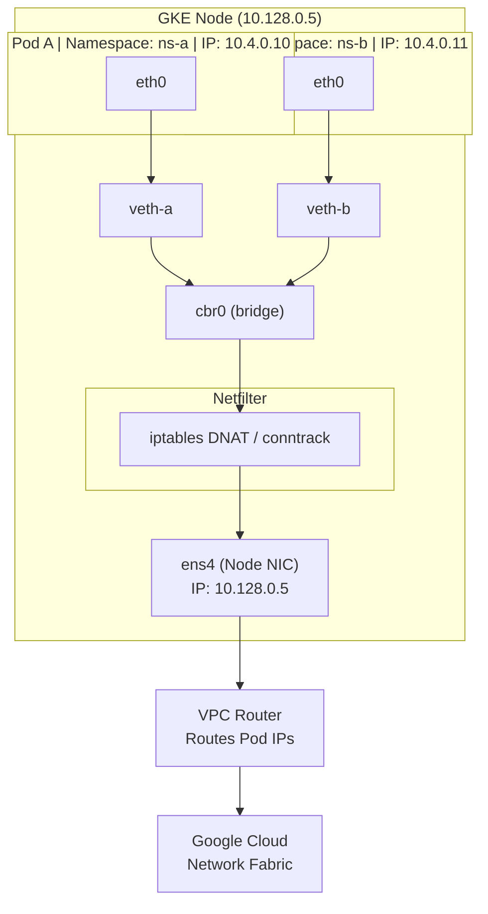
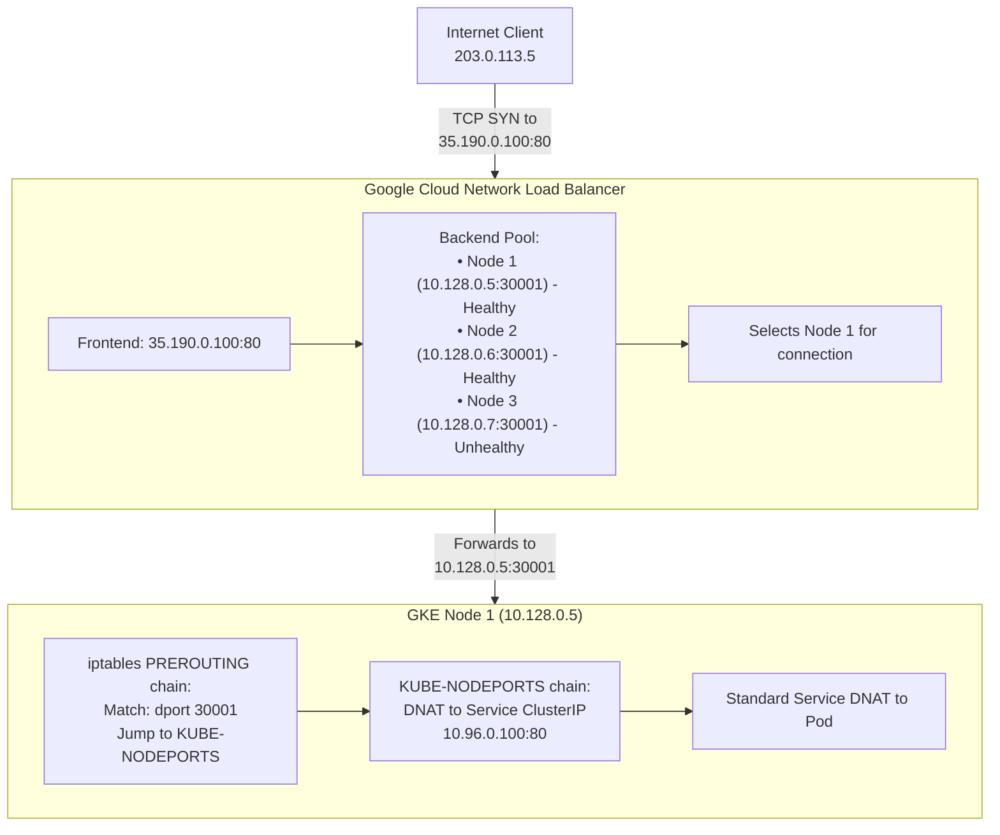
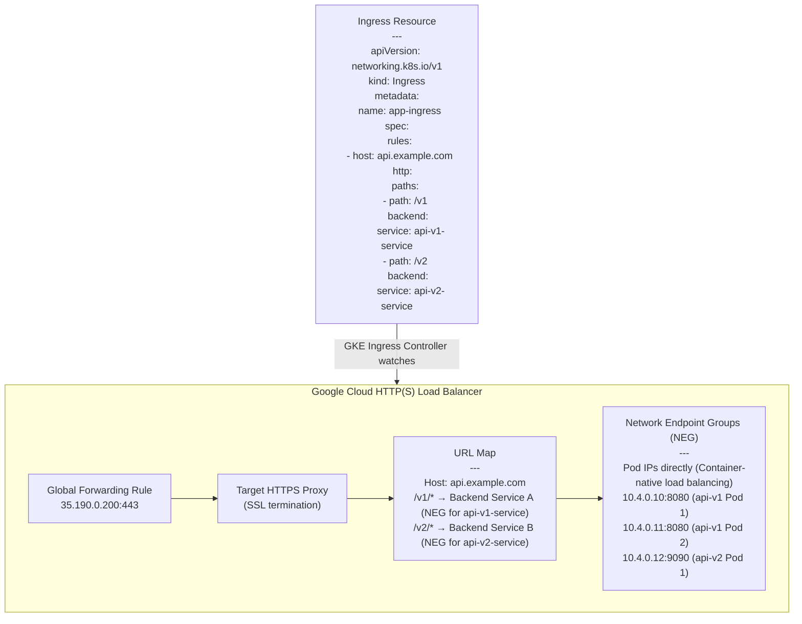
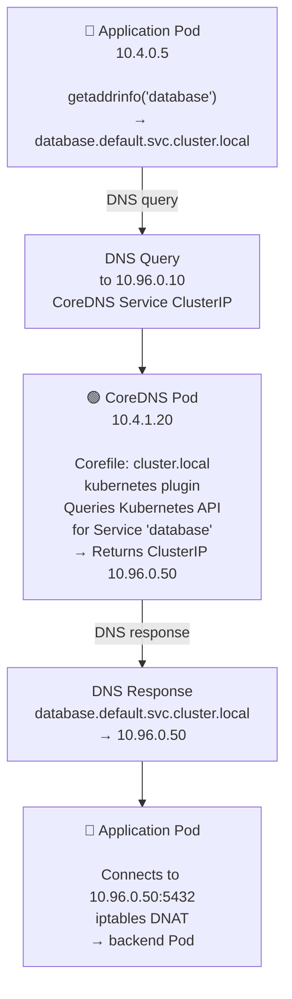

# Lesson 3: Networking, Service Discovery, Ingress: Multi-Tier Communication

## 1. First-Principles Intuition & Invariants

Kubernetes networking abstracts away the underlying physical and virtual network topology, presenting applications with a flat, routable address space where every Pod receives its own IP address and can communicate with any other Pod without Network Address Translation. This design philosophy—commonly called the "IP-per-Pod" model—eliminates the port-mapping complexity that plagued earlier container orchestration systems and allows developers to reason about network connectivity as if every container were a traditional virtual machine or bare-metal host. On Google Kubernetes Engine, this abstraction is realized through VPC-native clusters, which integrate Kubernetes networking directly with Google Cloud's Virtual Private Cloud infrastructure, enabling seamless interoperability between GKE workloads and other Google Cloud services while maintaining the illusion of a single, unified network plane.

The fundamental invariant underlying all Kubernetes networking is the **three-way reachability contract**: every Pod must be able to reach every other Pod without NAT, every Pod must be able to reach every Service without NAT, and every Node must be able to reach every Pod without NAT. This contract establishes a uniform addressing model where application code can reference network endpoints using stable identifiers—whether those endpoints are Pods that may be rescheduled across nodes, Services that front ephemeral Pod collections, or external resources accessible through Ingress. The implementation of this contract varies across different Kubernetes network plugins, but on GKE, the VPC-native architecture achieves it by allocating Pod IP addresses directly from the VPC subnet range and programming Google Cloud's Software-Defined Networking layer to route traffic between Pods, nodes, and external clients according to declarative Kubernetes objects.

Service discovery in Kubernetes builds atop this flat network model by introducing a layer of indirection between network clients and backend Pods. A Service object defines a stable virtual IP address—the ClusterIP—that remains constant even as the set of backend Pods changes due to scaling, rolling updates, or node failures. The Kubernetes control plane watches Service and Endpoint objects and programs every node's kernel networking stack with iptables or IPVS rules that implement load balancing and connection tracking. When a client Pod sends a packet to a Service's ClusterIP, the node's netfilter hooks intercept the packet, rewrite its destination IP to match one of the healthy backend Pod IPs, and forward it through the VPC network. This request-time indirection happens entirely in kernel space, minimizing latency while preserving the developer's mental model of connecting to a fixed address.

The transition from internal cluster networking to external Internet traffic introduces additional complexity, as Kubernetes must integrate with the cloud provider's load balancing infrastructure while maintaining portability across different hosting environments. GKE solves this by offering three progressively sophisticated Service types—ClusterIP for internal-only communication, NodePort for direct node-level exposure, and LoadBalancer for cloud-native integration—and a separate Ingress resource for HTTP/HTTPS routing with path-based fanout and TLS termination. Each abstraction trades off simplicity for functionality: ClusterIP services remain invisible outside the cluster, NodePort services expose a high-numbered port on every node's public IP, LoadBalancer services provision a dedicated Google Cloud Network Load Balancer, and Ingress controllers orchestrate the sophisticated HTTP(S) Load Balancer with URL routing, SSL certificates, and backend health checks. Understanding when to use each primitive requires reasoning about failure domains, blast radius, cost, and the operational burden of managing external-facing infrastructure.

VPC-native clusters on GKE allocate two distinct IP ranges from the VPC subnet: the primary range for nodes and a secondary range—called an "alias IP range"—for Pods. This dual-range design enables Google Cloud's VPC routing layer to distinguish between node traffic and Pod traffic, applying different firewall rules and routing policies to each. When a Pod starts on a node, the kubelet invokes the Container Network Interface plugin, which assigns an IP address from the node's allocated Pod CIDR block and configures the node's virtual network interface to route traffic destined for that Pod IP. Because Pod IPs are drawn from the VPC's address space, they are natively routable to other Google Cloud resources like Compute Engine VMs, Cloud SQL instances, and Memorystore clusters without requiring additional NAT gateways or VPN tunnels. This native integration eliminates an entire class of networking complexity and security vulnerabilities, as firewall rules can reference Pod IP ranges directly rather than relying on source NAT addresses that obscure the true origin of traffic.

The DNS resolution mechanism within a Kubernetes cluster operates through a specialized CoreDNS deployment that watches Service and Pod objects and dynamically generates DNS records according to a predictable naming scheme. Every Service receives a fully qualified domain name of the form `<service-name>.<namespace>.svc.cluster.local`, and Pods can query this name to discover the Service's ClusterIP. The kubelet configures each Pod's `/etc/resolv.conf` to point to the CoreDNS Service's ClusterIP, and the CoreDNS Pods themselves implement a recursive resolver that first checks the Kubernetes API for cluster-internal names, then delegates to upstream DNS servers for external queries. This architecture allows application code to reference backend dependencies using symbolic names rather than hardcoded IP addresses, enabling zero-downtime deployments and cross-namespace communication while maintaining strong isolation boundaries through NetworkPolicies. The DNS suffix search path configured in each Pod includes the Pod's own namespace, allowing unqualified service names like `database` to resolve to `database.<current-namespace>.svc.cluster.local` without requiring developers to remember the full domain hierarchy.

Service load balancing in GKE relies on either iptables rules or IPVS—IP Virtual Server—depending on the cluster's kube-proxy configuration mode. In iptables mode, kube-proxy translates each Service into a sequence of netfilter rules that implement random or round-robin load balancing by probabilistically jumping to different destination NAT targets. For a Service with three backend Pods, kube-proxy generates a rule chain where the first rule has a 33% probability of selecting backend A, the second rule has a 50% probability of selecting backend B from the remaining two, and the final rule unconditionally selects backend C. This probabilistic approach distributes load uniformly over time but operates at the connection level rather than the packet level—once a connection is established, all subsequent packets in that flow follow the same destination due to connection tracking state in the kernel's conntrack table. In IPVS mode, kube-proxy programs the kernel's IPVS module with load balancing rules, enabling more sophisticated algorithms like least-connection, locality-based, and weighted round-robin. IPVS maintains its own connection tracking and scheduling logic, offering better performance and scalability for clusters with thousands of Services.

Google Cloud Load Balancing integration transforms Kubernetes Services from internal abstractions into Internet-facing endpoints by provisioning and managing external load balancers that distribute traffic across the cluster's nodes. When a Service of type LoadBalancer is created, GKE's cloud controller manager invokes the Google Cloud API to provision a Network Load Balancer, which operates at Layer 4 and forwards TCP or UDP packets to the NodePort allocated for the Service on every cluster node. The load balancer's backend pool consists of all nodes in the cluster—even those not running Pods for the Service—and relies on kube-proxy's iptables or IPVS rules to forward traffic from the NodePort to the appropriate Pod. This design introduces an extra network hop compared to direct Pod addressing, but it simplifies failure handling: when a node fails, the load balancer's health checks detect the unavailability and remove the node from the backend pool, while kube-proxy on surviving nodes automatically updates its rules to exclude the failed node's Pods. The external IP address assigned to the LoadBalancer Service remains stable across Pod rescheduling and rolling updates, providing a fixed entry point for external clients.

Ingress controllers implement HTTP-aware routing and load balancing by acting as reverse proxies that terminate client connections, inspect HTTP headers and paths, and forward requests to backend Services based on declarative routing rules. The Ingress resource itself is merely a specification—a YAML manifest that declares which hostnames and URL paths should route to which Services—and the actual implementation is provided by an Ingress controller, which watches Ingress objects and programs its reverse proxy accordingly. On GKE, the default GKE Ingress controller integrates with Google Cloud's HTTP(S) Load Balancer, a globally distributed, anycast-addressed load balancer that terminates SSL, performs URL-based routing in Google's frontend infrastructure, and forwards requests to regional backend services that distribute traffic across cluster nodes. This architecture enables sophisticated features like URL rewriting, request header manipulation, global load balancing across multiple regions, and integration with Google Cloud Armor for DDoS protection and Web Application Firewall rules. The Ingress controller translates Ingress rules into Google Cloud load balancer configuration, provisioning backend services, URL maps, target proxies, and global forwarding rules as necessary to implement the desired routing behavior.

The security boundary between internal cluster networking and external Internet traffic is enforced through a combination of Kubernetes NetworkPolicies, Google Cloud firewall rules, and Identity-Aware Proxy integration. NetworkPolicies operate at Layer 3 and 4, allowing cluster administrators to define which Pods can communicate with which other Pods or external IP ranges. These policies are implemented by the network plugin—on GKE, the default is Calico or Dataplane V2, which uses eBPF or iptables to enforce rules at the Pod network interface level. Google Cloud firewall rules operate at the VPC level, controlling which external IP addresses can reach node IPs and load balancer frontends. By combining both layers of policy enforcement, operators can implement defense-in-depth: even if an attacker compromises a Pod, NetworkPolicies prevent lateral movement to other Pods, while VPC firewall rules prevent external attackers from directly probing node IPs or internal Services. Identity-Aware Proxy adds application-level authentication by requiring users to authenticate with Google Cloud Identity before accessing Ingress-exposed applications, enabling zero-trust access control without requiring VPNs or additional authentication layers in application code.

## 2. Core Architecture & Mechanics

The packet flow through a VPC-native GKE cluster begins at the Pod's network namespace, a Linux kernel construct that isolates network interfaces, routing tables, and firewall rules. When a container starts, the kubelet invokes the CNI plugin, which creates a virtual Ethernet pair—one end attached to the Pod's network namespace and the other end attached to a bridge device on the node's root network namespace. The CNI plugin assigns an IP address from the node's Pod CIDR to the Pod's interface and configures a default route that sends all non-local traffic through the bridge to the node's routing table. This setup mirrors the classic bridged networking model used in virtual machines, but with one crucial difference: the Pod IP addresses are allocated from the VPC's alias IP range, making them directly routable within the VPC without requiring masquerading or tunneling.



When Pod A initiates a connection to Pod B running on a different node, the packet exits Pod A's network namespace through its veth interface and arrives at the node's bridge. The node's routing table recognizes the destination IP 10.4.0.11 as belonging to another node's Pod CIDR and forwards the packet through the physical network interface to the VPC router. Google Cloud's VPC routing layer consults its route table, discovers that 10.4.0.11 is assigned to node 10.128.0.6, and forwards the packet through the Andromeda software-defined network to that node. The receiving node's routing table directs the packet to its bridge, which forwards it through the appropriate veth interface into Pod B's network namespace. This entire path operates at Layer 3 without any tunneling or encapsulation overhead, as the Pod IP addresses are natively understood by the VPC infrastructure.

Service abstraction introduces an additional layer of packet rewriting through the kube-proxy component running on each node. Consider a Service named `backend` in the `prod` namespace with ClusterIP 10.96.0.100 and three backend Pods with IPs 10.4.0.10, 10.4.0.11, and 10.4.0.12. The kube-proxy on each node installs iptables rules in the `nat` table's `PREROUTING` and `OUTPUT` chains to intercept packets destined for 10.96.0.100 and rewrite the destination address to one of the backend Pod IPs. The netfilter framework evaluates these rules before routing decisions, ensuring that the kernel routes the rewritten packet to the correct Pod based on its actual IP rather than the virtual ClusterIP.

```mermaid
flowchart TD
    client["Client Pod\n10.4.0.5"]

    client -->|"Sends packet to Service ClusterIP\n10.96.0.100:80"| kube_services

    subgraph nat ["iptables nat/OUTPUT chain"]
        kube_services["KUBE-SERVICES\n-d 10.96.0.100/32 -p tcp --dport 80\n-j KUBE-SVC-BACKEND"]

        kube_services --> svc_chain

        subgraph svc_chain ["KUBE-SVC-BACKEND chain"]
            rule1["Rule 1\n-m statistic --mode random\n--probability 0.33\n-j KUBE-SEP-POD-A"]
            rule2["Rule 2\n-m statistic --mode random\n--probability 0.50\n-j KUBE-SEP-POD-B"]
            rule3["Rule 3\n-j KUBE-SEP-POD-C"]

            rule1 -->|"DNAT to 10.4.0.10:8080"| sep_a["KUBE-SEP-POD-A"]
            rule2 -->|"DNAT to 10.4.0.11:8080"| sep_b["KUBE-SEP-POD-B"]
            rule3 -->|"DNAT to 10.4.0.12:8080"| sep_c["KUBE-SEP-POD-C"]
        end
    end

    sep_a -->|"Destination rewritten to\n10.4.0.10:8080"| routing
    sep_b -->|"Destination rewritten to\n10.4.0.11:8080"| routing
    sep_c -->|"Destination rewritten to\n10.4.0.12:8080"| routing

    routing["Routing Decision\nForward via VPC network"]

    routing --> podA["Pod A\n10.4.0.10:8080"]
    routing --> podB["Pod B\n10.4.0.11:8080"]
    routing --> podC["Pod C\n10.4.0.12:8080"]
```



The probabilistic selection mechanism relies on the `statistic` match module in iptables, which maintains per-rule counters to approximate uniform distribution across backends. Connection tracking in the kernel's `nf_conntrack` module records the DNAT translation for each connection, ensuring that subsequent packets in the same TCP flow—identified by source IP, source port, destination IP, and destination port—receive consistent destination address translation. When the backend Pod replies, the source NAT reverse translation occurs in the `POSTROUTING` chain, rewriting the source IP from the Pod's address back to the Service's ClusterIP so the client sees replies coming from the address it originally contacted.

LoadBalancer Services extend this architecture by provisioning an external Network Load Balancer that forwards traffic to the Service's NodePort on all cluster nodes. The cloud controller manager watches for Services of type LoadBalancer and invokes the Google Cloud API to create a forwarding rule, target pool, and health checks. The forwarding rule assigns a public IP address—drawn from Google Cloud's global anycast range—and directs traffic to the target pool, which consists of all GKE nodes' primary IP addresses. Health checks probe each node's NodePort to determine whether the node is capable of forwarding traffic to healthy backend Pods; if the check fails due to no Pods being scheduled on that node or all Pods being unhealthy, the load balancer removes the node from the pool until health checks succeed again.



This dual-layer NAT design—external load balancer to NodePort, then NodePort to Pod—introduces an extra network hop and complicates source IP preservation. By default, the external client's IP address is lost during the SNAT performed by kube-proxy when forwarding from the NodePort to the Pod. To preserve the client IP, Services can set `externalTrafficPolicy: Local`, which instructs kube-proxy to only forward traffic to Pods running on the same node that received the external connection, bypassing the second SNAT and allowing backend Pods to see the true client IP. However, this changes the load balancing behavior: nodes without Pods will fail health checks and be removed from the load balancer's backend pool, potentially creating uneven traffic distribution if Pods are not evenly spread across nodes.

Ingress introduces HTTP-layer routing by positioning a reverse proxy—either the GKE Ingress controller's integration with Google Cloud HTTP(S) Load Balancer or a third-party controller like nginx-ingress or Istio Gateway—between external clients and backend Services. The GKE Ingress controller watches Ingress resources and translates them into Google Cloud load balancer configuration objects: a URL map that defines hostname and path-based routing rules, backend services that represent Kubernetes Services and their health checks, target HTTP(S) proxies that handle SSL termination and HTTP/2 negotiation, and global forwarding rules that allocate anycast IP addresses. When a client connects to the Ingress IP address, Google's global frontend infrastructure terminates the SSL connection, parses the HTTP request, evaluates the URL map to determine the appropriate backend service, and forwards the request to a healthy GKE node in the nearest region.



The GKE Ingress controller can operate in two modes: service-based backends, where traffic is forwarded to NodePorts and then load-balanced by kube-proxy to Pods, or container-native load balancing with Network Endpoint Groups. In NEG mode, the Ingress controller registers Pod IPs directly with the Google Cloud load balancer as backend endpoints, bypassing the NodePort layer entirely and eliminating the extra network hop. This requires the load balancer to have direct VPC network connectivity to Pod IPs, which is automatically satisfied in VPC-native clusters. NEG mode provides better performance, more accurate health checking—the load balancer probes Pod IPs directly rather than relying on NodePort availability—and precise connection draining during rolling updates, as the load balancer can track individual Pod lifecycle events rather than treating all Pods behind a NodePort as an opaque pool.

DNS resolution within the cluster operates through a CoreDNS deployment in the `kube-system` namespace, typically running as a three-replica Deployment with anti-affinity rules to spread Pods across nodes for high availability. Each Pod's `/etc/resolv.conf` is generated by the kubelet at container start time and configured to use the CoreDNS Service's ClusterIP as the nameserver, with a search path that includes the Pod's namespace and the cluster domain suffix `svc.cluster.local`. When a container performs a DNS lookup for `database`, the resolver library first tries `database.default.svc.cluster.local`, then falls back to the upstream DNS servers configured in CoreDNS for external names.



CoreDNS implements the Kubernetes plugin by watching Service and Pod resources through the Kubernetes API and generating DNS responses on-demand rather than pre-building a zone file. This architecture ensures that DNS records are always consistent with the current cluster state, even during rapid scaling or failover events. The plugin generates A records for Services that return the ClusterIP, SRV records that enumerate backend Pods with port numbers, and PTR records for reverse lookups. For headless Services—those with `clusterIP: None`—CoreDNS returns A records for all backend Pod IPs instead of a single ClusterIP, enabling clients to implement client-side load balancing or service mesh sidecar injection patterns.

The interaction between NetworkPolicies and Service load balancing requires careful consideration of packet flow and stateful connection tracking. NetworkPolicies are enforced at the Pod's network interface by the CNI plugin, which installs iptables or eBPF rules that match against source and destination IPs, ports, and protocols. When a NetworkPolicy allows traffic from a specific namespace or Pod selector, the enforcement point evaluates the packet's true source IP—the IP of the originating Pod—not the Service's ClusterIP. This means that NetworkPolicies work correctly even when traffic flows through Service abstraction, as the DNAT translation performed by kube-proxy occurs after NetworkPolicy egress evaluation on the source Pod and before NetworkPolicy ingress evaluation on the destination Pod. However, administrators must ensure that health check traffic from the kubelet and load balancer health probes is explicitly allowed in NetworkPolicies, as these probes may originate from node IPs or Google Cloud IP ranges rather than Pod IPs.

## 3. High-Performance Optimization & Failure Modes

Optimizing network performance in GKE clusters requires understanding the entire packet path from client to Pod and identifying opportunities to reduce latency, increase throughput, and minimize resource consumption. The most impactful optimization for Ingress-exposed applications is enabling container-native load balancing through Network Endpoint Groups, which eliminates the NodePort indirection and allows the Google Cloud load balancer to distribute traffic directly to Pod IPs. This reduces per-request latency by 1-2 milliseconds—a significant improvement for high-throughput APIs—and enables more precise connection draining during rolling updates, as the load balancer can track individual Pod readiness probes rather than relying on NodePort availability as a proxy for backend health.

To enable NEG mode for a Service, annotate it with `cloud.google.com/neg: '{"ingress": true}'`, which instructs the GKE Ingress controller to create a Network Endpoint Group and register Pod IPs as backends. The NEG controller watches Pod lifecycle events and dynamically adds or removes endpoints as Pods are created, become ready, or terminate. During a rolling update, the load balancer's connection draining period—configurable through the `cloud.google.com/connection-draining-timeout` annotation—ensures that in-flight requests to Pods being terminated have time to complete before the Pod is forcibly killed. This graceful shutdown mechanism is critical for avoiding 5xx errors during deployments and requires coordination between Kubernetes' terminationGracePeriodSeconds, the load balancer's draining timeout, and the application's shutdown handler that stops accepting new requests while finishing existing ones.

```yaml
apiVersion: v1
kind: Service
metadata:
  name: web-service
  annotations:
    cloud.google.com/neg: '{"ingress": true}'
    cloud.google.com/backend-config: "web-backend-config"
spec:
  type: ClusterIP
  selector:
    app: web
  ports:
  - port: 80
    targetPort: 8080
---
apiVersion: cloud.google.com/v1
kind: BackendConfig
metadata:
  name: web-backend-config
spec:
  connectionDraining:
    drainingTimeoutSec: 60
  healthCheck:
    checkIntervalSec: 10
    timeoutSec: 5
    healthyThreshold: 2
    unhealthyThreshold: 3
    type: HTTP
    requestPath: /healthz
    port: 8080
  timeoutSec: 30
```

The BackendConfig custom resource provides fine-grained control over load balancer behavior, including health check parameters, connection timeouts, session affinity, and integration with Google Cloud Armor for DDoS protection and Web Application Firewall rules. Health check configuration directly impacts failure detection latency: a short `checkIntervalSec` and low `unhealthyThreshold` enable rapid detection of unhealthy Pods, but increase the load on backend Pods from health probe traffic. The optimal configuration depends on the application's failure mode—whether failures are transient and recoverable within seconds or persistent and require immediate traffic evacuation. For stateless APIs, aggressive health checks with `checkIntervalSec: 5` and `unhealthyThreshold: 2` minimize the number of failed requests served from unhealthy Pods. For stateful applications with slow startup times, more lenient settings prevent premature marking of healthy Pods as unhealthy during initialization.

Service mesh architectures like Istio or Linkerd bypass kube-proxy entirely by injecting sidecar proxies into each Pod and implementing service discovery through control plane APIs rather than iptables DNAT. The sidecar intercepts outbound connections from application containers, resolves Service names to backend Pod IPs through the control plane, and establishes direct Pod-to-Pod connections with client-side load balancing, circuit breaking, and retry policies. This architecture eliminates the performance overhead of iptables rule traversal—which scales poorly beyond a few thousand Services—and enables sophisticated traffic management policies like weighted routing for canary deployments, fault injection for chaos testing, and distributed tracing for request correlation across microservices. However, service mesh introduces additional CPU and memory overhead from the sidecar proxies, increases complexity for debugging network issues, and requires careful capacity planning to handle the control plane's load from thousands of Pods watching for endpoint updates.

The primary failure mode for Service-based load balancing is the race condition between Pod termination and endpoint removal from kube-proxy's iptables rules. When a Pod begins shutting down, the kubelet marks it as not ready and the endpoint controller removes it from the Service's Endpoints object. However, this update must propagate through the API server to kube-proxy on every node, which then regenerates iptables rules. During this propagation window—typically 1-5 seconds—clients may still receive the terminating Pod's IP as a DNAT target and send traffic to a Pod that has already stopped accepting connections. Mitigating this requires implementing a preStop hook that sleeps for 5-10 seconds before beginning shutdown, giving the endpoint removal time to propagate, combined with graceful shutdown in the application that continues serving in-flight requests while rejecting new connections.

```yaml
apiVersion: apps/v1
kind: Deployment
metadata:
  name: web-app
spec:
  replicas: 3
  template:
    spec:
      terminationGracePeriodSeconds: 60
      containers:
      - name: app
        image: gcr.io/project/web-app:v2.1.0
        ports:
        - containerPort: 8080
        lifecycle:
          preStop:
            exec:
              command:
              - /bin/sh
              - -c
              - sleep 10 && kill -SIGTERM 1
        livenessProbe:
          httpGet:
            path: /healthz
            port: 8080
          initialDelaySeconds: 30
          periodSeconds: 10
        readinessProbe:
          httpGet:
            path: /ready
            port: 8080
          initialDelaySeconds: 5
          periodSeconds: 3
```

DNS caching introduces another failure mode when Services are updated or backend Pods change. Many application libraries and language runtimes cache DNS responses for extended periods—sometimes indefinitely—causing clients to continue connecting to old IP addresses after a Service's ClusterIP changes or backend Pods are rescheduled. The default TTL for Kubernetes DNS responses is 30 seconds, but application-level caches may ignore this and implement their own policies. For long-lived connections like database connection pools or gRPC streams, this manifests as stuck connections to terminated Pods or load imbalance where a subset of clients never discovers new backends. The solution is configuring application DNS resolvers to respect TTLs, implementing connection health checking and reconnection logic, or using headless Services with client-side load balancing that periodically re-resolves DNS and refreshes the backend set.

NetworkPolicy enforcement introduces performance overhead by requiring packet filtering on every Pod-to-Pod connection. In Calico's iptables mode, each NetworkPolicy translates to multiple iptables rules that match against source and destination IP sets, and the kernel must traverse these rules for every packet in a connection's setup phase. For clusters with hundreds of NetworkPolicies and thousands of Pods, this rule evaluation becomes a significant CPU cost. Dataplane V2—GKE's eBPF-based networking mode—mitigates this by compiling NetworkPolicies into efficient BPF programs that execute in the kernel with much lower overhead than iptables. Enabling Dataplane V2 requires creating a new node pool with the feature enabled, as it changes the CNI plugin and cannot be applied to existing nodes. The eBPF approach also enables better observability through connection tracking maps that expose which policies allowed or denied specific connections.

VPC-native cluster IP exhaustion occurs when the allocated Pod and Service CIDR ranges are too small for the cluster's scale. Each node consumes a block of Pod IPs—typically /24 for 256 addresses—and each Service consumes one IP from the Service CIDR. A cluster with 100 nodes requires at least a /17 Pod CIDR (32,768 addresses) to allocate 256 IPs per node with headroom for growth, and a /16 Service CIDR can accommodate 65,536 Services, far exceeding typical requirements. Running out of Pod IPs manifests as nodes entering `NotReady` state with errors indicating failure to allocate Pod CIDR blocks, while exhausting Service IPs causes `kubectl create service` operations to fail with "range is full" errors. The VPC subnet must be sized appropriately during cluster creation, as expanding CIDR ranges after cluster creation is not supported and requires recreating the cluster with larger ranges. The optimal approach is using `/21` or larger Pod secondary ranges and a `/20` Service range for production clusters expected to scale beyond 50 nodes.

LoadBalancer Service quotas and regional capacity limits can prevent new Service creation in high-density clusters. Google Cloud imposes per-project quotas on forwarding rules, target pools, and health checks, and each LoadBalancer Service consumes multiple quota resources. A cluster with 50 LoadBalancer Services may hit the default regional forwarding rule quota of 50, causing subsequent Services to remain in pending state with quota exceeded errors. Monitoring quota usage through the Google Cloud Console and requesting increases before hitting limits prevents this failure mode. Alternatively, consolidating multiple Services behind a single Ingress reduces load balancer resource consumption by sharing a single HTTP(S) Load Balancer across many backend Services, though this requires all Services to be HTTP-based and introduces the constraint that path-based routing must disambiguate between backends.

Ingress SSL certificate provisioning introduces deployment delays when using Google-managed certificates, as the certificate issuance process involves domain validation through HTTP-01 or DNS-01 challenges that may take minutes to hours to complete. The ManagedCertificate resource automates this by requesting certificates from Google's internal CA and updating the Ingress load balancer with the issued certificate, but requires that the domain's DNS records already point to the Ingress IP address before certificate provisioning can succeed. For rapid iteration during development, using self-signed certificates or cert-manager with Let's Encrypt provides faster certificate issuance, while production environments benefit from the zero-maintenance approach of Google-managed certificates despite the initial provisioning delay.

```yaml
apiVersion: networking.gke.io/v1
kind: ManagedCertificate
metadata:
  name: api-example-com-cert
spec:
  domains:
  - api.example.com
---
apiVersion: networking.k8s.io/v1
kind: Ingress
metadata:
  name: api-ingress
  annotations:
    networking.gke.io/managed-certificates: api-example-com-cert
    kubernetes.io/ingress.class: gce
spec:
  rules:
  - host: api.example.com
    http:
      paths:
      - path: /*
        pathType: ImplementationSpecific
        backend:
          service:
            name: api-service
            port:
              number: 80
```

Cross-region traffic routing for global Ingress deployments requires configuring multi-cluster Ingress, where a single Ingress resource distributes traffic across GKE clusters in multiple regions. Google Cloud HTTP(S) Load Balancer's global anycast IP addresses route clients to the nearest Google Point of Presence, and the load balancer forwards requests to healthy backend clusters based on proximity and capacity. This architecture provides automatic failover if an entire regional cluster becomes unavailable and reduces latency for geographically distributed users. However, it introduces complexity in managing consistent Service definitions across clusters and requires shared VPC or VPC peering to enable direct Pod IP communication between clusters for applications that need cross-region data replication or coordination.

The most subtle networking failure mode involves MTU mismatches between VPC networks, on-premises environments accessed through Cloud VPN or Interconnect, and Pod network interfaces. GKE sets the Pod MTU to match the VPC's MTU—typically 1460 bytes to account for GRE or VXLAN encapsulation overhead—but if traffic traverses a VPN tunnel with an even smaller MTU, packets may be fragmented or dropped if the Don't Fragment bit is set. Symptoms include successful small requests but failed large POST bodies or responses, and resolution requires coordinating MTU settings across all network segments or implementing Path MTU Discovery at the application layer. The `ip link` command on nodes reveals the actual MTU for Pod interfaces, and tcpdump captures can confirm whether fragmentation or DF-bit drops are occurring.

Monitoring network performance requires instrumenting multiple layers: Pod-to-Pod latency through application metrics, Service response times through load balancer logs, and packet loss or retransmission rates through node-level netstat counters. Google Cloud Monitoring automatically collects load balancer request count, latency percentiles, and error rates, but Pod-level metrics require installing a metrics exporter like Prometheus or deploying a service mesh with built-in telemetry. The netstat output on nodes exposes TCP retransmission rates, listen queue overflows, and SYN flood protection activations, all of which indicate network congestion or misconfigurations. For clusters with stringent latency requirements, enabling CPU pinning for latency-sensitive Pods through the Guaranteed QoS class and isolating them on dedicated node pools with higher bandwidth network interfaces reduces noisy neighbor effects and ensures consistent performance.
