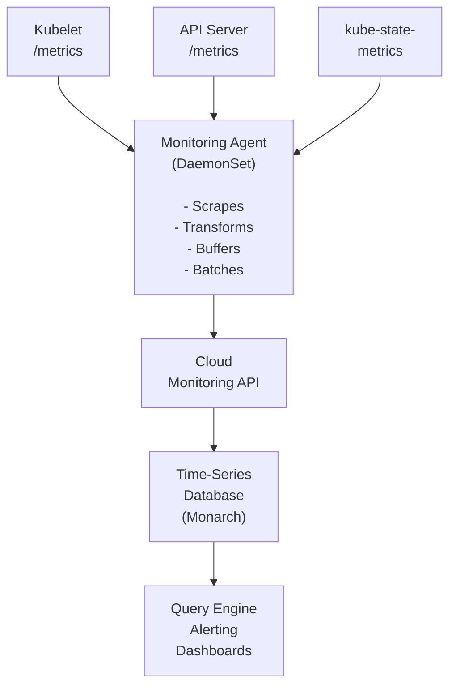
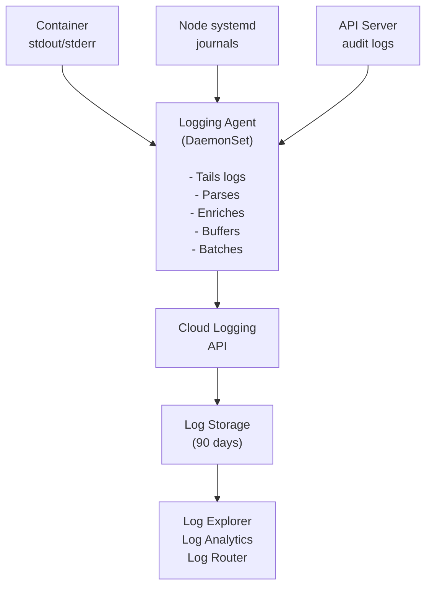
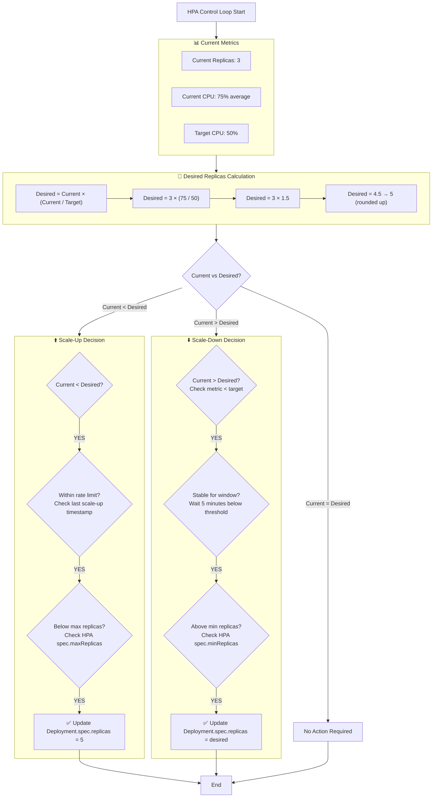
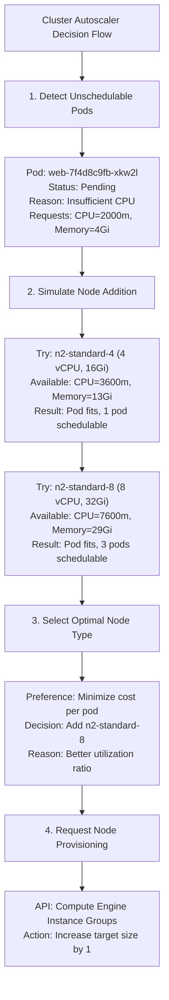

# Lesson 6: Operations, Observability, Autoscaling: Production Resilience

## 1. First-Principles Intuition & Invariants

Production Kubernetes clusters exist in a state of perpetual flux. Workloads scale with traffic patterns that follow circadian rhythms, seasonal campaigns, and unpredictable viral events. Nodes fail due to hardware degradation, kernel panics, or cloud provider maintenance windows. Applications deploy continuously, replacing old pods with new ones in rolling waves that must never drop traffic. The fundamental challenge of production resilience is maintaining service-level objectives while the substrate beneath your applications constantly shifts.

Google Kubernetes Engine distinguishes itself from self-managed Kubernetes through its deeply integrated control plane that transforms operational complexity into declarative configuration. Where a self-managed cluster requires you to manually provision monitoring agents, configure log aggregation pipelines, implement autoscaling controllers, and orchestrate disaster recovery procedures, GKE embeds these capabilities directly into the platform fabric. The control plane maintains constant vigilance over cluster state, comparing observed reality against desired specifications and driving reconciliation loops that heal divergence.

The operational model rests on three invariant principles that govern all production-grade distributed systems. First, observability precedes reliability—you cannot fix what you cannot see. Every component in the request path must emit structured telemetry that preserves causal relationships across service boundaries. Second, capacity management operates as a continuous optimization problem balancing cost against performance headroom. Autoscaling systems must react faster than traffic growth while avoiding oscillation that wastes resources. Third, failure domains must be isolated through defense-in-depth layering where no single component failure cascades into total system collapse.

GKE's observability substrate integrates with Google Cloud's operations suite, previously known as Stackdriver, which provides unified monitoring, logging, and tracing across the entire infrastructure stack. Unlike bolt-on observability solutions that instrument applications after deployment, Cloud Monitoring and Cloud Logging sit directly in the data path. Every API server request, kubelet state transition, and container lifecycle event flows through instrumentation hooks that extract metrics and logs before forwarding them to durable storage. This architectural positioning eliminates the sampling bias and blind spots that plague sidecar-based observability where instrumentation competes with application workloads for CPU and memory.

The autoscaling subsystem implements a hierarchical control system with three distinct feedback loops operating at different time scales. Horizontal Pod Autoscaling (HPA) operates at the pod replica level with a default control loop period of fifteen seconds, scaling workloads based on CPU utilization, memory consumption, or custom metrics scraped from application endpoints. Vertical Pod Autoscaling (VPA) operates at the container resource request level with a longer evaluation window, adjusting CPU and memory reservations based on historical usage patterns. Cluster Autoscaler operates at the node infrastructure level, adding or removing compute capacity based on pod scheduling pressure. These three systems must coordinate without creating destructive interference patterns where one controller's actions trigger cascading reactions in others.

Health checking forms the foundation of self-healing infrastructure. Kubernetes implements three distinct probe types—liveness probes that restart unhealthy containers, readiness probes that control load balancer traffic routing, and startup probes that provide extended initialization windows for slow-starting applications. Each probe type serves a specific failure domain. Liveness probes detect application deadlock where a process remains running but cannot make forward progress. Readiness probes isolate transient failures like database connection pool exhaustion where the application cannot serve traffic but may recover without restart. Startup probes handle initialization phases that exceed normal health check timeouts, preventing premature liveness probe failures during lengthy data loading or cache warming operations.

Rolling updates implement zero-downtime deployments through careful orchestration of pod lifecycle transitions. The Deployment controller maintains two ReplicaSets simultaneously during a rollout—the old ReplicaSet scaling down as the new ReplicaSet scales up. The `maxSurge` parameter controls how many extra pods can exist above desired replica count, trading memory overhead for faster rollout speed. The `maxUnavailable` parameter sets the maximum number of pods that can be simultaneously unavailable, trading rollout speed for blast radius containment. The interplay between these parameters, pod disruption budgets, and readiness probe latency determines whether a rollout completes smoothly or triggers cascading failures.

Disaster recovery transcends simple backup and restore procedures. Modern distributed systems require continuous replication across failure domains with automated failover mechanisms that maintain service availability during regional outages. GKE regional clusters distribute control plane components and worker nodes across multiple zones within a region, providing tolerance for single-zone failures without manual intervention. Backup strategies must capture both cluster configuration state stored in etcd and persistent volume data attached to workloads. The recovery time objective (RTO) and recovery point objective (RPO) drive architectural decisions about synchronous versus asynchronous replication, backup frequency, and failover automation.

Cost optimization in Kubernetes clusters operates as a constraint satisfaction problem with multiple competing objectives. You must maintain sufficient capacity headroom to absorb traffic spikes without violating latency SLOs while minimizing idle resource waste. Preemptible VMs and Spot instances offer substantial cost savings but inject transient failures that workloads must tolerate through proper pod disruption budgets and replica counts. Committed use discounts reward capacity planning accuracy but penalize architectural changes that shift resource profiles. The optimal cost structure emerges from understanding your workload's performance characteristics, traffic patterns, and failure tolerance thresholds.

## 2. Core Architecture & Mechanics

The Cloud Monitoring architecture implements a time-series database optimized for high-cardinality dimensional metrics with microsecond-precision timestamps. Every metric consists of a metric type identifier, a set of label key-value pairs that define dimensions, and a sequence of timestamped values. The metric type follows a hierarchical namespace convention like `kubernetes.io/container/cpu/core_usage_time` that encodes the resource hierarchy. Labels attach metadata dimensions such as `cluster_name`, `namespace_name`, `pod_name`, and `container_name` that enable filtering and aggregation during query execution.

Metric collection flows through a multi-stage pipeline that begins with metric sources embedded in GKE components. The kubelet exposes container metrics through the `/metrics/cadvisor` and `/metrics/resource` endpoints using the Prometheus exposition format. The API server emits control plane metrics tracking request latency, admission webhook duration, and etcd operation performance. The kube-state-metrics service synthesizes higher-level Kubernetes object metrics by watching API server state changes and computing derived metrics like pod restart counts and deployment rollout status.



The Google Cloud Monitoring agent, deployed as a DaemonSet on every node, implements the collection and forwarding pipeline. It scrapes metric endpoints at regular intervals, applies label transformations to normalize dimension names, buffers samples in memory to absorb temporary API unavailability, and batches writes to the Cloud Monitoring API to reduce request overhead. The agent maintains an internal write-ahead log that prevents metric loss during agent restarts. When the agent falls behind due to API throttling or network disruption, it implements exponential backoff with jitter to avoid thundering herd reconnection patterns.

The time-series database uses a columnar storage layout optimized for time-range queries and label-based filtering. Each metric type stores its values in a separate table partitioned by time windows, typically one hour or one day depending on retention policy. Within each partition, values compress using delta-of-delta encoding for timestamps and XOR-based compression for floating-point values, techniques derived from Facebook's Gorilla time-series database. Label indexes use inverted indexes where each unique label value points to the set of time series containing that label, enabling rapid filtering without scanning all series.

Query execution implements a distributed scatter-gather pattern where the query coordinator decomposes temporal and dimensional predicates into per-partition subqueries dispatched to storage nodes. Each storage node evaluates its local partition, applies time-range filters, performs label matching, and executes aggregation functions. The coordinator merges partial results, applies final aggregations, and streams responses to the client. Complex queries involving multi-metric joins or rate calculations across long time windows distribute computation across hundreds of storage nodes to maintain interactive query latency.

Cloud Logging implements a structured logging pipeline that preserves the semantic structure of log entries rather than flattening them into unstructured text lines. Each log entry consists of a timestamp, severity level, resource descriptor identifying the source, and a payload that can be structured JSON or unstructured text. The resource descriptor follows the same hierarchical model as metrics, identifying whether the log originated from a container, pod, node, or cluster-level component. Structured payloads enable precise field extraction during query processing without brittle regex parsing that breaks when log formats evolve.



The logging agent runs as a DaemonSet with privileged access to node filesystem paths where container runtime writes container logs. On GKE nodes using containerd, logs write to `/var/log/pods/{namespace}_{pod}_{uid}/{container}/` as newline-delimited files. The agent tails these files, parses JSON-structured entries if present, enriches each entry with Kubernetes metadata like namespace and pod name by querying the local kubelet API, and forwards entries to Cloud Logging. For nodes using Docker, the agent reads from journald where Docker logs via the `journald` logging driver.

Log routing implements a powerful filtering and transformation layer that directs log entries to different sinks based on inclusion and exclusion filters. A sink defines a destination like Cloud Storage for archival, BigQuery for analytical queries, or Pub/Sub for streaming processing, plus a filter expression in Cloud Logging Query Language. Filter expressions match against any field in the log entry structure, enabling rules like routing all error-level logs from production namespaces to a dedicated incident management sink while routing verbose debug logs from development namespaces to inexpensive archival storage.

The Horizontal Pod Autoscaler implements a proportional feedback controller that adjusts replica counts based on the ratio between observed metric values and target thresholds. The controller runs in the API server as part of the controller manager, evaluating all HPA objects every fifteen seconds by default. For each HPA, the controller queries the metrics API to retrieve current values for the target metric across all pods selected by the HPA's label selector. It computes the average metric value, divides by the target threshold to get a utilization ratio, and multiplies the current replica count by this ratio to get the desired replica count.

The scaling calculation implements rate limiting and stabilization windows to prevent thrashing. When scaling up, the controller applies the desired replica count immediately to respond quickly to traffic increases. When scaling down, the controller waits for a stabilization window, five minutes by default, during which the metric must remain below the threshold before reducing replicas. This asymmetry reflects the different risk profiles—scaling up too slowly drops traffic, while scaling down too quickly triggers immediate scale-up oscillation. The controller also enforces minimum and maximum replica bounds and respects a scale-up rate limit that prevents doubling replicas more frequently than every three minutes.



The Vertical Pod Autoscaler operates through three cooperating components: the Recommender generates resource recommendations based on historical usage, the Updater triggers pod evictions to apply new recommendations, and the Admission Controller injects recommendations into new pods at creation time. Unlike HPA which modifies an external object (Deployment replicas), VPA modifies the pod spec itself, specifically the `resources.requests` fields that determine scheduling and QoS class.

The Recommender watches pod metrics over a sliding time window, typically seven days, computing percentile statistics for CPU and memory usage. It applies a confidence multiplier to account for traffic variability, typically setting requests at the 90th percentile of observed usage plus a safety margin. For CPU, the recommendation targets efficient packing without throttling. For memory, the recommendation must prevent OOM kills, so it uses a higher percentile and larger safety margin since memory is non-compressible and OOM termination disrupts service availability.

VPA operates in three modes that control how aggressively it applies recommendations. In `Off` mode, VPA generates recommendations but does not modify pods, useful for evaluating impact before enabling. In `Initial` mode, VPA applies recommendations only when pods are created, not to running pods, suitable for stateful workloads where eviction causes prolonged recovery. In `Auto` mode, VPA evicts pods whose actual requests differ significantly from recommendations, triggering the Deployment controller to recreate them with updated resource specifications. The eviction threshold prevents thrashing where small metric fluctuations trigger continuous pod restarts.

The Cluster Autoscaler monitors unschedulable pods caused by insufficient node capacity and provisions additional nodes to satisfy their resource requirements. It runs as a Deployment in the cluster, querying the API server every ten seconds for pending pods. When it finds pods stuck in the Pending state with a scheduler failure reason indicating insufficient CPU, memory, or other resources, it simulates scheduling these pods onto hypothetical new nodes with different machine type profiles to determine the most efficient node type to add.

The scaling decision balances multiple competing factors. Cost efficiency favors larger nodes that maximize resource utilization by packing more pods per node, reducing per-pod overhead from system daemons and kernel memory. Scheduling latency favors smaller nodes that provision faster and waste less capacity when partially utilized. Blast radius containment favors spreading pods across more nodes to limit impact when a node fails. The autoscaler implements these tradeoffs through configurable parameters like `--scale-down-unneeded-time` that controls how long a node must be underutilized before becoming eligible for removal.



Scale-down operates conservatively to avoid disrupting workloads. The autoscaler identifies nodes as underutilized when their CPU and memory requests fall below configurable thresholds, fifty percent by default. Before removing a node, it verifies that all pods running on that node can reschedule onto other existing nodes without violating pod disruption budgets, pod anti-affinity rules, or resource constraints. It then cordons the node to prevent new pod scheduling, drains the node by gracefully terminating pods, and finally deletes the node from the underlying instance group.

Health checks implement the liveness, readiness, and startup probe types through three distinct handler mechanisms. The `exec` handler runs a command inside the container and considers the probe successful if the command exits with status code zero. The `httpGet` handler performs an HTTP GET request to a specified path and port, succeeding on any status code between 200 and 399. The `tcpSocket` handler attempts a TCP connection to a specified port, succeeding if the connection establishes. Each handler type serves different application architectures—exec for legacy applications without HTTP endpoints, httpGet for modern HTTP services, and tcpSocket for TCP-based services like databases and message queues.

The kubelet executes probes according to configured timing parameters. The `initialDelaySeconds` parameter delays the first probe after container startup, allowing initialization to complete. The `periodSeconds` parameter controls probe frequency, balancing detection latency against overhead. The `timeoutSeconds` parameter sets the deadline for probe completion, protecting against hung applications. The `successThreshold` requires consecutive successful probes before transitioning to healthy state, preventing flapping. The `failureThreshold` requires consecutive failed probes before taking action, providing resilience against transient failures.

Liveness probe failures trigger container restart through the kubelet's restart policy. The restart applies exponential backoff, starting at ten seconds and doubling on each successive failure up to a maximum of five minutes. This backoff prevents tight restart loops that waste CPU cycles and fill logs with crash reports. The kubelet tracks restart count per container, exposing it as a metric and incrementing the `restartCount` field in the pod status. Excessive restarts indicate fundamental application problems rather than transient failures, triggering alerts for human investigation.

Readiness probe failures isolate unhealthy pods from load balancing without restarting them. The kubelet removes the pod's IP address from the endpoints object that backs any services selecting this pod. In-cluster traffic from other pods and external traffic from load balancers stops flowing to the unhealthy pod immediately upon removal from endpoints. The pod remains running, allowing it to recover from transient conditions like temporary database unavailability or circuit breaker activation. Once readiness probes succeed again, the kubelet adds the pod back to endpoints and traffic resumes.

Rolling updates orchestrate Deployment changes through a carefully controlled dance between two ReplicaSets. When you modify the Deployment's pod template, the Deployment controller creates a new ReplicaSet with zero replicas. It then begins incrementally scaling up the new ReplicaSet while scaling down the old ReplicaSet, maintaining the total pod count within bounds set by `maxSurge` and `maxUnavailable`. The update proceeds in waves, creating new pods, waiting for them to pass readiness probes, and only then terminating old pods.

```text
Rolling Update State Progression:

Initial State: Deployment with 4 replicas
ReplicaSet-v1: 4 pods (all Ready)
ReplicaSet-v2: 0 pods

Update Triggered: Change container image
maxSurge: 1 (allow 5 total pods during update)
maxUnavailable: 1 (require 3 Ready pods minimum)

Step 1: Scale up new ReplicaSet
ReplicaSet-v1: 4 pods (4 Ready)
ReplicaSet-v2: 1 pod (0 Ready → waiting for readiness)

Step 2: New pod becomes Ready, scale down old
ReplicaSet-v1: 4 pods (4 Ready → 3 Ready after termination)
ReplicaSet-v2: 1 pod (1 Ready)

Step 3: Continue scaling new, maintain constraints
ReplicaSet-v1: 3 pods (3 Ready)
ReplicaSet-v2: 2 pods (1 Ready, 1 Starting)

Step 4: Repeat until completion
ReplicaSet-v1: 0 pods
ReplicaSet-v2: 4 pods (4 Ready)
```

The update respects pod disruption budgets that limit voluntary disruptions. A PodDisruptionBudget specifies either a `minAvailable` count or `maxUnavailable` count of pods that must or can be simultaneously unavailable. During a rolling update, the Deployment controller checks whether terminating a pod would violate any PDB before proceeding. If the PDB blocks termination, the update pauses until pods become available through normal lifecycle events like scheduled maintenance or autoscaler scale-down.

Update failures trigger automatic rollback through the Deployment's revision history. The Deployment controller maintains a configurable number of old ReplicaSets, ten by default, enabling rollback to any previous version. When the new ReplicaSet fails to reach the desired replica count within a progress deadline, typically ten minutes, the controller marks the Deployment as failed and halts the rollout. You can manually trigger rollback by reverting the pod template to a previous revision, or use `kubectl rollout undo` to automatically restore the most recent working version.

Disaster recovery for GKE clusters requires capturing both control plane state and persistent data. The control plane state resides in etcd, containing all Kubernetes objects like Deployments, Services, ConfigMaps, and RBAC policies. Persistent data resides in persistent volumes backed by Compute Engine disks, Cloud Storage buckets, or Cloud Filestore shares. A complete backup must capture both dimensions, preserving the relationships between stateful workloads and their storage.

GKE regional clusters provide built-in disaster recovery for control plane failures by distributing API server replicas and etcd members across multiple zones. Each zone runs an independent etcd member participating in a distributed Raft quorum. When one zone fails, the surviving zones maintain quorum and continue serving API requests without manual intervention. The control plane automatically replicates configuration changes to all zones, ensuring consistent state. Worker nodes distribute across zones according to node pool configuration, isolating workload failures to single zones.

Backup strategies for persistent volumes depend on the underlying storage backend. Compute Engine persistent disks support volume snapshots that capture point-in-time disk images. Snapshots implement copy-on-write, storing only blocks that differ from the previous snapshot, minimizing storage costs. You can automate snapshot creation through scheduled cron jobs that use the Compute Engine API or through third-party backup operators like Velero. Restoration creates new disks from snapshots, which you then attach to pods by creating PersistentVolume and PersistentVolumeClaim objects pointing to the new disks.

For application-level backup, Velero provides a cloud-native backup and restore solution that captures both Kubernetes resources and persistent volumes. Velero implements backup as a two-phase process: first, it calls the Kubernetes API to export all objects matching the backup's label selectors, serializing them to JSON files stored in Cloud Storage; second, it triggers volume snapshot creation for all persistent volumes referenced by the backed-up pods. Restoration reverses this process, creating objects from stored JSON and creating volumes from snapshots. Velero supports scheduled backups, retention policies, and cross-cluster migration scenarios.

## 3. High-Performance Optimization & Failure Modes

Monitoring query performance degrades rapidly with increasing cardinality, the product of label value combinations. A metric with five labels each having ten possible values creates 100,000 potential time series. Query engines must evaluate filters against this expanded dimensionality, scanning indexes and loading data from storage. The solution requires careful label design that captures operationally relevant dimensions without exploding cardinality. Prefer coarse-grained labels like `pod_name` over fine-grained labels like `request_id`. Use log entries rather than metric labels for high-cardinality dimensions like user IDs or transaction IDs.

Alert fatigue emerges when monitoring thresholds trigger too frequently, training operators to ignore notifications. Effective alerting applies multiple techniques to reduce false positives. Use longer evaluation windows that smooth transient spikes—alerting on five minutes of elevated error rate rather than a single spike prevents alarms during brief network hiccups. Implement composite conditions that require multiple signals to align—alert when both error rate increases and latency degrades, not just one metric alone. Route alerts based on severity, sending critical production outages to paging systems while routing warning-level issues to ticketing systems for asynchronous investigation.

The HPA controller can enter oscillation patterns where scaling actions trigger counterproductive responses. Consider an HPA targeting fifty percent CPU with a workload that drops to forty percent after scaling up, triggering immediate scale-down that pushes CPU to sixty percent, triggering scale-up again. This oscillation wastes resources through constant pod churn and degrades performance through scheduling overhead. The stabilization window and rate limiting mitigate this, but pathological workloads with sharp demand transitions may require custom metrics that better represent service capacity than raw CPU utilization.

Memory-based autoscaling presents unique challenges because memory is non-compressible and many applications pre-allocate memory at startup. A Java application configured with a large heap consumes that heap immediately, showing constant high memory utilization regardless of actual load. HPA based on memory percentage cannot distinguish between genuinely overloaded applications and applications with aggressive memory configuration. Solutions include custom metrics that track application-specific load indicators like request queue depth, or using memory-based VPA to right-size resource requests rather than replica counts.

VPA and HPA interact in complex ways when both target the same Deployment. HPA scales replicas while VPA adjusts per-pod resources, creating potential conflicts. If HPA scales up due to high CPU but VPA simultaneously increases CPU requests per pod, the net capacity gain may differ from expected. GKE recommends avoiding simultaneous VPA and HPA on CPU or memory metrics, instead configuring HPA to scale on custom metrics like requests per second while letting VPA optimize resource efficiency. For stateless workloads, prefer HPA over VPA because horizontal scaling provides better fault isolation and more granular capacity adjustment.

The Cluster Autoscaler introduces scheduling latency when node provisioning delays exceed pod startup time. Compute Engine typically provisions nodes in two to three minutes, during which pods remain in Pending state. Applications sensitive to scale-up latency should maintain headroom by setting minimum node counts that absorb traffic spikes without requiring node addition. Alternatively, pre-provision nodes using node pools with minimum sizes that scale down during low-demand periods but scale up faster during peaks because nodes already exist in a stopped state.

Cluster Autoscaler can orphan pods when scale-down incorrectly identifies nodes as empty. This occurs when pods use host network or host port configurations that the autoscaler cannot detect through normal pod resource accounting. Prevent this by setting the `cluster-autoscaler.kubernetes.io/safe-to-evict: "false"` annotation on pods that require special handling. Alternatively, adjust scale-down utilization thresholds and grace periods to prefer keeping nodes longer over aggressive cost optimization.

Health check tuning requires understanding application startup characteristics and failure modes. Liveness probes that fire too quickly kill containers that need longer initialization, creating restart loops. Startup probes with generous timeouts solve this for slow-starting applications, allowing them to initialize without liveness probe interference. Conversely, readiness probes that succeed too quickly admit traffic to containers that have not fully warmed caches or connection pools, causing request failures. Calibrate readiness probes by measuring actual application readiness time under production load, not just successful startup.

Readiness probe failures during rolling updates can deadlock the update process. If new pods never pass readiness due to configuration errors or dependency failures, the Deployment controller never terminates old pods because the new pods cannot serve traffic. The update stalls with both old and new ReplicaSets running simultaneously, consuming double resources. The progress deadline timeout eventually fails the Deployment, but investigation and rollback waste time. Prevent this by validating configurations in staging environments and implementing pre-deployment validation hooks that catch configuration errors before rollout begins.

Pod disruption budgets that are too strict can prevent necessary maintenance operations. A PDB with `minAvailable: 100%` blocks all voluntary disruptions, preventing node drains during cluster upgrades or autoscaler scale-down. Kubernetes cannot evict any pod without violating the PDB, forcing administrators to delete the PDB before proceeding with maintenance. Design PDBs to allow at least one pod unavailable for small deployments, or use percentage-based `minAvailable: 80%` for larger deployments to permit some disruption while maintaining service availability.

Log volume management requires proactive retention policies and sampling strategies. High-traffic applications generate gigabytes of logs per hour, overwhelming storage budgets and making query performance unusable. Implement log sampling for verbose debug logs, capturing only a fraction of entries while logging all error and warning levels. Use log exclusion filters to drop noisy logs that provide minimal operational value, like successful health check requests or static asset access logs. Archive old logs to Cloud Storage where they remain queryable through BigQuery external tables but cost significantly less than hot Cloud Logging storage.

Backup and restore testing must occur regularly because untested backups inevitably fail during actual disaster scenarios. Schedule quarterly disaster recovery drills that perform full cluster restoration from backup to a separate test cluster. Verify that all stateful applications recover with correct data and that service dependencies reconnect properly. Measure actual RTO by timing the restore process from disaster declaration to full service availability. Adjust backup frequency and retention based on measured RPO—if the business can tolerate one hour of data loss, hourly backups suffice, but financial transaction systems may require continuous replication.

Cost optimization requires instrumenting cloud spend visibility at the namespace and workload level. Enable GKE cost allocation by configuring namespace labels and applying them to all resources. Cloud Billing exports these labels to BigQuery, enabling SQL queries that attribute costs to specific teams or applications. Identify expensive workloads by joining usage metrics from Cloud Monitoring with billing data, revealing compute-intensive services that may benefit from more efficient algorithms or right-sized instance types. Implement chargeback or showback models that surface costs to development teams, creating economic incentives for efficiency improvements.

Preemptible VMs in node pools reduce costs by up to eighty percent compared to standard instances but require workload tolerance for sudden termination. Preemptible nodes receive thirty-second termination notices, after which the cloud provider forcibly shuts down the VM. Applications must handle SIGTERM signals gracefully, completing in-flight requests within the termination grace period. Use preemptible nodes for stateless workloads that can reschedule quickly and maintain sufficient replica counts to absorb preemption without violating SLOs. Combine preemptible and standard node pools, using pod node affinity to prefer preemptible nodes while tolerating fallback to standard nodes during preemption waves.

Committed use discounts require accurate long-term capacity planning but offer up to fifty-seven percent savings compared to on-demand pricing. Analyze historical resource usage over at least three months to identify baseline capacity that remains constant regardless of traffic patterns. Commit to this baseline capacity through one-year or three-year discount contracts. Scale above committed capacity using on-demand or preemptible instances that absorb traffic variability. Re-evaluate commitments quarterly as application architectures evolve and usage patterns shift, adjusting contracts during renewal windows.

Cluster sprawl multiplies operational overhead and dilutes cost visibility. Organizations often create separate clusters for each application team or environment, resulting in dozens of underutilized clusters with independent control planes, node pools, and monitoring stacks. Consolidate workloads using namespace isolation, network policies, and RBAC to achieve multi-tenancy within fewer larger clusters. Use separate node pools within a cluster to isolate workload types, providing dedicated nodes for high-priority production services while sharing best-effort nodes for development and testing. This consolidation reduces per-cluster overhead from system pods and improves resource utilization through better bin packing.

Monitoring cost scales with metric and log volume. High-cardinality metrics or verbose logging can consume more budget than the infrastructure being monitored. Reduce monitoring costs by decreasing retention periods for low-priority logs, aggregating metrics before ingestion, and using sampling for high-volume debug logs. GKE Autopilot clusters provide more aggressive default log filtering compared to Standard clusters, dropping verbose logs from system components that provide minimal operational insight. Evaluate whether operational value justifies monitoring costs—retaining seven days of debug logs may provide adequate troubleshooting capability at a fraction of the cost of ninety-day retention.

This lesson establishes the production operation foundations required for resilient GKE deployments. The integration of monitoring, logging, autoscaling, health checking, and disaster recovery transforms Kubernetes from a development platform into an enterprise-grade production runtime. The next lesson examines security hardening, workload identity, and policy enforcement that protect these production systems from unauthorized access and malicious activity.
