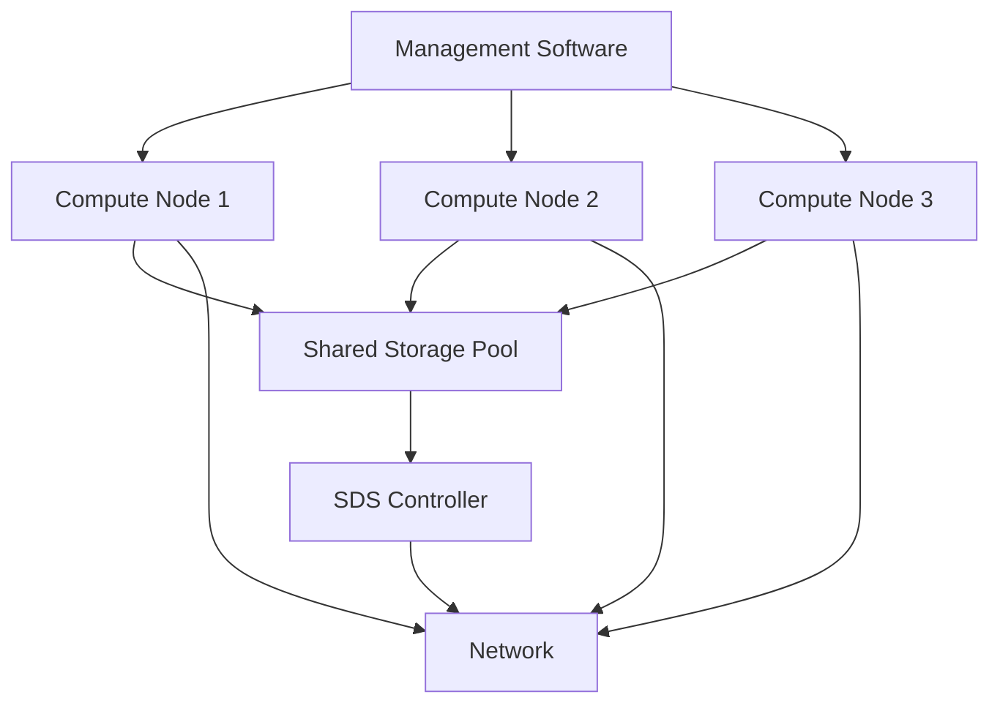

# Lesson 1: HCI Architecture Overview

## 1. First-Principles Intuition & Invariants

Hyper-Converged Infrastructure (HCI) represents a paradigm shift in data center architecture, aiming to simplify and optimize the deployment and management of computing resources. At its core, HCI consolidates storage, compute, and networking into a single, integrated system. This consolidation is driven by the need to address the inefficiencies and complexities inherent in traditional three-tier architectures, where storage, compute, and networking are managed separately. The theoretical grounding of HCI is rooted in the principles of abstraction, resource pooling, and automation, which collectively aim to enhance operational efficiency, scalability, and fault tolerance.

The problem space that HCI addresses is multifaceted. In traditional data centers, the separation of storage, compute, and networking leads to siloed management, increased operational overhead, and suboptimal resource utilization. HCI seeks to alleviate these issues by providing a unified platform that abstracts the underlying hardware, allowing for seamless scaling and management. The invariants of HCI include the seamless integration of storage and compute resources, the ability to scale out by adding more nodes, and the provision of high availability and fault tolerance through redundancy and automated failover mechanisms.

From a mathematical and systems perspective, HCI can be understood through the lens of resource pooling and load balancing. Resource pooling involves aggregating multiple physical resources into a single logical resource, which can then be dynamically allocated to different workloads. This abstraction layer allows for efficient resource utilization and simplifies the management of complex infrastructure. Load balancing, on the other hand, ensures that resources are distributed evenly across the system, preventing any single node from becoming a bottleneck. These principles are fundamental to the design and operation of HCI systems, enabling them to deliver high performance and reliability.

## 2. Core Architecture & Mechanics

The core architecture of HCI is built around a distributed, scale-out model where each node in the cluster contributes both compute and storage resources. This architecture is typically implemented using a combination of software-defined storage (SDS) and software-defined networking (SDN) technologies. The key components of an HCI system include the compute nodes, storage nodes, and management software.

Each compute node in an HCI cluster is equipped with a combination of CPUs, memory, and local storage. These nodes are interconnected via a high-speed network, which is used for both data transfer and management communication. The local storage on each node is aggregated into a shared storage pool using SDS technologies, which provide features such as data replication, erasure coding, and thin provisioning. This shared storage pool is then presented to the compute nodes as a single, logical storage resource, allowing for efficient data access and management.

The management software in an HCI system is responsible for orchestrating the deployment, scaling, and management of the cluster. This software typically includes features such as resource management, workload scheduling, and monitoring. The management software uses a combination of declarative state machines and continuous level-triggered reconciliation loops to ensure that the cluster is always in the desired state. This approach allows for automated scaling and failover, ensuring high availability and fault tolerance.

To illustrate the core architecture of HCI, consider the following diagram:

In this diagram, each compute node is connected to the shared storage pool, which is managed by the SDS controller. The management software orchestrates the deployment and management of the cluster, ensuring that the system is always in the desired state.

## 3. High-Performance Optimization & Failure Modes

The high-performance optimization of HCI systems is achieved through a combination of resource pooling, load balancing, and efficient data management. Resource pooling allows for the aggregation of multiple physical resources into a single logical resource, which can then be dynamically allocated to different workloads. Load balancing ensures that resources are distributed evenly across the system, preventing any single node from becoming a bottleneck. Efficient data management, achieved through SDS technologies, ensures that data is stored and accessed efficiently, minimizing latency and maximizing throughput.

Concurrency is a critical aspect of HCI systems, as they must be able to handle multiple workloads simultaneously. To achieve high concurrency, HCI systems use a combination of parallel processing and distributed computing techniques. Parallel processing involves executing multiple tasks simultaneously on a single node, while distributed computing involves executing tasks across multiple nodes in the cluster. Both techniques are essential for achieving high performance and scalability.

Resource scaling is another critical aspect of HCI systems, as they must be able to scale out by adding more nodes as demand increases. To achieve resource scaling, HCI systems use a combination of automated scaling and dynamic resource allocation techniques. Automated scaling involves automatically adding or removing nodes from the cluster based on demand, while dynamic resource allocation involves dynamically allocating resources to workloads based on their requirements.

Boundary edge cases and failure modes are also critical considerations in HCI systems. Boundary edge cases include scenarios where the system is operating at its limits, such as when all nodes are fully utilized or when the network is congested. Failure modes include scenarios where the system is unable to meet its performance or availability requirements, such as when a node fails or when the network is partitioned. To mitigate these issues, HCI systems use a combination of redundancy, automated failover, and monitoring techniques. Redundancy involves replicating data and resources across multiple nodes, automated failover involves automatically switching to a backup node in the event of a failure, and monitoring involves continuously monitoring the system for performance and availability issues.

In conclusion, Hyper-Converged Infrastructure (HCI) represents a significant advancement in data center architecture, offering a unified platform that abstracts the underlying hardware and simplifies the management of complex infrastructure. The core architecture of HCI is built around a distributed, scale-out model where each node in the cluster contributes both compute and storage resources, and the management software orchestrates the deployment, scaling, and management of the cluster. High-performance optimization and failure mitigation are achieved through a combination of resource pooling, load balancing, efficient data management, concurrency, resource scaling, redundancy, automated failover, and monitoring techniques.
