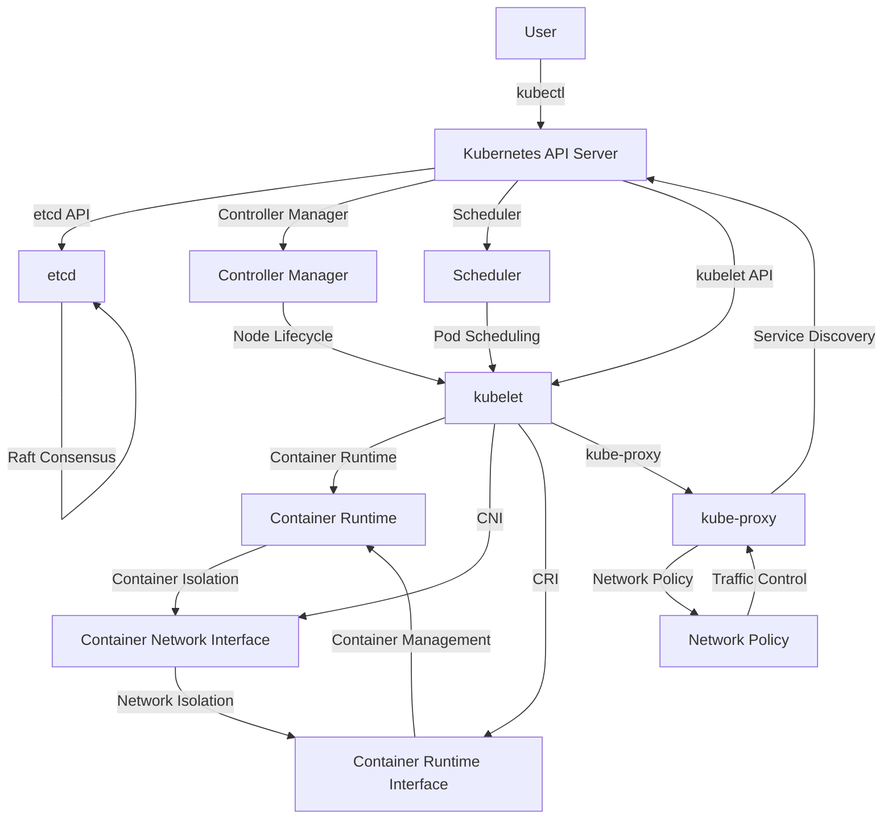

# Lesson 5: RKE2 Security and Management

## 1. First-Principles Intuition & Invariants

In the realm of container orchestration, Rancher Kubernetes Engine 2 (RKE2) emerges as a robust, lightweight, and secure alternative to its more resource-intensive counterpart, RKE. RKE2 is designed to simplify the deployment and management of Kubernetes clusters, particularly in environments where resource constraints are a concern. At its core, RKE2 embodies a set of architectural principles that prioritize security, efficiency, and ease of use. These principles are grounded in the fundamental concepts of distributed systems, container isolation, and security best practices.

The security of RKE2 is built upon several invariants that ensure the integrity and confidentiality of the cluster. One such invariant is the use of mutual TLS (Transport Layer Security) for all communication between nodes and the control plane. This ensures that only authenticated and authorized entities can communicate within the cluster, mitigating the risk of man-in-the-middle attacks. Another invariant is the enforcement of strict RBAC (Role-Based Access Control) policies, which ensure that users and services have the minimum necessary permissions to perform their tasks. This principle of least privilege is crucial in preventing unauthorized access and privilege escalation within the cluster.

The management of RKE2 is centered around the concept of declarative state machines, where the desired state of the cluster is defined and continuously reconciled by the control plane. This approach ensures that the cluster remains in a consistent and predictable state, even in the face of failures or changes in the environment. The use of etcd as the distributed key-value store for RKE2 is a critical component of this architecture, as it provides a reliable and fault-tolerant mechanism for storing and retrieving cluster state.

## 2. Core Architecture & Mechanics

The architecture of RKE2 is designed to be both efficient and secure, leveraging several key components and mechanisms to achieve these goals. At the heart of RKE2 is the control plane, which consists of the Kubernetes API server, etcd, and several controller components. These components work together to manage the state of the cluster and ensure that the desired state is achieved.

One of the key architectural decisions in RKE2 is the use of a single-node etcd cluster for small deployments. This simplifies the deployment process and reduces the resource overhead associated with maintaining a multi-node etcd cluster. For larger deployments, RKE2 supports the use of a multi-node etcd cluster, which provides enhanced fault tolerance and scalability. The etcd cluster in RKE2 is configured to use Raft consensus, which ensures that changes to the cluster state are replicated across all nodes in a consistent and reliable manner.

The security of RKE2 is further enhanced by the use of mutual TLS for all communication between nodes and the control plane. This ensures that all data transmitted within the cluster is encrypted and authenticated, preventing unauthorized access and eavesdropping. The use of mutual TLS is complemented by the enforcement of strict RBAC policies, which ensure that users and services have the minimum necessary permissions to perform their tasks. This is achieved through the use of Kubernetes RBAC APIs, which allow administrators to define roles and bindings that specify the permissions granted to users and services.

The management of RKE2 is centered around the concept of declarative state machines, where the desired state of the cluster is defined and continuously reconciled by the control plane. This approach ensures that the cluster remains in a consistent and predictable state, even in the face of failures or changes in the environment. The use of etcd as the distributed key-value store for RKE2 is a critical component of this architecture, as it provides a reliable and fault-tolerant mechanism for storing and retrieving cluster state.

To illustrate the architecture of RKE2, we can use a Mermaid diagram to depict the key components and their interactions:

In this diagram, the Kubernetes API server acts as the central hub for all communication within the cluster. It interacts with etcd to store and retrieve cluster state, with the controller manager and scheduler to manage the lifecycle of nodes and the scheduling of pods, and with the kubelet to manage the containers running on each node. The container runtime and container network interface work together to provide container isolation and network isolation, while the kube-proxy and network policy components provide service discovery and traffic control.

## 3. High-Performance Optimization & Failure Modes

The performance and reliability of RKE2 are critical factors in its design and implementation. One of the key optimizations in RKE2 is the use of a single-node etcd cluster for small deployments, which reduces the resource overhead associated with maintaining a multi-node etcd cluster. For larger deployments, RKE2 supports the use of a multi-node etcd cluster, which provides enhanced fault tolerance and scalability. The etcd cluster in RKE2 is configured to use Raft consensus, which ensures that changes to the cluster state are replicated across all nodes in a consistent and reliable manner.

Another optimization in RKE2 is the use of mutual TLS for all communication between nodes and the control plane. This ensures that all data transmitted within the cluster is encrypted and authenticated, preventing unauthorized access and eavesdropping. The use of mutual TLS is complemented by the enforcement of strict RBAC policies, which ensure that users and services have the minimum necessary permissions to perform their tasks. This is achieved through the use of Kubernetes RBAC APIs, which allow administrators to define roles and bindings that specify the permissions granted to users and services.

The management of RKE2 is centered around the concept of declarative state machines, where the desired state of the cluster is defined and continuously reconciled by the control plane. This approach ensures that the cluster remains in a consistent and predictable state, even in the face of failures or changes in the environment. The use of etcd as the distributed key-value store for RKE2 is a critical component of this architecture, as it provides a reliable and fault-tolerant mechanism for storing and retrieving cluster state.

In terms of failure modes, RKE2 is designed to be resilient to a wide range of failures, including node failures, network partitions, and etcd failures. The use of Raft consensus in etcd ensures that changes to the cluster state are replicated across all nodes in a consistent and reliable manner, even in the event of network partitions or node failures. The use of mutual TLS and RBAC policies ensures that unauthorized access and privilege escalation are prevented, even in the event of a security breach.

To ensure the reliability and performance of RKE2, it is important to monitor and log the cluster state and activity. RKE2 provides several tools and mechanisms for monitoring and logging, including the use of Prometheus for metrics collection and Grafana for visualization, and the use of Fluentd for log collection and Elasticsearch for log storage and analysis. These tools and mechanisms provide administrators with real-time visibility into the cluster state and activity, allowing them to quickly identify and address any issues that may arise.

In conclusion, RKE2 is a robust, lightweight, and secure container orchestration platform that is designed to simplify the deployment and management of Kubernetes clusters. Its architecture is grounded in the fundamental concepts of distributed systems, container isolation, and security best practices, and it provides a wide range of tools and mechanisms for monitoring and logging the cluster state and activity. By understanding the architecture and mechanics of RKE2, administrators can effectively manage and secure their Kubernetes clusters, ensuring that they remain reliable and performant in the face of a wide range of challenges.
