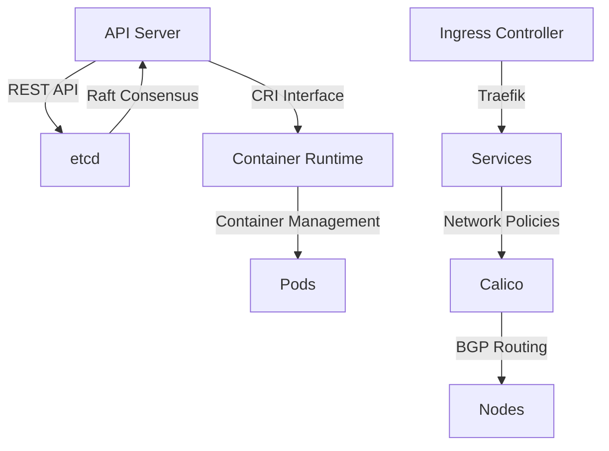
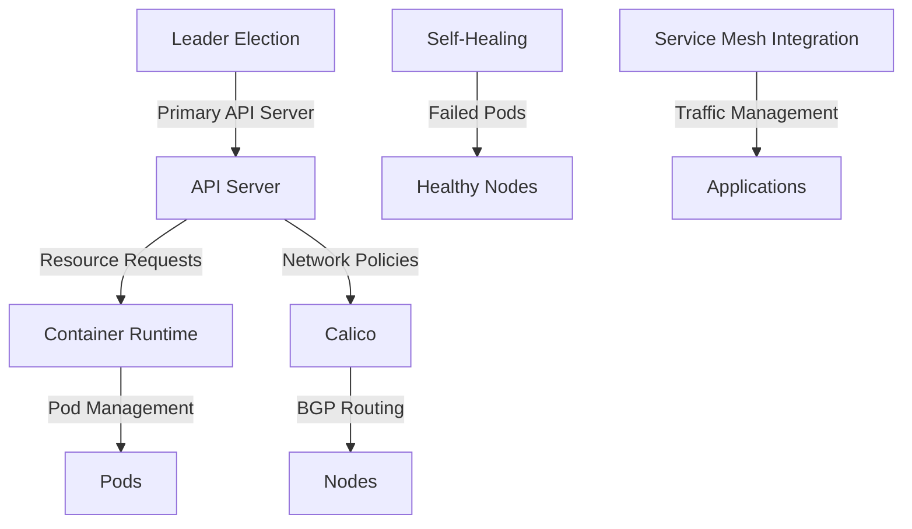

# Lesson 6: Advanced RKE2 Features and Use Cases

## 1. First-Principles Intuition & Invariants

RKE2, a Kubernetes distribution tailored for edge and IoT environments, embodies a sophisticated blend of Kubernetes' declarative state management with the operational efficiencies required for distributed systems at the edge. At its core, RKE2 leverages the Kubernetes API server, etcd, and a suite of controllers to orchestrate containerized applications across a cluster. However, its advanced features extend beyond these foundational components, addressing the unique challenges of edge computing, such as resource constraints, network latency, and the need for robust security.

One of the primary invariants in RKE2 is its commitment to minimalism and ease of deployment. This is achieved through a streamlined installation process that requires no external dependencies, a single binary, and a lightweight footprint. The system is designed to be resilient, with built-in high availability and self-healing capabilities. Another invariant is the emphasis on security, which is integrated at every layer of the system, from the kernel to the application level.

RKE2's architecture is grounded in the principles of Kubernetes, but it introduces several optimizations and enhancements to better suit edge environments. These include the use of lightweight container runtimes, efficient resource management, and advanced networking capabilities. The system's design is driven by the need to provide a robust, scalable, and secure platform for deploying containerized applications in resource-constrained environments.

## 2. Core Architecture & Mechanics

At the heart of RKE2's architecture is the Kubernetes API server, which serves as the central point of control and management for the cluster. The API server interacts with etcd, a distributed key-value store, to maintain the state of the cluster. RKE2 employs a consensus algorithm based on Raft to ensure data consistency and reliability across the etcd cluster. The Raft algorithm operates with a quorum size of $Q = \lfloor N/2 \rfloor + 1$, where $N$ is the number of nodes in the etcd cluster. This ensures that the system can tolerate up to $\lfloor (N-1)/2 \rfloor$ node failures without losing quorum.

One of the key features of RKE2 is its support for lightweight container runtimes, such as containerd and CRI-O. These runtimes are optimized for resource efficiency and provide a robust foundation for deploying containerized applications. RKE2 also includes a built-in ingress controller, which simplifies the process of exposing services to external traffic. The ingress controller is implemented using Traefik, a modern reverse proxy and load balancer that is highly efficient and easy to configure.

Another important aspect of RKE2's architecture is its networking capabilities. The system uses Calico, a popular CNI (Container Network Interface) plugin, to provide network policies and IP address management. Calico's BGP-based networking model ensures that traffic is routed efficiently across the cluster, even in the presence of network latency and packet loss. Additionally, RKE2 supports advanced networking features such as service mesh integration, which allows for fine-grained traffic management and observability.

To illustrate the internal data structures and algorithms in RKE2, we can use a Mermaid diagram to visualize the interaction between the API server, etcd, and the container runtime:

In this diagram, the API server interacts with etcd to maintain the state of the cluster, using the Raft consensus algorithm to ensure data consistency. The API server also communicates with the container runtime through the CRI (Container Runtime Interface) to manage pods. The ingress controller, implemented using Traefik, exposes services to external traffic, while Calico provides network policies and IP address management using BGP-based routing.

## 3. High-Performance Optimization & Failure Modes

RKE2 is designed to optimize performance and resource utilization in edge environments. One of the key optimizations is the use of lightweight container runtimes, such as containerd and CRI-O, which are optimized for resource efficiency. These runtimes provide a robust foundation for deploying containerized applications, with minimal overhead and low resource consumption.

Another important optimization is the use of efficient resource management techniques. RKE2 leverages Kubernetes' resource requests and limits to ensure that each pod receives the resources it needs, without consuming more than its allocated quota. This ensures that the system remains stable and responsive, even under heavy load.

RKE2 also includes several mechanisms for handling failure modes and ensuring high availability. The system uses a leader election algorithm to elect a primary API server, which is responsible for managing the cluster. If the primary API server fails, a new leader is elected automatically, ensuring that the system remains operational. Additionally, RKE2 includes a self-healing mechanism that automatically restarts failed pods and reschedules them to healthy nodes.

One of the key challenges in edge environments is network latency and packet loss. To address this, RKE2 uses Calico's BGP-based networking model to ensure that traffic is routed efficiently across the cluster. Calico's BGP-based routing model allows for fine-grained control over traffic flows, ensuring that packets are delivered reliably and efficiently.

Another important aspect of RKE2's high-performance optimization is its support for advanced networking features, such as service mesh integration. Service mesh integration allows for fine-grained traffic management and observability, enabling developers to monitor and optimize the performance of their applications. RKE2 supports several popular service mesh implementations, including Istio and Linkerd, making it easy to integrate with existing infrastructure.

In addition to its high-performance optimizations, RKE2 includes several advanced features that are particularly useful in edge environments. One of these features is the ability to deploy edge-specific workloads, such as IoT applications and machine learning models. RKE2 provides a robust platform for deploying these workloads, with support for GPU acceleration, edge caching, and other optimizations.

Another important feature of RKE2 is its support for multi-cluster management. RKE2 allows for the deployment of multiple clusters, each with its own set of nodes and resources. This enables organizations to deploy applications across multiple edge locations, ensuring that they are available and responsive, even in the presence of network latency and packet loss.

To illustrate the high-performance optimizations and failure modes in RKE2, we can use a Mermaid diagram to visualize the interaction between the API server, container runtime, and network policies:

In this diagram, the API server manages resource requests and pod management through the container runtime, while network policies are enforced using Calico's BGP-based routing model. The system uses leader election to elect a primary API server, which is responsible for managing the cluster. If the primary API server fails, a new leader is elected automatically. Additionally, the system includes a self-healing mechanism that automatically restarts failed pods and reschedules them to healthy nodes. Service mesh integration allows for fine-grained traffic management and observability, enabling developers to monitor and optimize the performance of their applications.

In conclusion, RKE2 is a powerful and flexible Kubernetes distribution that is well-suited for edge and IoT environments. Its advanced features, including lightweight container runtimes, efficient resource management, and advanced networking capabilities, enable organizations to deploy containerized applications with minimal overhead and low resource consumption. By leveraging the principles of Kubernetes, RKE2 provides a robust platform for deploying applications across multiple edge locations, ensuring that they are available and responsive, even in the presence of network latency and packet loss.
