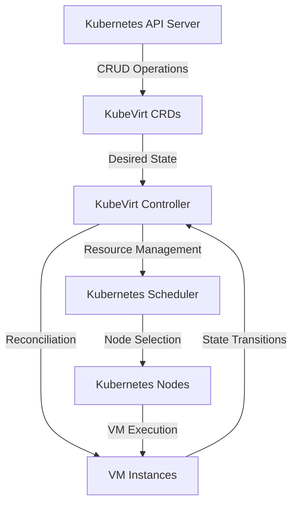

# Lesson 1: Kubevirt Architecture Overview

## 1. First-Principles Intuition & Invariants

In the realm of cloud-native infrastructure, the ability to run virtual machines (VMs) alongside containerized workloads presents a compelling opportunity to unify diverse application deployment models. KubeVirt, an open-source project that integrates VMs into Kubernetes, exemplifies this convergence. By leveraging Kubernetes' declarative state management and orchestration capabilities, KubeVirt enables the seamless deployment, scaling, and management of VMs within a Kubernetes cluster. This integration is not merely a juxtaposition of technologies but a harmonious blend that leverages the strengths of both paradigms.

At the heart of KubeVirt's design is the principle of abstraction and resource management. Kubernetes, with its robust API server and controller mechanisms, provides a powerful framework for managing distributed systems. By extending this framework to include VMs, KubeVirt inherits Kubernetes' ability to handle complex, multi-node deployments with high availability and fault tolerance. The problem space that KubeVirt addresses is the need for a unified platform that can support both containerized and virtualized workloads, enabling organizations to transition smoothly between these paradigms without sacrificing the benefits of Kubernetes.

The invariants that underpin KubeVirt's architecture are rooted in the principles of declarative state management and continuous reconciliation. Just as Kubernetes ensures that the actual state of the cluster matches the desired state specified in its manifests, KubeVirt extends this concept to VMs. This means that the desired state of a VM, including its configuration, resources, and network settings, is defined in a Kubernetes Custom Resource Definition (CRD). The KubeVirt controller then continuously reconciles this desired state with the actual state of the VM, ensuring that any discrepancies are corrected in a timely and automated manner.

## 2. Core Architecture & Mechanics

KubeVirt's architecture is built on several key components that work in concert to provide a seamless integration of VMs into Kubernetes. These components include the API server, controller, and virtual machine instances. To understand how these components interact, it is essential to delve into the internal data structures, algorithms, and execution models that power KubeVirt.

### The API Server

The Kubernetes API server serves as the central point of interaction for all components within the cluster. In the context of KubeVirt, the API server is extended to support custom resources that represent VMs. These custom resources, defined through CRDs, allow users to specify the desired state of a VM, including its CPU, memory, storage, and network configurations. The API server ensures that these resources are stored in etcd, Kubernetes' distributed key-value store, and provides a consistent and reliable interface for accessing and modifying them.

### The Controller

The KubeVirt controller is responsible for reconciling the desired state of VMs with their actual state. This process involves several key steps, including the creation, deletion, and management of VM instances. The controller continuously monitors the state of VMs and takes corrective actions when discrepancies are detected. For example, if a VM instance is terminated unexpectedly, the controller will automatically restart it to maintain the desired state.

The controller's operation is grounded in the principles of declarative state management and continuous reconciliation. It uses Kubernetes' event-driven architecture to respond to changes in the cluster, such as the creation or deletion of VM resources. When a VM resource is created, the controller triggers the creation of the corresponding VM instance. Similarly, when a VM resource is deleted, the controller ensures that the VM instance is terminated and all associated resources are cleaned up.

### Virtual Machine Instances

At the core of KubeVirt's architecture are the virtual machine instances themselves. These instances are lightweight, containerized VMs that run on top of the Kubernetes cluster. Each VM instance is managed by a dedicated controller that ensures its desired state is maintained. The VM instances are created and managed using Kubernetes' native scheduling and resource management capabilities, allowing them to be seamlessly integrated into the cluster.

The lifecycle of a VM instance is managed through a series of state transitions. When a VM resource is created, the controller triggers the creation of the corresponding VM instance. This involves launching a container that runs the VM, along with any necessary support processes, such as network and storage drivers. Once the VM instance is running, the controller continuously monitors its state and takes corrective actions when necessary.

To illustrate the architecture of KubeVirt, consider the following diagram:

In this diagram, the Kubernetes API server interacts with KubeVirt CRDs to manage the desired state of VMs. The KubeVirt controller continuously reconciles this desired state with the actual state of VM instances, ensuring that any discrepancies are corrected. The Kubernetes scheduler is responsible for selecting the appropriate nodes to run VM instances, while the VM instances themselves are executed on Kubernetes nodes.

## 3. High-Performance Optimization & Failure Modes

KubeVirt's architecture is designed to optimize performance and reliability, even in the face of complex, multi-node deployments. One of the key optimizations is the use of Kubernetes' native scheduling and resource management capabilities. By leveraging Kubernetes' sophisticated scheduling algorithms, KubeVirt can efficiently allocate resources to VM instances, ensuring that they are placed on the most suitable nodes.

Another optimization is the use of containerized VMs. By running VMs as containers, KubeVirt can take advantage of Kubernetes' lightweight, efficient container runtime. This allows VM instances to be started and stopped quickly, reducing the overhead associated with traditional VM management. Additionally, containerized VMs can be easily scaled up or down, allowing organizations to dynamically adjust their resource allocations based on demand.

In terms of failure modes, KubeVirt's architecture is designed to be resilient and fault-tolerant. The use of declarative state management and continuous reconciliation ensures that any discrepancies between the desired and actual states of VMs are corrected in a timely and automated manner. Additionally, KubeVirt leverages Kubernetes' built-in fault tolerance mechanisms, such as node failure detection and automatic restarts, to ensure that VM instances remain available even in the event of hardware failures.

One potential failure mode is the loss of a Kubernetes node. In this scenario, KubeVirt's controller will automatically restart the affected VM instances on other nodes within the cluster. This ensures that the desired state of the VMs is maintained, even in the face of node failures. Another potential failure mode is the loss of etcd, Kubernetes' distributed key-value store. To mitigate this risk, KubeVirt can be configured to use a highly available etcd cluster, ensuring that the desired state of VMs is preserved even in the event of etcd failures.

In conclusion, KubeVirt's architecture is a testament to the power of integrating VMs into Kubernetes. By leveraging Kubernetes' declarative state management and orchestration capabilities, KubeVirt provides a seamless and efficient way to manage VMs within a Kubernetes cluster. The core components of KubeVirt, including the API server, controller, and virtual machine instances, work in concert to ensure that the desired state of VMs is maintained, even in the face of complex, multi-node deployments. Through a combination of high-performance optimizations and robust fault tolerance mechanisms, KubeVirt enables organizations to transition smoothly between containerized and virtualized workloads, while maintaining the benefits of Kubernetes.
