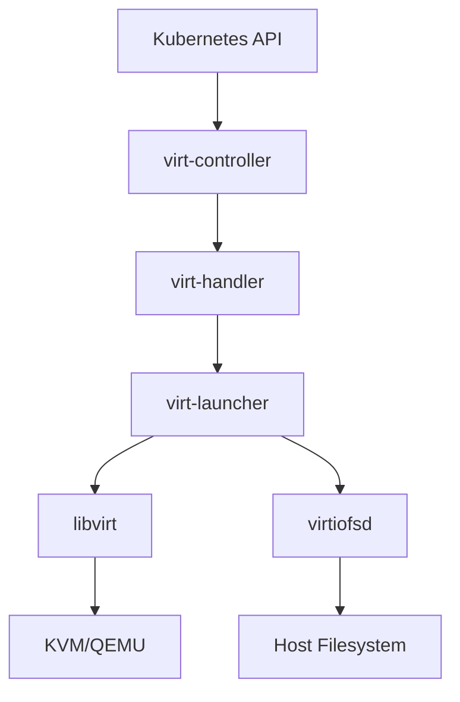

# Lesson 5: Advanced Features and Use Cases

## 1. First-Principles Intuition & Invariants

In the realm of virtualization, KubeVirt emerges as a powerful extension to Kubernetes, seamlessly integrating virtual machines (VMs) into the containerized ecosystem. To fully appreciate the advanced features and use cases of KubeVirt, it is essential to delve into the foundational principles that underpin its architecture. At its core, KubeVirt leverages the Kubernetes API to manage VMs as first-class citizens, enabling the deployment, scaling, and management of VMs alongside containerized workloads. This integration is not merely a superficial layering but a deep integration that exploits Kubernetes' declarative state management and continuous reconciliation loops.

The problem space addressed by KubeVirt is multifaceted. Traditional virtualization platforms often operate in silos, separate from container orchestration systems. This separation can lead to inefficiencies in resource utilization, increased operational complexity, and a fragmented management landscape. KubeVirt bridges this gap by allowing VMs to be managed using the same tools and paradigms as containers, thereby unifying the infrastructure and simplifying operations. This unification is achieved through a series of invariants and abstractions that ensure seamless integration and efficient resource management.

One of the key invariants in KubeVirt is the use of Kubernetes Custom Resource Definitions (CRDs) to represent VMs. CRDs allow KubeVirt to extend the Kubernetes API with new resource types, such as `VirtualMachine` and `VirtualMachineInstance`, which can be managed using familiar Kubernetes commands and tools. This abstraction layer provides a consistent interface for managing both VMs and containers, enabling developers and operators to leverage the full power of Kubernetes while maintaining the flexibility and performance of VMs.

Another critical invariant is the use of Kubernetes' declarative state management to ensure that the desired state of VMs is continuously reconciled with the actual state. This reconciliation loop is a fundamental aspect of Kubernetes' architecture and is extended to VMs in KubeVirt. By continuously monitoring the state of VMs and making the necessary adjustments to achieve the desired configuration, KubeVirt ensures high availability and reliability, even in the face of failures and changes in the infrastructure.

## 2. Core Architecture & Mechanics

To understand the advanced features and use cases of KubeVirt, it is essential to dissect its core architecture and mechanics. At the heart of KubeVirt is the `virt-handler` component, which is responsible for managing the lifecycle of VMs on each node in the Kubernetes cluster. The `virt-handler` interacts with the Kubernetes API to receive instructions for creating, starting, stopping, and deleting VMs, and it uses a combination of Linux kernel features and container runtimes to instantiate and manage these VMs.

One of the key components of the `virt-handler` is the `virt-launcher` container, which is responsible for launching and managing individual VMs. The `virt-launcher` container is a lightweight runtime that uses the `libvirt` library to manage the VM lifecycle. `libvirt` is a widely used virtualization management library that provides a consistent interface for managing VMs across different hypervisors, such as KVM, QEMU, and LXC.

The `virt-launcher` container also includes a `virtiofsd` daemon, which provides a high-performance shared filesystem between the host and the VM. `virtiofsd` uses the virtio-fs protocol, which is a shared filesystem that allows VMs to access files on the host filesystem with low latency and high throughput. This shared filesystem is particularly useful for scenarios where VMs need to access large datasets or share files with other VMs or containers.

Another critical component of KubeVirt is the `virt-controller`, which is responsible for managing the lifecycle of `VirtualMachine` and `VirtualMachineInstance` resources at the cluster level. The `virt-controller` interacts with the Kubernetes API to receive instructions for creating, starting, stopping, and deleting VMs, and it uses a combination of Kubernetes controllers and custom logic to ensure that the desired state of VMs is continuously reconciled with the actual state.

To illustrate the architecture of KubeVirt, we can use a Mermaid diagram to visualize the key components and their interactions:

In this diagram, the Kubernetes API is the central point of control, and the `virt-controller` is responsible for managing the lifecycle of VMs at the cluster level. The `virt-handler` is responsible for managing the lifecycle of VMs on each node, and it uses the `virt-launcher` container to launch and manage individual VMs. The `virt-launcher` container uses `libvirt` to manage the VM lifecycle and `virtiofsd` to provide a high-performance shared filesystem. Finally, `libvirt` interacts with the KVM/QEMU hypervisor to instantiate and manage the VMs, and `virtiofsd` interacts with the host filesystem to provide shared access to files.

## 3. High-Performance Optimization & Failure Modes

To ensure high performance and reliability, KubeVirt employs a series of optimizations and failure modes that are designed to maximize resource utilization and minimize downtime. One of the key optimizations in KubeVirt is the use of live migration, which allows VMs to be moved from one node to another without downtime. Live migration is a critical feature for ensuring high availability and scalability, as it allows VMs to be moved to nodes with available resources or to nodes that are undergoing maintenance or upgrades.

Live migration in KubeVirt is achieved through a combination of Kubernetes' declarative state management and the `libvirt` library. When a VM needs to be migrated, the `virt-controller` updates the desired state of the VM to indicate that it should be moved to a different node. The `virt-handler` on the source node then uses `libvirt` to initiate the live migration process, which involves copying the memory and state of the VM to the target node while the VM continues to run. Once the migration is complete, the `virt-handler` on the target node takes over management of the VM, and the `virt-handler` on the source node releases the resources associated with the VM.

To ensure that live migration is performed efficiently and reliably, KubeVirt employs a series of optimizations and failure modes. One of the key optimizations is the use of memory deduplication, which reduces the amount of memory that needs to be copied during the migration process. Memory deduplication is achieved through a combination of `libvirt` and the `virtio-balloon` device, which allows the VM to release unused memory pages to the host before the migration begins. This reduces the amount of memory that needs to be copied during the migration process, which in turn reduces the migration time and improves the overall performance of the system.

Another critical optimization is the use of incremental migration, which allows only the changed memory pages to be copied during the migration process. Incremental migration is achieved through a combination of `libvirt` and the `virtio-mem` device, which allows the VM to report the memory pages that have changed since the last migration. This reduces the amount of memory that needs to be copied during the migration process, which in turn reduces the migration time and improves the overall performance of the system.

In addition to these optimizations, KubeVirt also employs a series of failure modes to ensure that live migration is performed reliably. One of the key failure modes is the use of checkpointing, which allows the VM to be paused and its state to be saved before the migration begins. Checkpointing is achieved through a combination of `libvirt` and the `virtio-balloon` device, which allows the VM to release unused memory pages to the host before the migration begins. If the migration fails for any reason, the VM can be restored from the checkpoint, which ensures that the VM is not lost and that the migration process can be retried.

Another critical failure mode is the use of rollback, which allows the VM to be restored to its original state if the migration fails. Rollback is achieved through a combination of `libvirt` and the `virtio-balloon` device, which allows the VM to release unused memory pages to the host before the migration begins. If the migration fails for any reason, the VM can be restored to its original state, which ensures that the VM is not lost and that the migration process can be retried.

In addition to live migration, KubeVirt also supports multi-cluster management, which allows VMs to be managed across multiple Kubernetes clusters. Multi-cluster management is a critical feature for ensuring high availability and scalability, as it allows VMs to be moved to different clusters in response to changes in the infrastructure or workload requirements.

Multi-cluster management in KubeVirt is achieved through a combination of Kubernetes' declarative state management and the `virt-controller` component. When a VM needs to be moved to a different cluster, the `virt-controller` updates the desired state of the VM to indicate that it should be moved to a different cluster. The `virt-handler` on the source cluster then uses `libvirt` to stop the VM and release the resources associated with the VM. The `virt-handler` on the target cluster then uses `libvirt` to launch the VM and start the VM.

To ensure that multi-cluster management is performed efficiently and reliably, KubeVirt employs a series of optimizations and failure modes. One of the key optimizations is the use of shared storage, which allows VMs to be moved between clusters without copying the VM disks. Shared storage is achieved through a combination of Kubernetes' PersistentVolume and PersistentVolumeClaim resources, which allow VM disks to be shared between clusters. This reduces the amount of data that needs to be copied during the migration process, which in turn reduces the migration time and improves the overall performance of the system.

Another critical optimization is the use of network optimization, which allows VMs to be moved between clusters without incurring significant network latency. Network optimization is achieved through a combination of Kubernetes' Service and Ingress resources, which allow VMs to be exposed to the network in a consistent and efficient manner. This reduces the network latency and improves the overall performance of the system.

In addition to these optimizations, KubeVirt also employs a series of failure modes to ensure that multi-cluster management is performed reliably. One of the key failure modes is the use of checkpointing, which allows the VM to be paused and its state to be saved before the migration begins. Checkpointing is achieved through a combination of `libvirt` and the `virtio-balloon` device, which allows the VM to release unused memory pages to the host before the migration begins. If the migration fails for any reason, the VM can be restored from the checkpoint, which ensures that the VM is not lost and that the migration process can be retried.

Another critical failure mode is the use of rollback, which allows the VM to be restored to its original state if the migration fails. Rollback is achieved through a combination of `libvirt` and the `virtio-balloon` device, which allows the VM to release unused memory pages to the host before the migration begins. If the migration fails for any reason, the VM can be restored to its original state, which ensures that the VM is not lost and that the migration process can be retried.

In conclusion, KubeVirt is a powerful extension to Kubernetes that allows VMs to be managed as first-class citizens. By leveraging Kubernetes' declarative state management and continuous reconciliation loops, KubeVirt provides a unified infrastructure that can manage both VMs and containers. The advanced features of KubeVirt, such as live migration and multi-cluster management, are designed to ensure high performance and reliability, and they are achieved through a series of optimizations and failure modes that are grounded in first-principles intuition and invariants. Whether you are a senior software engineer, systems programmer, or domain architect, KubeVirt provides a powerful and flexible platform for managing VMs in a Kubernetes environment.
