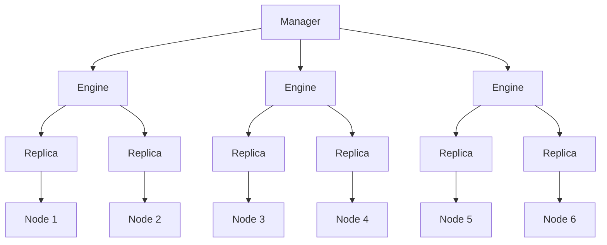

# Lesson 1: Longhorn Architecture Overview

## 1. First-Principles Intuition & Invariants

In the realm of distributed storage systems, Longhorn emerges as a robust solution designed to provide high availability, reliability, and scalability for containerized applications. To fully appreciate the architecture of Longhorn, it is essential to delve into the theoretical underpinnings that govern its design and operation. At its core, Longhorn addresses the challenges of data persistence and fault tolerance in dynamic, cloud-native environments. These challenges are rooted in the ephemeral nature of containerized workloads, where instances can be spun up and down with minimal notice, necessitating a storage system that can seamlessly integrate with Kubernetes while ensuring data integrity and availability.

The problem space for distributed storage systems like Longhorn is multifaceted. It involves balancing the need for high performance with the requirement for fault tolerance. This balance is achieved through a combination of replication, data distribution, and efficient resource management. Mathematically, the system must ensure that the probability of data loss is minimized, even in the presence of node failures. This is achieved through replication, where data is stored across multiple nodes, and the system can tolerate a certain number of node failures without data loss. The replication factor, denoted as \( R \), determines the number of copies of each piece of data. For example, a replication factor of 3 means that each piece of data is stored on three different nodes. The system must also ensure that the data is evenly distributed across the nodes to prevent any single node from becoming a bottleneck.

From a systems perspective, Longhorn must operate within the constraints of a Kubernetes cluster, which is a highly dynamic environment. Kubernetes abstracts the underlying infrastructure and provides a platform for deploying, scaling, and managing containerized applications. This abstraction introduces unique challenges for storage systems, as they must integrate seamlessly with Kubernetes while providing the necessary storage services. Longhorn addresses these challenges through a combination of Kubernetes-native design principles and advanced storage techniques.

## 2. Core Architecture & Mechanics

At the heart of Longhorn's architecture lies its ability to provide block storage services to Kubernetes pods. Longhorn achieves this through a combination of components that work together to manage the storage lifecycle, including data replication, snapshotting, and backup. The primary components of Longhorn are the Manager, the Engine, and the Replica.

The Manager is the central control plane component of Longhorn. It is responsible for managing the overall state of the storage system, including the placement of replicas, the scheduling of snapshots, and the management of backups. The Manager operates as a Kubernetes controller, continuously reconciling the desired state of the storage system with the actual state. This reconciliation process is driven by a declarative state machine, where the Manager listens for changes to the Kubernetes API and updates the storage system accordingly. The Manager also provides a RESTful API for managing Longhorn resources, allowing administrators to perform tasks such as creating and deleting volumes, managing replicas, and scheduling snapshots.

The Engine is the component responsible for providing block storage services to Kubernetes pods. Each Engine instance is associated with a single volume and is responsible for managing the lifecycle of that volume, including data replication, snapshotting, and backup. The Engine communicates with the Manager to receive instructions and updates, and it communicates with the Replicas to manage data replication. The Engine also provides a gRPC interface for interacting with the volume, allowing Kubernetes pods to read and write data to the volume.

The Replica is the component responsible for storing the actual data. Each Replica instance is associated with a single volume and is responsible for storing a copy of the volume's data. Replicas are distributed across the nodes in the Kubernetes cluster, ensuring that the data is replicated across multiple nodes. The Engine communicates with the Replicas to manage data replication, ensuring that the data is consistent across all replicas. Replicas also support snapshotting and backup, allowing administrators to create point-in-time snapshots of the data and back up the data to external storage systems.

To illustrate the architecture of Longhorn, consider the following diagram:

In this diagram, the Manager is responsible for managing the overall state of the storage system, while the Engines and Replicas are responsible for providing block storage services to Kubernetes pods. The Engines communicate with the Replicas to manage data replication, ensuring that the data is consistent across all replicas. The Replicas are distributed across the nodes in the Kubernetes cluster, ensuring that the data is replicated across multiple nodes.

## 3. High-Performance Optimization & Failure Modes

To ensure high performance and reliability, Longhorn employs a variety of optimization techniques and failure mitigation strategies. One of the key optimizations is the use of efficient data replication algorithms. Longhorn uses a combination of synchronous and asynchronous replication to ensure that data is replicated across multiple nodes while minimizing the impact on performance. Synchronous replication ensures that data is written to all replicas before acknowledging the write to the client, while asynchronous replication allows the client to acknowledge the write before the data is written to all replicas. By using a combination of synchronous and asynchronous replication, Longhorn can balance the need for data consistency with the need for performance.

Another key optimization is the use of efficient data distribution algorithms. Longhorn uses a combination of load balancing and data placement algorithms to ensure that the data is evenly distributed across the nodes in the Kubernetes cluster. Load balancing ensures that the data is evenly distributed across the nodes, preventing any single node from becoming a bottleneck. Data placement algorithms ensure that the data is placed on the most appropriate nodes, taking into account factors such as node capacity, network latency, and node availability.

To mitigate failures, Longhorn employs a variety of strategies. One of the key strategies is the use of data replication. By replicating data across multiple nodes, Longhorn can tolerate node failures without data loss. Longhorn also employs a variety of failure detection and recovery mechanisms to ensure that the system can quickly recover from failures. For example, Longhorn uses a combination of heartbeat messages and timeout mechanisms to detect node failures. When a node failure is detected, Longhorn automatically re-schedules the replicas to other nodes, ensuring that the data remains available.

In addition to data replication and failure detection, Longhorn also employs a variety of other strategies to ensure high performance and reliability. For example, Longhorn uses a combination of caching and compression techniques to improve performance. Caching ensures that frequently accessed data is stored in memory, reducing the need to read data from disk. Compression ensures that data is stored in a more compact form, reducing the amount of storage required and improving performance.

In conclusion, Longhorn is a robust distributed storage system designed to provide high availability, reliability, and scalability for containerized applications. Its architecture is grounded in the theoretical principles of distributed systems, and it employs a variety of optimization techniques and failure mitigation strategies to ensure high performance and reliability. By understanding the architecture of Longhorn, senior software engineers, systems programmers, and domain architects can effectively design and deploy distributed storage systems in Kubernetes environments.
