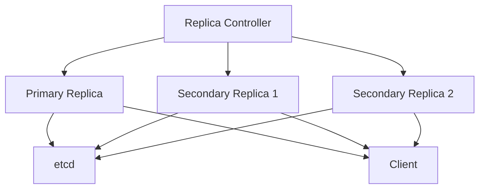

# Lesson 2: Replica Management

## 1. First-Principles Intuition & Invariants

In the realm of distributed storage systems, ensuring data redundancy and fault tolerance is paramount. The challenge lies in balancing these critical requirements with performance, scalability, and operational simplicity. Longhorn, a distributed block storage system designed for Kubernetes, addresses these challenges through a sophisticated replica management strategy. At its core, Longhorn's replica management is grounded in the principles of data replication, consistency, and fault tolerance, which are essential for maintaining data integrity and availability in the face of node failures.

Data replication is a fundamental technique used to ensure that data is available even if some nodes in the system fail. In Longhorn, this is achieved by maintaining multiple copies, or replicas, of each volume. The number of replicas is configurable, allowing administrators to strike a balance between fault tolerance and resource utilization. The system must ensure that these replicas remain consistent with each other, even as data is written and read concurrently by different clients. This consistency is crucial for maintaining the integrity of the data and ensuring that all clients see the same version of the data.

Consistency in distributed systems is often achieved through various replication protocols, each with its own trade-offs in terms of performance, complexity, and fault tolerance. Longhorn employs a strong consistency model, ensuring that all replicas are updated atomically and consistently. This is achieved through a combination of distributed consensus algorithms and careful management of write operations. The system must also handle the complexities of network partitions, node failures, and other transient faults, ensuring that the replicas remain in sync and that data is not lost or corrupted.

Fault tolerance is another critical aspect of Longhorn's replica management. The system must be able to recover from node failures without data loss or significant downtime. This is achieved through a combination of replica placement strategies, automatic failover mechanisms, and data recovery processes. Longhorn ensures that replicas are distributed across different nodes to minimize the risk of data loss due to a single point of failure. In the event of a node failure, the system can automatically promote a healthy replica to the primary role, ensuring that data access is uninterrupted.

The invariants of Longhorn's replica management system are rooted in the principles of data consistency, fault tolerance, and performance. The system must ensure that all replicas are consistent with each other, that data is available even in the presence of node failures, and that the system can scale efficiently to handle large volumes of data and high levels of concurrency. These invariants are enforced through a combination of distributed consensus algorithms, replica placement strategies, and data recovery processes.

## 2. Core Architecture & Mechanics

At the heart of Longhorn's replica management is the concept of a replica set, which consists of one primary replica and multiple secondary replicas. The primary replica is responsible for handling all write operations, while the secondary replicas receive updates from the primary and are used for read operations. This separation of duties allows Longhorn to optimize performance and ensure consistency.

The replica set is managed by a control plane component called the Replica Controller. The Replica Controller is responsible for creating, updating, and deleting replicas as needed. It also monitors the health of each replica and ensures that the replica set remains in a consistent and fault-tolerant state. The Replica Controller uses a distributed consensus algorithm, such as Raft, to coordinate the creation and deletion of replicas across the cluster. This ensures that the replica set remains consistent even in the presence of network partitions and node failures.

The internal data structures and algorithms used by Longhorn's replica management system are designed to be efficient and scalable. Each replica is implemented as a separate process, allowing the system to handle a large number of replicas concurrently. The replicas communicate with each other using a combination of gRPC and HTTP/2, ensuring low-latency and high-throughput communication. The system also uses a distributed key-value store, such as etcd, to store metadata about the replicas and their state. This allows the Replica Controller to efficiently manage the replica set and ensure that it remains in a consistent and fault-tolerant state.

The following diagram illustrates the architecture of Longhorn's replica management system:

In this diagram, the Replica Controller is responsible for managing the replica set, which consists of one primary replica and two secondary replicas. The replicas communicate with each other and the Replica Controller using gRPC and HTTP/2, and they store metadata about their state in etcd. The primary replica handles all write operations, while the secondary replicas handle read operations. Clients can read from any replica in the set, but they can only write to the primary replica.

## 3. High-Performance Optimization & Failure Modes

Longhorn's replica management system is designed to be highly performant and fault-tolerant. The system uses a combination of techniques to optimize performance and handle failure modes.

One of the key optimizations in Longhorn's replica management system is the use of asynchronous replication. When a write operation is received by the primary replica, it is immediately acknowledged to the client, and the data is written to the primary replica's local storage. The primary replica then asynchronously replicates the data to the secondary replicas. This allows the system to handle a large number of write operations concurrently without being bottlenecked by the replication process.

Another optimization in Longhorn's replica management system is the use of efficient data structures and algorithms. Each replica is implemented as a separate process, allowing the system to handle a large number of replicas concurrently. The replicas communicate with each other using a combination of gRPC and HTTP/2, ensuring low-latency and high-throughput communication. The system also uses a distributed key-value store, such as etcd, to store metadata about the replicas and their state. This allows the Replica Controller to efficiently manage the replica set and ensure that it remains in a consistent and fault-tolerant state.

Longhorn's replica management system is also designed to handle a variety of failure modes. The system uses a distributed consensus algorithm, such as Raft, to coordinate the creation and deletion of replicas across the cluster. This ensures that the replica set remains consistent even in the presence of network partitions and node failures. The system also uses a variety of techniques to handle node failures, such as automatic failover and data recovery. When a node fails, the system can automatically promote a healthy replica to the primary role, ensuring that data access is uninterrupted. The system can also recover data from the remaining replicas in the event of a catastrophic failure.

In conclusion, Longhorn's replica management system is a sophisticated and efficient solution for ensuring data redundancy and fault tolerance in distributed storage systems. The system is grounded in the principles of data replication, consistency, and fault tolerance, and it uses a combination of distributed consensus algorithms, efficient data structures, and asynchronous replication to optimize performance and handle failure modes. By understanding the architecture and mechanics of Longhorn's replica management system, senior software engineers, systems programmers, and domain architects can design and implement robust and scalable distributed storage solutions.
