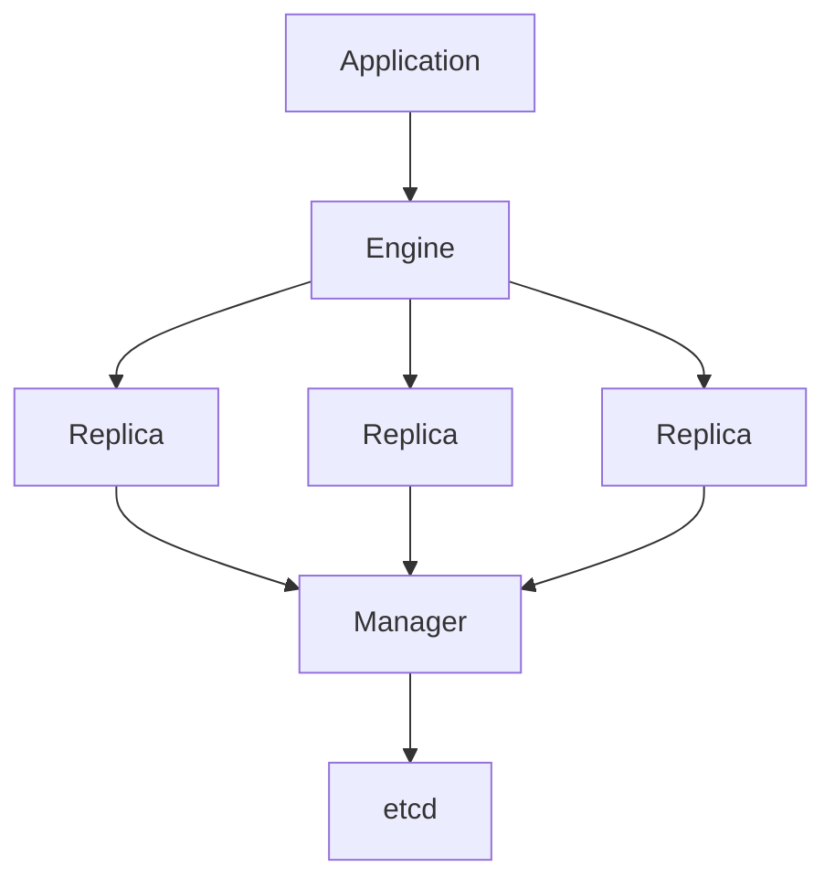

# Lesson 5: Performance Optimization

## 1. First-Principles Intuition & Invariants

In the realm of distributed storage systems, performance optimization is a multifaceted endeavor that requires a deep understanding of the underlying architecture, resource management, and the interplay between software and hardware. Longhorn, a distributed block storage system designed for Kubernetes, embodies these principles by leveraging containerized components and a microservices architecture to provide high availability and fault tolerance. At its core, Longhorn's performance is governed by several invariants and theoretical constructs that must be understood to achieve optimal results.

First and foremost, the performance of a distributed storage system is fundamentally tied to its ability to efficiently manage data replication and consistency. Longhorn employs a strong consistency model, ensuring that data is replicated across multiple nodes to maintain high availability. This replication introduces inherent latency and resource overhead, which must be carefully managed to minimize performance degradation. The system's performance is thus a delicate balance between consistency, availability, and partition tolerance, as described by the CAP theorem. In Longhorn, the choice is made to prioritize consistency and availability, which necessitates a robust mechanism for data replication and conflict resolution.

Another critical invariant in Longhorn's performance is the efficient use of system resources, particularly CPU, memory, and network bandwidth. Longhorn is designed to run as a set of containerized services, each responsible for a specific aspect of storage management. These services must be optimized to minimize resource consumption while maximizing throughput and latency. This involves careful tuning of resource allocation, scheduling policies, and data path optimizations.

The performance of Longhorn is also influenced by the underlying storage infrastructure, including the choice of storage backend, network topology, and disk I/O characteristics. Longhorn supports various storage backends, such as local disks, network-attached storage (NAS), and cloud-based storage solutions. The choice of backend and its configuration can significantly impact performance, as different storage solutions have varying I/O characteristics and latency profiles. Additionally, network topology plays a crucial role in determining the performance of Longhorn, as data replication and consistency checks require efficient communication between nodes.

Finally, the performance of Longhorn is governed by the system's ability to handle concurrent workloads and scale efficiently as the number of nodes and data volumes increases. Longhorn employs a distributed architecture that allows it to scale horizontally by adding more nodes to the cluster. However, scaling introduces additional complexity, as the system must manage increased data replication and consistency checks, as well as handle higher levels of concurrency. Efficient concurrency control and resource scaling mechanisms are therefore essential to maintain optimal performance as the system grows.

## 2. Core Architecture & Mechanics

To understand the performance optimization strategies for Longhorn, it is essential to delve into its core architecture and mechanics. Longhorn is designed as a microservices-based distributed storage system, with each component responsible for a specific aspect of storage management. The primary components of Longhorn include the Manager, Replica, and Engine services.

The Manager service is responsible for orchestrating the storage cluster, managing the lifecycle of storage volumes, and ensuring data replication and consistency. The Manager service maintains a global state of the storage cluster, including information about the available nodes, storage volumes, and their replicas. This state is stored in an etcd key-value store, which provides a consistent and reliable data store for the Manager service.

The Replica service is responsible for managing the storage volumes and their replicas. Each storage volume is replicated across multiple nodes to ensure high availability. The Replica service is responsible for creating, deleting, and managing the replicas of each storage volume. It also handles data replication and consistency checks, ensuring that the replicas are consistent with the primary volume.

The Engine service is responsible for providing block-level access to the storage volumes. It acts as a bridge between the storage volumes and the applications that use them. The Engine service provides a block device interface to the applications, allowing them to read and write data to the storage volumes. The Engine service also handles data path optimizations, such as caching and compression, to improve performance.

The interaction between these components is illustrated in the following diagram:

In this diagram, the Application interacts with the Engine service, which in turn interacts with the Replica services to read and write data to the storage volumes. The Manager service orchestrates the storage cluster, managing the lifecycle of the storage volumes and their replicas. The Manager service also interacts with the etcd key-value store to maintain the global state of the storage cluster.

The performance of Longhorn is influenced by the internal data structures and algorithms used by these components. For example, the Manager service uses a distributed consensus algorithm, such as Raft, to ensure consistency and reliability of the global state. The Raft algorithm is designed to provide a strong consistency model while minimizing latency and resource overhead. The Manager service also uses a Multi-Version Concurrency Control (MVCC) mechanism to manage concurrent access to the global state, ensuring that the state is consistent even in the presence of concurrent updates.

The Replica service uses a distributed data replication algorithm to ensure data consistency across multiple nodes. The algorithm is designed to minimize the overhead of data replication while ensuring that the replicas are consistent with the primary volume. The Replica service also uses a caching mechanism to improve performance, caching frequently accessed data in memory to reduce disk I/O.

The Engine service uses a data path optimization algorithm to improve performance. The algorithm is designed to minimize the overhead of data path operations, such as read and write, while maximizing throughput and latency. The Engine service also uses a caching mechanism to improve performance, caching frequently accessed data in memory to reduce disk I/O.

## 3. High-Performance Optimization & Failure Modes

To achieve optimal performance in Longhorn, it is essential to employ a range of optimization strategies and techniques. These strategies are designed to minimize resource consumption, improve concurrency control, and handle failure modes efficiently.

One of the key strategies for optimizing performance in Longhorn is to carefully tune the resource allocation and scheduling policies. Longhorn is designed to run as a set of containerized services, each responsible for a specific aspect of storage management. These services must be optimized to minimize resource consumption while maximizing throughput and latency. This involves careful tuning of resource allocation, scheduling policies, and data path optimizations.

For example, the Manager service can be optimized by tuning the Raft consensus algorithm to minimize latency and resource overhead. The Raft algorithm can be configured to use a smaller election timeout, reducing the time it takes to elect a new leader in the event of a failure. The Raft algorithm can also be configured to use a smaller heartbeat interval, reducing the overhead of maintaining the consensus state.

The Replica service can be optimized by tuning the data replication algorithm to minimize the overhead of data replication. The data replication algorithm can be configured to use a smaller batch size, reducing the overhead of data replication while ensuring that the replicas are consistent with the primary volume. The Replica service can also be optimized by tuning the caching mechanism to improve performance. The caching mechanism can be configured to use a larger cache size, reducing disk I/O and improving performance.

The Engine service can be optimized by tuning the data path optimization algorithm to minimize the overhead of data path operations. The data path optimization algorithm can be configured to use a larger buffer size, reducing the overhead of data path operations while maximizing throughput and latency. The Engine service can also be optimized by tuning the caching mechanism to improve performance. The caching mechanism can be configured to use a larger cache size, reducing disk I/O and improving performance.

Another key strategy for optimizing performance in Longhorn is to improve concurrency control and handle failure modes efficiently. Longhorn is designed to handle concurrent workloads and scale efficiently as the number of nodes and data volumes increases. Efficient concurrency control and resource scaling mechanisms are therefore essential to maintain optimal performance as the system grows.

One of the key challenges in concurrency control is to minimize contention and ensure that the system can handle high levels of concurrency without performance degradation. Longhorn employs a distributed consensus algorithm, such as Raft, to ensure consistency and reliability of the global state. The Raft algorithm is designed to provide a strong consistency model while minimizing latency and resource overhead. The Manager service also uses a Multi-Version Concurrency Control (MVCC) mechanism to manage concurrent access to the global state, ensuring that the state is consistent even in the presence of concurrent updates.

Another key challenge in concurrency control is to handle failure modes efficiently. Longhorn is designed to provide high availability and fault tolerance, ensuring that data is replicated across multiple nodes to maintain availability in the event of a failure. However, handling failures efficiently is essential to minimize performance degradation and ensure that the system remains responsive.

One of the key strategies for handling failures efficiently is to use a distributed consensus algorithm, such as Raft, to ensure consistency and reliability of the global state. The Raft algorithm is designed to provide a strong consistency model while minimizing latency and resource overhead. The Manager service also uses a Multi-Version Concurrency Control (MVCC) mechanism to manage concurrent access to the global state, ensuring that the state is consistent even in the presence of concurrent updates.

Another key strategy for handling failures efficiently is to use a distributed data replication algorithm to ensure data consistency across multiple nodes. The data replication algorithm is designed to minimize the overhead of data replication while ensuring that the replicas are consistent with the primary volume. The Replica service also uses a caching mechanism to improve performance, caching frequently accessed data in memory to reduce disk I/O.

In conclusion, performance optimization in Longhorn is a multifaceted endeavor that requires a deep understanding of the underlying architecture, resource management, and the interplay between software and hardware. By carefully tuning resource allocation and scheduling policies, improving concurrency control, and handling failure modes efficiently, it is possible to achieve optimal performance in Longhorn, ensuring high availability and fault tolerance while minimizing resource consumption and maximizing throughput and latency.
