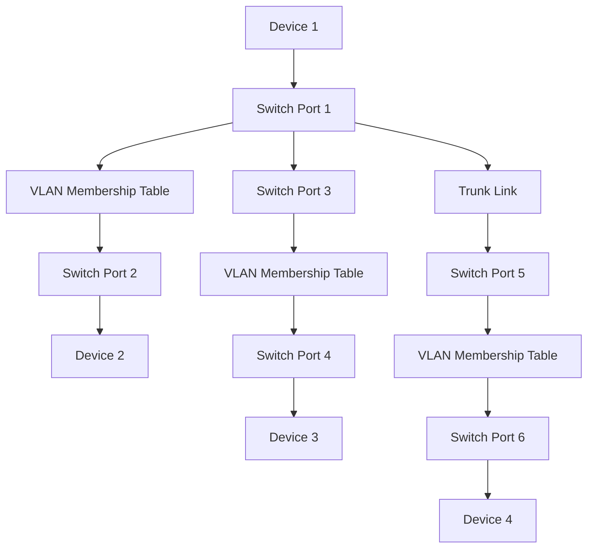

# Lesson 2: VLAN Networking Basics

## 1. First-Principles Intuition & Invariants

In the realm of network architecture, the Virtual Local Area Network (VLAN) is a fundamental construct that enables network segmentation within a single physical network. VLANs allow network administrators to logically partition a network into multiple broadcast domains, thereby enhancing security, performance, and manageability. The concept of VLANs is rooted in the need to address the limitations of traditional broadcast domains, which can become inefficient and insecure as networks grow in size and complexity.

At its core, a VLAN is a group of devices on one or more local area networks (LANs) that are configured to communicate as if they were attached to the same wire, even though they are physically located on different segments. This segmentation is achieved through the use of VLAN tags, which are inserted into the Ethernet frames to identify the VLAN to which a frame belongs. The IEEE 802.1Q standard defines the format of these tags, which consist of a 12-bit VLAN identifier (VID) and a 3-bit priority code point (PCP).

The primary invariant of VLANs is that they operate at Layer 2 of the OSI model, the Data Link Layer. This means that VLANs do not require any changes to the IP addressing scheme of the network, as they operate transparently to Layer 3 devices such as routers. Instead, VLANs rely on switches to enforce the segmentation by forwarding frames only to the ports that belong to the same VLAN. This segmentation is crucial for isolating traffic between different departments, projects, or security zones within an organization.

Another critical invariant of VLANs is their ability to span multiple switches. This is achieved through the use of trunk links, which are special types of links that can carry traffic for multiple VLANs. Trunk links are configured on the switches to allow the passage of tagged frames, which are then forwarded to the appropriate ports based on the VLAN tags. This capability allows VLANs to be used to segment large networks that span multiple physical locations or data centers.

## 2. Core Architecture & Mechanics

The architecture of VLANs is centered around the use of VLAN tags and the configuration of switches to enforce the segmentation. When a device sends a frame on a VLAN-enabled switch, the switch examines the frame to determine the VLAN to which it belongs. If the frame is untagged, the switch assigns it to the default VLAN, which is typically VLAN 1. If the frame is tagged, the switch uses the VLAN tag to determine the VLAN to which it belongs.

The switch then forwards the frame to the appropriate ports that belong to the same VLAN. This forwarding is achieved through the use of a VLAN membership table, which maps each port to one or more VLANs. The VLAN membership table is configured by the network administrator and is used by the switch to enforce the segmentation. The following Mermaid diagram illustrates the basic architecture of VLANs:



In this diagram, devices 1 and 2 are connected to switch ports 1 and 2, respectively, which are configured to belong to VLAN 10. Device 3 is connected to switch port 3, which is configured to belong to VLAN 20. Switch port 4 is a trunk link that carries traffic for both VLAN 10 and VLAN 20. Device 4 is connected to switch port 6, which is configured to belong to VLAN 20.

When device 1 sends a frame to device 2, the switch examines the frame and determines that it belongs to VLAN 10. The switch then forwards the frame to switch port 2, which is the only port that belongs to VLAN 10. Similarly, when device 3 sends a frame to device 4, the switch examines the frame and determines that it belongs to VLAN 20. The switch then forwards the frame to switch port 4, which is the trunk link that carries traffic for VLAN 20. The switch on the other end of the trunk link examines the frame and forwards it to switch port 6, which is the only port that belongs to VLAN 20.

The VLAN membership table is a critical component of the VLAN architecture, as it determines the ports that belong to each VLAN. The table is typically configured using the Command Line Interface (CLI) of the switch, and it can be modified to add or remove ports from VLANs. The following example shows how to configure a VLAN membership table using the CLI of a Cisco switch:

```shell
Switch(config)# vlan 10
Switch(config-vlan)# name Sales
Switch(config-vlan)# exit
Switch(config)# vlan 20
Switch(config-vlan)# name Engineering
Switch(config-vlan)# exit
Switch(config)# interface FastEthernet0/1
Switch(config-if)# switchport mode access
Switch(config-if)# switchport access vlan 10
Switch(config-if)# exit
Switch(config)# interface FastEthernet0/2
Switch(config-if)# switchport mode access
Switch(config-if)# switchport access vlan 10
Switch(config-if)# exit
Switch(config)# interface FastEthernet0/3
Switch(config-if)# switchport mode access
Switch(config-if)# switchport access vlan 20
Switch(config-if)# exit
Switch(config)# interface FastEthernet0/4
Switch(config-if)# switchport mode trunk
Switch(config-if)# switchport trunk allowed vlan 10,20
Switch(config-if)# exit
```

In this example, VLAN 10 is configured with the name "Sales," and VLAN 20 is configured with the name "Engineering." The switch ports are then configured to belong to the appropriate VLANs. Switch ports 1 and 2 are configured to belong to VLAN 10 in access mode, which means that they can only carry traffic for VLAN 10. Switch port 3 is configured to belong to VLAN 20 in access mode. Switch port 4 is configured to belong to both VLAN 10 and VLAN 20 in trunk mode, which means that it can carry traffic for both VLANs.

## 3. High-Performance Optimization & Failure Modes

The performance of VLANs is primarily determined by the efficiency of the switch in forwarding frames to the appropriate ports. The switch uses the VLAN membership table to determine the ports that belong to each VLAN, and it forwards frames only to the ports that belong to the same VLAN. This segmentation reduces the amount of broadcast traffic on the network, which improves performance and reduces congestion.

However, the performance of VLANs can be affected by the configuration of the VLAN membership table. If the table is not configured correctly, the switch may forward frames to the wrong ports, which can cause network congestion and performance issues. To mitigate this risk, network administrators should carefully configure the VLAN membership table and test the configuration to ensure that it is working correctly.

Another factor that can affect the performance of VLANs is the use of trunk links. Trunk links carry traffic for multiple VLANs, which can increase the amount of traffic on the link and reduce performance. To mitigate this risk, network administrators should configure trunk links to carry only the VLANs that are necessary for the network, and they should use link aggregation to distribute the traffic across multiple links.

The failure modes of VLANs are primarily related to the configuration of the VLAN membership table and the use of trunk links. If the VLAN membership table is not configured correctly, the switch may forward frames to the wrong ports, which can cause network congestion and performance issues. To mitigate this risk, network administrators should carefully configure the VLAN membership table and test the configuration to ensure that it is working correctly.

Another failure mode of VLANs is the use of trunk links. Trunk links carry traffic for multiple VLANs, which can increase the amount of traffic on the link and reduce performance. If the trunk link is not configured correctly, the switch may forward frames to the wrong ports, which can cause network congestion and performance issues. To mitigate this risk, network administrators should configure trunk links to carry only the VLANs that are necessary for the network, and they should use link aggregation to distribute the traffic across multiple links.

In conclusion, VLANs are a powerful tool for network segmentation that can improve security, performance, and manageability. The architecture of VLANs is centered around the use of VLAN tags and the configuration of switches to enforce the segmentation. The performance of VLANs is primarily determined by the efficiency of the switch in forwarding frames to the appropriate ports, and the failure modes of VLANs are primarily related to the configuration of the VLAN membership table and the use of trunk links. By understanding the architecture and mechanics of VLANs, network administrators can configure VLANs to meet the needs of their network and ensure that they are operating efficiently and reliably.
