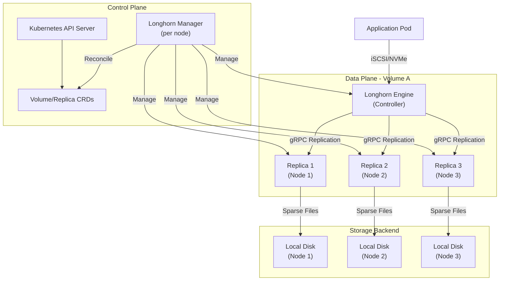
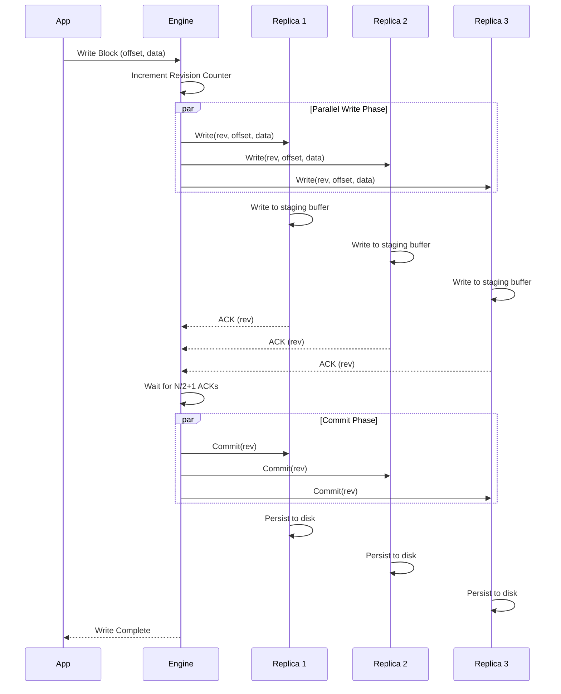
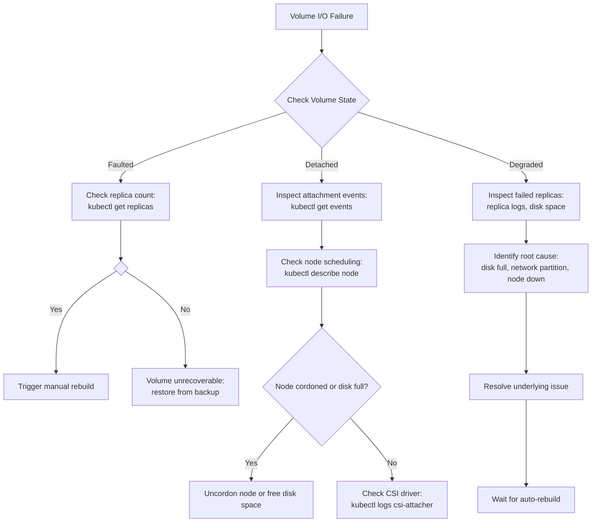

# Operational Verification Labs: 03 Longhorn Distributed Storage

## Objective & Environment Setup

Longhorn is a cloud-native distributed block storage system designed for Kubernetes, implementing a microservices-based architecture where each volume operates as an independent controller process coordinating multiple replica processes. Unlike traditional SAN/NAS systems that centralize storage management, Longhorn follows a disaggregated model where storage controllers run as pods alongside application workloads, enabling fine-grained failure domains and horizontal scalability.

At its core, Longhorn employs a two-phase commit protocol for write operations across replicas, ensuring consistency without requiring distributed consensus algorithms like Raft or Paxos for the data path itself. The control plane uses Kubernetes Custom Resource Definitions (CRDs) as the source of truth, with the Longhorn Manager acting as a reconciliation controller that observes desired state and actuates changes through the Longhorn Engine processes.

This lab validates Longhorn's operational characteristics through three dimensions: subsystem state introspection, performance boundary testing, and chaos engineering. The exercises require root access to cluster nodes for kernel-level observability and the ability to inject controlled failures.

### Architecture Overview



### Write Path and Consistency Model



Longhorn uses a revision-based consistency protocol where each write is tagged with a monotonically increasing revision number. The Engine waits for a quorum (majority) of replicas to acknowledge the write before returning success to the application. This ensures that even if minority replicas fail, the committed data remains recoverable. Replicas maintain both a write-ahead log (for crash recovery) and the actual block data stored in sparse files, enabling efficient space utilization for thin-provisioned volumes.

### Required CLI Tools

| Tool | Version | Purpose |
|------|---------|---------|
| `kubectl` | v1.28+ | Kubernetes API interaction |
| `bpftool` | v7.0+ | BPF program and map inspection |
| `bpftrace` | v0.19+ | Dynamic kernel tracing with BPF |
| `iproute2` | v6.0+ | Network configuration and monitoring |
| `tcpdump` | v4.99+ | Network packet capture |
| `strace` | v6.1+ | System call tracing |
| `perf` | v6.1+ | CPU profiling and performance counters |
| `fio` | v3.35+ | I/O workload generation and benchmarking |
| `jq` | v1.6+ | JSON processing |
| `curl` | v8.0+ | HTTP client for API calls |

### Environment Configuration

```bash
# Verify Kubernetes cluster meets minimum requirements
kubectl version --short
kubectl get nodes -o wide

# Validate kernel version supports BPF features (5.10+ required for BPF ring buffers)
uname -r
cat /boot/config-$(uname -r) | grep -E "CONFIG_BPF|CONFIG_DEBUG_INFO_BTF"

# Confirm Longhorn installation and readiness
kubectl get pods -n longhorn-system -o wide
kubectl get storageclass -o yaml | grep -A 5 "provisioner: driver.longhorn.io"

# Verify Longhorn CRDs are registered
kubectl api-resources | grep longhorn.io

# Check existing volumes and their health
kubectl get volumes.longhorn.io -A
kubectl get replicas.longhorn.io -A

# Install fio for I/O benchmarking (on test pod)
# This will be done per-exercise as needed
```

## Exercise 1: Live State & Internal Subsystem Inspection

This exercise dissects Longhorn's runtime state by examining control plane reconciliation loops, data plane replication streams, and kernel-level I/O behavior. Unlike black-box monitoring, this approach observes internal data structures, protocol state machines, and resource allocation patterns.

### 1.1 Control Plane State: CRD Reconciliation and Manager Behavior

The Longhorn Manager runs a set of Kubernetes controllers that watch CRD objects (Volumes, Replicas, Engines, Nodes, Settings) and reconcile actual state toward desired state. Each node runs a Manager instance that handles local operations while coordinating with the cluster-wide consensus stored in etcd via the Kubernetes API.

```bash
# Examine Longhorn Manager deployment architecture
kubectl get daemonset longhorn-manager -n longhorn-system -o yaml | grep -A 20 "spec:"

# Identify manager pods and their node assignments
kubectl get pods -n longhorn-system -l app=longhorn-manager -o custom-columns=\
"POD:.metadata.name,NODE:.spec.nodeName,STATUS:.status.phase,IP:.status.podIP"

# Inspect manager process tree and resource consumption
MANAGER_POD=$(kubectl get pods -n longhorn-system -l app=longhorn-manager -o jsonpath='{.items[0].metadata.name}')
kubectl exec -n longhorn-system $MANAGER_POD -- ps auxf | grep -E "longhorn|PID"

# Analyze controller reconciliation activity from structured logs
kubectl logs -n longhorn-system $MANAGER_POD --tail=500 | jq -r 'select(.controller != null) | "\(.time) [\(.controller)] \(.msg)"'

# Examine manager's view of cluster state
kubectl exec -n longhorn-system $MANAGER_POD -- curl -s http://localhost:9500/v1/settings | jq '{
  "BackupTarget": .backupTarget,
  "DefaultReplicaCount": .defaultReplicaCount,
  "StorageMinimalAvailablePercentage": .storageMinimalAvailablePercentage,
  "StorageOverProvisioningPercentage": .storageOverProvisioningPercentage
}'

# Inspect node status and disk scheduling metadata
kubectl exec -n longhorn-system $MANAGER_POD -- curl -s http://localhost:9500/v1/nodes | jq '.data[] | {
  name: .name,
  state: .state,
  disks: [.disks[] | {path: .path, storageAvailable: .storageAvailable, storageMaximum: .storageMaximum, conditions: .conditions}]
}'
```

**Expected Observations:**
- Manager pods run as a DaemonSet (one per node) to handle node-local operations
- Reconciliation logs show controller loops processing Volume, Replica, and Engine objects
- Node objects reflect disk capacity, utilization, and scheduling eligibility
- Settings govern global behavior like replica count and overprovisioning ratios

### 1.2 Data Plane State: Engine and Replica Protocol Inspection

Each Longhorn volume consists of an Engine process (the controller) and multiple Replica processes (the storage backend). The Engine exposes a block device to the host (via iSCSI or NVMe-oF) and coordinates writes across replicas using gRPC-based replication protocol.

```bash
# List all volumes and their controller/replica distribution
kubectl get volumes.longhorn.io -A -o custom-columns=\
"NAMESPACE:.metadata.namespace,NAME:.metadata.name,STATE:.status.state,ROBUSTNESS:.status.robustness,\
SIZE:.spec.size,REPLICAS:.spec.numberOfReplicas,FRONTEND:.spec.frontend"

# Select a volume for detailed inspection
VOLUME_NAME=$(kubectl get volumes.longhorn.io -A -o jsonpath='{.items[0].metadata.name}')
VOLUME_NAMESPACE=$(kubectl get volumes.longhorn.io -A -o jsonpath='{.items[0].metadata.namespace}')

# Examine volume controller (Engine) process
kubectl get engines.longhorn.io -n $VOLUME_NAMESPACE -o yaml | yq eval ".items[] | select(.metadata.name == \"$VOLUME_NAME\")"

# Identify Engine pod and its characteristics
ENGINE_POD=$(kubectl get pods -n longhorn-system -l "longhorn.io/component=instance-manager,longhorn.io/instance-manager-type=engine" -o jsonpath='{.items[0].metadata.name}')
kubectl describe pod -n longhorn-system $ENGINE_POD | grep -A 10 "Containers:"

# Inspect Engine's view of replica health and synchronization state
kubectl exec -n longhorn-system $MANAGER_POD -- curl -s "http://localhost:9500/v1/volumes/$VOLUME_NAME" | jq '{
  name: .name,
  state: .state,
  robustness: .robustness,
  replicas: [.replicas[] | {
    name: .name,
    mode: .mode,
    hostId: .hostId,
    running: .running,
    address: .address
  }],
  controllers: [.controllers[] | {
    hostId: .hostId,
    endpoint: .endpoint,
    running: .running
  }]
}'

# Examine replica objects and their backing storage
kubectl get replicas.longhorn.io -n $VOLUME_NAMESPACE -o custom-columns=\
"NAME:.metadata.name,NODE:.spec.nodeID,STATE:.status.currentState,DISK:.spec.diskID,SIZE:.spec.volumeSize"

REPLICA_NAME=$(kubectl get replicas.longhorn.io -n $VOLUME_NAMESPACE -o jsonpath='{.items[0].metadata.name}')
kubectl get replica.longhorn.io -n $VOLUME_NAMESPACE $REPLICA_NAME -o yaml | yq eval '.spec, .status'

# Identify replica process and inspect its data directory
REPLICA_NODE=$(kubectl get replica.longhorn.io -n $VOLUME_NAMESPACE $REPLICA_NAME -o jsonpath='{.spec.nodeID}')
ssh $REPLICA_NODE "sudo ls -lh /var/lib/longhorn/replicas/$REPLICA_NAME/"
ssh $REPLICA_NODE "sudo du -sh /var/lib/longhorn/replicas/$REPLICA_NAME/"

# Inspect replica metadata file (volume.meta)
ssh $REPLICA_NODE "sudo cat /var/lib/longhorn/replicas/$REPLICA_NAME/volume.meta" | jq
```

**Expected Observations:**
- Each volume has exactly one Engine (controller) and N replicas (typically 3)
- Engine tracks replica modes: RW (read-write), RO (read-only), WO (write-only), ERR (failed)
- Replicas store data as sparse files: volume-head.img (active writes) and volume-snap-*.img (snapshots)
- Metadata file contains volume size, sector size, and head/snapshot chain

### 1.3 Kernel-Level I/O Path Tracing with BPF

BPF enables observation of kernel I/O subsystem behavior without instrumenting userspace code. This section traces block layer operations, system calls, and network sockets involved in Longhorn's data path.

```bash
# Verify BPF support and available programs
sudo bpftool feature probe kernel | grep -E "program_type|map_type"
sudo bpftool prog list | grep -E "kprobe|tracepoint"

# Trace block I/O requests issued to Longhorn volumes
# This captures bio (block I/O) submissions at the kernel level
sudo bpftrace -e '
tracepoint:block:block_bio_queue
/comm == "fio" || comm == "dd"/
{
  printf("%-8s %-16s dev=%d:%d sector=%lu len=%d rw=%d\n",
    strftime("%H:%M:%S", nsecs),
    comm,
    args->dev >> 20,
    args->dev & ((1 << 20) - 1),
    args->sector,
    args->nr_sector * 512,
    args->rwbs
  );
}' &

# Generate test I/O for observation
kubectl exec -n $VOLUME_NAMESPACE <pod-using-volume> -- dd if=/dev/zero of=/mnt/test bs=4k count=1000

# Trace system calls made by replica processes
REPLICA_POD=$(kubectl get pods -n longhorn-system -l "longhorn.io/component=instance-manager,longhorn.io/instance-manager-type=replica" -o jsonpath='{.items[0].metadata.name}')
REPLICA_PID=$(kubectl exec -n longhorn-system $REPLICA_POD -- pgrep -f "longhorn.*replica")
sudo strace -p $REPLICA_PID -e trace=write,pwrite64,fsync,fdatasync -f -ttt 2>&1 | head -100

# Monitor network I/O between Engine and Replicas (gRPC replication protocol)
# Longhorn uses port 10000+ for replica communication
sudo tcpdump -i any -n 'tcp portrange 10000-10100' -c 100 -w /tmp/longhorn-replication.pcap
tshark -r /tmp/longhorn-replication.pcap -T fields -e frame.number -e ip.src -e ip.dst -e tcp.srcport -e tcp.dstport -e frame.len | head -20

# Trace file system operations on replica data directories
sudo bpftrace -e '
tracepoint:syscalls:sys_enter_openat,
tracepoint:syscalls:sys_enter_write,
tracepoint:syscalls:sys_enter_fsync
/str(args->filename) =~ /longhorn/ || comm =~ /longhorn//
{
  printf("%-8s %-16s %-10s %s\n",
    strftime("%H:%M:%S", nsecs),
    comm,
    probe,
    str(args->filename)
  );
}'
```

**Expected Observations:**
- Block layer traces show bio submissions with device major:minor numbers corresponding to iSCSI/NVMe devices
- Replica processes perform pwrite64() calls to sparse files followed by fsync()/fdatasync() for durability
- TCP packets between Engine and Replicas carry gRPC-encoded replication protocol messages
- Filesystem tracing reveals writes to volume-head.img and periodic metadata updates

### 1.4 Memory and CPU Resource Profiling

Longhorn processes have distinct resource consumption patterns: Managers perform reconciliation logic (CPU-bound during cluster state changes), Engines handle I/O translation (memory-bound for buffering), and Replicas perform disk writes (I/O-bound).

```bash
# Profile CPU usage of Longhorn components
kubectl top pods -n longhorn-system --sort-by=cpu

# Deep dive into Manager process CPU consumption
kubectl exec -n longhorn-system $MANAGER_POD -- sh -c 'top -b -n 1 | head -20'

# Analyze memory allocation patterns
kubectl exec -n longhorn-system $MANAGER_POD -- sh -c 'cat /proc/$(pgrep longhorn-manager)/status | grep -E "VmRSS|VmSwap|VmData|VmStk"'

# Use perf to profile CPU hotspots in Engine process
ENGINE_NODE=$(kubectl get pod -n longhorn-system $ENGINE_POD -o jsonpath='{.spec.nodeName}')
ENGINE_PID=$(ssh $ENGINE_NODE "pgrep -f 'longhorn.*engine'")
ssh $ENGINE_NODE "sudo perf record -F 99 -p $ENGINE_PID -g -- sleep 10"
ssh $ENGINE_NODE "sudo perf report --stdio" | head -50

# Analyze memory allocations with BPF
sudo bpftrace -e '
tracepoint:kmem:kmalloc,
tracepoint:kmem:kmem_cache_alloc
/comm =~ /longhorn//
{
  @bytes[comm] = sum(args->bytes_alloc);
}
interval:s:5 {
  print(@bytes);
  clear(@bytes);
}'
```

**Expected Observations:**
- Manager pods consume 50-200MB RSS, with CPU spikes during reconciliation
- Engine pods consume memory proportional to I/O queue depth and buffer sizes
- Replica pods show high iowait during sustained write workloads
- perf profiles reveal hot paths in gRPC marshaling and filesystem operations

## Exercise 2: Benchmarking & Saturation Profiling

This exercise characterizes Longhorn's performance envelope by systematically varying workload parameters (I/O size, queue depth, read/write mix) and observing saturation points where throughput plateaus or latency degrades nonlinearly.

### 2.1 Baseline Single-Volume I/O Performance

```bash
# Create a PVC backed by Longhorn
cat <<EOF | kubectl apply -f -
apiVersion: v1
kind: PersistentVolumeClaim
metadata:
  name: fio-benchmark-pvc
  namespace: default
spec:
  accessModes:
    - ReadWriteOnce
  storageClassName: longhorn
  resources:
    requests:
      storage: 10Gi
EOF

# Wait for PVC to bind
kubectl wait --for=condition=Bound pvc/fio-benchmark-pvc --timeout=60s

# Deploy fio benchmarking pod
cat <<EOF | kubectl apply -f -
apiVersion: v1
kind: Pod
metadata:
  name: fio-benchmark
  namespace: default
spec:
  containers:
  - name: fio
    image: dmonakhov/fio:latest
    command: ["/bin/sh"]
    args: ["-c", "sleep infinity"]
    volumeMounts:
    - name: benchmark-volume
      mountPath: /mnt/test
    resources:
      limits:
        cpu: "4"
        memory: "4Gi"
  volumes:
  - name: benchmark-volume
    persistentVolumeClaim:
      claimName: fio-benchmark-pvc
  restartPolicy: Never
EOF

kubectl wait --for=condition=Ready pod/fio-benchmark --timeout=120s

# Sequential read throughput test
kubectl exec fio-benchmark -- fio --name=seq-read \
  --filename=/mnt/test/testfile \
  --size=5G \
  --direct=1 \
  --rw=read \
  --bs=128k \
  --ioengine=libaio \
  --iodepth=32 \
  --numjobs=1 \
  --time_based=1 \
  --runtime=60 \
  --group_reporting \
  --output-format=json+ \
  > /tmp/seq-read.json

jq '.jobs[0] | {read_bw_MiB: (.read.bw / 1024), read_iops: .read.iops, read_lat_us_mean: .read.lat_ns.mean / 1000}' /tmp/seq-read.json

# Sequential write throughput test
kubectl exec fio-benchmark -- fio --name=seq-write \
  --filename=/mnt/test/testfile \
  --size=5G \
  --direct=1 \
  --rw=write \
  --bs=128k \
  --ioengine=libaio \
  --iodepth=32 \
  --numjobs=1 \
  --time_based=1 \
  --runtime=60 \
  --group_reporting \
  --output-format=json+ \
  > /tmp/seq-write.json

jq '.jobs[0] | {write_bw_MiB: (.write.bw / 1024), write_iops: .write.iops, write_lat_us_mean: .write.lat_ns.mean / 1000}' /tmp/seq-write.json

# Random read IOPS test (4K blocks, high queue depth)
kubectl exec fio-benchmark -- fio --name=rand-read-4k \
  --filename=/mnt/test/testfile \
  --size=5G \
  --direct=1 \
  --rw=randread \
  --bs=4k \
  --ioengine=libaio \
  --iodepth=128 \
  --numjobs=4 \
  --time_based=1 \
  --runtime=60 \
  --group_reporting \
  --output-format=json+ \
  > /tmp/rand-read-4k.json

jq '.jobs[0] | {read_iops: .read.iops, read_lat_us_p50: .read.lat_ns.percentile."50.000000" / 1000, read_lat_us_p99: .read.lat_ns.percentile."99.000000" / 1000}' /tmp/rand-read-4k.json

# Random write IOPS test with fsync (durability simulation)
kubectl exec fio-benchmark -- fio --name=rand-write-4k-sync \
  --filename=/mnt/test/testfile \
  --size=5G \
  --direct=1 \
  --rw=randwrite \
  --bs=4k \
  --ioengine=libaio \
  --iodepth=32 \
  --numjobs=4 \
  --fsync=1 \
  --time_based=1 \
  --runtime=60 \
  --group_reporting \
  --output-format=json+ \
  > /tmp/rand-write-4k-sync.json

jq '.jobs[0] | {write_iops: .write.iops, write_lat_us_p50: .write.lat_ns.percentile."50.000000" / 1000, write_lat_us_p99: .write.lat_ns.percentile."99.000000" / 1000}' /tmp/rand-write-4k-sync.json

# Mixed read/write workload (70/30 read/write ratio)
kubectl exec fio-benchmark -- fio --name=mixed-rw \
  --filename=/mnt/test/testfile \
  --size=5G \
  --direct=1 \
  --rw=randrw \
  --rwmixread=70 \
  --bs=4k \
  --ioengine=libaio \
  --iodepth=64 \
  --numjobs=4 \
  --time_based=1 \
  --runtime=60 \
  --group_reporting \
  --output-format=json+ \
  > /tmp/mixed-rw.json

jq '.jobs[0] | {read_iops: .read.iops, write_iops: .write.iops, total_iops: (.read.iops + .write.iops)}' /tmp/mixed-rw.json
```

**Performance Analysis:**
- Sequential throughput limited by network bandwidth between Engine and Replicas (typically 100-500 MB/s per volume)
- Random read IOPS depend on backend disk random access performance (5K-20K IOPS typical for SSD-backed replicas)
- Random write IOPS constrained by replication quorum latency (P99 latencies 5-20ms for 3-replica setup)
- fsync operations amplify write latency due to coordinated durability across replicas

### 2.2 Saturation Testing: Concurrent Volume Operations

```bash
# Create multiple PVCs for parallel testing
for i in {1..5}; do
  cat <<EOF | kubectl apply -f -
apiVersion: v1
kind: PersistentVolumeClaim
metadata:
  name: fio-pvc-$i
  namespace: default
spec:
  accessModes:
    - ReadWriteOnce
  storageClassName: longhorn
  resources:
    requests:
      storage: 5Gi
EOF
done

kubectl wait --for=condition=Bound pvc/fio-pvc-{1..5} --timeout=120s

# Deploy concurrent fio workers
for i in {1..5}; do
  cat <<EOF | kubectl apply -f -
apiVersion: v1
kind: Pod
metadata:
  name: fio-worker-$i
  namespace: default
spec:
  containers:
  - name: fio
    image: dmonakhov/fio:latest
    command: ["/bin/sh"]
    args:
      - -c
      - |
        fio --name=concurrent-test \
          --filename=/mnt/test/testfile \
          --size=2G \
          --direct=1 \
          --rw=randrw \
          --rwmixread=50 \
          --bs=4k \
          --ioengine=libaio \
          --iodepth=32 \
          --numjobs=2 \
          --time_based=1 \
          --runtime=300 \
          --group_reporting \
          --output-format=json+ > /tmp/result.json
        sleep infinity
    volumeMounts:
    - name: test-volume
      mountPath: /mnt/test
  volumes:
  - name: test-volume
    persistentVolumeClaim:
      claimName: fio-pvc-$i
  restartPolicy: Never
EOF
done

# Monitor system-wide resource consumption during saturation
watch -n 5 'kubectl top nodes && echo "---" && kubectl top pods -n longhorn-system --sort-by=cpu | head -10'

# Collect per-volume performance metrics
for i in {1..5}; do
  kubectl exec fio-worker-$i -- cat /tmp/result.json > /tmp/fio-worker-$i.json
done

# Aggregate results
for i in {1..5}; do
  echo "Worker $i:"
  jq '.jobs[0] | {read_iops: .read.iops, write_iops: .write.iops, read_lat_us_p99: .read.lat_ns.percentile."99.000000" / 1000}' /tmp/fio-worker-$i.json
done

# Analyze Manager CPU usage under concurrent load
kubectl exec -n longhorn-system $MANAGER_POD -- sh -c '
  for i in {1..10}; do
    ps aux | grep longhorn-manager | grep -v grep | awk "{print \$3}"
    sleep 5
  done
' | awk '{sum+=$1; count++} END {print "Average CPU%:", sum/count}'
```

**Saturation Indicators:**
- IOPS per volume decline as number of concurrent volumes increases due to shared node resources
- P99 latencies increase nonlinearly when aggregate I/O exceeds backend disk IOPS capacity
- Manager CPU usage rises with replica count due to status monitoring overhead
- Network utilization approaches link capacity limits (observe via `iftop` or `nload` on nodes)

### 2.3 Kernel-Level Bottleneck Identification

```bash
# Profile block layer queueing behavior
sudo bpftrace -e '
tracepoint:block:block_rq_issue {
  @queue_time_us[comm] = hist((nsecs - args->start_time_ns) / 1000);
}
interval:s:10 {
  print(@queue_time_us);
  clear(@queue_time_us);
}' &

# Run sustained I/O workload
kubectl exec fio-benchmark -- fio --name=stress \
  --filename=/mnt/test/testfile \
  --size=5G \
  --direct=1 \
  --rw=randrw \
  --bs=4k \
  --ioengine=libaio \
  --iodepth=128 \
  --numjobs=8 \
  --time_based=1 \
  --runtime=60

# Analyze CPU scheduler behavior for replica processes
sudo perf sched record -a -- sleep 30
sudo perf sched latency | grep longhorn

# Identify lock contention in kernel filesystem layer
sudo bpftrace -e '
kprobe:__mutex_lock_slowpath {
  @lock_contention[kstack] = count();
}
interval:s:10 {
  print(@lock_contention, 10);
  clear(@lock_contention);
}'
```

**Bottleneck Diagnostics:**
- High block layer queue times indicate disk I/O saturation
- CPU scheduler latencies >10ms for replica processes suggest CPU contention
- Mutex contention in filesystem code paths (ext4, xfs) limits write throughput

## Exercise 3: Fault Injection & Recovery Analysis

This exercise validates Longhorn's resilience through controlled chaos engineering: network partitions, node failures, and disk corruption. The goal is to verify that the system maintains data consistency and availability within documented recovery time objectives (RTOs).

### 3.1 Network Partition Between Engine and Replicas

Longhorn's replication protocol requires quorum (N/2+1) acknowledgments. Partitioning minority replicas should allow the system to continue operating, while partitioning the majority should degrade volume availability.

```bash
# Identify replica distribution for a test volume
VOLUME_NAME=$(kubectl get volumes.longhorn.io -A -o jsonpath='{.items[0].metadata.name}')
kubectl exec -n longhorn-system $MANAGER_POD -- curl -s "http://localhost:9500/v1/volumes/$VOLUME_NAME" | jq '.replicas[] | {name: .name, hostId: .hostId, address: .address}'

# Select two replicas on different nodes
REPLICA1_NODE=$(kubectl get replicas.longhorn.io -A -o jsonpath='{.items[0].spec.nodeID}')
REPLICA2_NODE=$(kubectl get replicas.longhorn.io -A -o jsonpath='{.items[1].spec.nodeID}')

# Partition first replica by blocking its replication port (10000+)
REPLICA1_PORT=$(kubectl get replicas.longhorn.io -A -o jsonpath='{.items[0].status.port}')
ssh $REPLICA1_NODE "sudo iptables -A INPUT -p tcp --dport $REPLICA1_PORT -j DROP"
ssh $REPLICA1_NODE "sudo iptables -A OUTPUT -p tcp --sport $REPLICA1_PORT -j DROP"

# Monitor volume robustness status (should remain "healthy" with 2/3 replicas)
watch -n 2 "kubectl get volume.longhorn.io $VOLUME_NAME -o jsonpath='{.status.robustness}'"

# Observe replica mode transitions in Manager logs
kubectl logs -n longhorn-system -l app=longhorn-manager --tail=100 | grep -i "replica.*mode\|robustness"

# Verify I/O continues to work
kubectl exec fio-benchmark -- dd if=/dev/urandom of=/mnt/test/testfile bs=1M count=100 oflag=direct
kubectl exec fio-benchmark -- md5sum /mnt/test/testfile

# Restore network connectivity
ssh $REPLICA1_NODE "sudo iptables -D INPUT -p tcp --dport $REPLICA1_PORT -j DROP"
ssh $REPLICA1_NODE "sudo iptables -D OUTPUT -p tcp --sport $REPLICA1_PORT -j DROP"

# Monitor replica resynchronization (rebuilding process)
kubectl logs -n longhorn-system -l app=longhorn-manager --tail=200 | grep -i "rebuild\|sync"

# Verify replica mode returns to RW (read-write)
kubectl exec -n longhorn-system $MANAGER_POD -- curl -s "http://localhost:9500/v1/volumes/$VOLUME_NAME" | jq '.replicas[] | {name: .name, mode: .mode}'
```

**Expected Behavior:**
- Volume robustness degrades from "healthy" to "degraded" when minority replicas are unavailable
- Engine marks partitioned replica as WO (write-only) or ERR (error) after timeout (~10 seconds)
- I/O operations continue uninterrupted with quorum replicas
- Replica rebuild initiates after partition heals, copying missing revisions from healthy replicas
- Rebuild duration proportional to divergence between replicas (typically MB/s to GB/s depending on backend disk speed)

### 3.2 Simulated Node Failure and Volume Migration

Node failures trigger Kubernetes pod eviction and Longhorn's volume migration logic. Longhorn must detach the volume from the failed node, reattach it to a healthy node, and restore I/O path availability.

```bash
# Create a test pod using a Longhorn volume
cat <<EOF | kubectl apply -f -
apiVersion: v1
kind: Pod
metadata:
  name: volume-consumer
  namespace: default
spec:
  containers:
  - name: app
    image: busybox
    command: ["/bin/sh", "-c"]
    args:
      - |
        while true; do
          date >> /mnt/data/heartbeat.log
          sleep 5
        done
    volumeMounts:
    - name: data
      mountPath: /mnt/data
  volumes:
  - name: data
    persistentVolumeClaim:
      claimName: fio-benchmark-pvc
EOF

kubectl wait --for=condition=Ready pod/volume-consumer --timeout=60s

# Identify node hosting the pod
POD_NODE=$(kubectl get pod volume-consumer -o jsonpath='{.spec.nodeName}')

# Record current heartbeat log state
kubectl exec volume-consumer -- tail -n 10 /mnt/data/heartbeat.log

# Simulate node failure by draining (prevents pod restart on same node)
kubectl drain $POD_NODE --ignore-daemonsets --delete-emptydir-data --force

# Monitor pod and volume status during migration
watch -n 2 "kubectl get pod volume-consumer -o wide && echo '---' && kubectl get volume.longhorn.io -A | grep $VOLUME_NAME"

# Observe volume detachment and reattachment events
kubectl get events -n longhorn-system --sort-by='.lastTimestamp' | grep -E "Volume|Attach|Detach" | tail -20

# Wait for pod to be rescheduled and volume to reattach (typically 30-120 seconds)
kubectl wait --for=condition=Ready pod/volume-consumer --timeout=180s

# Verify data continuity (heartbeat log should resume without gaps)
kubectl exec volume-consumer -- tail -n 20 /mnt/data/heartbeat.log

# Measure downtime by analyzing heartbeat gaps
kubectl exec volume-consumer -- cat /mnt/data/heartbeat.log | awk '{print $4}' | while read line; do echo $(date -d "$line" +%s); done | awk 'NR>1 {print $1 - prev} {prev=$1}' | sort -n | tail -1

# Restore node to schedulable state
kubectl uncordon $POD_NODE
```

**Expected Behavior:**
- Pod enters "Terminating" state when node is drained
- Volume detaches from failed node after grace period (default 6 minutes)
- Kubernetes reschedules pod to a healthy node
- Longhorn attaches volume to new node and establishes I/O path
- Total downtime typically 2-10 minutes depending on grace periods and storage backend
- Data integrity preserved (no log entries lost or corrupted)

### 3.3 Replica Disk Corruption and Automatic Rebuild

Disk corruption simulates bit rot, hardware failures, or filesystem inconsistencies. Longhorn should detect corrupted replicas and automatically rebuild them from healthy replicas.

```bash
# Identify a replica's data directory
VOLUME_NAME=$(kubectl get volumes.longhorn.io -A -o jsonpath='{.items[0].metadata.name}')
REPLICA_NAME=$(kubectl get replicas.longhorn.io -A -o jsonpath='{.items[0].metadata.name}')
REPLICA_NODE=$(kubectl get replicas.longhorn.io -A -o jsonpath='{.items[0].spec.nodeID}')
REPLICA_DIR="/var/lib/longhorn/replicas/$REPLICA_NAME"

# Corrupt replica data by writing random bytes to volume-head.img
ssh $REPLICA_NODE "sudo dd if=/dev/urandom of=$REPLICA_DIR/volume-head-*.img bs=1M count=10 seek=100 conv=notrunc"

# Trigger volume health check (Longhorn periodically verifies replica data)
# Force immediate health check by restarting manager on replica node
MANAGER_POD=$(kubectl get pods -n longhorn-system -l app=longhorn-manager -o jsonpath="{.items[?(@.spec.nodeName=='$REPLICA_NODE')].metadata.name}")
kubectl delete pod -n longhorn-system $MANAGER_POD

# Monitor replica status for corruption detection
watch -n 5 "kubectl get replicas.longhorn.io -A | grep $REPLICA_NAME"

# Observe manager logs for corruption events
kubectl logs -n longhorn-system -l app=longhorn-manager --tail=200 | grep -i "corrupt\|fail\|error" | grep $REPLICA_NAME

# Verify automatic rebuild is triggered
kubectl get events -n longhorn-system --sort-by='.lastTimestamp' | grep -i rebuild | tail -10

# Monitor rebuild progress
kubectl exec -n longhorn-system $MANAGER_POD -- curl -s "http://localhost:9500/v1/volumes/$VOLUME_NAME" | jq '.replicas[] | select(.name == "'$REPLICA_NAME'") | {name: .name, mode: .mode, rebuildState: .rebuildState}'

# Verify replica returns to healthy state after rebuild completes
watch -n 5 "kubectl exec -n longhorn-system $MANAGER_POD -- curl -s http://localhost:9500/v1/volumes/$VOLUME_NAME | jq '.replicas[] | {name: .name, mode: .mode}'"
```

**Expected Behavior:**
- Longhorn detects data corruption through checksum mismatches during read operations
- Corrupted replica transitions to ERR mode
- Controller initiates automatic rebuild from healthy replicas
- New replica created on different disk/node if available
- Volume robustness returns to "healthy" after successful rebuild

### 3.4 Chaos Engineering: Simultaneous Multi-Failure Scenarios

```bash
# Install Chaos Mesh for advanced failure injection
kubectl apply -f https://mirrors.chaos-mesh.org/v2.6.0/crd.yaml
kubectl apply -f https://mirrors.chaos-mesh.org/v2.6.0/chaos-mesh.yaml

# Wait for Chaos Mesh to be ready
kubectl wait --for=condition=Ready pods -n chaos-mesh --all --timeout=180s

# Create a chaos experiment: network latency + pod failure
cat <<EOF | kubectl apply -f -
apiVersion: chaos-mesh.org/v1alpha1
kind: NetworkChaos
metadata:
  name: longhorn-network-delay
  namespace: default
spec:
  action: delay
  mode: all
  selector:
    namespaces:
      - longhorn-system
    labelSelectors:
      app: longhorn-manager
  delay:
    latency: "100ms"
    jitter: "50ms"
  duration: "5m"
---
apiVersion: chaos-mesh.org/v1alpha1
kind: PodChaos
metadata:
  name: longhorn-replica-kill
  namespace: default
spec:
  action: pod-kill
  mode: one
  selector:
    namespaces:
      - longhorn-system
    labelSelectors:
      longhorn.io/component: instance-manager
      longhorn.io/instance-manager-type: replica
  scheduler:
    cron: "*/2 * * * *"
  duration: "5m"
EOF

# Monitor volume health during chaos
watch -n 5 "kubectl get volumes.longhorn.io -A -o custom-columns='NAME:.metadata.name,STATE:.status.state,ROBUSTNESS:.status.robustness'"

# Run I/O workload to measure impact
kubectl exec fio-benchmark -- fio --name=chaos-test \
  --filename=/mnt/test/testfile \
  --size=2G \
  --direct=1 \
  --rw=randrw \
  --bs=4k \
  --ioengine=libaio \
  --iodepth=32 \
  --numjobs=2 \
  --time_based=1 \
  --runtime=300 \
  --group_reporting \
  --output-format=json+ \
  > /tmp/chaos-test.json

# Analyze latency degradation during chaos
jq '.jobs[0] | {
  read_lat_us_p50: .read.lat_ns.percentile."50.000000" / 1000,
  read_lat_us_p99: .read.lat_ns.percentile."99.000000" / 1000,
  write_lat_us_p50: .write.lat_ns.percentile."50.000000" / 1000,
  write_lat_us_p99: .write.lat_ns.percentile."99.000000" / 1000
}' /tmp/chaos-test.json

# Clean up chaos experiments
kubectl delete networkchaos longhorn-network-delay
kubectl delete podchaos longhorn-replica-kill
```

**Resilience Validation:**
- System tolerates network latency up to 200-300ms before volume I/O timeouts
- Replica pod kills trigger automatic restarts and resynchronization
- Volume remains operational (degraded) with N/2+1 healthy replicas
- P99 latencies increase 2-5x during active chaos but stabilize after failures resolve

## Diagnostic Cheat Sheet & Verification Checklist

### Quick Reference Commands

| Task | Command | Expected Output |
|------|---------|-----------------|
| List all volumes | `kubectl get volumes.longhorn.io -A` | Volumes in "attached" or "detached" state |
| Check volume health | `kubectl get volume.longhorn.io <name> -o jsonpath='{.status.robustness}'` | "healthy", "degraded", or "faulted" |
| View replica distribution | `kubectl get replicas.longhorn.io -A -o wide` | Replicas spread across nodes |
| Inspect Manager logs | `kubectl logs -n longhorn-system -l app=longhorn-manager --tail=100` | Reconciliation events, errors |
| Get volume metrics | `kubectl exec -n longhorn-system <manager-pod> -- curl -s http://localhost:9500/v1/volumes/<name>` | Volume state, replica modes, controller endpoint |
| Monitor node disk usage | `kubectl get nodes.longhorn.io -o json \| jq '.items[].spec.disks'` | Disk capacity, availability, conditions |
| Trace block I/O | `sudo bpftrace -e 'tracepoint:block:block_bio_queue { printf("%s\n", comm); }'` | Process names performing block I/O |
| Profile CPU hotspots | `sudo perf top -p $(pgrep longhorn-manager)` | Top functions consuming CPU |
| Capture replication traffic | `sudo tcpdump -i any -n 'tcp portrange 10000-10100' -w /tmp/capture.pcap` | gRPC packets between Engine and Replicas |
| Verify replica data integrity | `ssh <node> "sudo ls -lh /var/lib/longhorn/replicas/<replica-name>/"` | volume-head.img, volume.meta present |

### System Health Validation Matrix

| Component | Check | Healthy Indicator |
|-----------|-------|-------------------|
| Managers | `kubectl get pods -n longhorn-system -l app=longhorn-manager` | All pods Running, 1/1 Ready |
| Instance Managers | `kubectl get pods -n longhorn-system -l longhorn.io/component=instance-manager` | Pods Running, Engine and Replica types present |
| CSI Plugins | `kubectl get pods -n longhorn-system -l app=csi-attacher,app=csi-provisioner` | All pods Running |
| Volumes | `kubectl get volumes.longhorn.io -A` | State="attached", Robustness="healthy" |
| Replicas | `kubectl get replicas.longhorn.io -A` | CurrentState="running", no FailedAt timestamp |
| Nodes | `kubectl get nodes.longhorn.io` | AllowScheduling=true, Ready=true |
| Storage Classes | `kubectl get storageclass longhorn` | Provisioner=driver.longhorn.io |

### Troubleshooting Decision Tree



### Performance Baseline Expectations

| Workload | Block Size | Queue Depth | Expected Throughput/IOPS | Expected P99 Latency |
|----------|------------|-------------|-------------------------|---------------------|
| Sequential Read | 128KB | 32 | 200-500 MB/s | <5ms |
| Sequential Write | 128KB | 32 | 100-300 MB/s | <10ms |
| Random Read | 4KB | 128 | 10K-30K IOPS | <5ms |
| Random Write | 4KB | 32 | 3K-10K IOPS | <15ms |
| Mixed 70/30 R/W | 4KB | 64 | 5K-15K IOPS | <20ms |

*Note: Actual performance varies based on backend disk type (NVMe SSD > SATA SSD > HDD), network latency between nodes, and replica count.*

### Recovery Time Objectives (RTOs)

| Failure Scenario | Detection Time | Recovery Time | Data Loss Risk |
|------------------|----------------|---------------|----------------|
| Single replica failure | <30 seconds | Automatic rebuild: minutes to hours (size-dependent) | Zero (quorum maintained) |
| Minority replica partition | <30 seconds | Automatic resync after partition heals | Zero (quorum maintained) |
| Node failure | 5-10 minutes (grace period) | Volume reattachment: 2-10 minutes | Zero (replicas on other nodes) |
| Majority replica failure | <1 minute | Manual intervention required | Possible (volume faulted) |
| Disk corruption (single replica) | Variable (next read/write) | Automatic rebuild | Zero (healthy replicas available) |

This lab provides a comprehensive framework for operational validation of Longhorn distributed storage, enabling practitioners to verify system behavior under normal operation, saturation conditions, and various failure scenarios. The exercises combine Kubernetes-native observability with kernel-level tracing to provide deep visibility into both control plane logic and data plane performance.
