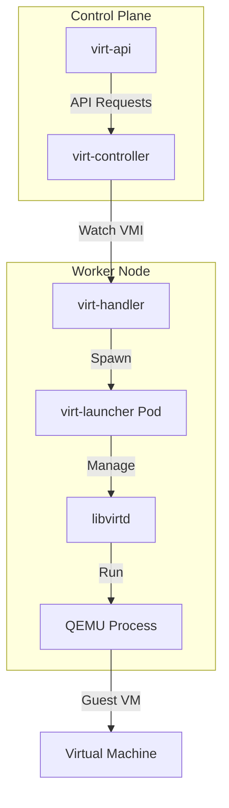
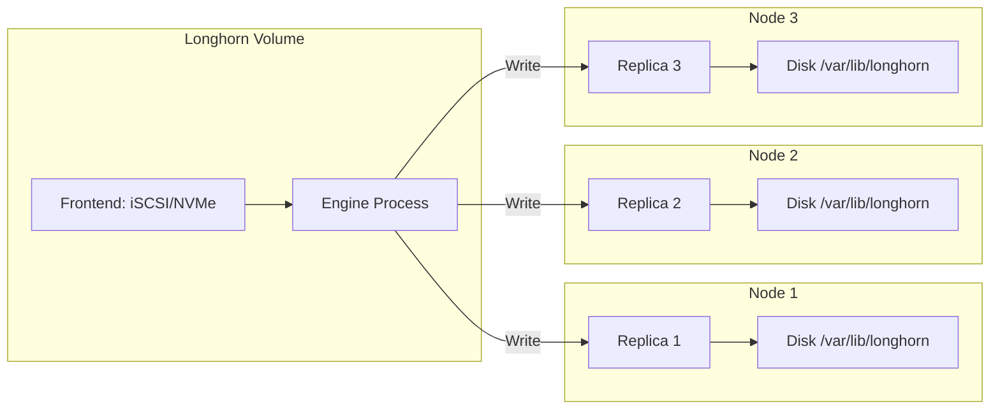
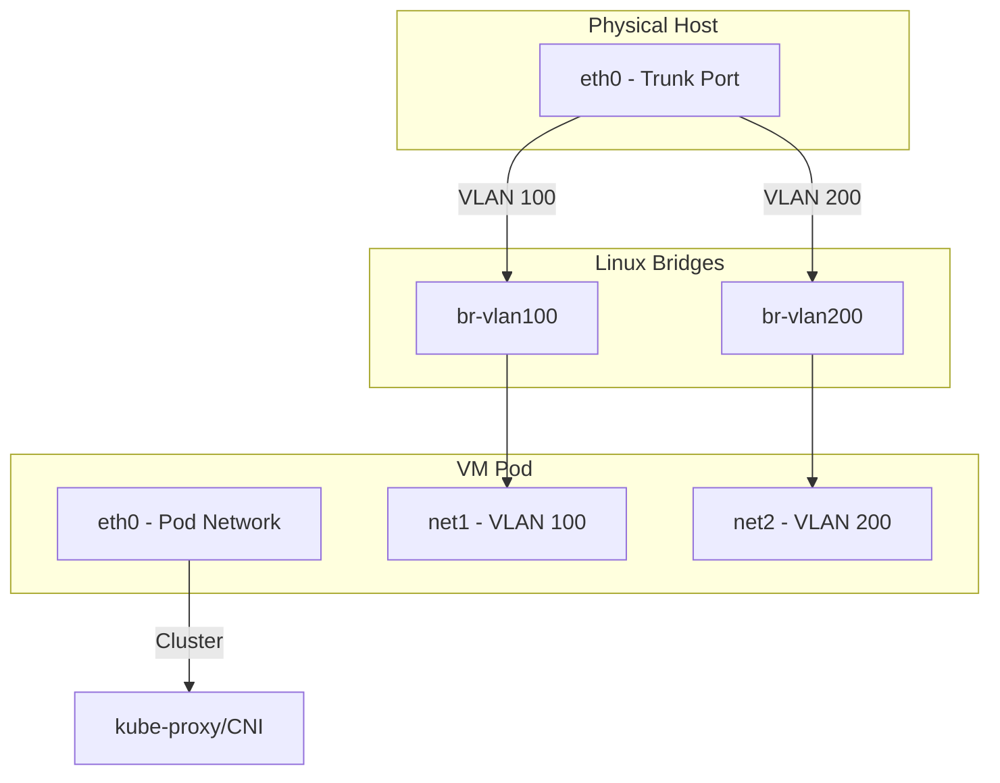

# Operational Verification Labs: Harvester Open-Source Hyperconverged Infrastructure

## Lab Environment Prerequisites

**Target Platform**: Harvester v1.3.x cluster (3+ nodes)  
**Required Tools**: kubectl, virtctl, longhorn-ctl, ip, tcpdump  
**Access Level**: Cluster admin privileges

## Lab 1: KubeVirt Virtual Machine Lifecycle Verification

### Objective
Verify VM provisioning, runtime state management, and resource allocation through KubeVirt's virtualization layer on Kubernetes.

### Theory Foundation

KubeVirt extends Kubernetes with CustomResourceDefinitions (VirtualMachine, VirtualMachineInstance) to manage VMs as pods. Each VMI spawns a virt-launcher pod containing:
- libvirtd process managing QEMU/KVM
- virt-handler daemonset coordinating node-level operations
- Compute resources isolated via cgroups



### Exercise 1.1: Create and Verify VM Instance

**VM Manifest** (ubuntu-test-vm.yaml):
```yaml
apiVersion: kubevirt.io/v1
kind: VirtualMachine
metadata:
  name: ubuntu-test-vm
  namespace: default
spec:
  running: true
  template:
    metadata:
      labels:
        kubevirt.io/vm: ubuntu-test-vm
    spec:
      domain:
        cpu:
          cores: 2
        devices:
          disks:
          - name: containerdisk
            disk:
              bus: virtio
          - name: cloudinitdisk
            disk:
              bus: virtio
          interfaces:
          - name: default
            masquerade: {}
        resources:
          requests:
            memory: 2Gi
      networks:
      - name: default
        pod: {}
      volumes:
      - name: containerdisk
        containerDisk:
          image: quay.io/kubevirt/ubuntu-container-disk:latest
      - name: cloudinitdisk
        cloudInitNoCloud:
          userData: |
            #cloud-config
            password: ubuntu
            chpasswd: { expire: False }
            ssh_pwauth: True
```

**Deployment and Verification**:
```bash
# Apply VM manifest
kubectl apply -f ubuntu-test-vm.yaml

# Verify VM object creation
kubectl get vm ubuntu-test-vm -o yaml

# Verify VMI instantiation
kubectl get vmi ubuntu-test-vm -o wide

# Inspect virt-launcher pod
VMI_POD=$(kubectl get pods -l kubevirt.io/vm=ubuntu-test-vm -o jsonpath='{.items[0].metadata.name}')
kubectl describe pod $VMI_POD

# Verify QEMU process inside launcher
kubectl exec $VMI_POD -c compute -- ps aux | grep qemu

# Check libvirt domain definition
kubectl exec $VMI_POD -c compute -- virsh list --all
kubectl exec $VMI_POD -c compute -- virsh dumpxml 1
```

**Expected Output Analysis**:
- VM Status: `Running: true`
- VMI Phase: `Running`
- virt-launcher pod: 2 containers (compute + istio-proxy if service mesh enabled)
- QEMU process: Running with `-machine q35` and virtio devices
- Libvirt domain: State `running`, memory 2097152 KiB

### Exercise 1.2: VM Live Migration Verification

**Migration Trigger**:
```bash
# Identify current node
CURRENT_NODE=$(kubectl get vmi ubuntu-test-vm -o jsonpath='{.status.nodeName}')
echo "VM currently on: $CURRENT_NODE"

# Initiate live migration
virtctl migrate ubuntu-test-vm

# Monitor migration progress
kubectl get virtualmachineinstancemigration -w

# Verify target pod creation
kubectl get pods -l kubevirt.io/vm=ubuntu-test-vm -o wide

# Check migration status
kubectl get vmi ubuntu-test-vm -o jsonpath='{.status.migrationState}' | jq .
```

**Deep Inspection During Migration**:
```bash
# Watch virt-handler logs on source node
kubectl logs -n harvester-system -l app.kubernetes.io/component=virt-handler \
  --tail=100 -f | grep ubuntu-test-vm

# Monitor memory transfer via libvirt
kubectl exec $VMI_POD -c compute -- \
  virsh domjobinfo 1 --completed

# Verify TCP connection for memory migration (source node)
TARGET_NODE=$(kubectl get vmi ubuntu-test-vm -o jsonpath='{.status.migrationState.targetNode}')
TARGET_IP=$(kubectl get node $TARGET_NODE -o jsonpath='{.status.addresses[0].address}')
sudo tcpdump -i any host $TARGET_IP and port 49152:49252 -n
```

**Migration Phase Breakdown**:
1. **Preparation**: Target virt-launcher pod created
2. **Pre-copy**: Memory pages transferred while VM runs (iterative)
3. **Stop-and-copy**: VM paused, remaining dirty pages transferred
4. **Handoff**: Target pod takes over, source pod terminates

### Exercise 1.3: CPU Pinning and NUMA Topology

**NUMA-aware VM Manifest** (numa-vm.yaml):
```yaml
apiVersion: kubevirt.io/v1
kind: VirtualMachine
metadata:
  name: numa-vm
spec:
  running: true
  template:
    metadata:
      annotations:
        kubevirt.io/allow-pod-bridge-network-live-migration: "true"
    spec:
      domain:
        cpu:
          cores: 4
          dedicatedCpuPlacement: true
          numa:
            guestMappingPassthrough: {}
        devices:
          disks:
          - name: containerdisk
            disk:
              bus: virtio
        resources:
          requests:
            memory: 4Gi
          limits:
            memory: 4Gi
      volumes:
      - name: containerdisk
        containerDisk:
          image: quay.io/kubevirt/cirros-container-disk-demo
```

**Verification**:
```bash
kubectl apply -f numa-vm.yaml

# Verify CPU manager static policy applied
NUMA_POD=$(kubectl get pods -l kubevirt.io/vm=numa-vm -o jsonpath='{.items[0].metadata.name}')
kubectl get pod $NUMA_POD -o jsonpath='{.spec.containers[0].resources}' | jq .

# Check actual CPU pinning on node
NODE=$(kubectl get pod $NUMA_POD -o jsonpath='{.spec.nodeName}')
POD_UID=$(kubectl get pod $NUMA_POD -o jsonpath='{.metadata.uid}')

# SSH to node and verify cgroup cpuset
ssh rancher@$NODE
cat /sys/fs/cgroup/cpuset/kubepods.slice/kubepods-pod${POD_UID//-/_}.slice/cpuset.cpus

# Verify inside VM
virtctl console numa-vm
# (inside VM)
lscpu | grep -E "NUMA node|CPU\(s\)"
```

---

## Lab 2: Longhorn Distributed Block Storage Replication

### Objective
Verify volume replication, snapshot consistency, and rebuild operations in Longhorn storage backend.

### Theory Foundation

Longhorn implements distributed block storage using:
- **Volume**: Logical storage unit
- **Replica**: Physical data copy on a node's local disk
- **Engine**: Replication controller coordinating I/O to replicas
- **Sync protocol**: Chain replication ensuring consistency



### Exercise 2.1: Volume Creation and Replica Distribution

**StorageClass with Replication** (longhorn-sc.yaml):
```yaml
apiVersion: storage.k8s.io/v1
kind: StorageClass
metadata:
  name: longhorn-replicated
provisioner: driver.longhorn.io
allowVolumeExpansion: true
parameters:
  numberOfReplicas: "3"
  staleReplicaTimeout: "30"
  fromBackup: ""
  dataLocality: "disabled"
  replicaAutoBalance: "best-effort"
```

**PVC Creation**:
```yaml
apiVersion: v1
kind: PersistentVolumeClaim
metadata:
  name: test-volume-claim
spec:
  accessModes:
    - ReadWriteOnce
  storageClassName: longhorn-replicated
  resources:
    requests:
      storage: 10Gi
```

**Verification Commands**:
```bash
kubectl apply -f longhorn-sc.yaml
kubectl apply -f test-pvc.yaml

# Wait for PVC binding
kubectl get pvc test-volume-claim -w

# Identify Longhorn volume name
LH_VOLUME=$(kubectl get pv $(kubectl get pvc test-volume-claim -o jsonpath='{.spec.volumeName}') \
  -o jsonpath='{.spec.csi.volumeHandle}')

# Inspect volume replicas
kubectl -n longhorn-system get replicas -l longhornvolume=$LH_VOLUME

# Get replica distribution across nodes
kubectl -n longhorn-system get replicas -l longhornvolume=$LH_VOLUME \
  -o custom-columns=NAME:.metadata.name,NODE:.spec.nodeID,STATE:.status.currentState
```

### Exercise 2.2: Replica Failure and Rebuild

**Simulate Node Failure**:
```bash
# Identify replica locations
kubectl -n longhorn-system get replicas -l longhornvolume=$LH_VOLUME -o wide

# Cordon one node to simulate failure
TARGET_NODE=$(kubectl -n longhorn-system get replicas -l longhornvolume=$LH_VOLUME \
  -o jsonpath='{.items[0].spec.nodeID}')
kubectl cordon $TARGET_NODE

# Delete instance-manager pod on that node (simulates node failure)
IM_POD=$(kubectl -n longhorn-system get pods -l longhorn.io/node=$TARGET_NODE \
  -l longhorn.io/component=instance-manager -o jsonpath='{.items[0].metadata.name}')
kubectl -n longhorn-system delete pod $IM_POD --force --grace-period=0

# Monitor replica rebuild
watch kubectl -n longhorn-system get replicas -l longhornvolume=$LH_VOLUME
```

**Rebuild Verification**:
```bash
# Check volume robustness
kubectl -n longhorn-system get volume $LH_VOLUME -o jsonpath='{.status.robustness}'

# Monitor engine logs during rebuild
ENGINE_POD=$(kubectl -n longhorn-system get pods -l longhorn.io/component=instance-manager \
  -l longhorn.io/engine=$LH_VOLUME -o jsonpath='{.items[0].metadata.name}')
kubectl -n longhorn-system logs $ENGINE_POD -c engine-manager -f | grep -E "replica|sync"

# Verify new replica created on different node
kubectl -n longhorn-system get replicas -l longhornvolume=$LH_VOLUME \
  -o custom-columns=NAME:.metadata.name,NODE:.spec.nodeID,AGE:.metadata.creationTimestamp
```

### Exercise 2.3: Snapshot and Backup Verification

**Create Volume Snapshot**:
```yaml
apiVersion: longhorn.io/v1beta2
kind: Volume
metadata:
  name: test-volume
  namespace: longhorn-system
spec:
  snapshotMaxCount: 5
```

```bash
# Trigger snapshot via API
curl -X POST "http://longhorn-backend:9500/v1/volumes/$LH_VOLUME?action=snapshotCreate" \
  -H "Content-Type: application/json" \
  -d '{"name":"manual-snapshot-1"}'

# List snapshots
kubectl -n longhorn-system get volume $LH_VOLUME \
  -o jsonpath='{.status.snapshotList}' | jq .

# Verify snapshot on disk (exec into replica pod)
REPLICA_POD=$(kubectl -n longhorn-system get pods \
  -l longhorn.io/component=instance-manager \
  -l longhorn.io/replica=$LH_VOLUME \
  -o jsonpath='{.items[0].metadata.name}')

kubectl -n longhorn-system exec $REPLICA_POD -- \
  ls -lh /var/lib/longhorn/replicas/$LH_VOLUME/
```

**Backup to S3 (Simulated)**:
```yaml
apiVersion: longhorn.io/v1beta2
kind: BackupTarget
metadata:
  name: default
  namespace: longhorn-system
spec:
  backupTargetURL: s3://longhorn-backup@us-east-1/
  credentialSecret: minio-secret
```

```bash
# Create backup from snapshot
curl -X POST "http://longhorn-backend:9500/v1/volumes/$LH_VOLUME?action=snapshotBackup" \
  -H "Content-Type: application/json" \
  -d '{"snapshotName":"manual-snapshot-1"}'

# Monitor backup progress
kubectl -n longhorn-system get backup -w

# Verify backup metadata
kubectl -n longhorn-system get backup -l longhornvolume=$LH_VOLUME -o yaml
```

---

## Lab 3: Multus CNI VLAN Bridge Networking

### Objective
Configure VLAN-tagged bridge networks for VM multi-homing with Linux bridge and Multus CNI.

### Theory Foundation

Multus enables attaching multiple network interfaces to pods/VMs:
- **Primary network**: Cluster network (Flannel/Calico)
- **Secondary networks**: VLAN bridges via NetworkAttachmentDefinition
- **Bridge CNI**: Creates Linux bridge with VLAN filtering



### Exercise 3.1: VLAN Bridge Configuration

**NetworkAttachmentDefinition for VLAN 100** (vlan100-nad.yaml):
```yaml
apiVersion: k8s.cni.cncf.io/v1
kind: NetworkAttachmentDefinition
metadata:
  name: vlan100-network
  namespace: default
spec:
  config: |
    {
      "cniVersion": "0.3.1",
      "type": "bridge",
      "bridge": "br-vlan100",
      "vlan": 100,
      "ipam": {
        "type": "host-local",
        "subnet": "192.168.100.0/24",
        "rangeStart": "192.168.100.10",
        "rangeEnd": "192.168.100.100",
        "gateway": "192.168.100.1"
      }
    }
```

**VLAN 200 Network** (vlan200-nad.yaml):
```yaml
apiVersion: k8s.cni.cncf.io/v1
kind: NetworkAttachmentDefinition
metadata:
  name: vlan200-network
  namespace: default
spec:
  config: |
    {
      "cniVersion": "0.3.1",
      "type": "bridge",
      "bridge": "br-vlan200",
      "vlan": 200,
      "ipam": {
        "type": "host-local",
        "subnet": "192.168.200.0/24",
        "rangeStart": "192.168.200.10",
        "rangeEnd": "192.168.200.100",
        "gateway": "192.168.200.1"
      }
    }
```

**Node-level Bridge Setup** (run on each worker node):
```bash
# Create VLAN interfaces
sudo ip link add link eth0 name eth0.100 type vlan id 100
sudo ip link add link eth0 name eth0.200 type vlan id 200

# Create bridges
sudo ip link add name br-vlan100 type bridge
sudo ip link add name br-vlan200 type bridge

# Attach VLAN interfaces to bridges
sudo ip link set eth0.100 master br-vlan100
sudo ip link set eth0.200 master br-vlan200

# Enable bridges
sudo ip link set br-vlan100 up
sudo ip link set br-vlan200 up
sudo ip link set eth0.100 up
sudo ip link set eth0.200 up

# Verify bridges
ip link show type bridge
bridge link show
```

### Exercise 3.2: Multi-homed VM with VLAN Networks

**VM with Multiple Networks** (multihomed-vm.yaml):
```yaml
apiVersion: kubevirt.io/v1
kind: VirtualMachine
metadata:
  name: multihomed-vm
  annotations:
    k8s.v1.cni.cncf.io/networks: vlan100-network, vlan200-network
spec:
  running: true
  template:
    metadata:
      labels:
        kubevirt.io/vm: multihomed-vm
      annotations:
        k8s.v1.cni.cncf.io/networks: vlan100-network, vlan200-network
    spec:
      domain:
        devices:
          disks:
          - name: containerdisk
            disk:
              bus: virtio
          interfaces:
          - name: default
            masquerade: {}
          - name: vlan100
            bridge: {}
          - name: vlan200
            bridge: {}
        resources:
          requests:
            memory: 1Gi
      networks:
      - name: default
        pod: {}
      - name: vlan100
        multus:
          networkName: vlan100-network
      - name: vlan200
        multus:
          networkName: vlan200-network
      volumes:
      - name: containerdisk
        containerDisk:
          image: quay.io/kubevirt/cirros-container-disk-demo
```

**Verification**:
```bash
kubectl apply -f vlan100-nad.yaml
kubectl apply -f vlan200-nad.yaml
kubectl apply -f multihomed-vm.yaml

# Wait for VM to start
kubectl wait --for=condition=Ready vmi/multihomed-vm --timeout=300s

# Verify network interfaces in virt-launcher pod
MULTI_POD=$(kubectl get pods -l kubevirt.io/vm=multihomed-vm -o jsonpath='{.items[0].metadata.name}')
kubectl exec $MULTI_POD -c compute -- ip addr show

# Expected: eth0 (pod network), net1 (VLAN 100), net2 (VLAN 200)

# Verify bridge attachments on node
NODE=$(kubectl get pod $MULTI_POD -o jsonpath='{.spec.nodeName}')
ssh rancher@$NODE

# List veth pairs connected to bridges
sudo bridge fdb show br br-vlan100
sudo bridge fdb show br br-vlan200

# Verify VLAN tagging
sudo tcpdump -i eth0 -e -n vlan 100 or vlan 200
```

### Exercise 3.3: VM-to-VM VLAN Communication Test

**Deploy Second VM on Same VLAN**:
```yaml
apiVersion: kubevirt.io/v1
kind: VirtualMachine
metadata:
  name: test-vm-vlan100
  annotations:
    k8s.v1.cni.cncf.io/networks: vlan100-network
spec:
  running: true
  template:
    metadata:
      annotations:
        k8s.v1.cni.cncf.io/networks: vlan100-network
    spec:
      domain:
        devices:
          disks:
          - name: containerdisk
            disk:
              bus: virtio
          interfaces:
          - name: default
            masquerade: {}
          - name: vlan100
            bridge: {}
        resources:
          requests:
            memory: 1Gi
      networks:
      - name: default
        pod: {}
      - name: vlan100
        multus:
          networkName: vlan100-network
      volumes:
      - name: containerdisk
        containerDisk:
          image: quay.io/kubevirt/cirros-container-disk-demo
```

**Connectivity Test**:
```bash
kubectl apply -f test-vm-vlan100.yaml

# Get VLAN 100 IP of first VM
virtctl console multihomed-vm
# (inside VM)
ip addr show eth1  # Note the 192.168.100.x address
VLAN100_IP=192.168.100.x

# From second VM, test connectivity
virtctl console test-vm-vlan100
# (inside VM)
ip addr show eth1
ping -c 4 $VLAN100_IP
```

**Packet Capture Verification** (on worker node):
```bash
# Capture on VLAN 100 bridge
sudo tcpdump -i br-vlan100 -n icmp

# Verify VLAN tags on trunk
sudo tcpdump -i eth0 -e -n 'vlan 100 and icmp'
```

---

## Lab 4: VM Migration Diagnostics and Troubleshooting

### Objective
Diagnose migration failures using virt-handler logs, libvirt migration monitoring, and network path analysis.

### Exercise 4.1: Pre-flight Migration Checks

**Migration Readiness Script**:
```bash
#!/bin/bash
VM_NAME=$1

# Check VMI exists and is running
VMI_STATUS=$(kubectl get vmi $VM_NAME -o jsonpath='{.status.phase}')
if [ "$VMI_STATUS" != "Running" ]; then
  echo "ERROR: VMI not running (status: $VMI_STATUS)"
  exit 1
fi

# Verify live migration feature gate
FEATURE_GATES=$(kubectl get kubevirt kubevirt -n harvester-system \
  -o jsonpath='{.spec.configuration.developerConfiguration.featureGates}')
echo "Feature gates: $FEATURE_GATES"

# Check if VM has migration-capable storage
VOLUME_TYPES=$(kubectl get vmi $VM_NAME -o jsonpath='{.spec.volumes[*].persistentVolumeClaim}')
if [ -z "$VOLUME_TYPES" ]; then
  echo "WARNING: VM uses ephemeral storage (containerDisk)"
fi

# Verify sufficient resources on target nodes
MEMORY_REQUEST=$(kubectl get vmi $VM_NAME -o jsonpath='{.spec.domain.resources.requests.memory}')
kubectl get nodes -o custom-columns=\
NAME:.metadata.name,\
ALLOCATABLE:.status.allocatable.memory,\
AVAILABLE:.status.capacity.memory

# Check network policies allowing migration port range (49152-49252)
kubectl get networkpolicies -A -o yaml | grep -E "49152|49252"
```

### Exercise 4.2: Migration Failure Analysis

**Trigger Migration and Capture Logs**:
```bash
VM_NAME=ubuntu-test-vm

# Start migration with verbose logging
virtctl migrate $VM_NAME --dry-run=false

# Monitor VMI migration object
kubectl get virtualmachineinstancemigration -w &

# Capture virt-handler logs from source node
SOURCE_NODE=$(kubectl get vmi $VM_NAME -o jsonpath='{.status.nodeName}')
kubectl logs -n harvester-system -l app.kubernetes.io/component=virt-handler \
  --field-selector spec.nodeName=$SOURCE_NODE -f > /tmp/source-handler.log &

# Capture target virt-handler logs
TARGET_NODE=$(kubectl get vmi $VM_NAME -o jsonpath='{.status.migrationState.targetNode}')
kubectl logs -n harvester-system -l app.kubernetes.io/component=virt-handler \
  --field-selector spec.nodeName=$TARGET_NODE -f > /tmp/target-handler.log &

# Wait for migration completion or failure
kubectl wait --for=condition=Succeeded vmim/$(kubectl get vmim -o name | tail -n1) --timeout=600s
RESULT=$?

# Analyze logs if migration failed
if [ $RESULT -ne 0 ]; then
  echo "=== SOURCE NODE ERRORS ==="
  grep -i "error\|failed" /tmp/source-handler.log | tail -20
  
  echo "=== TARGET NODE ERRORS ==="
  grep -i "error\|failed" /tmp/target-handler.log | tail -20
  
  # Check migration object status
  kubectl get vmim -o yaml | grep -A 20 status
fi
```

**Common Failure Patterns**:

1. **Network connectivity failure**:
```bash
# Symptom: Migration hangs in "Preparing target"
# Diagnosis: Test TCP connectivity on migration port range

# From source node
nc -zv $TARGET_NODE_IP 49152

# Verify firewall rules
sudo iptables-save | grep 49152
```

2. **Disk I/O bottleneck**:
```bash
# Symptom: Migration timeout with "disk dirty rate too high"
# Diagnosis: Check disk write activity

# On source node during migration
iostat -x 2 10 | grep -E "Device|vda"

# Check dirty memory rate in libvirt
kubectl exec $VMI_POD -c compute -- \
  virsh domjobinfo 1 | grep -E "Memory.*dirty"
```

3. **Insufficient memory on target**:
```bash
# Symptom: "Insufficient memory" in target virt-handler logs
# Diagnosis: Compare requested vs available memory

# Memory request
kubectl get vmi $VM_NAME -o jsonpath='{.spec.domain.resources.requests.memory}'

# Available memory on target
kubectl describe node $TARGET_NODE | grep -A 5 "Allocated resources"
```

### Exercise 4.3: Network Path Validation for Migration

**MTU Verification**:
```bash
# MTU mismatch causes fragmentation and migration slowdown
# Get VM pod IP
VMI_POD_IP=$(kubectl get pod $VMI_POD -o jsonpath='{.status.podIP}')

# From source node, test MTU to target
ssh rancher@$SOURCE_NODE
ping -M do -s 8972 -c 3 $TARGET_NODE_IP

# If ping fails, reduce packet size to find MTU limit
ping -M do -s 1472 -c 3 $TARGET_NODE_IP
```

**Latency and Bandwidth Test**:
```bash
# High latency or low bandwidth degrades live migration
# Install iperf3 on both nodes

# On target node
ssh rancher@$TARGET_NODE
iperf3 -s -p 49152

# On source node
ssh rancher@$SOURCE_NODE
iperf3 -c $TARGET_NODE_IP -p 49152 -t 10 -P 4

# Expected: >1 Gbps for acceptable migration performance
```

**TCP Dump During Migration**:
```bash
# Capture migration traffic on source node
sudo tcpdump -i any -w /tmp/migration.pcap \
  "host $TARGET_NODE_IP and portrange 49152-49252"

# Analyze with tcpdump
sudo tcpdump -r /tmp/migration.pcap -n | head -50

# Or analyze with tshark
tshark -r /tmp/migration.pcap -q -z io,stat,1
```

---

## Lab 5: Integration Scenario - VM Failover with Storage Replication

### Objective
Simulate node failure and verify automated VM restart with Longhorn volume replica promotion.

### Scenario Setup

**Deploy Stateful VM with PVC**:
```yaml
apiVersion: v1
kind: PersistentVolumeClaim
metadata:
  name: stateful-vm-disk
spec:
  accessModes:
    - ReadWriteOnce
  storageClassName: longhorn-replicated
  resources:
    requests:
      storage: 20Gi
---
apiVersion: kubevirt.io/v1
kind: VirtualMachine
metadata:
  name: stateful-vm
spec:
  running: true
  template:
    metadata:
      labels:
        kubevirt.io/vm: stateful-vm
    spec:
      domain:
        devices:
          disks:
          - name: datadisk
            disk:
              bus: virtio
          interfaces:
          - name: default
            bridge: {}
        resources:
          requests:
            memory: 2Gi
      networks:
      - name: default
        pod: {}
      volumes:
      - name: datadisk
        persistentVolumeClaim:
          claimName: stateful-vm-disk
```

### Exercise 5.1: Write Test Data and Verify Replication

```bash
kubectl apply -f stateful-vm.yaml

# Wait for VM ready
kubectl wait --for=condition=Ready vmi/stateful-vm --timeout=300s

# Write test data to disk
virtctl console stateful-vm
# (inside VM)
sudo mkfs.ext4 /dev/vda
sudo mkdir /mnt/data
sudo mount /dev/vda /mnt/data
echo "Test data at $(date)" | sudo tee /mnt/data/testfile.txt
sudo sync
exit

# Verify Longhorn replicas
LH_VOL=$(kubectl get pv $(kubectl get pvc stateful-vm-disk -o jsonpath='{.spec.volumeName}') \
  -o jsonpath='{.spec.csi.volumeHandle}')

kubectl -n longhorn-system get replicas -l longhornvolume=$LH_VOL \
  -o custom-columns=NAME:.metadata.name,NODE:.spec.nodeID,STATE:.status.currentState
```

### Exercise 5.2: Simulate Node Failure and Verify Failover

```bash
# Identify node running the VM
VM_NODE=$(kubectl get vmi stateful-vm -o jsonpath='{.status.nodeName}')
echo "VM running on: $VM_NODE"

# Simulate hard node failure (do not drain, just power off or cordone + delete pod)
kubectl cordon $VM_NODE

# Force delete virt-launcher pod
VMI_POD=$(kubectl get pods -l kubevirt.io/vm=stateful-vm -o jsonpath='{.items[0].metadata.name}')
kubectl delete pod $VMI_POD --force --grace-period=0

# Monitor VM rescheduling
kubectl get vmi stateful-vm -w

# Verify new node
NEW_NODE=$(kubectl get vmi stateful-vm -o jsonpath='{.status.nodeName}')
echo "VM rescheduled to: $NEW_NODE"

# Check Longhorn volume attachment transferred
kubectl -n longhorn-system get volume $LH_VOL -o jsonpath='{.status.kubernetesStatus}' | jq .
```

### Exercise 5.3: Data Integrity Verification

```bash
# Access VM on new node
virtctl console stateful-vm
# (inside VM)
sudo mount /dev/vda /mnt/data
cat /mnt/data/testfile.txt

# Expected: Original test data intact

# Verify filesystem consistency
sudo fsck -n /dev/vda
```

**Failure Mode Analysis**:
```bash
# Check if any replica was promoted during failover
kubectl -n longhorn-system get replicas -l longhornvolume=$LH_VOL \
  -o jsonpath='{.items[*].status.currentState}'

# Review Longhorn volume events
kubectl -n longhorn-system describe volume $LH_VOL | tail -30

# Verify replica count remains at 3
kubectl -n longhorn-system get replicas -l longhornvolume=$LH_VOL --no-headers | wc -l
```

---

## Lab 6: Performance Profiling and Resource Limits

### Objective
Profile VM CPU/memory usage, enforce resource limits, and validate QoS behavior under contention.

### Exercise 6.1: CPU Pressure Testing

**CPU-intensive VM** (cpu-stress-vm.yaml):
```yaml
apiVersion: kubevirt.io/v1
kind: VirtualMachine
metadata:
  name: cpu-stress-vm
spec:
  running: true
  template:
    spec:
      domain:
        cpu:
          cores: 2
        devices:
          disks:
          - name: containerdisk
            disk:
              bus: virtio
        resources:
          requests:
            memory: 2Gi
            cpu: "2"
          limits:
            memory: 2Gi
            cpu: "2"
      volumes:
      - name: containerdisk
        containerDisk:
          image: quay.io/kubevirt/fedora-cloud-container-disk-demo
```

**Deploy and Stress Test**:
```bash
kubectl apply -f cpu-stress-vm.yaml
virtctl console cpu-stress-vm

# Inside VM, install stress-ng
sudo dnf install -y stress-ng

# Run CPU stress
stress-ng --cpu 2 --timeout 60s --metrics-brief &

# Monitor from host
VMI_POD=$(kubectl get pods -l kubevirt.io/vm=cpu-stress-vm -o jsonpath='{.items[0].metadata.name}')
kubectl top pod $VMI_POD --containers

# Check cgroup CPU throttling
NODE=$(kubectl get pod $VMI_POD -o jsonpath='{.spec.nodeName}')
ssh rancher@$NODE

POD_UID=$(kubectl get pod $VMI_POD -o jsonpath='{.metadata.uid}')
cat /sys/fs/cgroup/cpu,cpuacct/kubepods.slice/kubepods-burstable.slice/kubepods-burstable-pod${POD_UID//-/_}.slice/cpu.stat
# Look for nr_throttled and throttled_time
```

### Exercise 6.2: Memory Overcommit Testing

**Memory pressure VM**:
```yaml
apiVersion: kubevirt.io/v1
kind: VirtualMachine
metadata:
  name: memory-test-vm
spec:
  running: true
  template:
    spec:
      domain:
        devices:
          disks:
          - name: containerdisk
            disk:
              bus: virtio
        resources:
          requests:
            memory: 4Gi
          limits:
            memory: 4Gi
          overcommitGuestOverhead: true
      volumes:
      - name: containerdisk
        containerDisk:
          image: quay.io/kubevirt/fedora-cloud-container-disk-demo
```

**Memory Stress Test**:
```bash
kubectl apply -f memory-test-vm.yaml
virtctl console memory-test-vm

# Inside VM
stress-ng --vm 1 --vm-bytes 3G --timeout 60s

# Monitor memory usage
kubectl top pod $(kubectl get pods -l kubevirt.io/vm=memory-test-vm -o name)

# Check for OOM events
kubectl describe pod $(kubectl get pods -l kubevirt.io/vm=memory-test-vm -o name) | grep -A 10 Events
```

---

## Lab 7: Network Performance and Packet Flow Analysis

### Objective
Profile network throughput between VMs, diagnose packet loss, and verify SR-IOV passthrough (if available).

### Exercise 7.1: VM-to-VM iperf3 Benchmarking

**Deploy Two VMs on Same VLAN**:
```bash
# Use multihomed-vm.yaml and test-vm-vlan100.yaml from Lab 3

# On first VM (server)
virtctl console multihomed-vm
sudo dnf install -y iperf3
iperf3 -s -B 192.168.100.x

# On second VM (client)
virtctl console test-vm-vlan100
sudo dnf install -y iperf3
iperf3 -c 192.168.100.x -t 30 -P 4

# Expected throughput: Near line rate (adjust for virtio overhead)
```

**Packet Loss Detection**:
```bash
# UDP test with bandwidth limit
iperf3 -c 192.168.100.x -u -b 1G -t 30

# Capture on host bridge
ssh rancher@$NODE
sudo tcpdump -i br-vlan100 -n -c 1000 udp
```

### Exercise 7.2: Latency Measurement with qperf

```bash
# Install qperf in both VMs
virtctl console multihomed-vm
sudo dnf install -y qperf
qperf

# From second VM
virtctl console test-vm-vlan100
sudo dnf install -y qperf
qperf 192.168.100.x tcp_lat udp_lat

# Expected: <1ms RTT for VMs on same node
```

---

## Validation Checklist

After completing all labs, verify:

- [ ] VMs successfully provision and migrate between nodes
- [ ] Longhorn volumes maintain 3 replicas and survive node failures
- [ ] VLAN networks allow VM-to-VM communication without cluster network involvement
- [ ] Migration completes within predictable timeframes (< 5 minutes for 2GB VM)
- [ ] Replica rebuild completes automatically after simulated failures
- [ ] Resource limits prevent VM overcommit from affecting node stability
- [ ] Network throughput meets expected performance (>1 Gbps for virtio)

## Troubleshooting Reference

**Common Issues**:

| Symptom | Diagnosis | Resolution |
|---------|-----------|------------|
| VM stuck in `Scheduling` | Check node resources | `kubectl describe vmi <name>` |
| Migration timeout | Network latency >100ms | Verify MTU, firewall rules |
| Longhorn replica failure | Disk full on node | Expand node disk or delete snapshots |
| VLAN bridge not working | Bridge not in promiscuous mode | `ip link set br-vlan100 promisc on` |
| VM crashes during migration | Insufficient target memory | Check `kubectl top nodes` |

**Essential Commands Summary**:
```bash
# VM lifecycle
virtctl start/stop/restart <vm>
virtctl migrate <vm>
virtctl console <vm>

# Longhorn inspection
kubectl -n longhorn-system get volumes
kubectl -n longhorn-system get replicas -l longhornvolume=<vol>

# Network debugging
ip link show type bridge
bridge fdb show br <bridge>
tcpdump -i <interface> -e -n vlan <id>

# Resource monitoring
kubectl top pods -l kubevirt.io/vm=<name>
kubectl get vmi <name> -o jsonpath='{.status.migrationState}'
```
